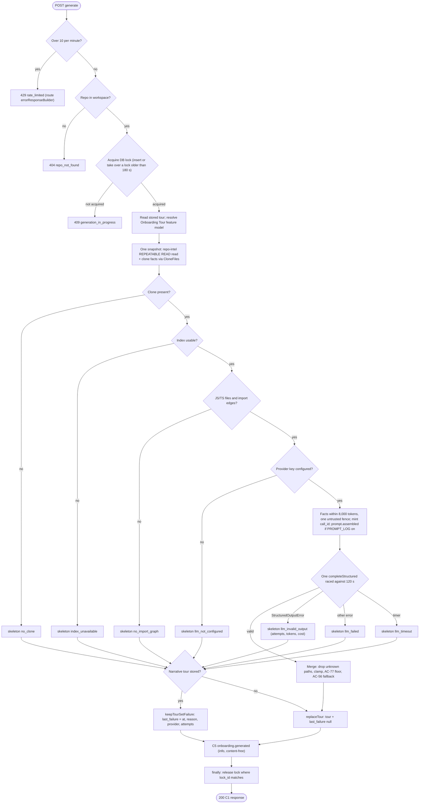
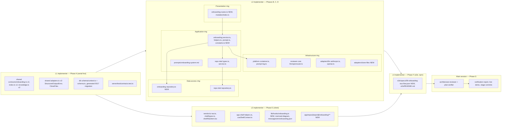

# Onboarding Generator ("Onboarding Tour") — Implementation plan

> Spec: [`2026-10-11-onboarding-generator`](../specs/2026-10-11-onboarding-generator.md) (`Status: approved`, rev 8) — read 2026-10-11.
> Status: **approved** (rev 2, 2026-10-11). Execution mode: **multi**.
> Scope: `server/` (pnpm), `client/` (pnpm), `reviewer-core/` (npm, one provider file), `e2e/` (npm), both `vendor/shared` trees. ACs are owned by the spec; this plan only maps them.
> Research reused: [`docs/research/2026-10-11-onboarding-generator.research.md`](../research/2026-10-11-onboarding-generator.research.md) (R1–R3), the pass-1 review, and the owner's rate-limit research (rev 2). Change sites below were opened first-hand.

> Plan changelog
> - rev 1: first plan against spec rev 6.
> - rev 2: re-planned against spec rev 8. AC-78 / EC-29 (`last_failure: null` on replace) mapped (D9 is now a spec requirement, no longer an assumed default). AC-77 / EC-28 First-tasks floor mapped; AC-52, AC-55, AC-56 re-read (D11 rewritten; hidden valid tasks are not counted in `dropped_ai_items`; AC-56 fallback limited to Critical paths and Guided reading path). D13 rate-limit envelope confirmed from `@fastify/rate-limit@11.0.0` source; the fallback and the "stop and report" are removed, V16 is a plain check. Added §2a Mermaid diagrams (generation workflow, lanes/phases/files structure). Added D19 (unavailable texts rendered from client i18n, NFR-7). §12 reduced to what is still open.

## 1. Requirements (verified)

| R | Requirement, restated | Spec id | Covered by steps | Verified by |
|---|---|---|---|---|
| R1 | Sidebar WORKSPACE order Pull Requests → Onboarding Tour → Project Context; item links to active repo's tour | AC-1 | E1, E3 | V20 |
| R2 | Item active (`aria-current="page"`) on a tour page | AC-2 | E2, E3 | V18 |
| R3 | `/onboarding` (Add repository) never activates the item | AC-3, EC-25 | E3 | V18, V27 |
| R4 | Switching repo while on a tour page shows the new repo's tour/empty state | AC-4 | E3, E4, E5 | V20, V21 |
| R5 | Empty state "Generate onboarding tour" naming the five sections in order | AC-5 | E7, E9 | V21 |
| R6 | Opening a stored tour never generates | AC-6 | E5, D6 | V21, V15 |
| R7 | Header title "Onboarding for {name}" + Regenerate + Share link | AC-7 | E9 | V21 |
| R8 | Subtitle "X of Y source files (JS/TS) · last refreshed …" / without "of Y" when null | AC-8, AC-9, EC-4, EC-5 | C2, D2, E8, E9 | V12, V13, V22 |
| R9 | Stats line; "0 LLM calls"; "cost unknown"; "(n attempts)" | AC-10, AC-11, AC-12, AC-13, EC-24 | E8, E9 | V22 |
| R10 | "On this page" list of five titles; activating scrolls + focuses heading | AC-14, AC-73 | E9 | V21 |
| R11 | Sections collapsible, expanded by default, `aria-expanded` | AC-15 | E9 | V21 |
| R12 | Provenance badge "AI-written" / "from index" per section | AC-16 | D2, E9 | V12, V21 |
| R13 | Generate/Regenerate disabled with "Generating…"/"Regenerating…"; old tour visible | AC-17 | E5, E9 | V21 |
| R14 | Returning mid-generation shows the stored result | AC-18, EC-13 | A7, D5, D6, E5 | V15, V21 |
| R15 | Load failure (network/5xx) → "Couldn’t load the onboarding tour" + Retry | AC-19 | E9 | V21 |
| R16 | Stale marker when `current_index.last_indexed_sha` ≠ `tour.index.last_indexed_sha` | AC-20, EC-14 | D6, E8, E9 | V21 |
| R17 | Share link copies the page URL, shows "Link copied" | AC-21 | E9 | V21 |
| R18 | Snapshot read once at start, used for the whole generation | AC-22, EC-14 | C2, C3, D6 | V13, V15 |
| R19 | No clone → skeleton `no_clone` from metadata, 0 LLM / 0 GitHub calls | AC-23, EC-1 | D2, D6 | V15, V27 |
| R20 | Degraded/failed index or repo-intel off → skeleton `index_unavailable`, 0 calls | AC-24, EC-2 | C3, D6 | V13, V15 |
| R21 | 0 JS/TS files or 0 edges → skeleton `no_import_graph`, 0 calls; run commands still derived | AC-25, EC-3 | D2, D6 | V15 |
| R22 | No key for the feature model's provider → `llm_not_configured`, 0 calls | AC-26, EC-8 | D6 | V15 |
| R23 | Exactly one logical structured call, one `call_id`, provider default retries | AC-27, NG10 | D6 | V15, V29 |
| R24 | Throw after retries → `llm_failed`; invalid after last attempt → `llm_invalid_output` (attempts 3) | AC-28, EC-9 | A6, B1–B3, D6 | V7, V8, V15 |
| R25 | 120 s without valid reply → `llm_timeout` | AC-29, EC-10, NFR-3 | D1, D6 | V15 |
| R26 | `partial` + each applying reason | AC-30 | D2 | V12, V15 |
| R27 | Skeleton banner text per reason | AC-31 | E7, E8, E9 | V22 |
| R28 | "Partial" badge, reasons in accessible description | AC-32 | E7, E8, E9 | V22 |
| R29 | Concurrent generate → 409 envelope `generation_in_progress`; one LLM call total | AC-33, EC-12 | A7, D5, D6, D7 | V15 |
| R30 | Client shows "A generation is already running for this repository" on that 409 | AC-70 | E5, E9 | V21 |
| R31 | >10 generate requests/min → 429 envelope `rate_limited` | AC-34 | D7, D13 | V16 |
| R32 | Unknown repo → 404 envelope `repo_not_found`, no LLM call | AC-76, EC-27 | D6, D7 | V15 |
| R33 | Replace stored tour on narrative, or on skeleton when no narrative stored | AC-35 | D5, D6 | V15 |
| R34 | Replacing the stored tour stores `last_failure: null`; banner disappears | AC-78, EC-29 | D5, D6, E9 | V15, V22 |
| R35 | Any skeleton reason while a narrative is stored → keep the narrative | AC-36, EC-11, EC-26 | D5, D6 | V15 |
| R36 | `last_failure` = end time, reason, feature provider, attempts (null pre-LLM) | AC-75 | A1, D5, D6 | V15 |
| R37 | Failure banner "Regeneration failed — {sentence} {next step} Showing the tour from …" | AC-71 | E7, E8, E9 | V22 |
| R38 | Byte-identical facts for the same inputs | AC-37 | D2 | V12 |
| R39 | Stack from ≤10 manifests (root + depth 1), PM by lockfile, TS/JS counts, frameworks list | AC-38 | B6, D1, D2, D6 | V12, V14 |
| R40 | >8,000 tokens → drop lowest-ranked, then trim README + repo map, record `facts_truncated` | AC-39, EC-7, NFR-4 | D2 | V12 |
| R41 | Run commands derived in the four fixed steps | AC-40 | D2 | V12 |
| R42 | LLM only annotates existing `order`s; ≤8 commands | AC-41, EC-16 | D2, D4 | V12 |
| R43 | No manifest → "No package.json found…" | AC-42 | D2, E7, E9 | V14, V23 |
| R44 | Manifest too large / invalid JSON / unreadable / outside clone → `skipped_files`, shown | AC-43, EC-19 | B6, D2, D6, E9 | V11, V14, V23 |
| R45 | Never read `.env` / `.env.*` contents; only test `.env.example` exists | AC-44, EC-20, NFR-8 | B6, D6 | V11, V14 |
| R46 | Narrative architecture prose (≤1,200 chars) + valid diagram | AC-45 | D2, E9 | V12, V23 |
| R47 | Skeleton architecture: stack line + ≤15 folders by count, no diagram | AC-46 | D2, E9 | V12, V23 |
| R48 | Critical paths ≤8 top-ranked after exclusions, rank order | AC-47 | D1, D2 | V12 |
| R49 | Critical row description = LLM text or "Imported by N files · E endpoints"; Open action | AC-48 | D2, E8, E9 | V12, V23 |
| R50 | Reading path ≤10 by `pagerank×(1+hotness)` desc, tie by path asc | AC-49 | D2 | V12 |
| R51 | "Ranked by import graph" while `hotness_available` false; score = pagerank | AC-50 | C3, D2, E9 | V12, V23 |
| R52 | Reading row: order, path, reason, "top {max(1,100−pct)}%" | AC-51 | D2, E8, E9 | V12, V19 |
| R53 | No file left after exclusions → "No ranked files" in both sections | AC-74, EC-6 | D2, E9 | V12, V23 |
| R54 | Narrative with ≥3 valid tasks after drops → show them (3–5), each title + rationale + 1–3 paths with Open | AC-52 | D2, D3, E9 | V12, V23 |
| R55 | Narrative with <3 valid tasks after drops → First tasks `available: false`, no items, AC-77 `unavailable_reason`; `mode` stays narrative; hidden valid tasks not counted in `dropped_ai_items` | AC-77, EC-28 | D2, E7, E9 | V12, V15, V23 |
| R56 | Skeleton First tasks unavailable text | AC-53 | D2, E7, E9 | V23 |
| R57 | Unknown-path AI items dropped and counted | AC-54, EC-15 | D2 | V12 |
| R58 | "{n} AI items were dropped…" with singular form | AC-72 | E7, E9 | V22 |
| R59 | Task with no valid path left is dropped; then AC-77 applies if <3 remain | AC-55 | D2 | V12 |
| R60 | Missing/invalid LLM description/reason in Critical paths or Guided reading path → deterministic text, `from_index`; First tasks have no fallback | AC-56 | D2 | V12 |
| R61 | Open → GitHub blob at `last_indexed_sha` (else default branch), new tab, noopener | AC-57, EC-21 | E8, E9 | V19, V23 |
| R62 | Copy gives exactly the command; "Copied" | AC-58 | E9 | V23 |
| R63 | Annotation single line, ≤80 chars, control chars removed, not copied | AC-59 | D2, E8, E9 | V19, V23 |
| R64 | All repo strings inside the existing untrusted fence; security paragraph unchanged | AC-60, EC-16 | D3, D4 | V12, V14 |
| R65 | Markdown without raw HTML/scripts; only http(s) links clickable | AC-61, EC-17 | E9 | V23 |
| R66 | Invalid Mermaid → omitted, prose kept, "Diagram could not be rendered" | AC-62, EC-18 | E6, E9 | V23 |
| R67 | Paths plain text, middle-truncated, full path in Open's accessible name | AC-63, EC-23 | E8, E9 | V19, V23 |
| R68 | One C5 info record per generation whatever `PROMPT_LOG` | AC-64, NFR-9 | D2, D6 | V15 |
| R69 | attempts/tokens/cost summed over all attempts | AC-65 | A6, B1–B3, D6 | V8, V15 |
| R70 | `prompt.assembled` shares the C5 `call_id` when `PROMPT_LOG` ≠ off | AC-66 | B5, D6 | V10, V15 |
| R71 | C5 content-free (no prompt, file, README, key) | AC-67, NFR-8 | D2, D6 | V12, V15 |
| R72 | ≤1 logical LLM call, 0 embedding, 0 GitHub per generation; 0 LLM on view | AC-68, NFR-4 | D6 | V15 |
| R73 | Headline: narrative tour, 5 sections, score order, only indexed paths, one call, one C5 | AC-69 | all of D, F1 | V15, V27, V31 |
| R74 | Stored-tour read p95 ≤300 ms, no LLM, no clone walk | NFR-1 | D6 (PK reads + one lock read + one `rootExists`) | V15, V31 |
| R75 | Skeleton generation p95 ≤5 s on 5,000 files | NFR-2 | C2, D6 | V15, V31 |
| R76 | Narrative generation ends ≤120 s | NFR-3 | D1, D6 | V15 |
| R77 | ≤1 call, facts ≤8,000 tokens, output ≤3,000 tokens, 0 calls per view | NFR-4 | D1, D2, D6 | V12, V15 |
| R78 | No LLM/clone/index failure produces a 5xx from generate | NFR-5 | D6 | V15 |
| R79 | Keyboard operable, accessible names, text badges | NFR-6 | E2, E9 | V21, V23 |
| R80 | All copy from `client/messages/en/`, correct plurals | NFR-7 | E7, E9 (D19) | V22, V23 |
| R81 | No key / `.env` / file content in tour, C5, or error messages | NFR-8 | B2, B3, B6, D6 | V11, V14, V15 |
| R82 | Reconstructable from one C5 record | NFR-9 | D2 | V12, V15 |
| R83 | ≤1,024 px readable; command rows may scroll | NFR-10 | E9 | V31 (manual) |
| R84 | Non-goals honoured: indexer and `GET /repos/:id/index-state` untouched (NG1), no auto generation (NG2), no GitHub (NG3), no MCP (NG4), no review-pipeline change (NG7), retry counts unchanged (NG10) | NG1–NG12 | C1–C3 (read-only), B1–B3 (no count change) | V17, V28, V29 |
| R85 | Lab rows 4, 9, 12, 13, 14: plan, verifier report, demo, stage commits | Lab reconciliation | G1–G4 | V30, V31 |

### Owner answers
- Q1 → a: standard envelope `{ error: { code, message, details? } }`, codes `repo_not_found` 404, `generation_in_progress` 409, `rate_limited` 429 (spec C2, AC-76, EC-27).
- Q2 → a: typed `StructuredOutputError { attempts, tokensIn, tokensOut, costUsd }` on the shared port (both trees), thrown from the exhausted-retries branch of all three providers; retry counts unchanged.
- Q3 → a: stored narrative kept for every `SkeletonReason`; `last_failure` set with `provider` and `attempts` (AC-36, AC-75, EC-26); banner includes next step (P7).
- Q4 → a: each section shows what the available data supports via `available` / `unavailable_reason` (D10).
- rev 2 — D9 → spec AC-78 / EC-29 (`last_failure: null` on replace). D11 → spec AC-77 / EC-28 floor; hidden valid tasks not counted in `dropped_ai_items`; AC-56 fallback only for Critical paths and Guided reading path. D13 → per-route `errorResponseBuilder` confirmed; no fallback. Lab rows 10/11 → as planned. Diagrams added (§2a).
- Execution mode: multi.

### Recommendations
| # | Recommendation | Owner | Reflected in |
|---|---|---|---|
| Rec 1 | Persist `{ tour, last_failure }` in the existing `onboarding.json` jsonb | accepted | §2 D2, §4, D5 |
| Rec 2 | New `contracts/onboarding.ts`, delete starter `Onboarding*`, fix `contracts.test.ts` | accepted | A1–A5 |
| Rec 3 | One snapshot read in repo-intel | accepted | C1–C3 |
| Rec 4 | Onboarding-local exclusion list; `isJunkPath` unchanged | accepted | §2 D12, D1, D2 |
| Rec 5 | In-memory per-repo lock | **rejected** → DB-backed lock | §2 D3, D4, A7, A8, D5 |
| Rec 6 | Frameworks list as a module constant | accepted | D1 |
| Rec 7 | Commit LO5 work before run-plan | **rejected** | §10 "LO5 working tree" |

## 2. Implementation decisions

| # | Decision (how, not what) | Consequence |
|---|---|---|
| D1 | C1 shapes live in **NEW** `contracts/onboarding.ts` (both trees). C3 facts, C4 narrative schema and C5 record are server-internal (module `prompt.ts` / `helpers.ts`) — they never cross a package boundary. | Client only sees C1; the LLM schema can change without a contract change |
| D2 | Stored tour = existing table `onboarding` (`server/src/db/schema/context.ts:120-126`): `json` = `{ v: 1, tour: Tour, last_failure: LastFailure \| null }`, `generated_at` = `tour.generated_at`. Parsed with a module-local Zod schema on read; an unparseable row reads as "no tour". | No migration for the tour; old starter rows (none written today) are ignored |
| D3 | **DB-backed lock** = NEW table `onboarding_generation_lock (repo_id uuid PK → repos.id ON DELETE CASCADE, lock_id uuid NOT NULL, started_at timestamptz NOT NULL DEFAULT now())`. Acquire = one atomic statement: `INSERT … ON CONFLICT (repo_id) DO UPDATE SET lock_id = excluded.lock_id, started_at = now() WHERE onboarding_generation_lock.started_at < now() - <TTL> RETURNING lock_id` → a returned row means acquired. Release = `DELETE … WHERE repo_id = $1 AND lock_id = $mine` in `finally`. GET reports `generation_in_progress` = a row exists with `started_at >= now() - TTL`. TTL = `LOCK_TTL_MS = 180_000` (> 120 s LLM deadline + ≤5 s facts + margin). | Atomic under concurrency (AC-33) and visible to GET from any request (AC-18). A crashed process leaves a row that **expires after 180 s** and is taken over by the next acquire — never locked forever. The `lock_id` match stops a late-finishing old generation from deleting a newer lock. Rejected alternative: Postgres advisory locks — session locks pin a pooled connection for up to 120 s and are invisible to GET without querying `pg_locks`; transaction-level locks would hold a transaction open across the LLM call |
| D4 | The lock clock is the DB's `now()` in both acquire and check (never the Node clock); TTL is injectable via `OnboardingService` options for tests. | No clock skew; tests can force a stale lock |
| D5 | Clone reads go through a **NEW port** `CloneFiles` (shared `adapters.ts`, both trees) with adapter **NEW** `server/src/adapters/clone-files/index.ts` wired on `container.cloneFiles`. Methods: `rootExists(root)`, `listChildDirs(root)` (sorted, no symlinks, skips `.git`/`node_modules`), `fileExists(root, path)` (`'file' \| 'missing' \| 'outside_repo'`, never opens the file), `readText(root, path, maxBytes)` → reuses `CloneDocRead` (`server/src/vendor/shared/adapters.ts:327-330`). Containment = realpath of root + realpath of target (following symlinks); outside → `outside_repo`. `readText` refuses any basename matching `/^\.env(\..*)?$/` before touching the file. | Onion rule 3; `.env` safety enforced twice (adapter + the service never asks). `CloneDocs` stays `.md`-only and untouched |
| D6 | One facade read per generation: `RepoIntel.getOnboardingSnapshot(repoId)` returning index row + walk stats + every `file_rank` row (pagerank, hotness, rank, percentile) + in-degree per file + total edge count + endpoints per file + the cached repo map pinned to the snapshot's `last_indexed_sha`. The repository reads the DB rows inside **one read-only `REPEATABLE READ` transaction**. A lighter `getOnboardingIndexStats(repoId)` serves `current_index` on GET. | AC-22 snapshot is truly consistent; `GET /repos/:id/index-state` unchanged (NG1); NFR-1 read stays a few PK reads |
| D7 | `StructuredOutputError extends Error` in shared `adapters.ts`: `name = 'StructuredOutputError'`, `statusCode = 502`, fields `schemaName, attempts, tokensIn, tokensOut, costUsd`; plus `isStructuredOutputError(e)` matching by `name` (cross-module-instance safe, as `server/src/app.ts:143-148` does for Zod). It carries no raw model output. | Other callers keep a 502 status; their `error.code` becomes `internal_error` (no caller or test depends on it — verified `rg "ExternalServiceError\|failed schema validation"` over `server/src/modules`, `server/test`, `reviewer-core`). Raw LLM output no longer reaches HTTP error bodies (NFR-8) |
| D8 | Timeout = `Promise.race` of `completeStructured` against a timer of `LLM_TIMEOUT_MS = 120_000` (injectable). On timeout: `llm_timeout`, `llm.calls = 1`, `call_id` set, `attempts/tokens/cost = null` (unknowable; the port has no abort). `maxTokens: 3000` on the call (NFR-4). | AC-29/NFR-3 met; the orphan provider call may still finish and be billed — §10 |
| D9 | Keep-vs-replace is one decision in the service: **replace** (narrative result, or skeleton with no narrative stored) → `replaceTour` writes `{ v:1, tour, last_failure: null }` (AC-35, AC-78); **keep** (skeleton result while a narrative is stored) → `keepTourSetFailure` overwrites only `json.last_failure` (AC-36, AC-75). No other path writes `last_failure`. | AC-78 holds by construction; one write per generation |
| D10 | Section availability per state (Q4 → a): `no_clone` → Architecture shows metadata (name, default branch, index status) and, if the index is usable, Critical paths / Reading path come from the index; How to run is `available: false`. `index_unavailable` → Critical paths / Reading path `available: false`; How to run is derived from the clone. `no_import_graph` / `llm_not_configured` / `llm_*` skeletons → everything deterministic is available (EC-3). First tasks: unavailable in every skeleton (AC-53) and in a narrative tour with fewer than 3 valid tasks (AC-77). | Uses only existing contract fields |
| D11 | The LLM output schema (C4) is **lenient** in Zod (no string-length / array-count constraints) so strict `json_schema` providers never reject it; the server clamps after parsing: prose 1,200 chars, descriptions/reasons 120, annotations 80 (single line, control chars stripped), task title 80 / rationale 240, paths to 3. First-task pipeline in `mergeNarrative`: (1) drop each cited path not in the snapshot, counting each in `dropped_ai_items` (AC-54); (2) drop tasks left with no path (AC-55); (3) if fewer than 3 tasks remain → section `available: false`, `items: []`, `unavailable_reason` = the exact AC-77 sentence, provenance `from_index`, and the remaining valid tasks are **not** counted in `dropped_ai_items`; else keep the first 5 (AC-52). AC-56's deterministic fallback is applied only to Critical paths and Guided reading path rows. | No retry is spent on length/count overruns; AC-52/55/56/77 exactly as the spec words them |
| D12 | Exclusions (Rec 4): module-local `ONBOARDING_EXCLUDED` = the substrings of `isJunkPath` (`server/src/modules/repo-intel/service.ts:752-767`) **plus** root-anchored `test/`, `tests/`, `__tests__/`, `fixtures/`, `migrations/`, and `/fixtures/`, `generated/`, `/__generated__/`, `.generated.`, `.gen.`, `.d.mts`, `.d.cts`. Applied in `helpers.ts`, never by changing `isJunkPath`. | Conventions sampling unchanged |
| D13 | Routes: `GET /repos/:id/onboarding` (C1) and `POST /repos/:id/onboarding/generate` (C2, no body). Client page `/repos/[repoId]/onboarding`. 404 via `new AppError('repo_not_found', …, 404)`, 409 via `new AppError('generation_in_progress', …, 409)`. 429 via the route's `config.rateLimit.errorResponseBuilder: (_req, ctx) => new AppError('rate_limited', \`Rate limit exceeded, retry in ${ctx.after}\`, ctx.statusCode, { retry_after: ctx.after })`. Evidence (`@fastify/rate-limit` 11.0.0, `server/package.json:22`): route params override global ones via `onRoute` → `mergeParams` (`server/node_modules/@fastify/rate-limit/index.js:142-149`, `:169`); the builder's return value is thrown with `ctx.statusCode = 429` (`index.js:317-333`), so it reaches the AppError branch of the shared handler (`server/src/app.ts:158-162`). `app.ts` is **not** edited; other routes' 429s are unchanged. | One envelope for this route (C2), no global side effect |
| D14 | `call_id` is minted by the onboarding service (`randomUUID()`) for every LLM generation; `emitPromptAssembled` gains an optional `callId` in `PromptLogCall`, and `Feature` gains `'onboarding'` (`server/src/platform/prompt-log.ts:16,196-206`). | AC-64/AC-66 share one id even with `PROMPT_LOG=off` |
| D15 | Facts are fenced once: `wrapUntrusted('onboarding_facts', stableJson(facts))` (imported the way `server/src/platform/prompt.ts:6-8` re-exports it). `stableJson` = `JSON.stringify` over objects built with a fixed key order; arrays pre-sorted. | AC-37 byte-identical; AC-60 single fence, closing delimiter neutralised by `reviewer-core/src/prompt.ts:51-55` |
| D16 | The client polls `GET` every 3 s while `generation_in_progress` is true (React Query `refetchInterval`), and the generate mutation seeds the query cache with its C1 response. | AC-17, AC-18 without a job table |
| D17 | Markdown reuse: `client/src/components/project-context/DocMarkdown/DocMarkdown.tsx` (no `rehype-raw`, only http(s) links clickable — lines 1-3, 29-35). Mermaid: add `onInvalid?: () => void` to `MermaidDiagram` (`client/src/components/mermaid-diagram/MermaidDiagram.tsx:21-59`, already `securityLevel: "strict"` at `:35`). | AC-61, AC-62 without a new renderer |
| D18 | Sidebar logic stays testable as pure functions in `client/src/components/app-shell/helpers.ts`: the anchored tour-route regex in `activeKeyFor`, and a NEW `repoSwitchTarget(pathname, id)` used by `useShellContext.onSelectRepo`. | AC-2/3/4 testable without rendering the shell |
| D19 | The server stores `unavailable_reason` as English text (contract field; AC-77 fixes its wording), but the client renders every **known** unavailable state from `client/messages/en/onboarding.json`, keyed by section kind + tour mode + `skeleton_reason` (AC-53, AC-77, D10 cases), and falls back to the stored `unavailable_reason` only for an unknown state. The server and i18n strings for AC-77 are byte-identical. | NFR-7 holds while the contract still carries the text |

## 2a. Diagrams

### Generation workflow (server, `POST /repos/:id/onboarding/generate`)



### Lanes, phases and files



In the lower half, arrows inside L2 show dependency direction (presentation → application → data access / ports); infrastructure implements the ports and is reached only through `container`.

## 3. What already exists — do not rebuild

| Layer | Already there | File |
|---|---|---|
| DB | table `onboarding(repo_id PK→repos cascade, json jsonb, generated_at)` — in migration 0000 | `server/src/db/schema/context.ts:120-126`, `server/src/db/schema.ts:36,73` |
| DB | walk stats `totalCandidates`, `bounded` inside `repo_index_state.stats` (full index only) | research R2; row read at `server/src/modules/repo-intel/repository.ts:205-244` |
| Feature model | id `onboarding` "Onboarding Tour" (server + client) | `server/src/vendor/shared/contracts/platform.ts:15,45-47`, `client/src/lib/feature-models.ts:15-17`, resolver `server/src/modules/settings/feature-models.ts:51-57` |
| Prompt | `onboarding.system.md` + loader `renderPrompt` | `server/src/prompts/onboarding.system.md:1-45`, `server/src/platform/prompts.ts:24-41` |
| Prompt fence | `wrapUntrusted` (re-exported by server) | `reviewer-core/src/prompt.ts:51-55`, `server/src/platform/prompt.ts:6-8` |
| Prompt log | `emitPromptAssembled`, `promptLogMode` | `server/src/platform/prompt-log.ts:196-225` |
| Tokenizer | `container.tokenizer` | `server/src/platform/container.ts:137-141` |
| Repo map | cached read `getRepoMap` / `getRepoMapCache` | `server/src/modules/repo-intel/service.ts:421-438`, `repository.ts:571-588` |
| LLM port | `completeStructured`, `StructuredResult.attempts` | `server/src/vendor/shared/adapters.ts:55-89` |
| Rate limiting | `@fastify/rate-limit` 11.0.0 with per-route config | `server/package.json:22`, `server/src/app.ts:101-103`, precedent `server/src/modules/conventions/routes.ts:41-50` |
| Error envelope | `AppError` + shared handler | `server/src/platform/errors.ts:7-17`, `server/src/app.ts:158-162` |
| Repo lookup with tenancy | `RepoRepository.getById(workspaceId, id)` | `server/src/modules/repos/repository.ts:36` |
| Request context | `getContext` | `server/src/modules/_shared/context.ts:14` |
| i18n | `shell.json` `nav.onboarding-tour`; namespace `onboarding.json` (copy to be rewritten); namespaces auto-loaded per file | `client/messages/en/shell.json:19`, `client/messages/en/onboarding.json:1-17`, `client/src/i18n/request.ts:19-21` |
| Client | `githubBlobUrl`, `formatCostUsd`, `formatTokenCount`, `DocMarkdown`, `MermaidDiagram`, `relativeTime` (pulls-local) | `client/src/lib/github-urls.ts:21-31`, `client/src/lib/format.ts:15,32`, `client/src/components/project-context/DocMarkdown/DocMarkdown.tsx`, `client/src/components/mermaid-diagram/MermaidDiagram.tsx`, `client/src/app/repos/[repoId]/pulls/helpers.ts:11` |
| Icon | `Lightbulb` | `client/src/vendor/ui/icons.tsx:109` |
| Test helpers | `makeClone`, `insertRepoAndPr`, `pg` fixture | `server/test/helpers/project-context.ts:8-40`, `server/test/helpers/pg.ts` |
| e2e | seeded `acme/payments-api` with `clonePath: null` | `e2e/specs/08-project-context.flow.json` (precedent) |

Starter items that are **replaced, not reused**: the `Onboarding*` contract (`server/src/vendor/shared/contracts/knowledge.ts:28-48`, client copy same lines), and the facade's `getTopFilesByRank` / `getCriticalPaths` (`server/src/modules/repo-intel/types.ts:180-186`), which return paths only (no pagerank, percentile or importers) and stay as they are.

### Code map — files this change touches

| File | Why it changes | Anchor |
|---|---|---|
| `server/src/vendor/shared/contracts/onboarding.ts` NEW | C1 Zod schemas | — |
| `client/src/vendor/shared/contracts/onboarding.ts` NEW | identical copy (T1) | — |
| `server/src/vendor/shared/index.ts` | export onboarding; header comment | `:7`, `:28` |
| `client/src/vendor/shared/index.ts` | same | `:7`, export block |
| `server/src/vendor/shared/contracts/knowledge.ts` | delete starter `Onboarding*`; header comment | `:4`, `:28-48` |
| `client/src/vendor/shared/contracts/knowledge.ts` | same | `:28-48` |
| `server/src/vendor/shared/adapters.ts` | `StructuredOutputError`, `isStructuredOutputError`, `CloneFiles` port | `:74-89`, `:320-345` |
| `client/src/vendor/shared/adapters.ts` | identical additions (T1) | same region |
| `server/test/contracts.test.ts` | replace `Onboarding.parse` literal (T6) | `:16`, `:166-190` |
| `server/src/db/schema/context.ts` | NEW table `onboardingGenerationLock` | `:120-126` |
| `server/src/db/schema.ts` | import + export new table | `:36`, `:73` |
| `server/src/db/migrations/0017_*.sql`, `meta/0017_snapshot.json`, `meta/_journal.json` | **generated** by `pnpm db:generate` | — |
| `reviewer-core/src/llm/openrouter.ts` | throw `StructuredOutputError` | `:125` |
| `server/src/adapters/llm/anthropic.ts` | throw `StructuredOutputError` | `:143-145` |
| `server/src/adapters/llm/openai.ts` | throw `StructuredOutputError` | `:132-134` |
| `server/src/platform/prompt-log.ts` | `Feature` + optional `callId` | `:16`, `:86`, `:196-206` |
| `server/src/adapters/clone-files/index.ts` NEW | `FsCloneFiles` | — |
| `server/src/platform/container.ts` | `cloneFiles` getter + override | `:60`, `:85`, `:144-149` |
| `server/src/modules/repo-intel/types.ts` | snapshot types + 2 facade methods | `:180-186` |
| `server/src/modules/repo-intel/repository.ts` | 2 read methods (Drizzle) | `:205-244`, `:432-460` |
| `server/src/modules/repo-intel/service.ts` | implement 2 facade methods | `:421-438` |
| `server/src/prompts/onboarding.system.md` | rewrite for C4, keep SECURITY paragraph | `:1-45` (keep `:11-12`) |
| `server/src/modules/onboarding/{constants,helpers,prompt,repository,service,routes}.ts` NEW | the module | — |
| `server/src/modules/index.ts` | register `onboarding` | `:30-44` |
| `server/test/helpers/onboarding.ts` NEW; `server/test/{clone-files,structured-output-error,prompt-log-callid,onboarding-helpers,onboarding-facts}.test.ts` NEW; `server/test/{onboarding,onboarding-snapshot}.it.test.ts` NEW | tests | — |
| `reviewer-core/test/structured-output-error.test.ts` NEW | openrouter exhausted retries | — |
| `client/src/vendor/ui/nav.ts` | nav item | `:21-28` |
| `client/src/vendor/ui/shell/types.ts` | `LinkLike` accepts `aria-current` | `:4-10` |
| `client/src/vendor/ui/shell/NavItem.tsx` | pass `aria-current` | `:21` |
| `client/src/components/app-shell/helpers.ts` | tour-route active key; `repoSwitchTarget` | `:26-41` (`:29`) |
| `client/src/components/app-shell/helpers.test.ts` NEW | AC-1–AC-4 cases | — |
| `client/src/components/app-shell/hooks/useShellContext.ts` | use `repoSwitchTarget` | `:31-37` |
| `client/src/lib/hooks/onboarding.ts` NEW, `client/src/lib/hooks/index.ts` | hooks + barrel export | index `:14` |
| `client/src/components/mermaid-diagram/MermaidDiagram.tsx` | `onInvalid` prop | `:21`, `:58-59` |
| `client/messages/en/onboarding.json` | full copy rewrite | `:1-17` |
| `client/src/app/repos/[repoId]/onboarding/**` NEW | page + components + tests | — |
| `e2e/specs/09-onboarding-tour.flow.json` NEW, `e2e/README.md` | skeleton flow + table row | README flow table (around `:96`) |

`server/src/app.ts` is **not** in the code map (D13).

## 4. Data model

**Unchanged:** `onboarding` (`server/src/db/schema/context.ts:120-126`). Its `json` holds `{ v: 1, tour, last_failure }` (D2). `generatedAt` is written explicitly as `new Date(tour.generated_at)` on replace (not `defaultNow()`), and left unchanged when a failure keeps the stored tour. A replace always writes `last_failure: null` (AC-78, D9).

**New table** (A7), in `server/src/db/schema/context.ts` right after `onboarding`:

```ts
export const onboardingGenerationLock = pgTable('onboarding_generation_lock', {
  repoId: uuid('repo_id').primaryKey().references(() => repos.id, { onDelete: 'cascade' }),
  lockId: uuid('lock_id').notNull(),
  startedAt: timestamp('started_at', { withTimezone: true }).defaultNow().notNull(),
});
```

camelCase property → snake_case column (T2). It is server-internal: no contract field mirrors it (C1's `generation_in_progress` is derived from it).

Migration (T4): edit `server/src/db/schema/context.ts` + `server/src/db/schema.ts` → `cd server && pnpm db:generate` → expect one `CREATE TABLE` + FK as `0017_<random>.sql` (one table added, nothing dropped, so `drizzle-kit` stays non-interactive) → `./node_modules/.bin/tsx src/db/migrate.ts`. Never hand-write or hand-edit it. The untracked `0016_windy_cardiac.sql` + `meta/0016_snapshot.json` (LO5) must stay on disk — `db:generate` diffs against `0016_snapshot.json`.

## 5. Contracts (`@devdigest/shared`)

**Both paths in every step (T1):** `server/src/vendor/shared/contracts/onboarding.ts` (canonical) and `client/src/vendor/shared/contracts/onboarding.ts` (byte-identical copy).

| Spec contract | Zod schema (exported name) |
|---|---|
| `SkeletonReason` | `OnboardingSkeletonReason = z.enum(['no_clone','index_unavailable','no_import_graph','llm_not_configured','llm_failed','llm_invalid_output','llm_timeout'])` |
| `PartialReason` | `OnboardingPartialReason = z.enum(['index_partial','index_capped','files_skipped','facts_truncated'])` |
| `SectionKind` | `OnboardingSectionKind = z.enum(['architecture_overview','critical_paths','run_locally','reading_path','first_tasks'])` |
| provenance | `OnboardingProvenance = z.enum(['from_index','ai_written'])` |
| `IndexSummary` | `OnboardingIndexSummary` — `status: z.enum(['full','partial','degraded','failed'])`, `files_indexed: int≥0`, `source_files_total: int≥0 \| null`, `files_bounded: int≥0 \| null`, `files_skipped: int≥0`, `last_indexed_sha: string \| null`, `hotness_available: boolean`, `clone_available: boolean` |
| `LlmUsage` | `OnboardingLlmUsage` — `calls: z.union([z.literal(0), z.literal(1)])`; `call_id`, `attempts`, `provider`, `model`, `tokens_in`, `tokens_out`, `cost_usd` all nullable |
| skipped file | `OnboardingSkippedFile` — `path: string`, `reason: z.enum(['too_large','invalid_json','unreadable','outside_repo'])` |
| item shapes | `OnboardingCriticalPathItem`, `OnboardingRunCommandItem`, `OnboardingReadingPathItem`, `OnboardingFirstTaskItem` exactly per spec §Contracts `Section` bullets (`paths: z.array(z.string()).min(1).max(3)`; `rank_percentile: int 0–100`; `order: int ≥ 1`; `annotation: string \| null`) |
| `Section` | `OnboardingSection = z.discriminatedUnion('kind', [...])` — five variants sharing `title`, `provenance`, `available`, `unavailable_reason: string \| null`, `body_markdown: string \| null`, `diagram: string \| null`, with `items` typed by kind (the `first_tasks` variant allows `items: []` with `available: false`, AC-77) |
| `Tour` | `OnboardingTour` — per spec table; `sections: z.array(OnboardingSection).length(5)` plus a `.superRefine` checking that kinds appear in `SectionKind` order and that `skeleton_reason` is non-null iff `mode === 'skeleton'` |
| `last_failure` | `OnboardingLastFailure` — `at: string` (ISO), `reason: OnboardingSkeletonReason`, `provider: string \| null`, `attempts: int \| null` |
| C1 | `OnboardingTourResponse` — `repo_id`, `repo_full_name`, `tour: OnboardingTour \| null`, `current_index: OnboardingIndexSummary`, `generation_in_progress: boolean`, `last_failure: OnboardingLastFailure \| null` |
| C2 | no request-body schema (route declares `params: IdParams` only); success = `OnboardingTourResponse`; errors use the existing envelope (`server/src/app.ts:158-162`) with the three codes |

Casing (T3): every field is `snake_case`; every enum value is lowercase `snake_case`. Nothing here is UPPERCASE.

Server-internal types (not contracts): C3 `OnboardingFacts`, C4 `NarrativeSchema`, C5 `OnboardingGeneratedRecord` in `server/src/modules/onboarding/{helpers,prompt}.ts` (D1).

Port additions, `adapters.ts` both trees (A6): `StructuredOutputError` + `isStructuredOutputError` (D7) and `interface CloneFiles` (D5).

## 6. Server

Grouped by ring. Package manager: **pnpm** for `server/`, **npm** for `reviewer-core/` (T9).

**Presentation** — `server/src/modules/onboarding/routes.ts` NEW
- `GET /repos/:id/onboarding` — auth: `getContext(app.container, req)` (as `server/src/modules/project-context/routes.ts:30-33`); authz: `service.read(workspaceId, id)` loads the repo with `RepoRepository.getById(workspaceId, id)` → `repo_not_found` 404 when absent or in another workspace; validation: `params: IdParams`, `response: { 200: OnboardingTourResponse }`.
- `POST /repos/:id/onboarding/generate` — same auth/authz; `params: IdParams`, no body schema, `response: { 200: OnboardingTourResponse }`; `config: { rateLimit: { max: 10, timeWindow: '1 minute', errorResponseBuilder: (_req, ctx) => new AppError('rate_limited', \`Rate limit exceeded, retry in ${ctx.after}\`, ctx.statusCode, { retry_after: ctx.after }) } }` (D13). Passes `req.log` to the service.
- No Drizzle, no fs, no LLM.

**Application** — `server/src/modules/onboarding/service.ts` NEW (`OnboardingService(container, { llmTimeoutMs?, lockTtlMs? })`)
- `read()`: repo (404) → stored json (D2) → `container.repoIntel.getOnboardingIndexStats` + `container.cloneFiles.rootExists(clonePath)` → `buildIndexSummary` → `repo.isLocked(repoId, ttl)` → C1.
- `generate()`: follows §2a's workflow diagram. Repo (404) → `tryAcquireLock` (else 409) → `try { … } finally { releaseLock }`. Inside: resolve feature model (`resolveFeatureModel(container, ws, 'onboarding')`), snapshot (one facade call, D6), clone facts (via `container.cloneFiles` only), skeleton precedence `no_clone` → `index_unavailable` → `no_import_graph` → `llm_not_configured` (`await container.llm(provider)` throwing `ConfigError`, `server/src/platform/container.ts:196-215`) → facts + budget → `emitPromptAssembled` with its own `callId` (D14) → one `completeStructured` race (D8) → `mergeNarrative` (D11) → keep-vs-replace (D9) → C5 `logger.info(record, 'onboarding.generated')` in its own try/catch → C1 response. Unexpected errors in the snapshot or clone steps are caught and mapped to the matching skeleton reason (NFR-5); only DB failures of the lock/persist steps can surface as 5xx.
- No Drizzle import, no `node:fs`, no SDK construction (onion rules 2, 3).

**Pure helpers** — `server/src/modules/onboarding/helpers.ts` NEW (no I/O): exclusion, ranking, critical selection, run-command derivation, package-manager + framework detection, structure, index summary, partial reasons, facts building + budget fitting (takes a `Tokenizer`), `mergeNarrative` (drop/count/clamp, AC-77 floor, AC-56 fallback for the two file-row sections), skeleton/narrative tour builders, `buildGeneratedRecord` (C5, whitelisted fields only). `constants.ts` NEW holds every cap, list and the AC-77 sentence (D1, D8, D11, D12, Rec 6). `prompt.ts` NEW holds `NarrativeSchema`, `NARRATIVE_SCHEMA_NAME = 'OnboardingNarrative'`, `buildSystemPrompt()` (`renderPrompt('onboarding.system.md', { language: 'English' })`) and `buildUserMessage(facts)` (D15).

**Data access** — `server/src/modules/onboarding/repository.ts` NEW (`OnboardingRepository`, the only Drizzle in the module): `getStored`, `replaceTour`, `keepTourSetFailure`, `tryAcquireLock`, `releaseLock`, `isLocked`. `server/src/modules/repo-intel/repository.ts`: `getOnboardingIndexStats`, `getOnboardingSnapshotRows` (D6).

**Domain facade** — `server/src/modules/repo-intel/types.ts` + `service.ts`: `getOnboardingIndexStats`, `getOnboardingSnapshot`; respect `config.repoIntelEnabled` (off → `{ enabled: false }`, mapped by the onboarding service to `index_unavailable`).

**Infrastructure** — `server/src/adapters/clone-files/index.ts` NEW; `server/src/platform/container.ts` getter; `server/src/platform/prompt-log.ts` (D14); LLM adapters (D7).

## 7. Client

Package manager: **pnpm** (T9). Feature-folder naming per `client/AGENTS.md`: `_components/<PascalName>/<PascalName>.tsx` + `index.ts` (+ `<PascalName>.test.tsx` where listed) + `styles.ts` where styled.

- `client/src/app/repos/[repoId]/onboarding/page.tsx` NEW — mirrors `client/src/app/repos/[repoId]/context/page.tsx:13-30` (AppShell, `useParams`, `"_"` → no-repo empty state); renders `OnboardingTourView`.
- `…/onboarding/constants.ts` NEW — `SECTION_ORDER`, `POLL_MS = 3000`, `ANNOTATION_MAX = 80`, section anchor ids.
- `…/onboarding/helpers.ts` NEW (pure) — `subtitleParts(tour)`, `statsParts(llm, mode)`, `topPercent(pct) = max(1, 100 − pct)`, `middleTruncate(path, max)`, `sanitizeAnnotation(s)` (drop `\r\n\t` and C0/C1 control chars, collapse spaces, ≤80), `skeletonCopyKey(reason)`, `unavailableCopyKey(section, tour)` (D19), `openFileUrl(fullName, sha ?? defaultBranch, path)` via `githubBlobUrl`, `isStale(current, tour)`.
- `_components/OnboardingTourView/` NEW — owns `useOnboardingTour` + `useGenerateOnboardingTour`, chooses empty / loading / error / tour states, renders header, banners, TOC, five sections.
- `_components/TourHeader/` NEW — title, subtitle, stats line, Partial badge (`aria-describedby` reasons), stale marker, Regenerate (label/disabled), Share link (`navigator.clipboard.writeText(window.location.href)` → "Link copied").
- `_components/TourBanners/` NEW — skeleton banner (AC-31), failure banner (AC-71; rendered only when `last_failure` is non-null, so it disappears after AC-78), dropped-items notice (AC-72), 409 message (AC-70).
- `_components/TourToc/` NEW — "On this page" buttons; on activate: `scrollIntoView` + `focus()` on the section heading (`tabIndex={-1}`).
- `_components/TourSection/` NEW — collapsible shell: heading button with `aria-expanded`/`aria-controls`, provenance badge text, unavailable text (D19) when `available` is false.
- `_components/ArchitectureBody/` NEW — `DocMarkdown` for `body_markdown`; `MermaidDiagram` with `onInvalid` → "Diagram could not be rendered"; skeleton stack line + folder list.
- `_components/FileRows/` NEW — shared row for Critical paths and Reading path (order, middle-truncated plain-text path, description/reason, "top N%", "Open" `<a target="_blank" rel="noopener noreferrer" aria-label="Open {full path} on GitHub">`); "No ranked files" when empty; "Ranked by import graph" note when `!hotness_available`.
- `_components/RunCommands/` NEW — numbered `<code>` rows (horizontal scroll allowed, NFR-10), copy button copying `item.command` only → "Copied", sanitised annotation as a muted single line; "No package.json found…" when empty; "Skipped files" list.
- `_components/FirstTasks/` NEW — tasks with paths and Open links; nothing else (unavailable states are rendered by `TourSection`, AC-53/AC-77).
- `client/src/lib/hooks/onboarding.ts` NEW — `useOnboardingTour(repoId)` (`queryKey: ["onboarding", repoId]`, `refetchInterval: (q) => q.state.data?.generation_in_progress ? POLL_MS : false`), `useGenerateOnboardingTour()` (mutation; `onSuccess` → `setQueryData`; error kept for 409 display; never fires on mount). Exported from `client/src/lib/hooks/index.ts`.
- i18n — all copy in `client/messages/en/onboarding.json` with ICU plurals: `{count, plural, one {# LLM call} other {# LLM calls}}`, attempts, tokens, files, dropped items; skeleton reasons `sentence` / `nextStep` with `{status}`, `{provider}`, `{attempts}` placeholders; partial reasons with `{x}`, `{y}`, `{n}`; the AC-53 and AC-77 unavailable texts.

## 8. Execution mode & agent lanes

Only the main session launches agents. L2 and L3 own disjoint file sets; L1 owns every shared/contract/schema file and finishes first. See §2a for the DAG diagram.

| Lane | Agent | Phases | Files owned | Waits on | Checkpoint |
|---|---|---|---|---|---|
| L1 | implementer | A | `server/src/vendor/shared/{index.ts,adapters.ts,contracts/onboarding.ts,contracts/knowledge.ts}`, `client/src/vendor/shared/{index.ts,adapters.ts,contracts/onboarding.ts,contracts/knowledge.ts}`, `server/test/contracts.test.ts`, `server/src/db/schema/context.ts`, `server/src/db/schema.ts`, generated `server/src/db/migrations/0017_*` + `meta/0017_snapshot.json` + `meta/_journal.json` | — | V1–V5 |
| L2 | implementer | B, C, D | `reviewer-core/src/llm/openrouter.ts`, `reviewer-core/test/structured-output-error.test.ts`, `server/src/adapters/llm/{anthropic,openai}.ts`, `server/src/adapters/clone-files/index.ts`, `server/src/platform/{container,prompt-log}.ts`, `server/src/modules/repo-intel/{types,repository,service}.ts`, `server/src/prompts/onboarding.system.md`, `server/src/modules/onboarding/**`, `server/src/modules/index.ts`, `server/test/helpers/onboarding.ts`, `server/test/{clone-files,structured-output-error,prompt-log-callid,onboarding-helpers,onboarding-facts}.test.ts`, `server/test/{onboarding,onboarding-snapshot}.it.test.ts` | L1 at V1–V5 | V6–V17 |
| L3 | implementer | E | `client/src/vendor/ui/{nav.ts,shell/types.ts,shell/NavItem.tsx}`, `client/src/components/app-shell/{helpers.ts,helpers.test.ts,hooks/useShellContext.ts}`, `client/src/components/mermaid-diagram/MermaidDiagram.tsx`, `client/src/lib/hooks/{onboarding.ts,index.ts}`, `client/messages/en/onboarding.json`, `client/src/app/repos/[repoId]/onboarding/**` | L1 at V2, V4 | V18–V25 |
| L4 | implementer | F | `e2e/specs/09-onboarding-tour.flow.json`, `e2e/README.md` | L2 + L3 | V27 (CI or a Docker machine) |
| L5 | main session runs this: `architecture-reviewer` ‖ `plan-verifier` | G1 | read-only on the diff; §10-sensitive files first | L2, L3, L4 | reports |
| L6 | main session runs this: save the verifier report, live demo, stage commits with the owner | G2–G4 | `docs/plans/2026-10-11-onboarding-generator.verification.md` (written by the main session; plan-verifier cannot write) | L5 | V30, V31 |

DAG: `L1 → (L2 ‖ L3) → L4 → L5 → L6`. Each implementer lane ends with the `engineering-insights` skill for the module(s) it touched.

## 9. Implementation plan

### Phase A — contracts, ports, lock table (L1; pnpm binaries in `server/` and `client/`)
| # | Step | Files | Skill | AC |
|---|---|---|---|---|
| A1 | Create the C1 schemas exactly as §5 (names, casing, refinements); export types with `z.infer` | `server/src/vendor/shared/contracts/onboarding.ts` NEW | `zod`, `typescript-expert` | AC-8, AC-9, AC-30, AC-35, AC-36, AC-75, AC-77, AC-78 |
| A2 | Copy A1 byte-identically | `client/src/vendor/shared/contracts/onboarding.ts` NEW | `zod` | same |
| A3 | Add `export * from './contracts/onboarding.js';` after the project-context export; list onboarding in the header comment instead of under knowledge | `server/src/vendor/shared/index.ts:7,28`, `client/src/vendor/shared/index.ts` (same lines) | `zod` | — |
| A4 | Delete the `// ---- Onboarding ----` block (`OnboardingLink`, `OnboardingSection`, `Onboarding`) and drop "Onboarding" from the file header. Edit only those lines — the file carries uncommitted LO5 `context_docs` edits that must survive | `server/src/vendor/shared/contracts/knowledge.ts:4,28-48`, `client/src/vendor/shared/contracts/knowledge.ts:28-48` | `zod` | — |
| A5 | Replace the `Onboarding` import and `Onboarding.parse({...})` literal with a valid `OnboardingTourResponse` (tour null) and a narrative-tour literal (incl. a `first_tasks` section with `available: false, items: []`); keep the other three contracts in that `it` | `server/test/contracts.test.ts:16,166-190` | `zod` | AC-35, AC-77 |
| A6 | Add `StructuredOutputError` + `isStructuredOutputError` (D7) after `StructuredResult`, and `interface CloneFiles` (D5) after `CloneDocs`; identical text in both trees | `server/src/vendor/shared/adapters.ts:74-89,334-345`, `client/src/vendor/shared/adapters.ts` (same regions) | `typescript-expert` | AC-28, AC-43, AC-44, AC-65 |
| A7 | Add `onboardingGenerationLock` (§4) after `onboarding`; import + add it to the schema barrel | `server/src/db/schema/context.ts:120-126`, `server/src/db/schema.ts:36,73` | `postgresql-table-design`, `drizzle-orm-patterns` | AC-18, AC-33 |
| A8 | `cd server && pnpm db:generate`; check the generated `0017_*.sql` is a single `CREATE TABLE` + FK (stop and report if it contains anything else); apply with `./node_modules/.bin/tsx src/db/migrate.ts` | generated migration files | `drizzle-orm-patterns` | AC-33 |

Checkpoint: V1–V5.

### Phase B — LLM failure accounting, prompt-log, clone-files port (L2; pnpm binaries in `server/`, npm in `reviewer-core/`)
| # | Step | Files | Skill | AC |
|---|---|---|---|---|
| B1 | Replace the final `throw new Error(...)` with `throw new StructuredOutputError({ schemaName: req.schemaName, attempts: maxRetries + 1, tokensIn, tokensOut, costUsd: costFromApi ?? this.estimateCost?.(req.model, tokensIn, tokensOut) ?? null })`; no change to any `maxRetries` | `reviewer-core/src/llm/openrouter.ts:125` | `typescript-expert` | AC-28, AC-65 |
| B2 | Same for Anthropic; cost via `estimateCost`; no `raw` payload | `server/src/adapters/llm/anthropic.ts:143-145` | `onion-architecture` | AC-28, AC-65, NFR-8 |
| B3 | Same for OpenAI | `server/src/adapters/llm/openai.ts:132-134` | `onion-architecture` | AC-28, AC-65, NFR-8 |
| B4 | Tests: openrouter with `vi.mock('openai')` answering invalid JSON 3× → `StructuredOutputError` with `attempts 3` and summed tokens (reviewer-core); anthropic/openai with mocked SDKs, same assertions + `isStructuredOutputError` by name (server) | `reviewer-core/test/structured-output-error.test.ts` NEW, `server/test/structured-output-error.test.ts` NEW | `typescript-expert` | AC-28, AC-65 |
| B5 | `Feature` += `'onboarding'`; `PromptLogCall.callId?: string`; `emitPromptAssembled` uses `call.callId ?? randomUUID()`; test: the given id is echoed, `off` returns null | `server/src/platform/prompt-log.ts:16,86,196-206`, `server/test/prompt-log-callid.test.ts` NEW | `onion-architecture` | AC-66 |
| B6 | `FsCloneFiles implements CloneFiles` (D5): realpath containment following symlinks, `.env*` refusal in `readText`, `listChildDirs` sorted and symlink-free | `server/src/adapters/clone-files/index.ts` NEW | `onion-architecture`, `security` | AC-38, AC-43, AC-44 |
| B7 | `ContainerOverrides.cloneFiles?`, `_cloneFiles`, getter `cloneFiles` beside `cloneDocs`. Additive only — the file carries uncommitted LO5 `cloneDocs` wiring | `server/src/platform/container.ts:60,85,144-149` | `onion-architecture` | AC-43 |
| B8 | Hermetic tests on temp dirs: symlink to outside → `outside_repo`; >512 KB → `too_large`; non-UTF-8 → `unreadable`; `.env` / `.env.local` read refused; `.env.example` `fileExists` true without reading; missing root → `rootExists` false | `server/test/clone-files.test.ts` NEW | `security` | AC-43, AC-44 |

Checkpoint: V6, V7, V8, V10, V11.

### Phase C — repo-intel snapshot read (L2)
| # | Step | Files | Skill | AC |
|---|---|---|---|---|
| C1 | Add `OnboardingIndexStats` (`enabled`, `status`, `filesIndexed`, `filesSkipped`, `lastIndexedSha`, `totalCandidates \| null`, `bounded \| null`) and `OnboardingSnapshot` (stats + `files: {path, pagerank, hotness, rank, percentile, importers, endpoints: string[]}[]` + `edgeCount` + `repoMap: string \| null`); add `getOnboardingIndexStats` / `getOnboardingSnapshot` to `RepoIntel` | `server/src/modules/repo-intel/types.ts:180-186` | `onion-architecture`, `typescript-expert` | AC-8, AC-22, AC-25 |
| C2 | Repository: `getOnboardingIndexStats(repoId)` (row + numeric-guarded `stats.totalCandidates` / `stats.bounded`, else null; tolerant like `tryGetIndexState`); `getOnboardingSnapshotRows(repoId)` inside `db.transaction(…, { isolationLevel: 'repeatable read', accessMode: 'read only' })`: state row, all `file_rank` rows, `file_edges` `count(*)` grouped by `to_file`, total edge count, all `file_facts` endpoints | `server/src/modules/repo-intel/repository.ts` (after `:205-244`, near `:432-460`) | `drizzle-orm-patterns` | AC-22, AC-49 |
| C3 | Service: implement both; flag off → `{ enabled: false, … }`; no state row → `status: 'degraded'`; repo map via `this.repo.getRepoMapCache(repoId, snapshot.lastIndexedSha, DEFAULT_REPO_MAP_TOKEN_BUDGET)` (read-only, never builds) | `server/src/modules/repo-intel/service.ts` (beside `:421-438`) | `onion-architecture` | AC-22, AC-24, AC-50 |
| C4 | DB-backed test: seeded state/rank/edges/facts → importers and endpoint counts correct; stats without walk keys → nulls; flag off → `enabled: false` | `server/test/onboarding-snapshot.it.test.ts` NEW | `drizzle-orm-patterns` | AC-8, AC-9, AC-22, AC-24 |

Checkpoint: V6, V13.

### Phase D — onboarding module (L2)
| # | Step | Files | Skill | AC |
|---|---|---|---|---|
| D1 | Constants: caps (8 critical, 10 reading, 3–5 tasks with `FIRST_TASKS_MIN = 3`, 8 commands, 15 folders, 40 routes, 30 scripts, 10 manifests, 3 child installs), `FACTS_TOKEN_BUDGET = 8000`, `README_TOKEN_CAP = 1500`, `MANIFEST_MAX_BYTES = 524288`, `LLM_TIMEOUT_MS = 120_000`, `LOCK_TTL_MS = 180_000`, `NARRATIVE_MAX_TOKENS = 3000`, text caps, `FIRST_TASKS_TOO_FEW_REASON` = the exact AC-77 sentence, `KNOWN_FRAMEWORKS`, `ONBOARDING_EXCLUDED` (D12), `LOCKFILES` (`pnpm-lock.yaml`→pnpm, `yarn.lock`→yarn, `package-lock.json`→npm), `COMPOSE_FILES`, `README_CANDIDATES`, `SECTION_TITLES` | `server/src/modules/onboarding/constants.ts` NEW | `onion-architecture` | AC-29, AC-38, AC-39, AC-41, AC-46, AC-47, AC-49, AC-52, AC-77 |
| D2 | Pure helpers (§6), incl. AC-40 derivation (root manifest → `{pm} install`, else up to 3 child dirs in path order `cd {dir} && {pm} install`; `cp .env.example .env` per such folder; `docker compose up -d`; `dev` else `start`); budget order: drop lowest-ranked reading/critical/routes/scripts items, then trim README, then repo map; `mergeNarrative` per D11 (unknown paths dropped and counted; empty tasks dropped; <3 valid tasks → `available: false` + AC-77 reason, remaining tasks hidden and not counted; ≥3 → first 5; AC-56 fallback only for the two file-row sections); `buildGeneratedRecord` with whitelisted keys only | `server/src/modules/onboarding/helpers.ts` NEW | `onion-architecture`, `typescript-expert` | AC-16, AC-30, AC-37–AC-42, AC-45–AC-56, AC-59, AC-64, AC-67, AC-74, AC-77 |
| D3 | `NarrativeSchema` (C4 fields, lenient — D11; `diagram` `.nullable()`, never `.optional()`), schema name, `buildSystemPrompt`, `buildUserMessage` (D15) | `server/src/modules/onboarding/prompt.ts` NEW | `zod` | AC-27, AC-60 |
| D4 | Rewrite the prompt for C4: keep lines 11-12 (SECURITY paragraph) verbatim; remove `{{sections}}`, `body`, `links`, `routes_and_apis`; instruct: cite only paths from FACTS, annotate commands only by `order`, never add commands, 3–5 first tasks with 1–3 paths each; keep the Mermaid rules and `{{language}}` | `server/src/prompts/onboarding.system.md:1-45` | `onion-architecture` | AC-41, AC-45, AC-52, AC-60 |
| D5 | `OnboardingRepository`: `getStored`, `replaceTour(repoId, tour)` (upsert `json = {v:1,tour,last_failure:null}` and `generatedAt` — the only write path for a replace, AC-78), `keepTourSetFailure(repoId, lastFailure)` (update `json.last_failure` only), `tryAcquireLock(repoId, lockId, ttlMs)` (D3 statement via `onConflictDoUpdate` with a `where`/`setWhere` on `started_at`, `returning`), `releaseLock(repoId, lockId)`, `isLocked(repoId, ttlMs)` | `server/src/modules/onboarding/repository.ts` NEW | `drizzle-orm-patterns` | AC-18, AC-33, AC-35, AC-36, AC-75, AC-78 |
| D6 | `OnboardingService.read` / `.generate` exactly as §6 and §2a (404, 409, skeleton precedence, availability per D10, one call + race, `StructuredOutputError` → `llm_invalid_output` with its attempts/tokens/cost, any other throw → `llm_failed`, keep-vs-replace per D9, C5 log in try/catch, lock released in `finally`) | `server/src/modules/onboarding/service.ts` NEW | `onion-architecture` | AC-6, AC-18, AC-20, AC-22–AC-29, AC-33, AC-35, AC-36, AC-64–AC-68, AC-75, AC-76, AC-78, NFR-5 |
| D7 | Routes per §6 (schemas, `getContext`, rate limit with the D13 `errorResponseBuilder`) | `server/src/modules/onboarding/routes.ts` NEW | `fastify-best-practices` | AC-33, AC-34, AC-76 |
| D8 | Register `onboarding` in the module registry | `server/src/modules/index.ts:30-44` | `fastify-best-practices` | — |
| D9 | Test helper: scripted counting `LLMProvider` (success / throw / `StructuredOutputError` / never-resolves / fail-once-then-succeed), counting GitHub and embedder fakes, index seeding (state, ranks, edges, facts), `makeClone` reuse | `server/test/helpers/onboarding.ts` NEW | `typescript-expert` | AC-68 |
| D10 | Hermetic helper tests: determinism, PM/frameworks, AC-40 design fixture → exactly the four commands, AC-41 order 9 / invented command ignored, budget trim + `facts_truncated`, exclusions incl. root `test/`, score order + tie, unknown path dropped + counted, task dropped; **AC-77**: 3 tasks of which 2 cite only `src/ghost.ts` → section `available: false`, `items: []`, exact reason, `mode` still narrative, `dropped_ai_items` counts only the 2 dropped paths; 3 valid tasks → available; 6 valid → 5 shown; AC-56 fallback on a missing critical description and a missing reading reason, none for tasks; C5 builder free of prompt/README/key sentinels | `server/test/onboarding-helpers.test.ts` NEW | `typescript-expert` | AC-30, AC-37–AC-41, AC-47–AC-56, AC-67, AC-74, AC-77 |
| D11 | Hermetic clone-facts tests through `FsCloneFiles` on temp clones: broken `package.json` → `invalid_json`; symlinked manifest outside → `outside_repo`; `.env` sentinel absent from facts and from the assembled user message; README containing `</untrusted>` is neutralised; manifest-less → no commands (AC-42 input) | `server/test/onboarding-facts.test.ts` NEW | `security` | AC-42, AC-43, AC-44, AC-60 |
| D12 | DB-backed integration via `buildApp({ overrides })` + `inject`: every skeleton reason with 0 LLM/GitHub/embedding calls; headline narrative (AC-69 assertions); one call / one `call_id`; fail-once-then-succeed sums attempts and tokens; `StructuredOutputError` → `attempts: 3`; never-resolving mock with `llmTimeoutMs: 50` → `llm_timeout`; with a narrative stored, each of the seven reasons keeps `generated_at` and `mode: narrative` and sets `last_failure` (`attempts: null` for the four pre-LLM ones); **AC-78**: with `last_failure.reason: llm_timeout` stored, a successful regeneration returns a new `generated_at` and `last_failure: null`, and a later GET also returns null; a narrative reply leaving <3 valid tasks stores First tasks unavailable (AC-77); two concurrent POSTs → one 200 + one 409 envelope, one call; GET during a slow generation → `generation_in_progress: true`; a lock row started 181 s ago is taken over; unknown repo → 404 `repo_not_found`, no call; exactly one `onboarding.generated` line with `PROMPT_LOG=off`; shared `call_id` with `prompt.assembled` under `summary`; sentinels absent from captured log lines; an index refresh written mid-generation does not change `tour.index.last_indexed_sha`; skeleton on a 5,000-file fixture < 5 s; GET of a max-size stored tour < 300 ms and 0 LLM calls | `server/test/onboarding.it.test.ts` NEW | `fastify-best-practices`, `drizzle-orm-patterns` | AC-6, AC-18, AC-22–AC-29, AC-33, AC-35, AC-36, AC-64–AC-69, AC-75–AC-78, NFR-1, NFR-2, NFR-3, NFR-5 |
| D13 | Rate-limit case: `buildApp` with `config.nodeEnv: 'development'` so the plugin registers (`server/src/app.ts:101-103`); 11th POST in a minute → 429 with body `{ error: { code: 'rate_limited', message, details: { retry_after } } }`; a 429 on another rate-limited route keeps its old body (spot check one) | `server/test/onboarding.it.test.ts` | `fastify-best-practices` | AC-34 |

Checkpoint: V6, V9, V12, V14–V17.

### Phase E — client (L3; pnpm binaries)
| # | Step | Files | Skill | AC |
|---|---|---|---|---|
| E1 | Insert `{ key: "onboarding-tour", label: "Onboarding Tour", icon: "Lightbulb", href: "/repos/:repoId/onboarding" }` between `pulls` and `context` (the `context` line is uncommitted LO5 — keep it) | `client/src/vendor/ui/nav.ts:21-28` | `frontend-ui-architecture` | AC-1 |
| E2 | `LinkLike` gains `"aria-current"?: "page"`; `NavItem` passes `aria-current={active ? "page" : undefined}` to `Link` | `client/src/vendor/ui/shell/types.ts:4-10`, `client/src/vendor/ui/shell/NavItem.tsx:21` | `react-best-practices` | AC-2, NFR-6 |
| E3 | `activeKeyFor`: `onboarding-tour` only for `/^\/repos\/[^/]+\/onboarding(\/|$)/`; bare `/onboarding` falls through to `""`; add `repoSwitchTarget(pathname, id)` (tour route → `/repos/{id}/onboarding`, else `/repos/{id}/pulls`) (D18). Tests: both active-key cases, existing keys unchanged, `NAV[0].items` keys in order `pulls, onboarding-tour, context`, both switch targets | `client/src/components/app-shell/helpers.ts:26-41`, `client/src/components/app-shell/helpers.test.ts` NEW | `react-testing-library` | AC-1, AC-2, AC-3, AC-4 |
| E4 | `onSelectRepo` pushes `repoSwitchTarget(pathname, id)` | `client/src/components/app-shell/hooks/useShellContext.ts:31-37` | `react-best-practices` | AC-4 |
| E5 | Hooks per §7 + barrel export | `client/src/lib/hooks/onboarding.ts` NEW, `client/src/lib/hooks/index.ts:14` | `react-best-practices` | AC-4, AC-6, AC-17, AC-18, AC-70 |
| E6 | `MermaidDiagram` optional `onInvalid`, called whenever state becomes `invalid`; existing callers unchanged | `client/src/components/mermaid-diagram/MermaidDiagram.tsx:21-59` | `react-best-practices` | AC-62 |
| E7 | Rewrite copy: title, empty state (five names in order), header, stats (plurals), subtitle (two variants), Partial reasons, skeleton reasons (sentence + next step), failure banner, 409 text, dropped items (plural), section titles, "Ranked by import graph", "No ranked files", "No package.json found…", "Skipped files", AC-53 text, AC-77 text (byte-identical to the server constant), D10 unavailable texts, "Diagram could not be rendered", "Copied", "Link copied", load error + Retry | `client/messages/en/onboarding.json:1-17` | `next-best-practices` | AC-5, AC-31, AC-32, AC-42, AC-53, AC-62, AC-70, AC-71, AC-72, AC-77, NFR-7 |
| E8 | Page shell, styles, constants and pure helpers (§7, incl. `unavailableCopyKey`) + `helpers.test.ts` | `client/src/app/repos/[repoId]/onboarding/{page.tsx,styles.ts,constants.ts,helpers.ts,helpers.test.ts}` NEW | `frontend-ui-architecture`, `next-best-practices` | AC-8–AC-13, AC-20, AC-51, AC-53, AC-57, AC-59, AC-63, AC-77 |
| E9 | Components per §7 (`OnboardingTourView`, `TourHeader`, `TourBanners`, `TourToc`, `TourSection`, `ArchitectureBody`, `FileRows`, `RunCommands`, `FirstTasks`), each `_components/<Name>/{<Name>.tsx,index.ts}` + `styles.ts` where styled | `client/src/app/repos/[repoId]/onboarding/_components/**` NEW | `frontend-ui-architecture`, `react-best-practices` | AC-5–AC-21, AC-31, AC-32, AC-42, AC-43, AC-45–AC-53, AC-57–AC-63, AC-70–AC-74, AC-77, AC-78, NFR-6, NFR-10 |
| E10 | Component tests with mocked hooks/fixtures: `OnboardingTourView.test.tsx` (empty, loading labels, error + Retry, 409, TOC focus, `aria-expanded`, skeleton/failure banners, stale marker, share clipboard), `TourHeader.test.tsx` (stats strings, plurals, cost unknown, attempts, Partial description), `TourBanners.test.tsx` (all seven reasons incl. `{status}`/`{provider}`/`{attempts}`; failure banner for `llm_timeout`/`no_clone`/`index_unavailable`; **no** "Regeneration failed —" text when `last_failure` is null; dropped items singular/plural), `TourSection.test.tsx` (AC-53 and AC-77 texts with no task rows), `FileRows.test.tsx` (Open URL/target/rel/aria-label, truncation, "top 2%", "No ranked files", note), `RunCommands.test.tsx` (copy exact text, annotation sanitised, no-manifest text, skipped files), `ArchitectureBody.test.tsx` (`<script>`/``/`javascript:` inert, invalid diagram text, skeleton folder list), `FirstTasks.test.tsx` (4 valid tasks render 4, Open links), `page.test.tsx` | the folders above (+ `…/onboarding/page.test.tsx` NEW) | `react-testing-library` | AC-4–AC-21, AC-31, AC-32, AC-42, AC-43, AC-45–AC-63, AC-70–AC-74, AC-77, AC-78 |

Checkpoint: V18–V25.

### Phase F — e2e (L4; **npm** in `e2e/`)
| # | Step | Files | Skill | AC |
|---|---|---|---|---|
| F1 | Flow: open `{BASE}/` → wait `/pulls` → click "Onboarding Tour" → wait url `/onboarding` → wait "Generate onboarding tour" → click it → wait "Clone not available." → wait "0 LLM calls". Description: writes one skeleton row to the hermetic DB, makes no LLM call (seeded `acme/payments-api` has `clonePath: null`) | `e2e/specs/09-onboarding-tour.flow.json` NEW | — | AC-1, AC-5, AC-11, AC-23, AC-31, AC-69 |
| F2 | Add the `09-onboarding-tour` row to the flow table and note it is the one flow that writes (skeleton only, no LLM) | `e2e/README.md` (flow table) | — | AC-69 |

Checkpoint: V27.

### Phase G — verification and lab artifacts (main session runs this; never an implementer)
| # | Step | Files | Skill | AC |
|---|---|---|---|---|
| G1 | main session runs this: `architecture-reviewer` ‖ `plan-verifier` on the diff (focus: §10 T1, T2, T4, onion rules on `modules/onboarding/*`, `adapters/clone-files`, LLM adapters) | read-only | — | all |
| G2 | main session runs this: save the plan-verifier matrix to `docs/plans/2026-10-11-onboarding-generator.verification.md` (Q-12) | that file | — | Lab rows 9, 12 |
| G3 | main session runs this with the owner: live demo on an unfamiliar OSS JS/TS repo; read the `onboarding.generated` line (`llm_calls: 1`, `attempts`, `cost_usd`) | — | — | AC-69, AC-10, AC-64 |
| G4 | the owner commits each stage per Lab row 14 (spec, plan, code, tests/fixes, verify, retro); `run-plan` never commits | — | — | Lab row 14 |

## 10. Risks & gotchas

- **LO5 working tree (Rec 7 rejected).** HEAD is `302209f`; Project Context, the agent rename, migration `0016_windy_cardiac.sql`, `adapters/clone-docs/`, `contracts/project-context.ts`, `DocMarkdown`, the `nav.ts` `context` line, `knowledge.ts` `context_docs` and the `container.ts` `cloneDocs` wiring are **uncommitted**. Every lane edits these files **additively at the named lines only**; no lane runs `git checkout`, `git stash`, `git restore`, `git reset` or `git clean`, and nobody regenerates or deletes migration 0016. Do not assume any LO5 file exists in HEAD — the anchors in this plan are against the working tree. Stage commits (G4) must be split by the owner: this feature's diff interleaves with LO5 changes in `container.ts`, `adapters.ts`, `index.ts`, `knowledge.ts`, `nav.ts`, `schema.ts` and `meta/_journal.json`.
- **T1 two contract trees** — A1/A2, A3, A4 and A6 each name both files; L1 owns both, so they cannot drift between lanes. `client/src/vendor/shared/contracts/knowledge.ts` already differs from the server copy elsewhere (`AgentVersion`, comments) — remove only the onboarding block; do not "sync" the rest.
- **T2 casing** — contract `snake_case`; Drizzle `repoId`/`lockId`/`startedAt` → `repo_id`/`lock_id`/`started_at`; repo-intel rows (`filePath`, `lastIndexedSha`) are mapped to `snake_case` only in `helpers.ts` (`buildIndexSummary`, tour builders). The stored jsonb is already contract-shaped (`snake_case`).
- **T3 enum casing** — all onboarding enums lowercase `snake_case`; `IndexSummary.status` reuses the lowercase repo-intel statuses.
- **T4 migrations** — A8 generates; one table added, nothing dropped → one non-interactive pass. If `db:generate` also emits unrelated pending diffs (the working tree has modified `server/src/db/schema/agents.ts` and `skills.ts`, whose migration should already be 0016), stop and report — never hand-edit the SQL.
- **T5 routes** — both routes: `getContext` auth, workspace-scoped repo lookup (authz), `IdParams` + response schema (validation); POST is also rate-limited (D13).
- **T6 literals** — removing `Onboarding` breaks `server/test/contracts.test.ts:166-190` (fixed in A5); no client code uses it (V25). `RepoIntel` gains two methods: the only implementer is `RepoIntelService`; test doubles use `as unknown as RepoIntel` (`server/test/conventions.it.test.ts:100`) and keep compiling. `LinkLike` gains an optional prop — no call site breaks.
- **T8 secrets** — `llm_not_configured` is detected by `container.llm()` throwing `ConfigError`; the module never reads a key. C5 is built from a whitelist, never by spreading objects that could carry `details`.
- **T9 package managers** — `server/`, `client/`: pnpm, and only the direct binaries in §11; `reviewer-core/`, `e2e/`: npm. No lane installs anything: `react-markdown`, `remark-gfm`, `mermaid` and `@fastify/rate-limit` are already dependencies.
- **Onion** — Drizzle only in `modules/onboarding/repository.ts` and `modules/repo-intel/repository.ts`; no `node:fs` in `modules/onboarding/**` (do **not** copy the `readFile` in `server/src/modules/conventions/service.ts:1`); clone I/O only via `container.cloneFiles`; LLM only via `container.llm()`. `feature-models.ts` querying Drizzle (`server/src/modules/settings/feature-models.ts:43-47`) is a pre-existing deviation the service only calls.
- **Rate limit inert in tests** — `server/src/app.ts:101-103` skips the plugin under `nodeEnv: 'test'`; D13's test builds the app with `'development'`. `app.ts` itself is not edited.
- **AC-77 counting** — the easiest mistake is adding the hidden valid tasks to `dropped_ai_items`. Only paths dropped under AC-54 are counted (D11, D10 test).
- **AC-77 / NFR-7 strings** — the AC-77 sentence exists twice (server constant, client i18n); a test on each side pins the exact text (D10, E10).
- **Timeout cannot abort** — the port has no `AbortSignal`; after `llm_timeout` the provider call may finish and be billed, and the lock is already released. Accepted per D8; the C5 record shows `attempts: null`.
- **Changed error code for other structured callers** — D7 changes the HTTP `error.code` of an exhausted structured call in conventions/intent from `external_service_error` (Anthropic/OpenAI) or `internal_error` 500 (OpenRouter) to `internal_error` 502. No test or client branch reads those codes.
- **Strict json_schema** — keep `NarrativeSchema` free of `.max()`, `.min()`, `.length()` (D11); strict mode needs every property required → `.nullable()` for `diagram`, never `.optional()`.
- **Exclusion drift** — `ONBOARDING_EXCLUDED` duplicates `JUNK_PATH_PATTERNS` (`server/src/modules/repo-intel/service.ts:752-767`) on purpose (Rec 4); add a comment cross-referencing it.
- **Repo switch** — today `onSelectRepo` always goes to `/pulls` (`useShellContext.ts:31-37`); without E3/E4, AC-4 fails silently.
- **Vendored UI** — `client/src/vendor/ui/{nav.ts,shell/types.ts,shell/NavItem.tsx}` are vendored; editing them is required by AC-1/AC-2 and follows the LO5 `nav.ts` precedent. Keep the edits minimal.
- **e2e writes** — flow 09 writes one skeleton row; it relies on the hermetic runner's fresh DB, like flows 02/08. This machine has no Docker, so V27 runs in CI (`e2e-web.yml`).

## 11. Verification

| # | Command | Expected | AC |
|---|---|---|---|
| V1 | `cd server && ./node_modules/.bin/tsc --noEmit` | clean | — |
| V2 | `cd client && ./node_modules/.bin/tsc --noEmit` | clean | — |
| V3 | `cd reviewer-core && npm run typecheck` | clean | — |
| V4 | `diff server/src/vendor/shared/contracts/onboarding.ts client/src/vendor/shared/contracts/onboarding.ts`; compare the `StructuredOutputError` and `CloneFiles` blocks of both `adapters.ts` | no differences | T1 |
| V5 | `cd server && ls src/db/migrations/0017_*.sql && ./node_modules/.bin/tsx src/db/migrate.ts` | one new file with `CREATE TABLE "onboarding_generation_lock"`; migrate succeeds | AC-33 |
| V6 | `cd server && ./node_modules/.bin/vitest run --exclude '**/*.it.test.ts'` | all pass (incl. `contracts.test.ts`) | AC-35, AC-77 |
| V7 | `cd reviewer-core && npm test` | pass incl. `structured-output-error.test.ts` | AC-28, AC-65 |
| V8 | `cd server && ./node_modules/.bin/vitest run test/structured-output-error.test.ts` | attempts 3, summed tokens, guard by name | AC-28, AC-65 |
| V9 | `cd server && rg -n "drizzle-orm\|db/schema\|node:fs\|new (OpenAI\|Anthropic\|Octokit)" src/modules/onboarding --glob '!repository.ts'` | no matches | onion |
| V10 | `cd server && ./node_modules/.bin/vitest run test/prompt-log-callid.test.ts` | given `callId` echoed; `off` → null | AC-66 |
| V11 | `cd server && ./node_modules/.bin/vitest run test/clone-files.test.ts` | containment, `.env` refusal, size/encoding reasons | AC-43, AC-44, NFR-8 |
| V12 | `cd server && ./node_modules/.bin/vitest run test/onboarding-helpers.test.ts` | determinism, derivation, budget, ordering, drops, AC-77 floor and counting, AC-56 scope, C5 whitelist | AC-16, AC-30, AC-37–AC-41, AC-45–AC-56, AC-59, AC-67, AC-74, AC-77, NFR-4, NFR-9 |
| V13 | `cd server && TEST_DATABASE_URL=… ./node_modules/.bin/vitest run onboarding-snapshot.it.test --no-file-parallelism` | snapshot counts, null walk stats, flag off | AC-8, AC-9, AC-22, AC-24 |
| V14 | `cd server && ./node_modules/.bin/vitest run test/onboarding-facts.test.ts` | `invalid_json`, `outside_repo`, `.env` sentinel absent, fence neutralised, no-manifest input | AC-38, AC-42, AC-43, AC-44, AC-60 |
| V15 | `cd server && TEST_DATABASE_URL=… ./node_modules/.bin/vitest run onboarding.it.test --no-file-parallelism` | every D12 assertion | AC-6, AC-18, AC-22–AC-29, AC-33, AC-35, AC-36, AC-64–AC-69, AC-75–AC-78, NFR-1, NFR-2, NFR-3, NFR-5 |
| V16 | same file, rate-limit case (D13) | 11th POST → 429 `{ error: { code: "rate_limited", message, details: { retry_after } } }`; another route's 429 body unchanged | AC-34 |
| V17 | `git diff --stat -- server/src/modules/repo-intel/pipeline server/src/modules/repo-intel/routes.ts server/src/app.ts` | empty | NG1, D13 |
| V18 | `cd client && ./node_modules/.bin/vitest run src/components/app-shell` | active key on tour route, none on `/onboarding` | AC-2, AC-3 |
| V19 | `cd client && ./node_modules/.bin/vitest run "src/app/repos/\[repoId\]/onboarding/helpers.test.ts"` | formatters pass | AC-8–AC-13, AC-51, AC-57, AC-59, AC-63 |
| V20 | `cd client && ./node_modules/.bin/vitest run src/components/app-shell` (same file as V18) | NAV order, switch target on tour route | AC-1, AC-4 |
| V21 | `cd client && ./node_modules/.bin/vitest run OnboardingTourView page.test` | view-level states | AC-4–AC-7, AC-14, AC-15, AC-17–AC-21, AC-70, AC-73, NFR-6 |
| V22 | `cd client && ./node_modules/.bin/vitest run TourHeader TourBanners` | strings, plurals, banners, no failure banner when `last_failure` null | AC-8–AC-13, AC-31, AC-32, AC-36, AC-71, AC-72, AC-78, NFR-7 |
| V23 | `cd client && ./node_modules/.bin/vitest run TourSection FileRows RunCommands ArchitectureBody FirstTasks` | section rendering, unavailable texts, safety | AC-16, AC-42, AC-43, AC-45–AC-63, AC-74, AC-77 |
| V24 | `cd client && ./node_modules/.bin/vitest run` | whole client suite green (existing `MermaidDiagram` callers unaffected) | — |
| V25 | `cd client && rg -n "\bOnboarding\b" src --glob '!**/vendor/**' --glob '!**/messages/**'` | no use of the deleted starter contract | T6 |
| V26 | `./scripts/verify.sh server client reviewer-core` | PASS | — |
| V27 | `cd e2e && npm run e2e:hermetic` (needs Docker — run in CI `e2e-web.yml` from this machine) | flows 01–09 pass; 06 still renders Add repository | AC-1, AC-3, AC-5, AC-11, AC-23, AC-31, AC-69 |
| V28 | `git diff --stat -- reviewer-core/src/prompt.ts reviewer-core/src/grounding.ts server/src/modules/reviews` | empty | NG7 |
| V29 | `git diff -- reviewer-core/src/llm/openrouter.ts server/src/adapters/llm/anthropic.ts server/src/adapters/llm/openai.ts \| rg "maxRetries\|retries"` | no changed line touches a retry count | NG10, AC-27 |
| V30 | main session: plan-verifier matrix saved to `docs/plans/2026-10-11-onboarding-generator.verification.md` | every AC row (AC-1–AC-78) has a test or a manual check | Lab rows 9, 12 |
| V31 | manual: boot locally (native Postgres, direct binaries), generate on an OSS JS/TS repo; read the `onboarding.generated` log line; reopen the stored tour and time the GET; view at 1,024 px | narrative tour; `llm_calls: 1`, `attempts`, `cost_usd`; GET fast with no LLM call; prose wraps, command rows scroll | AC-69, AC-10, AC-64, NFR-1, NFR-2, NFR-10 |

End-to-end: V15 (server headline) + V27 (browser skeleton) + V31 (live demo), as AC-69 prescribes.

## 12. Open questions & recommendations

- **Lab rows 10, 11** — as planned (owner confirmed): the cross-model plan review is a manual owner step (save as `docs/plans/2026-10-11-onboarding-generator.review.md`, Q-12); `test-writer` stays disabled, so L2/L3 own the tests.
- **D19** — rendering known unavailable states from client i18n rather than the stored `unavailable_reason` is an implementation choice that satisfies NFR-7 without a contract change. If the owner prefers the client to always show the stored text, say so before L3 starts; it changes E7–E9 only.
- No blocking question remains, and no spec revision is required to execute this plan.
