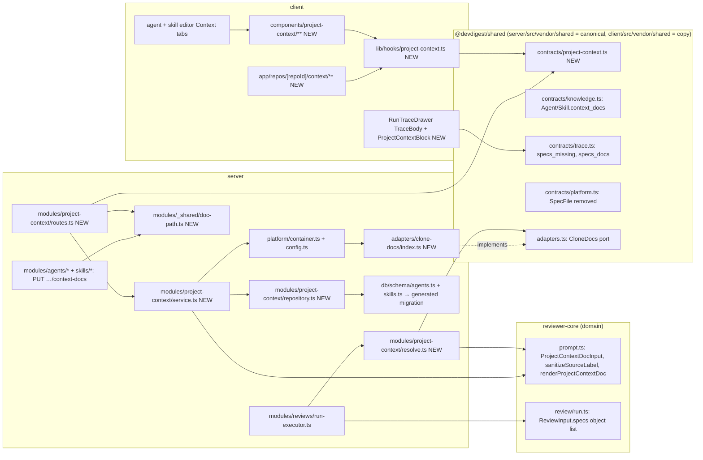
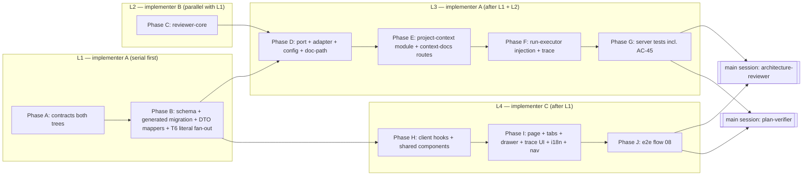

# Project Context — Implementation plan

> Spec: [`2026-10-11-project-context`](../specs/2026-10-11-project-context.md) (`Status: approved`, rev 5) — read 2026-10-11.
> Research: [`docs/research/2026-10-11-project-context.md`](../research/2026-10-11-project-context.md) (R1–R3, trusted, not re-traced).
> Status: **approved** (rev 1, 2026-10-11). Execution mode: **multi** (4 implementer lanes + main-session review rows).
> Scope: `@devdigest/shared` (both trees), `server/`, `reviewer-core/`, `client/`, `e2e/` (one flow). ACs are owned by the spec; this plan only maps them.

## 0. Diagrams

### 0.1 Run-time resolution / injection flow (AC-23…AC-36, AC-46)

```mermaid
flowchart TD
  A([POST /pulls/:id/review — single, all:true, MCP]) --> B[ReviewService.runReview → RunExecutor.executeRuns]
  B --> C[runOneAgent: agent row already loaded at run start]
  C --> D["agents.enabledSkillsForPrompt(agent.id) — ONE call (snapshot, AC-23)"]
  D --> E1[buildSkillBlocks(linked) — unchanged output]
  D --> E2["orderContextPaths(agent.contextDocs, linked[].skill.contextDocs) — agent first, skills in binding order, dedupe first-wins (AC-24/25)"]
  E2 --> F{repo.clonePath set and dir exists?}
  F -- no --> G1[every path → skipped reason no_clone]
  F -- yes --> H[for each path: validateDocPath lexical]
  H -- refused --> G2[skipped outside_repo]
  H -- ok --> I["container.cloneDocs.read(root, path, 512 KB) — realpath guard, fresh read (AC-26/38)"]
  I -- not_found / outside_repo / too_large / unreadable --> G3[skipped with that reason]
  I -- ok --> J["renderProjectContextDoc({path,text}) (reviewer-core) → wrapped_text; tokenizer.count(wrapped_text)"]
  G1 & G2 & G3 & J --> K["ResolvedProjectContext: docs[], specs_docs[], specs_read[], specs_missing[] + Live-log lines (AC-36)"]
  K --> L["reviewPullRequest({... specs: docs}) — omitted when docs empty (AC-29)"]
  L --> M["assemblePrompt: '## Project context' + docs.map(renderProjectContextDoc).join('\n\n') — every chunk in map-reduce (AC-27/32/37/40)"]
  M --> N[existing LLM call(s) only (AC-30) → groundFindings unchanged]
  N --> O["RunTrace: prompt_assembly.specs (engine), specs_read, specs_missing, specs_docs (AC-33/35/46)"]
```

### 0.2 Structure — files touched per package and dependency direction



### 0.3 Phase DAG with lanes



## 1. Requirements (verified)

| R | Requirement, restated | Spec id | Covered by steps | Verified by |
|---|---|---|---|---|
| R1 | Discovery lists exactly `.md` under any bucket folder at any depth; excludes `node_modules`, `vendor`, `dist`, `.git` | AC-1 | D2, D4, E3 | V6, V9 |
| R2 | Bucket set is configurable (config + parameter) | AC-2 | D3, E3 | V6, V9 |
| R3 | Outermost bucket gives the badge | AC-3 | D4 | V6 |
| R4 | Every C1 entry has all fields; `estimated_tokens` = shared tokenizer over the exact wrapped text the doc contributes | AC-4 | C1, E2, E3 | V5, V9, V10 |
| R5 | No clone → 200, empty, `clone_available:false`; client "Clone not available" | AC-5 | D2, E3, I2, I5 | V9, V13, V16 |
| R6 | > 2,000 → first 2,000 in path order, `truncated`, `total_found`; client notice | AC-6 | E3, I2 | V9, V13 |
| R7 | > 512 KB → `too_large`, non-UTF-8 → `unreadable`, null estimate; client marker, no preview, disabled toggle | AC-7 | D2, E3, H3, I2, I4 | V8, V9, V13 |
| R8 | ↻ re-runs discovery; no git process on refresh (tracked query only on reads) | AC-8 | D2, E3, I2 | V8, V9, V13 |
| R9 | Page lists docs grouped by folder in path order; empty state naming buckets | AC-9 | H4, I2 | V13 |
| R10 | Preview: rendered markdown + path, bucket badge, "Used by N agents", "≈ T tokens" | AC-10 | H2, H3, I2 | V13 |
| R11 | `used_by_agents` = distinct agents with path directly or via bound skill, enabled flags ignored | AC-11 | E1, E2 | V9 |
| R12 | Agent Context tab: heading, "{N} of {M} attached" (M = `total_found`; absent rows count in N only), order note, rows with handle/toggle/name/folder/badge/Preview; no-repo prompt | AC-12 | H4, H5, I3 | V13 |
| R13 | Attach/detach/reorder persist ordered path list, no Save button, attach appends | AC-13 | B1, E4, E5, H1, H5 | V9, V13 |
| R14 | "≈ N tokens" (sum of own attached estimates) + untrusted note | AC-14 | H4, H5 | V13 |
| R15 | Filter on name/path, case-insensitive, attach state kept | AC-15 | H4, H5 | V13 |
| R16 | Drawer "Attached" toggle attaches/detaches for the tab owner | AC-16 | H3, H5 | V13 |
| R17 | Attach changes: version unchanged, no snapshot | AC-17 | E4, E5 | V9 |
| R18 | Save failure → rows restored + message | AC-18 | H1, H5 | V13 |
| R19 | Paths are workspace-wide, resolved in the PR's own repo | AC-19 | E4, F1 | V10 |
| R20 | Absent path → "not in this repository" + Remove, excluded from estimate; under `truncated`, a path not returned shows as normal attached row with no estimate | AC-20 | H4, H5 | V13 |
| R21 | Skill Context tab: heading, "{N} attached", filter, inheritance note, same rows | AC-21 | H5, I4 | V13 |
| R22 | Skill "SERIALIZES AS": `## Project context` + `- <path>` lines | AC-22 | H4, H5 | V13 |
| R23 | Attach lists read once at run start (snapshot) | AC-23 | F1 | V10 |
| R24 | Union agent + enabled bound skills; disabled skill contributes none | AC-24 | E2, F1 | V7, V10 |
| R25 | Deterministic order; dedupe by path, first occurrence wins | AC-25 | E2, F1 | V7, V10 |
| R26 | Read fresh from PR repo clone working tree, no cache | AC-26 | E6, F1 | V10 |
| R27 | One `## Project context` section, one untrusted fence per doc, label from path | AC-27 | C1, C2 | V5, V10 |
| R28 | Stale / too large / unreadable / outside / no clone → skipped; run ends `done` | AC-28 | E6, F1 | V10 |
| R29 | Zero injected → no section, prompt as today | AC-29 | C1, F1 | V5, V10 |
| R30 | No extra LLM/embedding/network call | AC-30 | E6, F1 | V10 |
| R31 | Applies to `all:true` and MCP runs (same endpoint path) | AC-31 | F1 | V10 |
| R32 | map-reduce: section in every chunk | AC-32 | C2 | V5 |
| R33 | `specs_read` (injection order), `specs_missing` (resolution order) | AC-33 | A3, F1 | V10 |
| R34 | Trace Configuration rows "Specs read" + "Specs skipped", "none" when empty | AC-34 | I6 | V14 |
| R35 | Prompt-assembly block "Project context — attached specs (untrusted)" + total; per-doc expandable item (path, tokens, repo) → exact wrapped text; copy + search | AC-35 | A3, F1, I6 | V10, V14 |
| R36 | Live log lines exactly per C5 | AC-36 | E6, F1 | V10 |
| R37 | Text only inside existing fence; guard unchanged | AC-37 | C1 | V5 |
| R38 | Path guard on read, write, run: absolute, `..`, `\`, NUL, non-`.md`, realpath escape | AC-38 | D1, D2, E3, E6 | V6, V8, V9, V10 |
| R39 | Preview runs no script; non-http(s) links plain text | AC-39 | H2 | V13 |
| R40 | Prompt label only `[A-Za-z0-9/._-]`, others → `_` | AC-40 | C1 | V5 |
| R41 | Edit shows current raw markdown | AC-41 | I2 | V13 |
| R42 | Save: atomic replace, guarded, no git, no LLM | AC-42 | D2, E3 | V8, V9 |
| R43 | Tracked → Resync warning, driven by C2 `tracked` | AC-43 | A1, D2, E3, I2 | V8, V9, V13 |
| R44 | Save failure (removed, refused, > 512 KB, write error) → error shown, text kept | AC-44 | E3, I2 | V9, V13 |
| R45 | Headline: invariant spec attached → grounded finding; hermetic DB-backed pipeline test + opt-in live test + browser flow for "Clone not available" | AC-45 | G4, G5, J1 | V11, V12, V16 |
| R46 | Trace lists skipped paths with reasons, also when none injected | AC-46 | F1, I6 | V10, V14 |
| R47 | Confirm before discarding unsaved edits (navigate away / other doc) | AC-47 | I2 | V13 |
| R48 | Discovery ≤ 2 s p95 on ~5k files, one walk; 50 reads ≤ 1 s | NFR-1 | D2, E2 (cache, P7) | V17 (manual) |
| R49 | One read/save ≤ 500 ms | NFR-2 | D2 | V17 (manual) |
| R50 | Zero extra calls; tab estimate within ±5% of the `specs` log slot on a ≥ ~1k-token set | NFR-3 | C1, E3, F1 | V10 |
| R51 | Edits persist except explicit Resync; limitation shown | NFR-4 | D2, I2 | V8, V13 |
| R52 | Project-context failure never changes run status; loading / error + Retry states | NFR-5 | F1, I2, H5 | V10, V13 |
| R53 | WCAG 2.1 AA list (keyboard toggles, path accessible names, keyboard reorder, text badges, Escape + focus return) | NFR-6 | H2, H3, H5, I2 | V13 |
| R54 | All strings via catalog, ICU plurals | NFR-7 | I7 | V13, V17 |
| R55 | Untrusted handling; no doc text in server logs | NFR-8 | C1, E6, F1 | V10, V17 |
| R56 | Every feature API error carries a C2/C3 code | NFR-9 | D1, E3, E4, E5 | V9 |
| R57 | EC-1…EC-30 — each mapped through the AC it cites (EC-1 → V5/V10; EC-7 → V6/V8/V9; EC-10/11/13 → V7/V10; EC-20/29/30 → V8/V10; EC-23 → V5; EC-25 → V13; EC-26 → V5; EC-27 → V13; EC-28 → V9) | EC-* | as per AC | as per AC |

### Owner answers
- Q1 → a: spec rev 5 added `tracked: boolean` to the C2 read response (read-only git query on document reads only).
- Q2 → c: hermetic DB-backed server pipeline test + opt-in live test + one browser flow for "Clone not available".
- Q3 → a: NFR-3 parity checked on a realistic set (≥ ~1k tokens).
- C7 → confirmed (spec AC-20 / C1 `truncated` row). C8 → confirmed (AC-12: M = `total_found`).
- D1–D9 → OK. Execution mode → **multi**.

### Recommendations
| # | Recommendation | Owner | Reflected in |
|---|---|---|---|
| P1 | AC-45 via hermetic server pipeline test + opt-in live test + browser flow | accepted | spec rev 5 AC-45; §9 G4, G5, J1 |
| P2 | `tracked` on C2 read | accepted | spec rev 5 C2; §5, D2, E3 |
| P3 | Dedicated `PUT /agents/:id/context-docs`, `PUT /skills/:id/context-docs` | accepted | §6, E4, E5 |
| P4 | New `CloneDocs` port + adapter | accepted | §6, D2 |
| P5 | Replace `SpecFile`, drop `useReindexContext`, rewrite `context.json` empty copy | accepted | A4, B6, I7 |
| P6 | Pure render/label helpers exported from reviewer-core | accepted | C1, C3 |
| P7 | Discovery-only token-estimate cache keyed by (clone, path, size, mtime) | accepted | E2 |

## 2. Implementation decisions

| # | Decision (how, not what) | Consequence |
|---|---|---|
| D1 | C1/C2 live in a NEW contract file `contracts/project-context.ts` (both trees). URLs: `GET /repos/:id/context` (C1), `GET /repos/:id/context/document?path=` (C2 read), `PUT /repos/:id/context/document` (C2 save). `SpecFile` is deleted from `platform.ts` (both trees); `IndexStatus` stays (unused, harmless). | Keeps the pre-staged URL; removes the misleading shape; one new export line per `index.ts`. |
| D2 | Attach lists change through dedicated `PUT /agents/:id/context-docs` and `PUT /skills/:id/context-docs`, body `{ context_docs: string[] }`, whole-list replace, returning the updated `Agent` / `Skill`. Repository methods update only `context_docs` and never touch `version` / `*_versions`. | AC-17 holds by construction; the versioning `PUT /agents/:id` (`agents/repository.ts:120-143`) is untouched. Not T7 (no append shape). |
| D3 | `ReviewInput.specs` and `PromptParts.specs` become `ProjectContextDocInput[]` (`{ path: string; text: string }`). reviewer-core exports pure `sanitizeSourceLabel(path)` and `renderProjectContextDoc(doc)` (= `wrapUntrusted(sanitizeSourceLabel(path), text)`). The server uses the SAME function for `specs_docs[].wrapped_text`, discovery estimates and run-log estimates. | AC-4 / AC-35 / NFR-3 parity is byte-exact per document; only one engine caller (`run-executor.ts:220`). |
| D4 | Bucket set: `PROJECT_CONTEXT_BUCKETS` env (comma list) → `AppConfig.projectContextBuckets`, default `DEFAULT_BUCKETS = ['specs','docs','insights']` in `modules/project-context/constants.ts`. The service passes the set into the adapter's `discover` as a parameter. Excluded dirs are a fixed constant `EXCLUDED_DOC_DIRS = ['node_modules','vendor','dist','.git']`. Contract `bucket` is `z.string()` (not an enum) because the set is configurable. | AC-2 testable without env. |
| D5 | All clone file-system I/O goes through a NEW port `CloneDocs` (interface in `vendor/shared/adapters.ts`, both trees) implemented by `FsCloneDocs` in `server/src/adapters/clone-docs/index.ts`, exposed as `container.cloneDocs` with `ContainerOverrides.cloneDocs`. `isTracked` is the only method that spawns git (`simple-git` `ls-files --error-unmatch -- <path>`). Discovery never follows symlinked entries; read/write resolve `realpath` of root and target and refuse anything outside the root. | Onion rule 3; one guarded place; no repeat of the `repo-intel/service.ts:817` direct `readFile` deviation. |
| D6 | Zod at the rim validates shape only (`z.object({ context_docs: z.array(z.string()) })`, `{ path: z.string(), text: z.string() }`, query `{ path: z.string() }`). Domain rules (AC-38 lexical, 512-char item, uniqueness, ≤ 50, ≤ 512 KB text) run in pure helpers in `modules/_shared/doc-path.ts` and throw `new AppError(code, msg, status)` with the C2/C3 codes. | Rim validation always emits `validation_error` (`server/src/app.ts:124-129`); C2/C3 require `invalid_path`, `duplicate_path`, `attachment_limit`, `document_too_large`. |
| D7 | Storage: `context_docs` `jsonb` `$type<string[]>()` `.notNull().default([])` on `agents` and `skills` (Drizzle property `contextDocs`). Add-only → one `pnpm db:generate` pass. Not written into `agent_versions.config_json` or `skill_versions`. | No join table; ordered array; AC-13/17. |
| D8 | New module `server/src/modules/project-context/`: `routes.ts` (presentation), `service.ts` (application: discovery, read, save), `resolve.ts` (application: run-time resolution, no DB), `repository.ts` (data access: used-by query), `helpers.ts` (pure), `constants.ts`, `estimate-cache.ts` (in-memory, discovery only), `index.ts` (exports `resolveProjectContext` for `reviews/run-executor.ts`). | Keeps run-executor thin; resolution testable without HTTP. |
| D9 | Run-time snapshot (AC-23): `runOneAgent` calls `agents.enabledSkillsForPrompt(agent.id)` ONCE and passes the rows to both `buildSkillBlocks` (signature changes to take the rows) and `resolveProjectContext`; the agent's own `contextDocs` comes from the `AgentRow` loaded at run start. | No second read of attach lists during the run. |
| D10 | Payload size: `PUT /repos/:id/context/document` sets route `bodyLimit: 2 * 1024 * 1024` so a > 512 KB text reaches the service and gets `413 document_too_large` (byte length via `Buffer.byteLength(text,'utf8')`) instead of Fastify's generic 413. | Correct C2 code (AC-44). |
| D11 | Atomic save: `FsCloneDocs.write` writes `<dir>/.<name>.<random>.tmp` in the target's (realpath) directory and `rename`s it over the realpath target; the target must already exist (save never creates, NG3). | EC-29: a concurrent run reads old or new full text. |
| D12 | Discovery estimate cache (P7): `Map<string, {status, tokens}>` keyed `root\0path\0size\0mtimeMs`, max 20,000 entries (clear-all when full), used ONLY by the discovery listing. Run-time resolution and C2 reads never consult it (AC-26). | NFR-1 headroom. |
| D13 | AC-45 hermetic test = `server/test/project-context-headline.it.test.ts`; live test = `server/test/project-context-live.it.test.ts` wrapped in `describe.skipIf(process.env.DEVDIGEST_LIVE !== '1')` because CI's `vitest run .it.test` matches every `*.it.test.ts` (`.github/workflows/server-integration.yml:65`). | Live never runs in CI by accident. |
| D14 | Client: shared project-context UI lives in `client/src/components/project-context/` (used by the page, both editor tabs and the drawer); the page is `client/src/app/repos/[repoId]/context/`. The Context tab body is ONE component `ContextDocsTab` with `variant: 'agent' | 'skill'`. | No duplication between agent and skill tabs. |

## 3. What already exists — do not rebuild

| Layer | Already there | File |
|---|---|---|
| Engine slot | `ReviewInput.specs?: string[]` | `reviewer-core/src/review/run.ts:70`, pass-through `:154` |
| Engine slot | `PromptParts.specs`, `## Project context` section, `wrapUntrusted`, guard | `reviewer-core/src/prompt.ts:51-55`, `:68`, `:150-153`, `:163` |
| Engine | map-reduce re-assembles per chunk (AC-32 needs no engine change beyond the type) | `reviewer-core/src/review/run.ts:193` |
| Contract | `PromptAssembly.specs` | `server/src/vendor/shared/contracts/trace.ts:42` (client copy same line) |
| Contract | `RunTrace.specs_read` | `server/src/vendor/shared/contracts/trace.ts:89` |
| Contract | `SpecFile` (wrong shape → deleted, D1), `IndexStatus` (kept) | `*/vendor/shared/contracts/platform.ts:254-269` |
| Contract | error envelope `ApiErrorBody`; `AppError(code,msg,status)` | `platform.ts:279-285`; `server/src/platform/errors.ts:7-17` |
| Server | per-skill log line pattern to copy for C5 | `server/src/modules/reviews/run-executor.ts:402-424` |
| Server | enabled-skill list in binding order (snapshot source) | `server/src/modules/agents/repository.ts:212-220` |
| Server | `prompt_assembly` per-slot token log (`specs` slot for NFR-3) | `run-executor.ts:271-286` |
| Server | tokenizer port with `ceil(chars/4)` fallback | `server/src/adapters/tokenizer/index.ts:20-22`; `container.ts:132-135` |
| Server | `MockLLMProvider` recorded structured reply + `pr_files` patch fixtures | `server/src/adapters/mocks.ts:59`; `server/test/reviews.it.test.ts:91-96`, `:372-375` |
| Server | DB tests without Docker via `TEST_DATABASE_URL` | `server/test/helpers/pg.ts`; `server/INSIGHTS.md:59` |
| Client | `useContextFiles` / `useReindexContext` (wrong shape / dead endpoint → removed, P5) | `client/src/lib/hooks/core.ts:122-137` |
| Client | i18n namespace `context` (title, mode, editor keys reused; empty copy rewritten) | `client/messages/en/context.json` |
| Client | shell maps `/context` to nav key `context`, but NAV has no item | `client/src/components/app-shell/helpers.ts:30`; `client/src/vendor/ui/nav.ts:21-40` |
| Client | react-markdown 9 + remark-gfm renderer to copy (its `a` must be replaced for AC-39) | `client/src/app/skills/_components/SkillEditor/_components/SkillMarkdown/SkillMarkdown.tsx:13-44` |
| Client | Trace "Specs read" row + specs PromptBlock | `client/src/app/repos/[repoId]/pulls/[number]/_components/RunTraceDrawer/_components/TraceBody/TraceBody.tsx:39-50`, `:85-87` |
| DB | `code_chunks.source='spec'` (embedding, NG5) — NOT reused | `server/src/db/schema/context.ts:31-46` |

Sweep: `rg -n -i "context_docs|contextDocs|specs_missing|specs_docs|ProjectContext|DiscoveredDocument|SpecFile|bucket"` over `server/src client/src client/messages e2e mcp/src reviewer-core/src` (excluding `server/clones/**`, `.claude/worktrees/**`, `node_modules`) → nothing beyond the rows above.

### Code map — files this change touches

| File | Why it changes | Anchor |
|---|---|---|
| `server/src/vendor/shared/contracts/project-context.ts` **NEW** | C1, C2, C3 body, ProjectContextDoc | — |
| `client/src/vendor/shared/contracts/project-context.ts` **NEW** | identical copy (T1) | — |
| `server/src/vendor/shared/contracts/knowledge.ts` | `context_docs` on `Agent`, `Skill` | `:121-132`, `:296-314` |
| `client/src/vendor/shared/contracts/knowledge.ts` | same (T1; `Agent` sits ~6 lines earlier) | `:121-132`, `:~290-308` |
| `server/src/vendor/shared/contracts/trace.ts` / client copy | `specs_missing`, `specs_docs` on `RunTrace` | `:75-91` |
| `server/src/vendor/shared/contracts/platform.ts` / client copy | delete `SpecFile` | `:254-261` |
| `server/src/vendor/shared/index.ts` / client copy | export `project-context`; fix header comment | `:10`, `:17-26` |
| `server/src/vendor/shared/adapters.ts` / client copy | `CloneDocs` port | append after `:258` (server), end of file (client) |
| `server/src/db/schema/agents.ts` | `contextDocs` column | `:8-36` |
| `server/src/db/schema/skills.ts` | `contextDocs` column | `:5-21` |
| `server/src/db/migrations/00NN_*.sql` **GENERATED** | `pnpm db:generate` output | after `0015_neat_echo.sql` |
| `server/src/modules/agents/helpers.ts` | `toAgentDto` maps `context_docs` | `:12-33` |
| `server/src/modules/skills/helpers.ts` | `toSkillDto` maps `context_docs` | `:32-45` |
| `server/src/modules/agents/{routes,service,repository}.ts` | `PUT /agents/:id/context-docs` | routes `:109-118`, service `:95`, repo `:112` |
| `server/src/modules/skills/{routes,service,repository}.ts` | `PUT /skills/:id/context-docs` | routes `:109-114`, service `:115`, repo `:94` |
| `server/src/modules/_shared/doc-path.ts` **NEW** | lexical guard + list validation + limits | — |
| `server/src/adapters/clone-docs/index.ts` **NEW** | `FsCloneDocs` | — |
| `server/src/platform/container.ts` | `cloneDocs` getter + override | `:41-57`, `:132-135` |
| `server/src/platform/config.ts` | `PROJECT_CONTEXT_BUCKETS` → `projectContextBuckets` | env schema `:25-48`, `AppConfig` `:50-62`, `loadConfig` `:100-115` |
| `server/src/modules/project-context/*` **NEW** | module (D8) | — |
| `server/src/modules/index.ts` | register module | `:1-14`, `:29-44` |
| `server/src/modules/reviews/run-executor.ts` | snapshot, resolve, inject, trace, log | `:202-208`, `:220-243`, `:346-358`, `:402-424`, `:534-538` |
| `server/src/platform/trace-builder.ts` | RunTrace literal (T6) | `:48-52` |
| `server/test/contracts.test.ts` | RunTrace fixture (T6) | `:207-211` |
| `reviewer-core/src/prompt.ts` | object-list specs, helpers | `:51-55`, `:68`, `:150-163` |
| `reviewer-core/src/review/run.ts` | `ReviewInput.specs` type | `:69-70`, `:154` |
| `reviewer-core/src/index.ts` | export helpers + type | `:15-23` |
| `reviewer-core/test/prompt.test.ts` | fixture `specs: ['s1']` | `:100` |
| `client/src/lib/hooks/core.ts` | remove `useContextFiles`, `useReindexContext`, `SpecFile`/`IndexStatus` imports | `:18-19`, `:122-137` |
| `client/src/lib/hooks/project-context.ts` **NEW** + `client/src/lib/hooks/index.ts` | hooks + export | index `:4-13` |
| `client/src/components/project-context/**` **NEW** | DocMarkdown, BucketBadge, DocPreviewDrawer, ContextDocsTab | — |
| `client/src/app/repos/[repoId]/context/**` **NEW** | Project Context page | — |
| `client/src/vendor/ui/nav.ts` | NAV item `context` (vendored; deliberate, precedent: conventions) | `:21-40` |
| `client/src/app/agents/[id]/_components/AgentEditor/{constants.ts,AgentEditor.tsx}` | Context tab | constants `:11-14`, editor `:26` |
| `client/src/app/skills/constants.ts`, `client/src/app/skills/_components/SkillEditor/SkillEditor.tsx` | Context tab | `:32`, `:59-63` |
| `client/src/app/repos/[repoId]/pulls/[number]/_components/RunTraceDrawer/_components/TraceBody/TraceBody.tsx` | Specs skipped row, ProjectContextBlock | `:39-50`, `:85-87` |
| `client/src/app/repos/[repoId]/pulls/[number]/_components/RunTraceDrawer/_components/ProjectContextBlock/**` **NEW** | per-doc items, skipped list | — |
| `client/messages/en/{context,agents,skills,runs}.json` | strings (NFR-7) | `context.json` all; `agents.json:50`; `skills.json:55`; `runs.json:31-50` |
| Client T6 fixtures (see §10 T6) | `context_docs`, `specs_missing`, `specs_docs` | listed in §10 |
| `e2e/specs/08-project-context.flow.json` **NEW**, `e2e/README.md` | AC-45 browser flow + coverage row | — |
| `server/README.md` | API map rows for the 5 new routes | API map section |

## 4. Data model

```ts
// server/src/db/schema/agents.ts — inside pgTable('agents', { … }) after `repoIntel`
contextDocs: jsonb('context_docs').$type<string[]>().notNull().default([]),

// server/src/db/schema/skills.ts — inside pgTable('skills', { … }) after `evidenceFiles`
contextDocs: jsonb('context_docs').$type<string[]>().notNull().default([]),
```

- `server/src/db/schema.ts` re-exports `./schema/agents` and `./schema/skills` already (`schema.ts:16-17`); drizzle-kit reads it (`server/drizzle.config.ts:8`).
- Then: `cd server && pnpm db:generate` (one pass; add-only, so drizzle-kit is not interactive — T4) → commit the generated `.sql` + `meta/*` untouched → apply with `./node_modules/.bin/tsx src/db/migrate.ts`. **Never hand-write or hand-edit the migration.**
- Owner's dev DB drift (root `INSIGHTS.md:63`, `server/INSIGHTS.md` 2026-09-23): before applying locally, run `select column_name from information_schema.columns where table_name in ('agents','skills') and column_name='context_docs'`; if the column already exists there, follow the `2026-09-23` remedy, do not edit the migration.
- `snapshotVersion` (`agents/repository.ts:148-166`) and skills `snapshotVersion` (`skills/repository.ts:202`) are NOT changed: `context_docs` stays out of version snapshots (AC-17).

## 5. Contracts (`@devdigest/shared`)

Every edit below is made **identically** in `server/src/vendor/shared/…` and `client/src/vendor/shared/…` in the same step (T1). Casing: all JSON fields snake_case; enums lowercase (T3).

| Spec contract | Zod schema (file `contracts/project-context.ts` unless noted) |
|---|---|
| C1 DiscoveredDocument | `DiscoveredDocument = z.object({ path: z.string(), folder: z.string(), name: z.string(), bucket: z.string(), size_bytes: z.number().int().nonnegative(), status: DocumentStatus, estimated_tokens: z.number().int().nonnegative().nullable(), used_by_agents: z.number().int().nonnegative() })`; `DocumentStatus = z.enum(['ok','too_large','unreadable'])` |
| C1 listing | `ProjectContextListing = z.object({ repo_id: z.string(), clone_available: z.boolean(), total_found: z.number().int().nonnegative(), truncated: z.boolean(), documents: z.array(DiscoveredDocument).max(2000) })` |
| C2 read | `DocumentContent = DiscoveredDocument.extend({ text: z.string(), tracked: z.boolean() })`; query `DocumentQuery = z.object({ path: z.string() })` |
| C2 save | `SaveDocumentBody = z.object({ path: z.string(), text: z.string() })`; response `DiscoveredDocument` (no `tracked`) |
| C2/C3 error codes | `ProjectContextErrorCode = z.enum(['invalid_path','document_not_found','repo_not_cloned','document_too_large','document_unreadable','document_write_failed','duplicate_path','attachment_limit'])` (documentation + client switch; responses use existing `ApiErrorBody`) |
| C3 field | `knowledge.ts`: `Agent` gets `context_docs: z.array(z.string()).default([])`; `Skill` gets `context_docs: z.array(z.string()).default([])` (inherits into `SkillSummary`) |
| C3 body | `SetContextDocsBody = z.object({ context_docs: z.array(z.string()) })` (shape only; rules in D6) |
| C4 | not a shared contract — `reviewer-core` type `ProjectContextDocInput { path: string; text: string }` (D3) |
| C5 | `trace.ts`: `ProjectContextDoc = z.object({ path: z.string(), repo: z.string(), status: z.enum(['injected','skipped']), reason: z.enum(['not_found','too_large','unreadable','outside_repo','no_clone']).nullable(), estimated_tokens: z.number().int().nonnegative().nullable(), wrapped_text: z.string().nullable() })`; `RunTrace` gets `specs_missing: z.array(z.string()).default([])` and `specs_docs: z.array(ProjectContextDoc).default([])` (old stored traces still parse). `ProjectContextDoc` lives in `trace.ts` to avoid a trace → project-context import. |
| Port (D5) | `adapters.ts`: `CloneDocEntry { path: string; sizeBytes: number; mtimeMs: number }`; `CloneDocRead = { kind: 'ok'; text: string; sizeBytes: number; mtimeMs: number } \| { kind: 'not_found' \| 'outside_repo' \| 'unreadable' } \| { kind: 'too_large'; sizeBytes: number }`; `CloneDocWrite = 'ok' \| 'not_found' \| 'outside_repo' \| 'write_failed'`; `interface CloneDocs { discover(root: string, opts: { buckets: readonly string[]; excludedDirs: readonly string[] }): Promise<CloneDocEntry[] \| null /* null = root missing */>; read(root: string, path: string, maxBytes: number): Promise<CloneDocRead>; write(root: string, path: string, text: string): Promise<CloneDocWrite>; isTracked(root: string, path: string): Promise<boolean> }` (TS interface, internal, camelCase is correct here) |

## 6. Server

**Presentation (rim)**
- `modules/project-context/routes.ts` NEW — all routes: auth = `getContext(app.container, req)` → `workspaceId` (same as every module, `agents/routes.ts:79-82`); authz = repo looked up by `(workspaceId, id)` via `RepoRepository.getById` (`repos/repository.ts:36`) → `NotFoundError` (404 `not_found`, "existing behaviour"); validation = Zod `params: IdParams`, `querystring: DocumentQuery`, `body: SaveDocumentBody`, response schemas from §5.
  - `GET /repos/:id/context` → `ProjectContextListing`
  - `GET /repos/:id/context/document?path=` → `DocumentContent`
  - `PUT /repos/:id/context/document` (`bodyLimit` 2 MiB, D10) → `DiscoveredDocument`
- `modules/agents/routes.ts` — `PUT /agents/:id/context-docs`, `{ params: IdParams, body: SetContextDocsBody }`, auth `getContext`, authz = agent in workspace else 404; returns `Agent`.
- `modules/skills/routes.ts` — `PUT /skills/:id/context-docs`, same shape; returns `Skill`.

**Application**
- `modules/project-context/service.ts` NEW — `list(workspaceId, repoId)`, `read(workspaceId, repoId, path)`, `save(workspaceId, repoId, path, text)`. Uses `container.cloneDocs`, `container.tokenizer`, `container.config.projectContextBuckets`, `renderProjectContextDoc` from `@devdigest/reviewer-core`, its repository, and the estimate cache (D12, listing only). Error mapping: lexical refusal → `invalid_path` 422; `outside_repo`/`not_found` → `document_not_found` 404; null `clonePath` or missing root → `repo_not_cloned` 409; > 512 KB → `document_too_large` 413; non-UTF-8 → `document_unreadable` 422; write error → `document_write_failed` 500. `tracked` = `cloneDocs.isTracked` on `read` only.
- `modules/project-context/resolve.ts` NEW — `resolveProjectContext({ cloneRoot: string | null, repoFullName, agentDocs, skillDocs: string[][], cloneDocs, tokenizer })` → `{ docs, specsDocs, specsRead, specsMissing, lines }`. Per-path try/catch; never throws (NFR-5). No DB.
- `modules/agents/service.ts` — `setContextDocs(workspaceId, id, docs)`: `validateContextDocs(docs)` → `repo.setContextDocs` → `toAgentDto`.
- `modules/skills/service.ts` — same for skills.
- `modules/reviews/run-executor.ts` — §9 Phase F.

**Data access**
- `modules/project-context/repository.ts` NEW — `attachedPathsByAgent(workspaceId)`: rows `{ agentId, docs }` from `agents.contextDocs` plus rows from `agent_skills ⋈ skills` (`skills.contextDocs`), both workspace-scoped, no enabled filters (AC-11). Drizzle only here.
- `modules/agents/repository.ts` — `setContextDocs(workspaceId, id, docs)`: `update(agents).set({ contextDocs: docs })` scoped by workspace; NO version change.
- `modules/skills/repository.ts` — same.

**Infrastructure**
- `adapters/clone-docs/index.ts` NEW — `FsCloneDocs` (D5, D11). Discovery: one recursive `readdir({ withFileTypes })` walk, skip symlink entries and `excludedDirs`, keep `*.md` whose directory segments include a bucket, `stat` for size + mtime, sort by path. Read: lexical check (defence in depth), `realpath(root)` and `realpath(join(root,path))`, containment check with `path.relative`, `stat` size > max → `too_large`, `TextDecoder('utf-8', { fatal: true })` → `unreadable`. `isTracked`: `simpleGit(root).raw(['ls-files','--error-unmatch','--', path])` → true / false on error (argv-hardened with `--`, `server/AGENTS.md` Conventions).
- `platform/container.ts` — `get cloneDocs(): CloneDocs` lazy `FsCloneDocs`, override `ContainerOverrides.cloneDocs`.
- `platform/config.ts` — `PROJECT_CONTEXT_BUCKETS: z.string().optional()` → `projectContextBuckets: string[]` (split, trim, lowercase, drop empty; default `DEFAULT_BUCKETS`). The default constant is in config's own scope (config may not import a module) — define `DEFAULT_PROJECT_CONTEXT_BUCKETS` in `config.ts` and re-export it from `project-context/constants.ts`.

## 7. Client

Conventions: feature folders `_components/<PascalName>/` + `<Name>.tsx` + `<Name>.test.tsx` + `styles.ts` + `index.ts` (`client/AGENTS.md`); all strings via `useTranslations` (NFR-7).

- `client/src/lib/hooks/project-context.ts` NEW — `useProjectContext(repoId)` (`["project-context", repoId]`, GET C1), `useContextDocument(repoId, path)` (GET C2), `useSaveContextDocument(repoId)` (PUT C2; invalidates listing), `useSetAgentContextDocs(agentId)` / `useSetSkillContextDocs(skillId)` (PUT C3, optimistic update of `["agent", id]` / `["skill", id]` with rollback + toast on error → AC-18; invalidate `["project-context"]` for used-by counts).
- `client/src/components/project-context/` NEW:
  - `DocMarkdown/` — react-markdown + remark-gfm (no rehype-raw), `a` override renders `<a>` only for `^https?://` hrefs, else plain `<span>` (AC-39).
  - `BucketBadge/` — text label + colour (NFR-6); unknown bucket → neutral.
  - `DocPreviewDrawer/` — preview with path, badge, "Used by {n, plural…}", "≈ {T} tokens", optional "Attached" switch (AC-10, AC-16); Escape closes, focus returns to opener (NFR-6); `too_large`/`unreadable` → marker, no preview, switch disabled (AC-7).
  - `ContextDocsTab/` — shared tab body (`variant: 'agent' | 'skill'`): rows from `helpers.ts` `buildContextRows(listing, attached)` (attached-first in persisted order then unattached in path order; absent → `"not in this repository"` + Remove unless `listing.truncated`, C7), count (agent: "{N} of {M}" with `M = total_found`; skill: "{N} attached"), filter (AC-15), drag handle + keyboard Move up/down buttons (NFR-6), toggle with accessible name containing path, footer "≈ {N} tokens" summing `estimated_tokens` of attached rows present in the listing (AC-14, AC-20), untrusted note, skill-only "SERIALIZES AS" block (`## Project context` + `- <path>` per attached path, AC-22) and inheritance note (AC-21); states: no active repo (AC-12), `clone_available:false` (AC-5), loading / error + Retry (NFR-5).
- `client/src/app/repos/[repoId]/context/page.tsx` NEW + `_components/ProjectContextView/` NEW (folder-grouped list, ↻ refresh = `refetch()`, "Showing 2,000 of {N} documents", empty state naming buckets, clone-not-available) + `_components/DocumentPane/` NEW (Preview/Edit toggle; Edit = `<textarea>` with raw text from C2; `tracked` → Resync warning (AC-43); Save → C2 PUT; failure keeps text and shows the C2 message (AC-44); dirty-state confirm on selecting another doc and `beforeunload` + router-leave guard (AC-47)) + `helpers.ts` (`groupByFolder`) + `constants.ts`.
- Agent editor: `TABS` gets `{ key: "context", labelKey: "editor.tabs.context", icon: <an existing IconName from client/src/vendor/ui/icons.tsx, e.g. "FileText"> }`; `AgentEditor.tsx` renders `<ContextDocsTab variant="agent" …/>` for `tab === "context"`.
- Skill editor: `EDITOR_TABS` gets `"context"` (after `"preview"`); `SkillEditor.tsx` renders `<ContextDocsTab variant="skill" …/>`.
- Trace: `TraceBody.tsx` adds a "Specs skipped" row after "Specs read" (AC-34) and replaces the specs `PromptBlock` with `ProjectContextBlock` NEW: label "Project context — attached specs (untrusted)", total `~N tokens`, one expandable item per `specs_docs` entry with `status==='injected'` (path, `~N tokens`, `repo`, expanded = `wrapped_text` with Copy + in-block search), and the skipped list with reasons — rendered whenever `specs_docs` has any entry, even when `prompt_assembly.specs` is null (AC-35, AC-46). Falls back to the old `PromptBlock` for traces with `prompt_assembly.specs` but empty `specs_docs` (pre-change traces).
- Nav: `client/src/vendor/ui/nav.ts` WORKSPACE group gets `{ key: "context", label: "Project Context", icon: <existing IconName>, href: "/repos/:repoId/context" }` (no `gKey` unless an unused letter is confirmed).

## 8. Execution mode & agent lanes

| Lane | Agent | Phases | Files owned | Waits on | Checkpoint |
|---|---|---|---|---|---|
| L1 | implementer A | A, B | both `vendor/shared/contracts/{project-context,knowledge,trace,platform}.ts`, both `vendor/shared/{index,adapters}.ts`, `server/src/db/schema/{agents,skills}.ts`, generated migration, `server/src/modules/{agents,skills}/helpers.ts`, `server/src/modules/reviews/run-executor.ts` (literal-only edit B4), `server/src/platform/trace-builder.ts`, `server/test/contracts.test.ts`, `client/src/lib/hooks/core.ts`, client T6 fixture files (§10 T6) | — | V1, V2 |
| L2 | implementer B | C | `reviewer-core/src/prompt.ts`, `reviewer-core/src/review/run.ts`, `reviewer-core/src/index.ts`, `reviewer-core/test/prompt.test.ts`, `reviewer-core/test/project-context.test.ts` NEW | — (disjoint from L1) | V3, V5 |
| L3 | implementer A | D, E, F, G | `server/src/modules/_shared/doc-path.ts`, `server/src/adapters/clone-docs/**`, `server/src/platform/{container,config}.ts`, `server/src/modules/project-context/**`, `server/src/modules/index.ts`, `server/src/modules/{agents,skills}/{routes,service,repository}.ts`, `server/src/modules/reviews/run-executor.ts`, `server/test/{doc-path,clone-docs,project-context-helpers}.test.ts`, `server/test/project-context*.it.test.ts`, `server/README.md` | L1 (V1, V2), L2 (V3) | V4–V12 |
| L4 | implementer C | H, I, J | `client/src/lib/hooks/{project-context,index}.ts`, `client/src/components/project-context/**`, `client/src/app/repos/[repoId]/context/**`, `client/src/vendor/ui/nav.ts`, `client/src/app/agents/[id]/_components/AgentEditor/{constants.ts,AgentEditor.tsx}`, `client/src/app/skills/constants.ts`, `client/src/app/skills/_components/SkillEditor/SkillEditor.tsx`, `client/src/app/repos/[repoId]/pulls/[number]/_components/RunTraceDrawer/_components/{TraceBody,ProjectContextBlock}/**`, `RunTraceDrawer.test.tsx` (new assertions only after L1's literal fix), `client/messages/en/{context,agents,skills,runs}.json`, `e2e/specs/08-project-context.flow.json`, `e2e/README.md` | L1 (V2) | V13–V16 |
| R1 | main session runs this: `architecture-reviewer` | — | all L3 server files + `reviewer-core/src/prompt.ts` | L2, L3, L4 | report |
| R2 | main session runs this: `plan-verifier` | — | whole diff vs this plan + spec | L2, L3, L4 | report |

Disjointness: L1 and L3 are the same agent run serially, so `run-executor.ts` and the agents/skills module files moving from L1 (literal fixes) to L3 (behaviour) is a hand-over, not a parallel overlap. L2 ∩ L1 = ∅. L3 ∩ L4 = ∅ (no client file in L3, no server file in L4). `RunTraceDrawer.test.tsx` is touched by L1 (fixture literal) and then by L4 (assertions); L4 starts only after L1 finished.

Package managers (T9): L1/L3/L4 server+client → **pnpm packages, but run binaries directly, never `pnpm install`**; L2 → **npm** (`reviewer-core`); L4's e2e edit is JSON only — no `npm install` in `e2e/`.

## 9. Implementation plan

### Phase A — Contracts (L1) · ends at V1+V2 only together with Phase B

| # | Step | Files | Skill | AC |
|---|---|---|---|---|
| A1 | Create `contracts/project-context.ts` with `DocumentStatus`, `DiscoveredDocument`, `ProjectContextListing`, `DocumentContent` (incl. `tracked`), `DocumentQuery`, `SaveDocumentBody`, `SetContextDocsBody`, `ProjectContextErrorCode` exactly as §5 | `server/src/vendor/shared/contracts/project-context.ts` NEW, `client/src/vendor/shared/contracts/project-context.ts` NEW | `zod` | AC-4, AC-5, AC-6, AC-7, AC-43, NFR-9 |
| A2 | Add `context_docs: z.array(z.string()).default([])` to `Agent` and `Skill` | `server/src/vendor/shared/contracts/knowledge.ts`, `client/src/vendor/shared/contracts/knowledge.ts` | `zod` | AC-13, AC-19 |
| A3 | Add `ProjectContextDoc`; add `specs_missing` and `specs_docs` (both `.default([])`) to `RunTrace` | `server/src/vendor/shared/contracts/trace.ts`, `client/src/vendor/shared/contracts/trace.ts` | `zod` | AC-33, AC-35, AC-46 |
| A4 | Delete `SpecFile` (+ type) | `server/src/vendor/shared/contracts/platform.ts`, `client/src/vendor/shared/contracts/platform.ts` | `zod` | — (P5) |
| A5 | `export * from './contracts/project-context.js'`; header comment: replace `SpecFile` mention with `project-context` | `server/src/vendor/shared/index.ts`, `client/src/vendor/shared/index.ts` | `typescript-expert` | — |
| A6 | Add `CloneDocEntry`, `CloneDocRead`, `CloneDocWrite`, `CloneDocs` interface | `server/src/vendor/shared/adapters.ts`, `client/src/vendor/shared/adapters.ts` | `onion-architecture`, `typescript-expert` | AC-38, AC-42 |

### Phase B — Schema, migration, DTO mappers, T6 fan-out (L1) · checkpoint V1, V2

| # | Step | Files | Skill | AC |
|---|---|---|---|---|
| B1 | Add `contextDocs` jsonb column (§4) to `agents` and `skills` | `server/src/db/schema/agents.ts`, `server/src/db/schema/skills.ts` | `postgresql-table-design`, `drizzle-orm-patterns` | AC-13, AC-17 |
| B2 | `cd server && pnpm db:generate`; keep the generated SQL + meta as emitted; apply with `./node_modules/.bin/tsx src/db/migrate.ts` (after the §4 drift check) | `server/src/db/migrations/**` GENERATED | `drizzle-orm-patterns` | AC-13 |
| B3 | `toAgentDto`: `context_docs: row.contextDocs ?? []`; `toSkillDto`: same | `server/src/modules/agents/helpers.ts`, `server/src/modules/skills/helpers.ts` | `drizzle-orm-patterns` | AC-13 |
| B4 | RunTrace literals: add `specs_missing: [], specs_docs: []` next to `specs_read` at `run-executor.ts:355` and `:538`; `trace-builder.ts:52` add both fields (from input if present, else `[]`); `contracts.test.ts:211` fixture add both | `server/src/modules/reviews/run-executor.ts`, `server/src/platform/trace-builder.ts`, `server/test/contracts.test.ts` | `typescript-expert` | AC-33 |
| B5 | Client T6 fixtures: add `context_docs: []` to every typed `Agent`/`Skill` literal and `specs_missing: [], specs_docs: []` to the RunTrace fixture (full list §10 T6); add `context_docs: []` where a client builds a full `Skill` literal (`ConventionsSkillModal.tsx:~55-65` only if it is typed `Skill`, otherwise leave) | client files in §10 T6 | `react-testing-library`, `typescript-expert` | — |
| B6 | Remove `useContextFiles`, `useReindexContext` and the `SpecFile` / `IndexStatus` imports | `client/src/lib/hooks/core.ts` | `react-best-practices` | — (P5) |

### Phase C — reviewer-core (L2) · checkpoint V3, V5

| # | Step | Files | Skill | AC |
|---|---|---|---|---|
| C1 | Add `export interface ProjectContextDocInput { path: string; text: string }`, `export function sanitizeSourceLabel(path)` (`path.replace(/[^A-Za-z0-9/._-]/g, '_')`), `export function renderProjectContextDoc(d)` (= `wrapUntrusted(sanitizeSourceLabel(d.path), d.text)`); `PromptParts.specs?: ProjectContextDocInput[]`; `specsBlock = parts.specs.map(renderProjectContextDoc).join('\n\n')`. `INJECTION_GUARD`, `wrapUntrusted` unchanged | `reviewer-core/src/prompt.ts` | `onion-architecture`, `typescript-expert` | AC-27, AC-29, AC-37, AC-40, NFR-8 |
| C2 | `ReviewInput.specs?: ProjectContextDocInput[]` (doc comment: path + raw text, untrusted) | `reviewer-core/src/review/run.ts` | `typescript-expert` | AC-27, AC-32 |
| C3 | Export `sanitizeSourceLabel`, `renderProjectContextDoc`, `type ProjectContextDocInput` | `reviewer-core/src/index.ts` | `typescript-expert` | AC-4 |
| C4 | Update fixture `specs: ['s1']` → `[{ path: 'specs/s1.md', text: 's1' }]` | `reviewer-core/test/prompt.test.ts` | `typescript-expert` | AC-27 |
| C5 | NEW tests: one section + one fence per doc in order; empty doc still fenced (EC-1); `</untrusted>` inside a doc neutralised + guard is the system suffix (AC-37, EC-8); label `a"b>.md` → `a_b_.md` (AC-40, EC-26); no specs / empty array → no `## Project context` (AC-29); map-reduce: every chunk's `onPromptAssembled` sections contain `specs` (AC-32, EC-23) | `reviewer-core/test/project-context.test.ts` NEW | `typescript-expert` | AC-27, AC-29, AC-32, AC-37, AC-40 |

### Phase D — Port, adapter, config, path guard (L3) · checkpoint V4, V6, V8

| # | Step | Files | Skill | AC |
|---|---|---|---|---|
| D1 | `doc-path.ts` NEW: constants `MAX_DOC_BYTES = 512*1024`, `MAX_CONTEXT_DOCS = 50`, `MAX_DOC_PATH_LEN = 512`; `isLexicallyValidDocPath(p)` (non-empty, not absolute, no leading `/`, no `\`, no NUL, no `..` segment, ends `.md`, ≤ 512 chars); `validateDocPath(p)` throws `AppError('invalid_path', …, 422)`; `validateContextDocs(list)` → `attachment_limit` (> 50), `invalid_path`, `duplicate_path` (all 422) | `server/src/modules/_shared/doc-path.ts` NEW | `onion-architecture`, `typescript-expert` | AC-38, NFR-9 |
| D2 | `FsCloneDocs` implementing `CloneDocs` per §6 (discover / read / atomic write / isTracked) | `server/src/adapters/clone-docs/index.ts` NEW | `onion-architecture` | AC-1, AC-5, AC-7, AC-8, AC-38, AC-42, AC-43, NFR-1, NFR-2 |
| D3 | `PROJECT_CONTEXT_BUCKETS` env → `AppConfig.projectContextBuckets` + `DEFAULT_PROJECT_CONTEXT_BUCKETS` | `server/src/platform/config.ts` | `fastify-best-practices`, `zod` | AC-2 |
| D4 | `ContainerOverrides.cloneDocs?: CloneDocs`; `get cloneDocs()` lazy `FsCloneDocs` | `server/src/platform/container.ts` | `onion-architecture` | AC-38 |
| D5 | NEW unit tests: `doc-path.test.ts` (each refusal + code); `clone-docs.test.ts` on a `mkdtemp` fixture tree: in-bucket / out-of-bucket / `node_modules/pkg/docs/x.md` / `docs/specs/x.md` / symlink entry skipped / sorted; read: `../../etc/passwd` lexically refused upstream, out-of-tree symlink → `outside_repo`, > 512 KB → `too_large`, invalid UTF-8 → `unreadable`, missing → `not_found`; write: replaces content, refuses missing file and out-of-tree symlink, leaves no `.tmp`; `vi.mock('simple-git')` asserting `discover`/`read`/`write` never call it and `isTracked` does | `server/test/doc-path.test.ts` NEW, `server/test/clone-docs.test.ts` NEW | `typescript-expert` | AC-1, AC-7, AC-8, AC-38, AC-42 |

### Phase E — project-context module + context-docs routes (L3) · checkpoint V4, V7, V9

| # | Step | Files | Skill | AC |
|---|---|---|---|---|
| E1 | `repository.ts` NEW: `attachedPathsByAgent(workspaceId)` (two workspace-scoped selects, §6); `constants.ts` NEW (`DISCOVERY_CAP = 2000`, `EXCLUDED_DOC_DIRS`, re-export of default buckets) | `server/src/modules/project-context/repository.ts` NEW, `…/constants.ts` NEW | `drizzle-orm-patterns`, `onion-architecture` | AC-1, AC-6, AC-11 |
| E2 | `helpers.ts` NEW (pure): `docBucketOf(path, buckets)` (outermost dir segment in set), `toDiscovered(entry, bucket, status, tokens, usedBy)` (folder/name split), `usedByCounts(rows)` → `Map<path, number>` of distinct agents, `orderContextPaths(agentDocs, skillDocs[][])` (agent first, then skills in order, dedupe first wins), `formatContextLogLines(…)` producing the 3 C5 line shapes exactly; `estimate-cache.ts` NEW (D12) | `server/src/modules/project-context/helpers.ts` NEW, `…/estimate-cache.ts` NEW | `typescript-expert` | AC-3, AC-4, AC-11, AC-24, AC-25, AC-36 |
| E3 | `service.ts` NEW: `list` (no clone / missing root → `clone_available:false`; discover → path order → `total_found`, cap 2000, `truncated`; per entry: `size > MAX_DOC_BYTES` → `too_large`; else cache or `cloneDocs.read` → status + `tokenizer.count(renderProjectContextDoc({path,text}))`; `used_by_agents` from E1/E2); `read` (lexical guard → `cloneDocs.read` → error map §6 → `DocumentContent` with `tracked = await cloneDocs.isTracked`); `save` (lexical guard, byte length ≤ 512 KB else 413, `cloneDocs.write` → error map, then return fresh `DiscoveredDocument`). No git call except `isTracked` in `read`; no LLM | `server/src/modules/project-context/service.ts` NEW | `onion-architecture` | AC-1–AC-8, AC-38, AC-42–AC-44, NFR-1, NFR-2, NFR-3 |
| E4 | Agents: repo `setContextDocs` (no version touch); service `setContextDocs` (`validateContextDocs` → repo → `toAgentDto`, `undefined` when not in workspace); route `PUT /agents/:id/context-docs` (auth `getContext`, 404 on undefined); update route header comment list | `server/src/modules/agents/repository.ts`, `…/service.ts`, `…/routes.ts` | `fastify-best-practices`, `drizzle-orm-patterns`, `onion-architecture` | AC-13, AC-17, AC-19, NFR-9 |
| E5 | Skills: same as E4 for `PUT /skills/:id/context-docs` | `server/src/modules/skills/repository.ts`, `…/service.ts`, `…/routes.ts` | `fastify-best-practices`, `drizzle-orm-patterns`, `onion-architecture` | AC-13, AC-17, AC-19, NFR-9 |
| E6 | `resolve.ts` NEW: `resolveProjectContext` (§6): `cloneRoot` null or `discover`-style root check fails → every path `no_clone`; lexical refusal → `outside_repo`; `cloneDocs.read(root, path, MAX_DOC_BYTES)` → injected (`wrapped_text = renderProjectContextDoc`, tokens = `tokenizer.count(wrapped_text)`, `repo = owner/name`) or skipped with the read kind as reason; build `lines` via `formatContextLogLines`. Never reads the estimate cache. `index.ts` NEW exports `resolveProjectContext` and its types | `server/src/modules/project-context/resolve.ts` NEW, `…/index.ts` NEW | `onion-architecture` | AC-26, AC-28, AC-30, AC-36, AC-38, NFR-5, NFR-8 |
| E7 | `routes.ts` NEW with the 3 routes (§6, D10) and register `projectContext` in the module registry | `server/src/modules/project-context/routes.ts` NEW, `server/src/modules/index.ts` | `fastify-best-practices`, `zod` | AC-1, AC-5, AC-7, AC-38, AC-41, AC-42, AC-44 |
| E8 | Add the 5 routes to the API map | `server/README.md` | — | — |

### Phase F — Run-time injection + trace (L3) · checkpoint V4, V10

| # | Step | Files | Skill | AC |
|---|---|---|---|---|
| F1 | In `runOneAgent`: (a) fetch `linked = await this.agents.enabledSkillsForPrompt(agent.id)` once and change `buildSkillBlocks(linked, runId, runLog)` to take the rows (body unchanged otherwise); (b) `const pc = await resolveProjectContext({ cloneRoot: repo.clonePath, repoFullName: \`${repo.owner}/${repo.name}\`, agentDocs: agent.contextDocs ?? [], skillDocs: linked.map(l => l.skill.contextDocs ?? []), cloneDocs: this.container.cloneDocs, tokenizer: this.container.tokenizer })` wrapped in try/catch (on throw: `runLog.warn` + empty result, NFR-5); (c) `for (const l of pc.lines) runLog.info(l)`; (d) pass `...(pc.docs.length > 0 ? { specs: pc.docs } : {})` to `reviewPullRequest`; (e) trace literal: `specs_read: pc.specsRead, specs_missing: pc.specsMissing, specs_docs: pc.specsDocs`; `traceFromBuffer` keeps `[]` (EC-24) | `server/src/modules/reviews/run-executor.ts` | `onion-architecture`, `typescript-expert` | AC-19, AC-23–AC-31, AC-33, AC-35, AC-36, AC-46, NFR-3, NFR-5, NFR-8 |

### Phase G — Server tests (L3) · checkpoint V4, V7, V9–V12

| # | Step | Files | Skill | AC |
|---|---|---|---|---|
| G1 | Pure tests: `docBucketOf` (EC-4), `orderContextPaths` (EC-10, EC-11), `usedByCounts`, `formatContextLogLines` (exact strings), estimate cache key | `server/test/project-context-helpers.test.ts` NEW | `typescript-expert` | AC-3, AC-11, AC-25, AC-36 |
| G2 | DB-backed API test on a `mkdtemp` fixture clone (`repos.clone_path` set to it): C1 exact set/buckets/statuses/order; changed bucket config via `loadConfig` override (AC-2); 2,001 tiny files → cap + `truncated` + `total_found`; null `clone_path` → `clone_available:false`; `used_by_agents` = 2 for one direct + one via-skill (AC-11); C2 read incl. `tracked` (fixture `git init` + `git add` one file; one untracked), traversal/symlink refused (422 / 404), 413 read + save, 409 no clone; save writes file, `isTracked` call count 0 on list and save (spy wrapper via `overrides.cloneDocs`); C3: stored order, append, `duplicate_path`, `attachment_limit`, `invalid_path`, 404 foreign workspace, `version` and `/versions` unchanged after PUT (AC-17) | `server/test/project-context.it.test.ts` NEW | `fastify-best-practices`, `drizzle-orm-patterns` | AC-1–AC-8, AC-11, AC-13, AC-17, AC-38, AC-42–AC-44, NFR-9 |
| G3 | DB-backed run test (pattern `reviews.it.test.ts:91-140`, `MockLLMProvider`): agent docs + enabled skill docs + disabled skill docs → `specs_read` order/dedupe, disabled excluded; stale path → `specs_missing` + run `done` + `specs_docs` reason `not_found`; oversize / non-UTF-8 / out-of-tree symlink → `too_large` / `unreadable` / `outside_repo`; null `clone_path` → all `no_clone`; zero docs → `prompt_assembly.specs` null and no `## Project context` in `user`; Live log lines match C5 exactly; `specs_docs[].wrapped_text` equals the fenced text inside `prompt_assembly.specs`; provider call count equal with and without docs (AC-30); file edited between two runs → second run injects new text (AC-26); repo B run resolves path attached while A active (AC-19, EC-18/19); `all: true` and `{agentId}` both populate `specs_read` (AC-31); mid-run attach edit via a custom `LLMProvider` that PUTs a new list before resolving → trace unchanged (AC-23); NFR-3: ≥ ~1k-token set → per-doc sum (C1 estimates) within ±5% of the `specs` slot logged by `Reviewer prompt composition` | `server/test/project-context-run.it.test.ts` NEW | `drizzle-orm-patterns`, `typescript-expert` | AC-19, AC-23–AC-31, AC-33, AC-35, AC-36, AC-46, NFR-3, NFR-5 |
| G4 | AC-45 hermetic pipeline test: fixture clone with `specs/architecture.md` ("module `api/` must not import `db/` directly"); `pr_files` patch adding `import { db } from '../db/client'` to `api/orders.ts`; agent "Security Reviewer" with that path attached via `PUT /agents/:id/context-docs`; `MockLLMProvider` recorded structured reply with one finding citing that added line and referencing the invariant; assert ≥ 1 persisted finding after `groundFindings`, its text references the violation, `specs_read` contains the spec and `prompt_assembly.specs` contains the invariant sentence | `server/test/project-context-headline.it.test.ts` NEW | `typescript-expert` | AC-45 |
| G5 | Opt-in live test (D13): same scenario with no `llm` override, provider key from `LocalSecretsProvider` / env (T8), `describe.skipIf(process.env.DEVDIGEST_LIVE !== '1')`; asserts a grounded finding referencing `api/` → `db/` | `server/test/project-context-live.it.test.ts` NEW | `typescript-expert` | AC-45 |

### Phase H — Client data + shared components (L4) · checkpoint V2, V13

| # | Step | Files | Skill | AC |
|---|---|---|---|---|
| H1 | Hooks per §7 (optimistic C3 with rollback + error toast); export from hooks barrel | `client/src/lib/hooks/project-context.ts` NEW, `client/src/lib/hooks/index.ts` | `react-best-practices`, `frontend-ui-architecture` | AC-5, AC-13, AC-16, AC-18, AC-41, AC-42 |
| H2 | `DocMarkdown` + `BucketBadge` (+ tests: `<script>` not executed / not in DOM, `javascript:` link rendered as text, http link is `<a>`) | `client/src/components/project-context/DocMarkdown/**` NEW, `…/BucketBadge/**` NEW | `react-best-practices`, `react-testing-library` | AC-3, AC-39, NFR-6 |
| H3 | `DocPreviewDrawer` (+ test: metadata, plural "Used by 1 agent"/"N agents", Attached switch calls handler, disabled for `too_large`, Escape closes and restores focus) | `client/src/components/project-context/DocPreviewDrawer/**` NEW | `react-best-practices`, `react-testing-library` | AC-7, AC-10, AC-16, NFR-6, NFR-7 |
| H4 | `ContextDocsTab/helpers.ts` `buildContextRows`, `attachedTokenSum`, `serializesAs` (+ unit tests incl. absent vs truncated, M = `total_found`) | `client/src/components/project-context/ContextDocsTab/helpers.ts` NEW, `…/helpers.test.ts` NEW | `frontend-ui-architecture` | AC-12, AC-14, AC-20, AC-22 |
| H5 | `ContextDocsTab` component (+ test: heading/count/note per variant, toggle accessible name contains path, attach appends, reorder via keyboard buttons, filter keeps state (EC-12), absent row Remove, forced 500 restores rows + message, no-repo / no-clone / loading / error+Retry states, SERIALIZES AS content) | `client/src/components/project-context/ContextDocsTab/**` NEW | `react-best-practices`, `react-testing-library` | AC-5, AC-12–AC-16, AC-18, AC-20–AC-22, NFR-5, NFR-6 |

### Phase I — Screens, trace, i18n, nav (L4) · checkpoint V2, V13, V14

| # | Step | Files | Skill | AC |
|---|---|---|---|---|
| I1 | Nav item `context` → `/repos/:repoId/context` | `client/src/vendor/ui/nav.ts` | `frontend-ui-architecture` | AC-9 |
| I2 | Page + `ProjectContextView` + `DocumentPane` + `helpers.ts` (`groupByFolder`) per §7, with tests: grouping and order, empty state, clone-not-available, truncated notice, refresh refetches, preview metadata, Edit shows raw text, tracked warning only when `tracked`, save failure keeps text + error, confirm on switching doc with unsaved text (cancel keeps text) | `client/src/app/repos/[repoId]/context/page.tsx` NEW, `…/context/_components/ProjectContextView/**` NEW, `…/context/_components/DocumentPane/**` NEW, `…/context/helpers.ts` NEW, `…/context/helpers.test.ts` NEW, `…/context/constants.ts` NEW | `next-best-practices`, `frontend-ui-architecture`, `react-best-practices`, `react-testing-library` | AC-5–AC-10, AC-41, AC-43, AC-44, AC-47, NFR-4, NFR-5, NFR-6 |
| I3 | Agent editor Context tab | `client/src/app/agents/[id]/_components/AgentEditor/constants.ts`, `…/AgentEditor.tsx` | `react-best-practices` | AC-12 |
| I4 | Skill editor Context tab | `client/src/app/skills/constants.ts`, `client/src/app/skills/_components/SkillEditor/SkillEditor.tsx` | `react-best-practices` | AC-21 |
| I5 | (covered by I2/H5: "Clone not available" state text from catalog) | — | — | AC-5 |
| I6 | `TraceBody` "Specs skipped" row; `ProjectContextBlock` NEW per §7 (+ tests: two injected items with path / `~N tokens` / `owner/name`, expand shows wrapped text, copy button, search highlights, skipped list with reasons, skipped-only trace still shows list, legacy trace fallback) | `…/RunTraceDrawer/_components/TraceBody/TraceBody.tsx`, `…/RunTraceDrawer/_components/ProjectContextBlock/**` NEW, `…/RunTraceDrawer/RunTraceDrawer.test.tsx` | `react-best-practices`, `react-testing-library` | AC-34, AC-35, AC-46 |
| I7 | Catalog: rewrite `context.json` (`empty.*` names bucket folders; add list/preview/edit/tracked-warning/save-error/confirm/truncated/clone-not-available/usedBy plural/tokens keys); `agents.json` `editor.tabs.context` + context-tab strings; `skills.json` `editor.tabs.context` + skill-tab strings; `runs.json` `trace.config.specsSkipped`, `trace.prompt.specs` = "Project context — attached specs (untrusted)", skipped-reason labels | `client/messages/en/context.json`, `client/messages/en/agents.json`, `client/messages/en/skills.json`, `client/messages/en/runs.json` | `next-best-practices` | AC-12, AC-14, AC-21, AC-34, AC-35, NFR-7 |

### Phase J — Browser flow (L4) · checkpoint V16 (CI)

| # | Step | Files | Skill | AC |
|---|---|---|---|---|
| J1 | Flow 08: open `{BASE}/`, follow the home redirect to the seeded repo (pattern of flow 02), click nav "Project Context", `wait --url /context`, `wait --text "Clone not available"` (seeded repo has `clonePath: null`, `server/src/db/seed.ts:93`); add the coverage row | `e2e/specs/08-project-context.flow.json` NEW, `e2e/README.md` | — | AC-5, AC-45 |

## 10. Risks & gotchas

- **T1 two contract trees** — every Phase A step names both files; `client/.../knowledge.ts` has `Agent` ~6 lines earlier than the server copy (R3 drift) — insert by symbol, not by line. `adapters.ts` already differs (`GitClient` lacks `sync` client-side, R1); append `CloneDocs` identically to both, do not "fix" the unrelated drift.
- **T2 casing** — contract `context_docs` ↔ Drizzle `contextDocs` ↔ column `context_docs` (B1, B3, E4, E5); `specs_missing`/`specs_docs`/`wrapped_text`/`estimated_tokens`/`size_bytes`/`used_by_agents`/`total_found`/`clone_available`/`repo_id` are snake_case in JSON; port types are camelCase (internal TS).
- **T3 enum casing** — `DocumentStatus` (`ok|too_large|unreadable`), `ProjectContextDoc.status` (`injected|skipped`) and `reason` (`not_found|too_large|unreadable|outside_repo|no_clone`) are all **lowercase**; `bucket` is a free lowercase string.
- **T4 migrations** — B2 uses `pnpm db:generate` only (add-only diff, single pass). Never hand-edit; respect the dev-DB drift check in §4.
- **T5 routes** — five new routes, each: auth `getContext`, workspace authz (404), Zod shape at rim, domain codes via `AppError` (D6). The document routes accept user paths: the lexical guard runs in the service AND the adapter re-checks + realpath-contains (defence in depth).
- **T6 required-field fan-out** (`.default([])` makes the inferred OUTPUT type require the field):
  - `RunTrace` (`specs_missing`, `specs_docs`): `server/src/modules/reviews/run-executor.ts:355`, `:538`; `server/src/platform/trace-builder.ts:48-52`; `server/test/contracts.test.ts:207-211`; `client/src/app/repos/[repoId]/pulls/[number]/_components/RunTraceDrawer/RunTraceDrawer.test.tsx:15`.
  - `Agent` (`context_docs`): `server/src/modules/agents/helpers.ts:12-33`; `client/src/app/agents/[id]/_components/AgentEditor/AgentEditor.test.tsx:~20-30`; `client/src/app/agents/[id]/_components/AgentEditor/_components/SkillsTab/SkillsTab.test.tsx:~29-39`; `client/src/app/agents/_components/AgentCard/AgentCard.test.tsx:~21-31`.
  - `Skill` / `SkillSummary` (`context_docs`): `server/src/modules/skills/helpers.ts:32-45`; client fixtures `SkillsLanding.test.tsx:40`, `SkillsTab.test.tsx:51`, `SkillEditor.test.tsx:35`, `VersionsTab.test.tsx:40`, `ConfigTab.test.tsx:37` (skills), `PreviewTab.test.tsx:19`, `SkillsRail.test.tsx:32`, `StatsTab.test.tsx:26`; check `ConventionsSkillModal.tsx:63` and `server/src/modules/conventions/service.ts:293` / `server/test/conventions.it.test.ts:205` (they build create-bodies, likely not typed `Skill` — change only if tsc says so).
  - Re-sweep before closing B: `rg -n "specs_read:|evidence_files:|repo_intel:" server client/src --glob '!**/vendor/**' --glob '!server/clones/**'` — every typed hit gets the new field.
- **T7** — `POST /agents/:id/skills` is not touched; the new `PUT …/context-docs` is replace-only (no append shape).
- **T8** — the live test reads the provider key only through `LocalSecretsProvider` / `process.env`; no key in fixtures, git or DB.
- **T9** — server/client: pnpm packages but run `./node_modules/.bin/*` directly (no `pnpm install`/`typecheck`/`db:migrate` — `ERR_PNPM_IGNORED_BUILDS`); `pnpm db:generate` is not gated. reviewer-core: npm. e2e: npm, JSON-only edit.
- **Zod default vs codes** — do not add `.max(50)` / `.refine` to the rim schemas; they would answer `validation_error` instead of `attachment_limit` / `invalid_path` (`server/src/app.ts:124-129`).
- **Fastify body limit** — without D10 a 512 KB+ save gets Fastify's own 413 with the wrong code.
- **Atomic write + symlink** — rename onto the *realpath* target; renaming onto the link path would replace an in-tree symlink with a regular file.
- **Cache leak into runs** — the estimate cache must never be imported by `resolve.ts` or used in `read` (AC-26).
- **Server logs** — log lines carry paths and counts only; never `text` (NFR-8). `prompt-log` verbose mode is the documented exception (`server/src/platform/prompt-log.ts:42`).
- **`done` before trace** — a run's row reaches `done` before its trace is saved (`server/INSIGHTS.md` 2026-09-21); G3/G4 must wait for the trace (`server/test/helpers/runs.ts`), not for `done`.
- **Vendored nav** — `client/src/vendor/ui/nav.ts` is under `vendor/`; this is a deliberate edit with precedent (conventions/skills items); keep it to one item.
- **No Docker locally** — G2–G4 run against native Postgres with `TEST_DATABASE_URL`; J1 only runs in CI (`e2e-web.yml`).

## 11. Verification

| # | Command | Expected | AC |
|---|---|---|---|
| V1 | `cd server && ./node_modules/.bin/tsc --noEmit` | clean (after B) | — |
| V2 | `cd client && ./node_modules/.bin/tsc --noEmit` | clean (after B; again after I) | — |
| V3 | `cd reviewer-core && npm run typecheck` | clean | — |
| V4 | `cd server && ./node_modules/.bin/tsc --noEmit` | clean after D, E, F | — |
| V5 | `cd reviewer-core && npm test` | `project-context.test.ts` + updated `prompt.test.ts` green | AC-27, AC-29, AC-32, AC-37, AC-40 |
| V6 | `cd server && ./node_modules/.bin/vitest run test/doc-path.test.ts test/clone-docs.test.ts` | green | AC-1, AC-2, AC-3, AC-38 |
| V7 | `cd server && ./node_modules/.bin/vitest run test/project-context-helpers.test.ts` | green | AC-3, AC-11, AC-24, AC-25, AC-36 |
| V8 | (in V6) adapter: no `simple-git` call on discover/read/write; atomic write; tracked only via `isTracked` | green | AC-8, AC-42, AC-43, NFR-4 |
| V9 | `cd server && TEST_DATABASE_URL=postgres://…/devdigest_test ./node_modules/.bin/vitest run test/project-context.it.test.ts --no-file-parallelism` | green | AC-1–AC-8, AC-11, AC-13, AC-17, AC-38, AC-42–AC-44, NFR-9 |
| V10 | `cd server && TEST_DATABASE_URL=… ./node_modules/.bin/vitest run test/project-context-run.it.test.ts --no-file-parallelism` | green | AC-19, AC-23–AC-31, AC-33, AC-35, AC-36, AC-46, NFR-3, NFR-5 |
| V11 | `cd server && TEST_DATABASE_URL=… ./node_modules/.bin/vitest run test/project-context-headline.it.test.ts --no-file-parallelism` | green (grounded finding referencing the violation) | AC-45 |
| V12 | `cd server && DEVDIGEST_LIVE=1 TEST_DATABASE_URL=… ./node_modules/.bin/vitest run test/project-context-live.it.test.ts --no-file-parallelism` (opt-in, real key) | green; without `DEVDIGEST_LIVE=1` the suite is skipped | AC-45 |
| V13 | `cd client && ./node_modules/.bin/vitest run` | all green incl. new component/page/helper tests | AC-5–AC-22, AC-39, AC-41, AC-43, AC-44, AC-47, NFR-5, NFR-6, NFR-7 |
| V14 | (in V13) `RunTraceDrawer.test.tsx` + `ProjectContextBlock.test.tsx` | green | AC-34, AC-35, AC-46 |
| V15 | Regression: `cd server && ./node_modules/.bin/vitest run --exclude '**/*.it.test.ts'` and `TEST_DATABASE_URL=… ./node_modules/.bin/vitest run .it.test --no-file-parallelism` | all green (skills/reviews/intent suites unchanged) | AC-29 |
| V16 | CI `e2e-web.yml` (or `cd e2e && npm run e2e:hermetic` where Docker exists) | flow 08 passes | AC-5, AC-45 |
| V17 | Manual: discovery timing on a ~5,000-file fixture clone (< 2 s p95), one 512 KB read/save (< 500 ms); plant a marker string in an attached doc, run a review, `rg` the server log for it → absent (unless `PROMPT_LOG=verbose`); grep new components for hard-coded English | within limits; no marker; no hard-coded strings | NFR-1, NFR-2, NFR-7, NFR-8 |
| V18 | End-to-end (manual, dev stack): open Project Context page on a cloned repo → preview + edit + save a doc; attach it on an agent and a skill; run a review; open the trace → Specs read/skipped rows, per-doc items with the edited text | as spec | G1–G7 |
| V19 | `./scripts/verify.sh server client reviewer-core` | PASS | — |

## 12. Open questions & recommendations

- None blocking. All spec questions are resolved (rev 5) and every planner decision was accepted by the owner.
- Implementer must NOT decide alone: any change to C1–C5 field names, types or error codes (→ `spec-creator`); any edit to `INJECTION_GUARD` / `wrapUntrusted` / `groundFindings` (NG7).
- Implementer may choose: the exact `IconName` for the nav item and Context tab (must exist in `client/src/vendor/ui/icons.tsx`), and whether the nav item gets a `gKey` (only an unused letter).
- Follow-up (not in scope, for the owner): `server/src/platform/trace-builder.ts` appears unused (no importer found by `rg "trace-builder"`); candidate for removal in a separate change.
