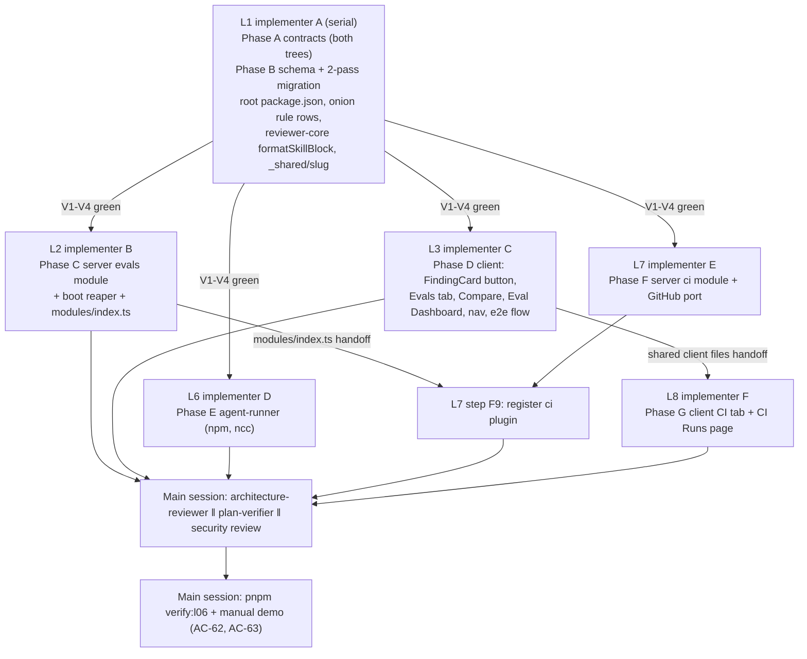
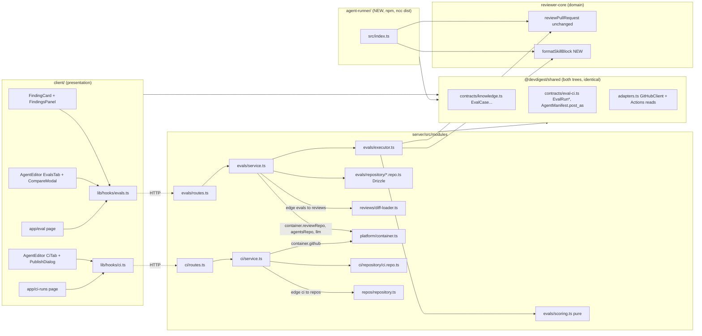
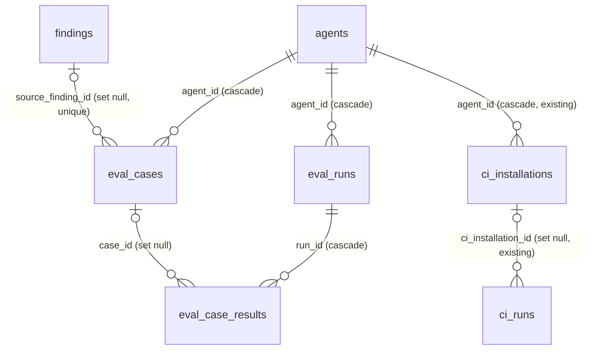

# Eval Pipeline for reviewer agents (+ Export agent to CI) — Implementation plan

> Spec: [`2026-10-29-eval-pipeline`](../specs/2026-10-29-eval-pipeline.md) (`Status: approved`, rev 5) — read 2026-10-29.
> Research: [`eval-pipeline.research.md`](../research/eval-pipeline.research.md) R1–R5 (trusted, not re-traced).
> Status: **approved** (rev 1, 2026-10-29). Execution mode: **multi**.
> Scope: `server/`, `client/`, `reviewer-core/`, NEW `agent-runner/`, `e2e/` (one flow), NEW root `package.json`, `.claude/skills/onion-architecture/` (rule rows only).
> ACs are owned by the spec; this plan only maps them. The owner reviews this file and gives an explicit go before any implementer runs.

---

## 0. Diagrams

### 0.1 Execution flow (lanes, in order)

### 0.2 Structure (onion rings, new files and edges)

### 0.3 Data model after migration

---

## 1. Requirements (verified)

Steps are in §9; checks (V-ids) are in §11. Bundled ACs (AC-16b, AC-33a, AC-45a, AC-56b, AC-61a) have **two checks each**, marked (i)/(ii).

| R | Requirement, restated | Spec id | Covered by steps | Verified by |
|---|---|---|---|---|
| R1 | Accepted finding → case `must_find` with the finding's file/lines in the producing agent's set | AC-1 | A2, B3, C3, C5, C6 | V10 |
| R2 | Dismissed finding → case `must_not_flag` | AC-2 | C5, C6 | V10 |
| R3 | Case stores the whole-file unified diff at click time | AC-3a, EC-5 | C2 (`sliceFileDiff`), C5 | V8, V10 |
| R4 | Case diff/expectation immutable after PR update, decision flip, run/finding deletion; `source.finding_id` → null on finding deletion | AC-3b, EC-3, EC-4 | B3 (FK set null), C5 | V10 |
| R5 | Name slug `a-z0-9-`, ≤60 chars | AC-4a, EC-25 | A9, C2 | V8 |
| R6 | Name clash → `-2`, `-3` … | AC-4b | C2, C3 (unique index), C5 | V8, V10 |
| R7 | Title/severity/category copied for display only | AC-5 | B3, C5 | V10 |
| R8 | Create = 0 LLM calls | AC-6a | C5 | V10 |
| R9 | Create/delete leave agent `version` unchanged | AC-6b | C5 | V10 |
| R10 | Same finding again → 200 `created:false`, unchanged | AC-7a, EC-2 | B3 (unique), C5, C6 | V10 |
| R11 | Client shows "Already an eval case" + link | AC-7b | D9 | V20 |
| R12 | No diff → 422 `diff_unavailable` naming the file; nothing created | AC-8a, EC-6 | C5 | V10 |
| R13 | Client shows the diff-unavailable message | AC-8b | D9 | V20 |
| R14 | Review without agent → 422 `finding_without_agent` | AC-9, EC-8 | C5 | V10 |
| R15 | Missing / foreign finding → 404 `finding_not_found` | AC-10, EC-24 | C5, C6 | V10 |
| R16 | Button disabled + hint while undecided | AC-11a, EC-1 | D9 | V20 |
| R17 | Button disabled while pending | AC-11b | D9 | V20 |
| R18 | Confirmation names the kind + links to the Evals tab | AC-12 | D9 | V20 |
| R19 | Button after Accept/Dismiss in the action row | AC-13a | D9 | V20 |
| R20 | Button hidden for agent-less reviews | AC-13b, EC-8 | D9 | V20 |
| R21 | Evals tab after Context at `?tab=evals` | AC-14a | D3 | V21 |
| R22 | Zero cases → `eval.json:66` empty text | AC-14b | D6 | V21 |
| R23 | <8 cases → count + "8+ cases recommended…" | AC-15 | D6 | V21 |
| R24 | Case rows: name, kind, `file:start[-end]`, `SEVERITY · category`, last result + summary | AC-16a | C3, C5, D6 | V11, V21 |
| R25 | Long name: (i) truncated to one line; (ii) full name on hover and to screen readers | AC-16b | D6 | V21 (i), V21 (ii) |
| R26 | "<passed> / <scored> passing" next to the heading | AC-17 | D6 | V21 |
| R27 | Delete after confirm removes the case | AC-18a | C3, C5, C6, D6 | V11, V21 |
| R28 | Past results keep the run-time case name | AC-18b, EC-19 | B3 (`case_name`, FK set null), C4 | V11 |
| R29 | Delete during a run → run finishes its captured set | AC-19 | C4, C5 | V11 |
| R30 | Skeletons while loading | AC-20 | D5, D6, D7 | V21 |
| R31 | Load error → text + Retry | AC-21 | D5, D6, D7 | V21 |
| R32 | "Run all evals" calls POST | AC-22a | D1, D4 | V22 |
| R33 | 202 `running` ≤1 s p95, before any LLM call completes | AC-22b, NFR-1 | C5 | V12 |
| R34 | Button shows the case count | AC-23 | D4 | V22 |
| R35 | Engine fed only stored diff, prompt, model, strategy, enabled skills in link order | AC-24 | C4, C5, A8 | V12 |
| R36 | No clone, no GitHub call during a run | AC-25, NG10 | C4 | V12 |
| R37 | Snapshot captured exactly once | AC-26a | C5 | V12 |
| R38 | Edits during a run don't change its inputs | AC-26b, EC-10 | C4, C5 | V12 |
| R39 | ≤1 engine review per case | AC-27a | C4 | V12 |
| R40 | Engine prompt assembly + grounding unchanged | AC-27b, NG9 | C4 (calls `reviewPullRequest` as is) | V12, V30 |
| R41 | No LLM calls beyond case reviews | AC-28, NFR-2 | C4 | V12 |
| R42 | Poll every 4 s, "Running… k / N cases" | AC-29a | D1, D4 | V22 |
| R43 | Run button disabled while running | AC-29b | D4 | V22 |
| R44 | Poll error → "Reconnecting…", retry next tick | AC-29c | D1, D4 | V22 |
| R45 | Second run → 409 `eval_run_in_progress`, `details.run_id` | AC-30a, EC-9 | B3 (partial unique), C5 | V13 |
| R46 | Client attaches to the returned run | AC-30b | D4 | V22 |
| R47 | Zero cases → 422 `no_eval_cases` | AC-31a | C5 | V13 |
| R48 | Zero cases → button disabled | AC-31b | D4 | V22 |
| R49 | Missing key → 422 `provider_not_configured`, no run row | AC-32a, EC-15 | C5 | V13 |
| R50 | Client shows message + link to `/settings/api-keys` | AC-32b | D4 | V22 |
| R51 | Failing case: (i) marked `error` with message, run continues; (ii) excluded from every metric/count except `cases_error` | AC-33a, EC-12 | C1, C4 | V9 (ii), V14 (i) |
| R52 | ≥1 error + ≥1 scored → `partial` | AC-33b | C1, C4 | V14 |
| R53 | All error → `failed`, `metrics:null`, first case's message | AC-34, EC-13 | C1, C4 | V14 |
| R54 | Boot: `running` → `failed` "server restarted during run" | AC-35, EC-14 | C3, C5, C8 | V15 |
| R55 | Eval runs absent from PR timeline, active runs, PR list score/cost, skills stats | AC-36a | B3 (own tables), C4 | V16 |
| R56 | No PR review, no finding created | AC-36b | C4 | V16 |
| R57 | Disabled agent runnable | AC-37, EC-21 | C5 | V13 |
| R58 | Match = same file + intersecting ranges; severity/category/title ignored | AC-38, EC-7 | C1 | V9 |
| R59 | Greedy labels in engine order: `tp` / `forbidden` / `unlabelled` | AC-39, EC-16 | C1 | V9 |
| R60 | Case pass/fail rule; unlabelled never affects status | AC-40, EC-17 | C1 | V9 |
| R61 | Pooled recall/precision/strict/citation | AC-41a | C1 | V9 |
| R62 | Null when denominator 0 | AC-41b | C1 | V9 |
| R63 | Client shows null as "—" | AC-41c | D2 (`formatPct`), D5 | V21 |
| R64 | Macro recall/precision over defined cases | AC-42a | C1 | V9 |
| R65 | Macro shown as secondary text | AC-42b | D5 | V21 |
| R66 | Scoring makes 0 LLM/embedding/network calls | AC-43a | C1 (pure file, no container) | V9 |
| R67 | Scoring twice → identical output | AC-43b | C1 | V9 |
| R68 | Four metric cards, whole-number percentages | AC-44a | D5 | V21 |
| R69 | No finished run → "—" + "No runs yet" | AC-44b | D5 | V21 |
| R70 | Delta vs previous finished run: (i) whole points; (ii) sign written as "▲/▼/±" text, not colour alone | AC-45a | D2 (`formatDelta`), D5 | V23 (i), V23 (ii) |
| R71 | One finished run → no delta | AC-45b | D5 | V23 |
| R72 | History: newest 50, columns, cost "—" when unknown, status | AC-46a, EC-23 | C3, C5, D7 | V11, V23 |
| R73 | No runs → `eval.json:11` text | AC-46b | D7 | V23 |
| R74 | "config changed" when same version, different `config_id` | AC-47, EC-11 | C2 (`configId`), D7 | V8, V23 |
| R75 | Row checkbox named "Select run <ran at>" | AC-48a | D7 | V23 |
| R76 | Compare enabled only with exactly 2 finished runs selected | AC-48b | D7 | V23 |
| R77 | Compare title "Compare runs · v<A> → v<B>", A older | AC-49a | D8 | V24 |
| R78 | Spinner while loading | AC-49b | D8 | V24 |
| R79 | Load error → error + Close | AC-49c | D8 | V24 |
| R80 | RECALL/PRECISION/CITATION/COST cards "A → B" + signed delta | AC-50 | D8 | V24 |
| R81 | Prompt line diff with +/− (scrolls when long) | AC-51a, EC-22 | D2 (`lineDiff`), D8 | V24 |
| R82 | Identical prompts → "No system prompt change" | AC-51b | D8 | V24 |
| R83 | Model/strategy/skill differences listed | AC-52a, EC-11 | D2 (`configDiff`), D8 | V24 |
| R84 | Same → "Same model and skills" | AC-52b | D8 | V24 |
| R85 | Different case sets → dataset warning | AC-53, EC-18 | D2, D8 | V24 |
| R86 | Close/Escape closes, selection kept | AC-54, NFR-4 | D8 | V24 |
| R87 | Sidebar "Eval Dashboard" in SKILLS LAB after Conventions | AC-55a | D10 | V25 |
| R88 | Highlighted on the page | AC-55b | D10 (mapping exists, `client/src/components/app-shell/helpers.ts:38`) | V25 |
| R89 | Card per agent: name, model, last run version/date/pass, recall/precision/citation | AC-56a | C3, C5, D11 | V17, V25 |
| R90 | (i) Agent without finished run → "No runs yet"; (ii) no agents → "No agents yet" | AC-56b | D11 | V25 (i), V25 (ii) |
| R91 | "Recent eval runs · all agents": 20 newest, columns | AC-57 | C3, D11 | V17, V25 |
| R92 | Skeleton while loading | AC-58a | D11 | V25 |
| R93 | Error + Retry | AC-58b | D11 | V25 |
| R94 | Click card/row → agent's Evals tab | AC-59 | D11 | V25 |
| R95 | Dashboard makes 0 LLM calls | AC-60 | C5 | V17 |
| R96 | Plain-text rendering of titles, names, summaries, prompts, diffs | AC-64, EC-25 | D5–D9, D11 | V26 |
| R97 | `pnpm verify:l06`: (i) runs verify.sh for server+client+reviewer-core, exits 0 when all pass; (ii) exits non-zero when any fails | AC-61a | B7 | V40 (i), V41 (ii) |
| R98 | Root manifest: no workspace, no dependencies | AC-61b | B7 | V42 |
| R99 | Demo set ≥8 cases of both kinds, created via the button | AC-62 | H3 (manual) | V43 |
| R100 | Prompt change → compare shows new version, prompt diff, non-zero recall/precision delta (hermetic stub + live) | AC-63 | C4, C9 | V18, V43 |
| R101 | (B) CI tab after Evals, heading "Continuous Integration" | AC-B1 | G3, G4 | V60 |
| R102 | (B) Installations list or empty text | AC-B2a | F7, F8, G4 | V50, V60 |
| R103 | (B) Spinner while loading | AC-B2b | G4 | V60 |
| R104 | (B) No connected repo → Publish disabled + hint | AC-B3 | G4 | V60 |
| R105 | (B) Opening Publish requests `action: files` preview | AC-B4a | G1, G4 | V61 |
| R106 | (B) Dialog lists every file path + contents before writing | AC-B4b | G4 | V61 |
| R107 | (B) Workflow + manifest (with `post_as`) + one skill file per enabled skill; runner ref from `DEVDIGEST_RUNNER_REF` | AC-B5 | F1, F5, F7 | V50 |
| R108 | (B) No key/token values in generated files | AC-B6a, NFR-6 | F5 | V50 |
| R109 | (B) "Add <KEY> to the repo's Actions secrets…" | AC-B6b | G4 | V61 |
| R110 | (B) Readability notice naming the repo before Publish | AC-B6c, EC-31 | G4 | V61 |
| R111 | (B) One commit on `devdigest/ci`, branch from `base` if missing | AC-B7a | F7 | V51 |
| R112 | (B) Open PR "Add DevDigest CI review" or reuse; return URL | AC-B7b, EC-27 | F7 | V51 |
| R113 | (B) Success records one installation | AC-B8a | F6, F7 | V51 |
| R114 | (B) Dialog shows "Published" + "View pull request" | AC-B8b | G4 | V61 |
| R115 | (B) GitHub error → 502 `github_write_failed`, no installation | AC-B9a, EC-26 | F7 | V51 |
| R116 | (B) Dialog shows the message | AC-B9b | G4 | V61 |
| R117 | (B) Runner reviews the PR diff with manifest config via the same engine + grounding | AC-B10 | E2–E6 | V55, V56 |
| R118 | (B) Runner posts per manifest `post_as`, `github_review` when absent | AC-B11a | E4 | V55 |
| R119 | (B) Runner exits non-zero at `ci_fail_on`; `never` never fails | AC-B11b | E5 | V55 |
| R120 | (B) `devdigest-result.json` uploaded on every run | AC-B12 | E6, F5 (workflow `if: always()` upload step) | V50, V55 |
| R121 | (B) Sidebar "CI Runs" | AC-B13a | G5 | V62 |
| R122 | (B) CI Runs page: newest 100 rows with `ci.json:16-23` columns, or empty state | AC-B13b | F6, F8, G6 | V52, V62 |
| R123 | (B) Refresh reads artifacts, adds each run exactly once | AC-B14a, EC-29 | B3 (`github_run_id` unique), F2–F4, F7 | V52 |
| R124 | (B) "Refreshing…" while in progress | AC-B14b | G6 | V62 |
| R125 | (B) GitHub read error → 502 `github_read_failed`, rows kept | AC-B15a | F7 | V52 |
| R126 | (B) Page shows the error | AC-B15b | G6 | V62 |
| R127 | (B) Invalid artifact skipped + counted | AC-B16a, EC-28 | F7 | V52 |
| R128 | (B) "<n> artifacts skipped (invalid format)" | AC-B16b | G6 | V62 |
| R129 | (B) Unconnected repo → 422 `repo_not_connected` | AC-B17, EC-30 | F7 | V51 |
| R130 | Latency: POST eval-runs ≤1 s; dashboard/history ≤500 ms at 20×200; 200-case tab responsive | NFR-1 | B3 (indexes), C3, C5, D6 | V12, V44 |
| R131 | LLM cost budget (0 for create/score/dashboard/compare/CI preview/refresh) | NFR-2 | C1, C4, C5, F7 | V10, V12, V17, V50, V52 |
| R132 | Per-case isolation, one running run per agent, reaper, ≤4 in flight | NFR-3 | B3, C4, C5, C8 | V12, V13, V14, V15 |
| R133 | Keyboard/a11y: accessible names, text deltas, focus trap + Escape | NFR-4 | D6–D8 | V21, V23, V24 |
| R134 | i18n: English catalogues, ICU plurals; no `uk` | NFR-5 | D2b, G2 | V21, V60 |
| R135 | No keys in results/logs/files; workspace scoping; no diff/prompt text in eval logs | NFR-6 | C4, C5, C6, F5 | V10, V14, V50 |
| R136 | Start/finish/per-error log lines | NFR-7 | C4 | V14 |
| R137 | Retention until agent deleted (cascade) | NFR-8, EC-20 | B3 | V19 |

### Owner answers
- Q1 → **a**: Parts A and B together; Part B lanes start after the Part A contracts.
- Q2 → **b**: `DEVDIGEST_RUNNER_REF` setting, default `OlegDEma/dev-digest/agent-runner@<tag>` (spec Q-16, rev 5).
- Q3 → **a**: fire-and-forget eval executor with the full trio (durable row first, failure recorded on the row, boot reaper). The eval executor is added to onion rule 8's sanctioned list in the same change.
- Q4 → **a**: `eval_runs` becomes the run-level table, NEW `eval_case_results`, new `eval_cases` columns, two-pass generation, 409 carries `details.run_id`, partial unique index "one running row per agent". Part B: `ci_runs.github_run_id` unique.
- C2, C3, C4, C5, C6, C7, C8, C9, C10 accepted as proposed (see §2, §10).

### Recommendations
| # | Recommendation | Owner | Reflected in |
|---|---|---|---|
| R1 | Pure `formatSkillBlock` in reviewer-core; `run-executor.ts` untouched | accepted | A8, C4, E3 |
| R2 | Pure `evals/scoring.ts` with table-driven unit tests | accepted | C1, V9 |
| R3 | Sync the drifting client vendor files before any contract edit | accepted | A1 |
| R4 | Defer Part B to its own plan | rejected | Part B is Phases E–G here |

## 2. Implementation decisions

| # | Decision (how, not what) | Consequence |
|---|---|---|
| D1 | New Part A contracts: C1/C2/C4 + replaced C3 `EvalCase` in `contracts/knowledge.ts` (C3 needs C2, and `eval-ci.ts` already imports from `knowledge.ts`); C5 response, C7–C14 in `contracts/eval-ci.ts` "Eval" section. The pre-staged `EvalRun`, `EvalCaseInput`, `EvalRunRecord`, `EvalDashboard` stay untouched (unused; NG5). | No import cycle. A grep finds no consumer of the replaced `EvalCase` (T6 has no literal sites). |
| D2 | `post_as` becomes a shared enum `CiPostAs` in `eval-ci.ts`, used by both `CiExportInput.post_as` and the new optional `AgentManifest.post_as` (default `github_review`). | One enum, no drift between export input and manifest. |
| D3 | 409 `eval_run_in_progress` → `AppError('eval_run_in_progress', msg, 409, { run_id })`, i.e. the body is `{ error: { code, message, details: { run_id } } }` (`server/src/platform/errors.ts:7-15`). The race is closed by a partial unique index `eval_runs(agent_id) WHERE status = 'running'`: a unique-violation on insert is mapped to the same 409. | Double-click safe without a lock. |
| D4 | `config_id` = sha256 hex of canonical JSON of `{agent_version, provider, model, system_prompt, strategy, skills}` (keys in fixed order), computed in `evals/helpers.ts` with `node:crypto`. | Equal iff every snapshot field is equal (C8). |
| D5 | Skill bodies for a run are resolved once at start (`container.agentsRepo.enabledSkillsForPrompt`, `server/src/modules/agents/repository.ts:225`), formatted with `formatSkillBlock`, and held **in executor memory** only; only `{skill_id, name, version}` is persisted in the snapshot. The case rows are also loaded once at start and passed to the executor. | AC-19/AC-26b hold. A restart loses the bodies, but the reaper fails the run anyway (AC-35). |
| D6 | Provider check = `await container.llm(snapshot.provider)` before inserting the run; a `ConfigError` maps to `422 provider_not_configured` naming the provider. | Works with test overrides (`container.ts:196-200`: an injected LLM wins), and no run row exists on failure. |
| D7 | Concurrency ≤4 = four async workers pulling from a shared index over the in-memory case array (`Promise.all`), no timers, no new dependency. | Rule 8 compliant ("no timers"). |
| D8 | Case diff = git diff first, else `pr_files` patch, via `loadDiff` (`server/src/modules/reviews/diff-loader.ts:12-30`); the file's section is cut from `UnifiedDiff.raw` (`server/src/vendor/shared/adapters.ts:249-252`) by `sliceFileDiff(raw, file)` at the `diff --git a/… b/<file>` header. If the slice is empty → `diff_unavailable`. At run time the stored text is re-parsed with `parseUnifiedDiff` (`server/src/adapters/git/diff-parser.ts:14`). | One file, all hunks (AC-3a). The run needs no git/GitHub (AC-25). |
| D9 | Finding/review/PR reads go through the composition-root `container.reviewRepo` (`getFinding`, `getReview`, `getPull`, `getRepo`; `server/src/modules/reviews/repository.ts:30-38,83,125`) and agent reads through `container.agentsRepo`. The only new import edge is `evals → reviews` (for `loadDiff` + `PullRow` type). | Rule 9/10 respected. The edge is added to the allow-list (B8). |
| D10 | Eval storage columns: expectation, display and source stored as **plain columns** on `eval_cases` (`expectation_kind`, `expectation_file`, `expectation_start_line`, `expectation_end_line`, `display_title`, `display_severity`, `display_category`, `source_pr_number`, `source_repo`). The pre-staged `input_files`, `input_meta`, `expected_output`, `notes` columns are **kept unused** (no drop on `eval_cases`, so that table needs one pass). | Fewer drops, simpler migration; NG6 keeps those columns for skill-owned cases later. |
| D11 | Run metrics stored as columns (`recall`, `precision`, `strict_precision`, `citation_accuracy`, `macro_recall`, `macro_precision`); `counts`, `config`, `case_ids` as `jsonb`; per-case findings as `jsonb` on `eval_case_results`. | Dashboard can sort and select without jsonb parsing; the rest stays simple. |
| D12 | Run `cost_usd` follows C11 literally: sum of case costs, `null` when any case cost is unknown (including errored cases that have no cost). | A `partial` run with an errored case shows cost "—". See §12. |
| D13 | Shared slug helper `server/src/modules/_shared/slug.ts` (`slugify(text, max = 60)`) implements AC-4a; `ci` reuses it for agent and skill file slugs (skills have no slug column, `server/src/db/schema/skills.ts:10-18`). | One rule, one test. `_shared/` is importable by any module. |
| D14 | Manifest file `.devdigest/agents/<slug>.yaml` is written as **JSON text** (JSON is valid YAML 1.2), so the server needs no YAML dependency; the runner parses it with `yaml` (R5). Workflow YAML is a fixed template string with JSON-quoted interpolations. | No new server dependency. The server test round-trips with `JSON.parse` + `AgentManifest.parse`. |
| D15 | Generated workflow `.github/workflows/devdigest-review.yml`: `on: pull_request: types: <triggers>`; `permissions: contents: read, pull-requests: write`; skip forks (`github.event.pull_request.head.repo.fork == false`, R5); step 1 `uses: <DEVDIGEST_RUNNER_REF>` with `env: <KEY>: ${{ secrets.<KEY> }}` and `GITHUB_TOKEN`; step 2 `actions/upload-artifact@v4` named `devdigest-result` with `if: always()`. | The artifact uploads on every run (AC-B12) without `@actions/artifact` in the runner. Only secret **references**, never values (AC-B6a). |
| D16 | CI ingest: per installation, list workflow runs of `devdigest-review.yml` from the last 30 days (Q-17); skip runs whose id already exists (`ci_runs.github_run_id` unique, `onConflictDoNothing`); for each new run, find the artifact `devdigest-result`, download the zip, `unzipSync` (`fflate`, already a server dep, R5), `JSON.parse`, `CiResultArtifact.safeParse`. Invalid → `skipped++`. Status: run conclusion `failure` → `failed`; `findings_count == 0` → `no_findings`; else `succeeded`. | Exactly-once (EC-29). No new server dependency. |
| D17 | Runner LLM providers: `openrouter` via reviewer-core `OpenRouterProvider` (`reviewer-core/src/index.ts:95`). Other providers → see §12 (open question; assumed default: the runner exits 1 with "provider 
 not supported in CI", **assumed default — confirm**). | Part B is shippable with OpenRouter agents. |
| D18 | Client polling: TanStack Query `refetchInterval: 4000` while `status === 'running'`, mirroring `client/src/lib/hooks/reviews.ts:33,45-46`. "Reconnecting…" = `query.isError && query.data` present. | No client timers. AC-29c is satisfied by the next interval tick. |

## 3. What already exists — do not rebuild

| Layer | Already there | File |
|---|---|---|
| DB | `eval_cases` (workspace FK, owner_kind/owner_id, name, input_diff, …) | `server/src/db/schema/eval.ts:7-20` |
| DB | `eval_runs` (per-case today; reshaped in B1/B3) | `server/src/db/schema/eval.ts:22-35` |
| DB | `ci_installations`, `ci_runs` | `server/src/db/schema/ci.ts:4-26` |
| DB | Exports in the schema barrel | `server/src/db/schema.ts:37-38,75-80` |
| Contracts | `EvalCase`, `EvalOwnerKind`, `EvalRun` | `server/src/vendor/shared/contracts/knowledge.ts:37-63` |
| Contracts | `EvalCaseInput`, `EvalRunRecord`, `EvalDashboard` (left unused) | `server/src/vendor/shared/contracts/eval-ci.ts:19-89` |
| Contracts | `CiTarget`, `CiFile`, `AgentManifest`, `CiExportInput`, `CiInstallation`, `CiExport`, `CiRun`, `CiResultArtifact` | `server/src/vendor/shared/contracts/eval-ci.ts:133-238` (file lines 125-240) |
| Contracts | Barrel exports both files | `server/src/vendor/shared/index.ts:23,27` |
| Port | `commitFiles`, `findOpenPr`, `openPullRequest` | `server/src/vendor/shared/adapters.ts:208-216` |
| Engine | `reviewPullRequest` (pure; optional intent/task/sessionId) | `reviewer-core/src/review/run.ts:148` |
| Engine | `OpenRouterProvider` export | `reviewer-core/src/index.ts:95` |
| Server | Shared repos on the container: `agentsRepo`, `reviewRepo` | `server/src/platform/container.ts:108-114` |
| Server | `enabledSkillsForPrompt` (bound + enabled, link order) | `server/src/modules/agents/repository.ts:225-233` |
| Server | `loadDiff` (git first, `pr_files` fallback) | `server/src/modules/reviews/diff-loader.ts:12-44` |
| Server | `RepoRepository.findByFullName` (connected-repo check) | `server/src/modules/repos/repository.ts:24` |
| Server | Error envelope `AppError(code, message, status, details)` | `server/src/platform/errors.ts:7-15` |
| Server | `IdParams`, `getContext` | `server/src/modules/_shared/schemas.ts:11`, `server/src/modules/_shared/context.ts:14` |
| Server | `MockLLMProvider` (records calls) | `server/src/adapters/mocks.ts:59-91` |
| Server | `fflate` dependency (`unzipSync`) | `server/package.json:30`, `server/src/modules/skills/helpers.ts:1` |
| Server | Boot reaper slot (agent_runs) | `server/src/app.ts:86-91` |
| Client | i18n `eval.json` (dashboard, evalsTab, page keys) | `client/messages/en/eval.json:1-84` |
| Client | i18n `ci.json` (CI tab, publish dialog, CI runs page) | `client/messages/en/ci.json:1-106` |
| Client | Agent tab labels `evals`, `ci` | `client/messages/en/agents.json:53,55` |
| Client | Nav labels "Eval Dashboard", "CI Runs" | `client/messages/en/shell.json:24,28` |
| Client | Active-key mapping `/eval` → `eval`, `/ci-runs` → `ci-runs` | `client/src/components/app-shell/helpers.ts:38,41` |
| Client | `?tab=` handling (accepts any key in `TAB_KEYS`) | `client/src/app/agents/[id]/page.tsx:27` |
| Client | `ReviewRecord.agent_id` (for hiding the button) | `server/src/vendor/shared/contracts/review-api.ts:27` |
| Repo | `.gitignore` un-ignores `agent-runner/dist/` | `.gitignore:3-6` |
| Repo | Generic verify script | `scripts/verify.sh:1-60` |

### Code map — files this change touches
| File | Why it changes | Anchor |
|---|---|---|
| `client/src/vendor/shared/contracts/knowledge.ts` | sync to server copy (A1), then D1 edits | `server/src/vendor/shared/contracts/knowledge.ts:37-63` |
| `client/src/vendor/shared/contracts/eval-ci.ts` | sync (A1), then D1/D2 edits | `server/src/vendor/shared/contracts/eval-ci.ts:1-240` |
| `client/src/vendor/shared/adapters.ts` | sync (A1); Part B port methods (F2) | `server/src/vendor/shared/adapters.ts:196-229` |
| `server/src/vendor/shared/contracts/knowledge.ts` | C1, C2, C4, C3 | `:52-63` |
| `server/src/vendor/shared/contracts/eval-ci.ts` | C5, C7–C14, `CiPostAs`, `AgentManifest.post_as`, `CiRefreshResult` | `:19-89`, `:152-183` |
| `server/src/vendor/shared/adapters.ts` | GitHub Actions read methods (F2) | `:196-229` |
| `server/test/contracts.test.ts` | parse tests for new schemas | exists (`server/test/contracts.test.ts`) |
| `reviewer-core/src/review/skills.ts` | NEW `formatSkillBlock` | format source `server/src/modules/reviews/run-executor.ts:440` |
| `reviewer-core/src/index.ts` | export `formatSkillBlock` | `reviewer-core/src/index.ts:95` |
| `reviewer-core/test/skills.test.ts` | NEW | `reviewer-core/test/` |
| `server/src/db/schema/eval.ts` | two-pass reshape + `evalCaseResults` | `:7-35` |
| `server/src/db/schema/ci.ts` | `github_run_id`, `agent`, `duration_ms` on `ci_runs` | `:14-26` |
| `server/src/db/schema.ts` | export `evalCaseResults` | `:37,75-76` |
| `server/src/db/migrations/**` | **generated only** (two passes) | `server/src/db/migrations/0017_ambiguous_slyde.sql` is the latest |
| `server/src/modules/_shared/slug.ts` | NEW `slugify` | — |
| `server/test/slug.test.ts` | NEW | — |
| `package.json` (repo root) | NEW, `verify:l06` only | — |
| `.claude/skills/onion-architecture/SKILL.md` | rule 8 sanctioned eval executor; rule 10 rows `evals → reviews`, `ci → repos` | rule 8, rule 10 table |
| `.claude/skills/onion-architecture/references/layermap.md` | same rows | `:119-133` |
| `server/src/modules/evals/**` | NEW module (routes, service, executor, scoring, helpers, repository/*) | pattern `server/src/modules/history/` |
| `server/src/modules/index.ts` | register `evals` (L2), then `ci` (L7) | `:2-17,32-49` |
| `server/src/app.ts` | eval-run reaper on boot | `:86-91` |
| `server/test/evals-scoring.test.ts`, `server/test/evals-helpers.test.ts`, `server/test/evals.it.test.ts` | NEW | pattern `server/test/agents-versions.it.test.ts` |
| `server/src/platform/config.ts` | `DEVDIGEST_RUNNER_REF` | `:15-48` |
| `server/src/adapters/github/octokit.ts` | Actions read methods | `:247-266` |
| `server/src/adapters/mocks.ts` | mock GitHub Actions methods | `server/src/adapters/mocks.ts` |
| `server/src/modules/ci/**` | NEW module | — |
| `server/test/ci-helpers.test.ts`, `server/test/ci.it.test.ts` | NEW | — |
| `agent-runner/**` | NEW package (npm) | `.gitignore:3-6` |
| `client/src/lib/hooks/evals.ts`, `client/src/lib/hooks/ci.ts` | NEW hooks | pattern `client/src/lib/hooks/reviews.ts:28-50` |
| `client/src/lib/hooks/index.ts` | export new hooks | exists |
| `client/messages/en/eval.json`, `client/messages/en/ci.json` | new keys | `eval.json:1-84`, `ci.json:1-106` |
| `client/src/app/agents/[id]/_components/AgentEditor/constants.ts` | Evals tab (L3), CI tab (L8) | `:11-15` |
| `client/src/app/agents/[id]/_components/AgentEditor/AgentEditor.tsx` | render the tabs | `:27-29` |
| `client/src/app/agents/[id]/_components/AgentEditor/_components/EvalsTab/**` | NEW | pattern `…/_components/SkillsTab/` |
| `client/src/app/agents/[id]/_components/AgentEditor/_components/CiTab/**` | NEW | same |
| `client/src/app/repos/[repoId]/pulls/[number]/_components/FindingCard/FindingCard.tsx` | button in the action row | `:101-122` |
| `client/src/app/repos/[repoId]/pulls/[number]/_components/FindingsPanel/FindingsPanel.tsx` | pass `agentId` | renders `<FindingCard` |
| `client/src/vendor/ui/nav.ts` | Eval Dashboard + CI Runs items | `:30-38` |
| `client/src/app/eval/**`, `client/src/app/ci-runs/**` | NEW pages | `client/src/app/skills/page.tsx` pattern |
| `e2e/specs/10-eval-dashboard.flow.json` | NEW flow (CI-only) | pattern `e2e/specs/03-agents.flow.json` |

## 4. Data model

All edits are in `server/src/db/schema/eval.ts` and `server/src/db/schema/ci.ts`. **No hand-written migration.** `eval_runs` both drops and adds columns, so generation runs in **two passes** (T4, `server/INSIGHTS.md:65`).

**Pass 1 (drops only)** — `eval_runs`: remove `caseId` (`case_id`, and its FK), `ranAt` (`ran_at`), `actualOutput` (`actual_output`), `pass`. Keep `recall`, `precision`, `citationAccuracy`, `durationMs`, `costUsd` (same meaning at run level). Then `cd server && pnpm db:generate`.

**Pass 2 (adds only)**

`eval_runs` (run-level):
| property | column | type |
|---|---|---|
| workspaceId | `workspace_id` | uuid not null → `workspaces.id` cascade |
| agentId | `agent_id` | uuid not null → `agents.id` **cascade** (EC-20) |
| agentName | `agent_name` | text not null |
| status | `status` | text enum `running\|done\|partial\|failed` not null |
| startedAt | `started_at` | timestamptz not null default now |
| finishedAt | `finished_at` | timestamptz null |
| progressDone | `progress_done` | integer not null default 0 |
| progressTotal | `progress_total` | integer not null |
| config | `config` | jsonb not null (`EvalConfigSnapshot`) |
| caseIds | `case_ids` | jsonb not null (`string[]`) |
| counts | `counts` | jsonb null (`EvalCounts`) |
| strictPrecision | `strict_precision` | double null |
| macroRecall | `macro_recall` | double null |
| macroPrecision | `macro_precision` | double null |
| error | `error` | text null |

Indexes: `uniqueIndex('eval_runs_one_running_per_agent').on(agentId).where(sql\`status = 'running'\`)` (D3); `index('eval_runs_agent_started').on(agentId, startedAt)`; `index('eval_runs_ws_started').on(workspaceId, startedAt)` (NFR-1).

`eval_cases` (adds only):
| property | column | type |
|---|---|---|
| agentId | `agent_id` | uuid null → `agents.id` **cascade** |
| sourceFindingId | `source_finding_id` | uuid null → `findings.id` **set null** |
| sourcePrNumber | `source_pr_number` | integer null |
| sourceRepo | `source_repo` | text null |
| expectationKind | `expectation_kind` | text enum `must_find\|must_not_flag` null |
| expectationFile | `expectation_file` | text null |
| expectationStartLine / EndLine | `expectation_start_line` / `expectation_end_line` | integer null |
| displayTitle / Severity / Category | `display_title` / `display_severity` / `display_category` | text null |
| createdAt | `created_at` | timestamptz not null default now |

Indexes: `uniqueIndex('eval_cases_source_finding').on(sourceFindingId)` (AC-7a; NULLs are distinct); `uniqueIndex('eval_cases_owner_name').on(ownerKind, ownerId, name)` (AC-4b). The new columns are nullable because `owner_kind = 'skill'` rows (NG6) would not have them; the repo always writes them for agent cases.

`eval_case_results` (NEW table):
| property | column | type |
|---|---|---|
| id | `id` | uuid pk default random |
| runId | `run_id` | uuid not null → `eval_runs.id` cascade |
| caseId | `case_id` | uuid null → `eval_cases.id` **set null** (AC-18b) |
| position | `position` | integer not null (case order in the run) |
| caseName | `case_name` | text not null |
| expectation | `expectation` | jsonb not null |
| status | `status` | text enum `pass\|fail\|error` not null |
| findings | `findings` | jsonb not null default `[]` |
| grounded / dropped | `grounded` / `dropped` | integer not null default 0 |
| summary | `summary` | text not null |
| costUsd | `cost_usd` | double null |
| durationMs | `duration_ms` | integer null |
| error | `error` | text null |
| finishedAt | `finished_at` | timestamptz not null default now |

Index: `index('eval_case_results_run').on(runId)`, `index('eval_case_results_case').on(caseId, finishedAt)` (last_result lookup).

`ci_runs` (adds only, Part B): `githubRunId: text('github_run_id')` + `uniqueIndex('ci_runs_github_run_id').on(githubRunId)`; `agent: text('agent')`; `durationMs: integer('duration_ms')` (CiRun `agent`, `duration_s` derive from these).

Then `cd server && pnpm db:generate` (pass 2) and apply: `cd server && ./node_modules/.bin/tsx src/db/migrate.ts`. **Before applying**, check `select count(*) from eval_runs` is 0 on the dev DB (the new NOT NULL columns cannot be added to a table with rows; no code writes it today, `server/AGENTS.md` "An empty table is expected").

## 5. Contracts (`@devdigest/shared`)

Every edit lands **byte-identically** in `server/src/vendor/shared/…` (canonical) and `client/src/vendor/shared/…` (copy), in the same step (T1). A1 first makes the client copies of `knowledge.ts`, `eval-ci.ts`, `adapters.ts` identical to the server copies (C2).

| Spec contract | Zod schema | File (both trees) | Casing |
|---|---|---|---|
| C1 | `EvalExpectationKind = z.enum(['must_find','must_not_flag'])` | `contracts/knowledge.ts` | lowercase snake |
| C2 | `EvalExpectation = z.object({ kind, file: z.string().min(1), start_line: z.number().int().min(1), end_line: z.number().int().min(1) }).refine(end ≥ start)` | `contracts/knowledge.ts` | snake_case fields |
| C4 | `EvalCaseStatus = z.enum(['pass','fail','error'])` | `contracts/knowledge.ts` | lowercase |
| C3 | `EvalCase` **replaced**: `{ id, owner_kind: z.literal('agent'), owner_id, name, expectation: EvalExpectation, display: { title, severity: Severity, category: FindingCategory }, input_diff: z.string(), source: { finding_id: z.string().nullable(), pr_number: z.number().int(), repo: z.string() }, created_at: z.string(), last_result: z.object({ run_id, status: EvalCaseStatus, ran_at, summary }).nullable() }` | `contracts/knowledge.ts` (imports `Severity`, `FindingCategory` from `./findings.js`) | Severity **UPPERCASE**, FindingCategory **lowercase** (T3) |
| C5 | `CreateEvalCaseResponse = z.object({ case: EvalCase, created: z.boolean() })` | `contracts/eval-ci.ts` | — |
| C6 | `z.array(EvalCase)` inline in the route; delete → 204 | — | — |
| C7 | `EvalRunStatus = z.enum(['running','done','partial','failed'])` | `contracts/eval-ci.ts` | lowercase |
| C8 | `EvalConfigSnapshot = { agent_version: int, config_id, provider: Provider, model, system_prompt, strategy: ReviewStrategy, skills: z.array({ skill_id, name, version: int }) }` | `contracts/eval-ci.ts` (import `Provider`, `ReviewStrategy` from `./knowledge.js`) | — |
| C9 | `EvalMetrics = { recall, precision, strict_precision, citation_accuracy, macro_recall, macro_precision }`, each `z.number().min(0).max(1).nullable()` | `contracts/eval-ci.ts` | — |
| C10 | `EvalCounts` — 14 fields, each `z.number().int().min(0)` | `contracts/eval-ci.ts` | — |
| C11 | `EvalRunSummary` (all fields per spec, nullable ones `.nullable()`) | `contracts/eval-ci.ts` | — |
| C12 | `EvalFindingLabel = z.enum(['tp','forbidden','unlabelled'])`; `EvalCaseResult` per spec | `contracts/eval-ci.ts` | Severity UPPERCASE, category lowercase |
| C13 | `EvalRunDetail = EvalRunSummary.extend({ results: z.array(EvalCaseResult) })` | `contracts/eval-ci.ts` | — |
| C14 | `EvalDashboardOverview = { agents: z.array({ agent_id, name, model, enabled, cases_total, last_run: EvalRunSummary.nullable() }), recent_runs: z.array(EvalRunSummary) }` | `contracts/eval-ci.ts` | — |
| C15/C16 | `CiPostAs = z.enum(['github_review','pr_comment','none'])`; `CiExportInput.post_as: CiPostAs.default('github_review')`; `AgentManifest.post_as: CiPostAs.default('github_review')` | `contracts/eval-ci.ts` | lowercase |
| C17/C18 | unchanged (existing) | `contracts/eval-ci.ts` | — |
| C19 | `CiRefreshResult = z.object({ ingested: z.number().int().min(0), skipped: z.number().int().min(0) })` | `contracts/eval-ci.ts` | — |

T6: `EvalCase` has no literal sites outside the contract files (grep run in pass 1). `AgentManifest.post_as` is defaulted, so existing `AgentManifest` literals keep compiling. Fixture literals are only the new tests.

## 6. Server

### `evals` module (NEW, `server/src/modules/evals/`)
- **Presentation — `routes.ts`**: default-export a Fastify plugin. All routes call `getContext(req)` (`_shared/context.ts:14`) for the workspace (T5 auth = the app's local auth provider, the same as every route; authz = every query is filtered by `ctx.workspaceId`; validation = Zod schemas via `fastify-type-provider-zod`):
  | Route | params/body | response | notes |
  |---|---|---|---|
  | `POST /findings/:id/eval-case` | `IdParams`, no body | 201/200 `CreateEvalCaseResponse` | |
  | `GET /agents/:id/eval-cases` | `IdParams` | `z.array(EvalCase)` | |
  | `DELETE /eval-cases/:id` | `IdParams` | 204 | |
  | `POST /agents/:id/eval-runs` | `IdParams`, no body | 202 `EvalRunSummary` | `config: { rateLimit: { max: 10, timeWindow: '1 minute' } }` as `reviews/routes.ts:32` |
  | `GET /agents/:id/eval-runs` | `IdParams` | `z.array(EvalRunSummary)` | |
  | `GET /eval-runs/:id` | `IdParams` | `EvalRunDetail` | |
  | `GET /eval-dashboard` | — | `EvalDashboardOverview` | |
- **Application — `service.ts`** (`EvalService(container)`): create case (D8, D9), list/delete cases, start run (checks → snapshot → insert `running` row → `void executor.run(...).catch(err => repo.failRun(id, err.message))`), list/get runs, dashboard, `reapStaleRuns()`. No Drizzle, no Fastify.
- **Application — `executor.ts`** (`EvalRunExecutor`): runs cases with ≤4 workers (D7); per case: `reviewPullRequest({ systemPrompt, model, diff: parseUnifiedDiff(case.inputDiff), llm, strategy, skills })` only — no intent, memory, specs, callers, repoMap (AC-24, NG10); then `scoreCase`, persist the result row, bump `progress_done`; at the end `aggregate` → final status. Logs: start / per-error / finish lines with ids, counts, status, duration, cost only (NFR-6, NFR-7).
- **Domain-pure — `scoring.ts`**: `matches(finding, expectation)`, `labelFindings(findings, expectations)`, `caseStatus`, `aggregate(results)` → `{ metrics, counts }`, `caseSummary`. Imports only types from `@devdigest/shared`. No container.
- **Pure — `helpers.ts`**: `caseNameFor(title, taken)` (uses `_shared/slug.ts`), `sliceFileDiff(raw, file)`, `configId(snapshot)`, row → DTO mappers (`toEvalCaseDto`, `toEvalRunSummaryDto`, `toEvalCaseResultDto`) mapping camelCase → snake_case (T2).
- **Data access — `repository/eval-case.repo.ts`, `repository/eval-run.repo.ts`**: the only files that import `drizzle-orm` / `db/schema`.

### `ci` module (NEW, `server/src/modules/ci/`)
- **Presentation — `routes.ts`**: `POST /agents/:id/export-ci` (body `CiExportInput`, response `CiExport`), `GET /agents/:id/ci-installations` (`z.array(CiInstallation)`), `GET /ci-runs` (`z.array(CiRun)`), `POST /ci-runs/refresh` (`CiRefreshResult`, rate-limited 10/min). Same auth/authz/validation as above.
- **Application — `service.ts`**: export (`files` → generate only; `open_pr` → `container.github().commitFiles` → `findOpenPr` ?? `openPullRequest` → insert installation; any GitHub throw → `AppError('github_write_failed', msg, 502)`), list installations, list runs, refresh (D16; GitHub throw → `AppError('github_read_failed', msg, 502)`).
- **Pure — `helpers.ts`**: `buildWorkflowYaml`, `buildManifest` (→ `AgentManifest`), `buildManifestFile` (JSON text, D14), `skillFile`, `providerKeyVar(provider)`, `ciRunStatus`.
- **Data access — `repository/ci.repo.ts`**.
- **Infrastructure**: `adapters.ts` GitHub port gains `listWorkflowRuns(repo, workflowFile, sinceIso)`, `listRunArtifacts(repo, runId)`, `downloadArtifactZip(repo, artifactId): Promise<Uint8Array>`; implemented in `adapters/github/octokit.ts`, mocked in `adapters/mocks.ts`. `platform/config.ts` gains `DEVDIGEST_RUNNER_REF`.

## 7. Client

Feature-folder naming per `client/AGENTS.md`: `_components/<PascalName>/<PascalName>.tsx` + `<PascalName>.test.tsx` + `index.ts` (+ `styles.ts`, `helpers.ts`, `constants.ts` as needed).

- `client/src/lib/hooks/evals.ts` (NEW): `useAgentEvalCases`, `useDeleteEvalCase`, `useCreateEvalCase`, `useAgentEvalRuns`, `useEvalRun(id)` (4 s while running), `useStartEvalRun`, `useEvalDashboard`.
- `AgentEditor/_components/EvalsTab/` (NEW): `EvalsTab.tsx` composing `_components/MetricCards/`, `_components/CaseList/`, `_components/RunHistory/`, `_components/CompareModal/`, with `helpers.ts` (`formatPct`, `formatDelta`, `lineDiff`, `configDiff`, `caseSetDiff`, `configChanged`).
- `FindingCard.tsx`: new `agentId?: string | null` prop + "Turn into eval case" button after Dismiss; `FindingsPanel.tsx` passes the review's `agent_id`.
- `client/src/app/eval/page.tsx` (NEW) + `client/src/app/eval/_components/EvalDashboard/` (`AgentCards`, `RecentRuns`).
- Part B: `client/src/lib/hooks/ci.ts`, `AgentEditor/_components/CiTab/` (+ `_components/PublishDialog/`), `client/src/app/ci-runs/page.tsx` + `_components/CiRunsTable/`.
- Plain text everywhere (AC-64): render via `{text}` children, `<pre>` for diffs/prompts; never `Markdown` or `dangerouslySetInnerHTML`.

## 8. Execution mode & agent lanes

Multi-agent. **Only the main session launches agents.** Package managers (T9): `server/`, `client/` = pnpm (but use the direct binaries); `reviewer-core/`, `agent-runner/`, `e2e/` = npm.

| Lane | Agent | Phases | Files owned | Waits on | Checkpoint |
|---|---|---|---|---|---|
| L1 | implementer A | A, B | both `vendor/shared` trees (`knowledge.ts`, `eval-ci.ts`, `adapters.ts` — sync + Part A/B contract edits), `server/test/contracts.test.ts`, `reviewer-core/src/review/skills.ts`, `reviewer-core/src/index.ts`, `reviewer-core/test/skills.test.ts`, `server/src/db/schema/eval.ts`, `server/src/db/schema/ci.ts`, `server/src/db/schema.ts`, generated `server/src/db/migrations/**`, `server/src/modules/_shared/slug.ts`, `server/test/slug.test.ts`, root `package.json`, `.claude/skills/onion-architecture/SKILL.md`, `.claude/skills/onion-architecture/references/layermap.md` | — | V1, V2, V3, V4, V5 |
| L2 | implementer B | C | `server/src/modules/evals/**`, `server/src/app.ts`, `server/src/modules/index.ts` (**first**: adds `evals`), `server/test/evals-*.test.ts`, `server/test/evals.it.test.ts` | L1 | V1, V6, V8–V19 |
| L3 | implementer C | D | `client/src/lib/hooks/evals.ts`, `client/src/lib/hooks/index.ts` (**first**), `client/messages/en/eval.json`, `client/src/vendor/ui/nav.ts` (**first**), `client/src/app/agents/[id]/_components/AgentEditor/constants.ts` + `AgentEditor.tsx` + `AgentEditor.test.tsx` (**first**), `…/AgentEditor/_components/EvalsTab/**`, `…/FindingCard/**`, `…/FindingsPanel/FindingsPanel.tsx`, `client/src/app/eval/**`, `e2e/specs/10-eval-dashboard.flow.json` | L1 | V2, V7, V20–V26 |
| L6 | implementer D | E | `agent-runner/**` (incl. committed `agent-runner/dist/**`) | L1 | V55, V56, V57 |
| L7 | implementer E | F | `server/src/modules/ci/**`, `server/src/platform/config.ts`, `server/src/adapters/github/octokit.ts`, `server/src/adapters/mocks.ts`, `server/src/vendor/shared/adapters.ts` + `client/src/vendor/shared/adapters.ts` (port extension, F2), `server/test/ci-*.test.ts`, `server/test/ci.it.test.ts`; `server/src/modules/index.ts` **only in F9, after L2 reports V6** | L1 (F1–F8), L2 (F9) | V1, V2, V50–V52 |
| L8 | implementer F | G | `client/src/lib/hooks/ci.ts`, `client/messages/en/ci.json`, `…/AgentEditor/_components/CiTab/**`, `client/src/app/ci-runs/**`; and, **after L3 is done**, `client/src/lib/hooks/index.ts`, `client/src/vendor/ui/nav.ts`, `AgentEditor/constants.ts`, `AgentEditor.tsx`, `AgentEditor.test.tsx` | L1, L3 (shared files), L7 F2 (client `adapters.ts` is not used by the client UI; no wait needed) | V2, V7, V60–V62 |
| L9 | main session runs this: architecture-reviewer | — | §10-sensitive files: `server/src/modules/evals/**`, `server/src/modules/ci/**`, `server/src/app.ts`, `agent-runner/src/**` | L2, L6, L7, L8 | report |
| L10 | main session runs this: plan-verifier | — | whole diff vs §1 | L2, L3, L6, L7, L8 | report |
| L11 | main session runs this: security review | — | `ci/**` (GitHub writes, artifact parsing), `agent-runner/**`, AC-64 render sites | L6, L7, L8 | report |
| L12 | main session runs this: final verification + manual demo | H | — | L9–L11 clean | V40–V44 |

Parallel lanes after L1: **L2 ‖ L3 ‖ L6 ‖ L7(F1–F8)**. Serial handoffs: `server/src/modules/index.ts` L2 → L7 (F9); client shared files L3 → L8. Within each lane, the file sets above are disjoint from every lane running at the same time.

## 9. Implementation plan

### Phase A — Contracts + engine helper (L1) — ends at V1, V2, V3, V5

| # | Step | Files | Skill | AC |
|---|---|---|---|---|
| A1 | Make the client copies byte-identical to the server copies of `contracts/knowledge.ts`, `contracts/eval-ci.ts`, `adapters.ts` (client gains `AgentManifest`, `AgentVersionConfig`, `AgentVersion`, `'openrouter'`, `CommitFile*`). Run client `tsc`; fix any client fallout from `'openrouter'` in `Provider` **in client code**, not in the contract. | `client/src/vendor/shared/contracts/knowledge.ts`, `client/src/vendor/shared/contracts/eval-ci.ts`, `client/src/vendor/shared/adapters.ts` | `zod`, `typescript-expert` | (T1, prerequisite) |
| A2 | Add `EvalExpectationKind`, `EvalExpectation`, `EvalCaseStatus`; replace `EvalCase` with the C3 shape (§5). Both trees. | `server/src/vendor/shared/contracts/knowledge.ts`, `client/src/vendor/shared/contracts/knowledge.ts` | `zod` | AC-1, AC-2, AC-5, AC-16a |
| A3 | Add `CreateEvalCaseResponse`, `EvalRunStatus`, `EvalConfigSnapshot`, `EvalMetrics`, `EvalCounts`, `EvalRunSummary`, `EvalFindingLabel`, `EvalCaseResult`, `EvalRunDetail`, `EvalDashboardOverview` to the "Eval" section. Both trees. | `server/src/vendor/shared/contracts/eval-ci.ts`, `client/src/vendor/shared/contracts/eval-ci.ts` | `zod` | AC-7a, AC-26a, AC-41a/b, AC-46a, AC-57 |
| A4 | Add `CiPostAs`; use it in `CiExportInput.post_as`; add `post_as: CiPostAs.default('github_review')` to `AgentManifest`; add `CiRefreshResult`. Fix the stale comment naming `CiService.agentYaml` to name `ci/helpers.ts`. Both trees. | same two `eval-ci.ts` files | `zod` | AC-B5, AC-B11a, AC-B14a |
| A5 | Add parse tests: a valid `EvalCase` (Severity UPPERCASE, category lowercase); a lowercase severity is rejected; `EvalExpectation` with `end_line < start_line` is rejected; `AgentManifest` without `post_as` parses to `github_review`. | `server/test/contracts.test.ts` | `zod` | AC-5, AC-B11a |
| A6 | Check `diff -q` for the three synced files between the trees (V3). | — | — | (T1) |
| A7 | NEW `formatSkillBlock(name, body)` returning `` `### ${name}\n${body.trim()}` `` (exactly `server/src/modules/reviews/run-executor.ts:440`). **Do not edit `run-executor.ts`** (NG9). | `reviewer-core/src/review/skills.ts` (NEW) | `onion-architecture`, `typescript-expert` | AC-24, AC-27b |
| A8 | Export it from the engine barrel; NEW test asserting the format for a body with surrounding whitespace. | `reviewer-core/src/index.ts`, `reviewer-core/test/skills.test.ts` (NEW) | `typescript-expert` | AC-24 |
| A9 | NEW `slugify(text, max = 60)`: lowercase; every run of characters outside `a-z0-9` → one `-`; trim leading/trailing `-`; cut to `max` and re-trim `-`; empty → `'case'`. NEW unit test (symbols, emoji, ``, 80-char title). | `server/src/modules/_shared/slug.ts` (NEW), `server/test/slug.test.ts` (NEW) | `typescript-expert` | AC-4a |

### Phase B — Schema, migrations, repo-level files (L1) — ends at V1, V4

| # | Step | Files | Skill | AC |
|---|---|---|---|---|
| B1 | **Pass 1**: remove `caseId`, `ranAt`, `actualOutput`, `pass` from `evalRuns` (drops only). | `server/src/db/schema/eval.ts` | `drizzle-orm-patterns`, `postgresql-table-design` | AC-26a (prerequisite) |
| B2 | `cd server && pnpm db:generate` → migration 0018 (drops). No hand edits. | `server/src/db/migrations/**` (generated) | `drizzle-orm-patterns` | — |
| B3 | **Pass 2**: add the §4 columns/indexes to `evalRuns` and `evalCases`; add NEW `evalCaseResults` table (in `eval.ts`; import `agents` from `./agents`, `findings` from `./reviews`); add `githubRunId`, `agent`, `durationMs` + unique index to `ciRuns`. | `server/src/db/schema/eval.ts`, `server/src/db/schema/ci.ts` | `postgresql-table-design`, `drizzle-orm-patterns` | AC-3b, AC-4b, AC-7a, AC-18b, AC-30a, AC-36a, AC-B14a, NFR-1, NFR-8 |
| B4 | Export `evalCaseResults` from the schema barrel. | `server/src/db/schema.ts` | `drizzle-orm-patterns` | — |
| B5 | `cd server && pnpm db:generate` → migration 0019 (adds). Verify it contains no `DROP`. | generated | `drizzle-orm-patterns` | — |
| B6 | Check `eval_runs` is empty, then apply: `cd server && ./node_modules/.bin/tsx src/db/migrate.ts`. | — | `drizzle-orm-patterns` | — |
| B7 | NEW root `package.json`: `{ "name": "devdigest-root", "private": true, "scripts": { "verify:l06": "./scripts/verify.sh --full server client reviewer-core" } }` — no `workspaces`, no `dependencies`/`devDependencies`, no lockfile. | `package.json` (NEW) | `typescript-expert` | AC-61a, AC-61b |
| B8 | Onion rules: rule 8 — add the eval-run executor (`evals/service.ts` → `evals/executor.ts`) to the sanctioned fire-and-forget list, naming its trio (running row first, failure on the row, boot reaper in `app.ts`); rule 10 — add rows `evals → reviews` ("`loadDiff` + `PullRow` for case creation") and `ci → repos` ("connected-repo check via `RepoRepository`"). Same rows in both files. | `.claude/skills/onion-architecture/SKILL.md`, `.claude/skills/onion-architecture/references/layermap.md` | `onion-architecture` | (C6, Q3) |

### Phase C — Server `evals` module (L2) — ends at V1, V6, V8–V19

| # | Step | Files | Skill | AC |
|---|---|---|---|---|
| C1 | NEW pure scoring: `matches` (same `file` && `f.start_line <= e.end_line && e.start_line <= f.end_line`); `labelFindings` greedy in engine order (first match of the `must_find` expectation → `tp`, first match of `must_not_flag` → `forbidden`, others `unlabelled`); `caseStatus`; `aggregate(results)` over **scored** cases only (`error` excluded from everything except `cases_error`) → pooled metrics (null on 0 denominator), macro values, `EvalCounts`; final status rule (`done`/`partial`/`failed`); `caseSummary` ("expected 1 finding, got 1" / "must not flag src/a.ts:12, got 1"). No imports beyond `@devdigest/shared` types. | `server/src/modules/evals/scoring.ts` (NEW) | `onion-architecture`, `typescript-expert` | AC-33a, AC-33b, AC-34, AC-38, AC-39, AC-40, AC-41a, AC-41b, AC-42a, AC-43a, AC-43b |
| C2 | NEW pure helpers: `caseNameFor(title, taken: Set<string>)` (slugify + `-2`, `-3`… while taken, keeping ≤60 incl. suffix); `sliceFileDiff(raw, file)` (D8); `configId(snapshot)` (D4); DTO mappers (T2). | `server/src/modules/evals/helpers.ts` (NEW) | `typescript-expert`, `zod` | AC-3a, AC-4a, AC-4b, AC-47 |
| C3 | NEW case repo: `findBySourceFinding`, `namesForAgent`, `insertCase` (maps unique-violation on `source_finding_id` → returns existing), `listForAgent` (newest first, with `last_result` via the latest `eval_case_results` row of a finished run), `deleteCase(workspaceId, id)`, `countForAgent`, `countsByAgent(workspaceId)`. | `server/src/modules/evals/repository/eval-case.repo.ts` (NEW) | `drizzle-orm-patterns` | AC-1, AC-2, AC-7a, AC-16a, AC-18a |
| C4 | NEW run repo: `insertRunningRun` (catches the partial-unique violation → returns `{ conflict: runningRunId }`), `findRunningRun(agentId)`, `insertCaseResult`, `bumpProgress`, `finishRun(id, {status, metrics, counts, cost, duration, error})`, `failRun(id, message)`, `reapRunning()` (→ `failed`, "server restarted during run", `finished_at = now()`), `listForAgent(agentId, 50)`, `getRunWithResults(workspaceId, id)`, `recentForWorkspace(workspaceId, 20)`, `latestFinishedPerAgent(workspaceId)` (`DISTINCT ON (agent_id)` ordered by `started_at desc`, status in `done|partial`). | `server/src/modules/evals/repository/eval-run.repo.ts` (NEW) | `drizzle-orm-patterns`, `postgresql-table-design` | AC-30a, AC-35, AC-46a, AC-56a, AC-57, NFR-1 |
| C5 | NEW executor: `run(runId, ctx: { snapshot, skillBlocks, cases, llm, log })`; 4 workers (D7); per case: `parseUnifiedDiff` of the stored text → `reviewPullRequest({ systemPrompt, model, strategy, diff, llm, skills: skillBlocks })` (no other inputs) → `labelFindings` on `outcome.review.findings` (grounded) with `outcome.dropped.length` as `dropped` → `insertCaseResult` → `bumpProgress`; on throw: `error` result with `err.message`, `log.warn({ runId, caseId, error })`. After all: `aggregate` → `finishRun`. Log start/finish lines (run id, agent id, case count, status, duration, cost) — never diff or prompt text. Imports `reviewPullRequest` from reviewer-core, `parseUnifiedDiff` from `adapters/git/diff-parser.js` (pure parser on the rim, as `diff-loader.ts:3` does) — **no Drizzle**. | `server/src/modules/evals/executor.ts` (NEW) | `onion-architecture`, `typescript-expert` | AC-19, AC-24, AC-25, AC-26b, AC-27a, AC-27b, AC-28, AC-33a, AC-33b, AC-34, AC-36b, AC-63, NFR-3, NFR-6, NFR-7 |
| C6 | NEW service. `createCaseFromFinding(ctx, findingId)`: `container.reviewRepo.getFinding` → `getReview`; `review.workspaceId !== ctx.workspaceId` or missing → `AppError('finding_not_found', …, 404)`; neither accepted nor dismissed → 422 `finding_undecided`; `review.agentId` null → 422 `finding_without_agent`; existing case → `{created:false}`; else `getPull` + `getRepo` → `loadDiff(container, container.reviewRepo, …)` → `sliceFileDiff`; empty → 422 `diff_unavailable` ("Diff for <file> is unavailable"); insert with kind from the decision, display, source, name. No LLM, and no agent write (AC-6a/b). `startRun(ctx, agentId)`: agent (404 `agent_not_found`, workspace-scoped; **enabled not checked**, AC-37) → cases (0 → 422 `no_eval_cases`) → `await container.llm(agent.provider)` (D6) → `enabledSkillsForPrompt` → snapshot + `configId` → `insertRunningRun` (conflict → 409 `eval_run_in_progress`, `details.run_id`) → fire `executor.run(...).catch(e => repo.failRun(id, e.message))` → return the summary (202). Plus `listCases`, `deleteCase` (404 `eval_case_not_found`), `listRuns`, `getRun` (404 `eval_run_not_found`), `dashboard` (agents of the workspace via `container.agentsRepo` — the list used by `GET /agents`, `server/src/modules/agents/routes.ts:75` — plus case counts, latest finished run, 20 recent runs; no LLM), `reapStaleRuns`. | `server/src/modules/evals/service.ts` (NEW) | `onion-architecture`, `fastify-best-practices` | AC-1, AC-2, AC-3a, AC-5, AC-6a, AC-6b, AC-7a, AC-8a, AC-9, AC-10, AC-18a, AC-22b, AC-26a, AC-30a, AC-31a, AC-32a, AC-37, AC-56a, AC-57, AC-60, NFR-3 |
| C7 | NEW routes (§6 table): Zod params/response from `@devdigest/shared`; `reply.code(201|200|202|204)`; no `.parse(req.body)`; no Drizzle import. | `server/src/modules/evals/routes.ts` (NEW) | `fastify-best-practices`, `zod` | AC-1, AC-7a, AC-10, AC-18a, AC-22a, AC-22b, AC-46a, AC-57 |
| C8 | Register the plugin: one import + one entry `evals`. | `server/src/modules/index.ts` | `fastify-best-practices` | — |
| C9 | Boot reaper: after the agent_runs reaper (`server/src/app.ts:86-91`), `await new EvalService(container).reapStaleRuns()` in its own try/catch with a log line. | `server/src/app.ts` | `onion-architecture` | AC-35 |
| C10 | NEW unit tests: scoring table (same file + intersect, off-by-one both sides, other file, two findings on the same lines → second `unlabelled`, must_not_flag only → recall/precision null + pass, error case excluded from counts except `cases_error`, all-error → failed/metrics null, run twice → deep-equal, a throwing LLM stub is never touched); helpers (slug clash `-2`/`-3`, ≤60 with suffix, `sliceFileDiff` two-file raw → one file with all hunks, `configId` equal/unequal per field). | `server/test/evals-scoring.test.ts` (NEW), `server/test/evals-helpers.test.ts` (NEW) | `typescript-expert` | AC-4a, AC-4b, AC-33a(ii), AC-38–AC-43b, AC-47 |
| C11 | NEW DB-backed test (pattern `server/test/agents-versions.it.test.ts`), using `MockLLMProvider` / a custom prompt-sensitive stub via container overrides and a `git` mock that throws (forces the `pr_files` path) + a GitHub mock that records calls. Covers the V10–V19 rows of §11. | `server/test/evals.it.test.ts` (NEW) | `drizzle-orm-patterns`, `fastify-best-practices` | AC-1–AC-3b, AC-5–AC-10, AC-18a–AC-19, AC-22b, AC-24–AC-28, AC-30a, AC-31a, AC-32a, AC-33a(i), AC-33b–AC-37, AC-46a, AC-56a, AC-57, AC-60, AC-63, NFR-7, NFR-8 |

### Phase D — Client Part A (L3) — ends at V2, V7, V20–V26

| # | Step | Files | Skill | AC |
|---|---|---|---|---|
| D1 | NEW hooks (D18) using `apiFetch` (`client/src/lib/api.ts:21`); `useEvalRun` refetches every 4000 ms while `status === 'running'`; `useStartEvalRun` exposes `ApiError` code/details so the tab can attach to `details.run_id`. Export from the hooks barrel. | `client/src/lib/hooks/evals.ts` (NEW), `client/src/lib/hooks/index.ts` | `react-best-practices`, `frontend-ui-architecture` | AC-22a, AC-29a, AC-29c, AC-30b |
| D2 | NEW pure helpers + tests: `formatPct` (whole number, null → "—"), `formatDelta` ("▲ n pt" / "▼ n pt" / "± 0 pt", whole points), `formatCost` (null → "—"), `lineDiff(a, b)` (LCS on lines → `{op:'+'|'−'|' ', text}`), `configDiff(a, b)` (model, strategy, skills added/removed/version changed), `caseSetDiff(a, b)` → `{added, removed}`, `configChanged(run, prev)`. | `client/src/app/agents/[id]/_components/AgentEditor/_components/EvalsTab/helpers.ts` (NEW) + `helpers.test.ts` | `typescript-expert`, `react-testing-library` | AC-41c, AC-45a, AC-46a, AC-47, AC-51a, AC-52a, AC-53 |
| D2b | Add English keys (ICU plurals): button "Turn into eval case", "Accept or dismiss first", "Already an eval case", created confirmation with `{kind}`, diff-unavailable text, "Run all evals ({count})", "Running… {done} / {total} cases", "Reconnecting…", provider message + "Open Settings → API Keys", "8+ cases recommended for stable metrics", "{passed} / {scored} passing", "config changed", "Select run {ranAt}", "Compare", compare title/cards/"No system prompt change"/"Same model and skills"/dataset warning/"Close", "No agents yet", "Recent eval runs · all agents", "Retry". Reuse the existing keys where they exist (`eval.json:11,66`, metric labels). | `client/messages/en/eval.json` | `next-best-practices` | NFR-5 |
| D3 | Add `{ key: "evals", labelKey: "editor.tabs.evals", icon: … }` after `context` in `TABS`; render `<EvalsTab key={agent.id} agent={agent} />` for `tab === "evals"`; extend the editor test for `?tab=evals`. | `…/AgentEditor/constants.ts`, `…/AgentEditor/AgentEditor.tsx`, `…/AgentEditor/AgentEditor.test.tsx` | `frontend-ui-architecture` | AC-14a |
| D4 | NEW `EvalsTab` shell: header with "Run all evals (N)" (disabled when N = 0 or a run is running), progress "Running… k / N cases", "Reconnecting…", 409 → attach to `details.run_id`, 422 `provider_not_configured` → message + link to `/settings/api-keys` (nav `SETTINGS_ITEM`, `client/src/vendor/ui/nav.ts:41-47`), 422 `no_eval_cases` message. | `…/EvalsTab/EvalsTab.tsx`, `index.ts`, `styles.ts` (NEW) | `react-best-practices`, `frontend-ui-architecture` | AC-22a, AC-23, AC-29a, AC-29b, AC-29c, AC-30b, AC-31b, AC-32b |
| D5 | NEW `MetricCards`: four cards from the latest finished run (RECALL; PRECISION with strict precision + unlabelled count beneath; CITATION ACCURACY; CASES PASSED `p/s`), macro values as secondary text, delta vs the previous finished run as text (hidden with one run), skeleton, error + Retry, "—" + "No runs yet". | `…/EvalsTab/_components/MetricCards/` (NEW: tsx, test, index, styles) | `react-best-practices`, `react-testing-library` | AC-20, AC-21, AC-41c, AC-42b, AC-44a, AC-44b, AC-45a, AC-45b |
| D6 | NEW `CaseList`: heading "Eval cases" + "p / s passing"; count + <8 hint; empty text `eval.json:66`; rows (name truncated with CSS `white-space:nowrap; overflow:hidden; text-overflow:ellipsis`, full name in `title` **and** in the accessible name, kind, `file:start[-end]`, `SEVERITY · category`, last result or "never run" + summary); Delete button with accessible name "Delete <name>" → confirm dialog → `useDeleteEvalCase`; skeleton; error + Retry. Plain list (200 rows, no virtualization needed). | `…/EvalsTab/_components/CaseList/` (NEW) | `react-best-practices`, `react-testing-library` | AC-14b, AC-15, AC-16a, AC-16b, AC-17, AC-18a, AC-20, AC-21, AC-64, NFR-1, NFR-4 |
| D7 | NEW `RunHistory`: newest 50 runs, columns (ran at, `v<agent_version>`, recall, precision, citation, pass, cost "—", status), "config changed" badge, kit `Checkbox` with accessible name "Select run <ran at>" (respect the kit gotcha in `client/AGENTS.md`), "Compare" enabled only with exactly 2 **finished** runs selected, empty text `eval.json:11`, skeleton, error + Retry. | `…/EvalsTab/_components/RunHistory/` (NEW) | `react-best-practices`, `react-testing-library` | AC-20, AC-21, AC-46a, AC-46b, AC-47, AC-48a, AC-48b, NFR-4 |
| D8 | NEW `CompareModal`: loads both runs (`useEvalRun` ×2), spinner, error + Close, title `Compare runs · v<A> → v<B>` (A = older by `started_at`), 4 cards "A → B" + signed delta (points; USD for cost), `<pre>` scrolling prompt diff with "+"/"−" or "No system prompt change", config changes or "Same model and skills", dataset warning, focus trap, Escape/Close → close without clearing selection. | `…/EvalsTab/_components/CompareModal/` (NEW) | `react-best-practices`, `react-testing-library` | AC-49a, AC-49b, AC-49c, AC-50, AC-51a, AC-51b, AC-52a, AC-52b, AC-53, AC-54, AC-64, NFR-4 |
| D9 | `FindingCard`: new prop `agentId`; after Dismiss render "Turn into eval case" when `agentId` is set — disabled with hint "Accept or dismiss first" when neither `accepted_at` nor `dismissed_at`, disabled while the mutation is pending; on 201 confirmation naming `must_find`/`must_not_flag` + link `/agents/<agentId>?tab=evals`; on 200 "Already an eval case" + same link; on 422 `diff_unavailable` the spec message with the file; errors inline under the action row. `FindingsPanel` passes `review.agent_id`. Extend `FindingCard.test.tsx`. | `…/FindingCard/FindingCard.tsx`, `…/FindingCard/FindingCard.test.tsx`, `…/FindingsPanel/FindingsPanel.tsx` | `react-best-practices`, `react-testing-library` | AC-7b, AC-8b, AC-11a, AC-11b, AC-12, AC-13a, AC-13b |
| D10 | Add `{ key: "eval", label: "Eval Dashboard", icon: …, href: "/eval" }` to SKILLS LAB after `conventions` (deliberate edit of a vendored file — the only nav source; §10). | `client/src/vendor/ui/nav.ts` | `frontend-ui-architecture` | AC-55a, AC-55b |
| D11 | NEW page `/eval` + `EvalDashboard` (`AgentCards`: name, model, last finished run version/date/`p/s`, recall/precision/citation or "No runs yet"; page-level "No agents yet"; `RecentRuns`: "Recent eval runs · all agents", 20 rows; skeleton; error + Retry; card/row click → `/agents/<id>?tab=evals`). | `client/src/app/eval/page.tsx` (NEW), `client/src/app/eval/_components/EvalDashboard/**` (NEW) | `next-best-practices`, `frontend-ui-architecture`, `react-best-practices` | AC-56a, AC-56b, AC-57, AC-58a, AC-58b, AC-59, AC-64 |
| D12 | Component tests per §11 V20–V26 (fake timers for polling; an `` title renders as literal text). | the `*.test.tsx` files above | `react-testing-library` | (all D ACs) |
| D13 | NEW e2e flow: open `/eval`, assert heading "Eval Dashboard", nav item active, agent cards or "No agents yet" rendered. **CI-only** (Docker; runs in `.github/workflows/e2e-web.yml`). See §12 for "seeded runs". | `e2e/specs/10-eval-dashboard.flow.json` (NEW) | `react-testing-library` (flow assertions) | AC-55b, AC-56a, AC-58a |

### Phase E — `agent-runner` (L6, npm) — ends at V55, V56, V57

| # | Step | Files | Skill | AC |
|---|---|---|---|---|
| E0 | **Verify first** (R5 unverified items; stop and report if any fails): (a) `npm view @vercel/ncc version` and pin it exactly; (b) `npm view yaml version`; (c) GitHub's docs for `uses: owner/repo/subdir@ref` → `agent-runner/action.yml` location and `runs.using: node20`; (d) whether `OpenRouterProvider` accepts an OpenAI base URL (for §12 D17). Record results in `agent-runner/README.md`. | `agent-runner/README.md` (NEW) | `typescript-expert` | AC-B10 |
| E1 | NEW package: `package.json` (npm; deps `yaml`, `zod` matching reviewer-core `^3.24.1`, `openai` matching reviewer-core `^4.77.0`; devDeps `@vercel/ncc` pinned, `typescript`, `vitest`; scripts `typecheck`, `test`, `build: ncc build src/index.ts -o dist`); `tsconfig.json` with the same path aliases as `reviewer-core/tsconfig.json:21-25` (`@devdigest/shared` → `../server/src/vendor/shared/index.ts`) plus `@devdigest/reviewer-core` → `../reviewer-core/src/index.ts`. **Do not add an `agent-runner/.gitignore` that ignores `dist/`** (conflicts with root `.gitignore:3-6`, R5). | `agent-runner/package.json`, `agent-runner/tsconfig.json`, `agent-runner/package-lock.json` (npm-generated) | `typescript-expert` | AC-B10 |
| E2 | `src/manifest.ts`: read `.devdigest/agents/*.yaml` (single file), parse with `yaml`, validate with `AgentManifest` (fails → exit 1 with the Zod message); `src/skills.ts`: read `.devdigest/skills/<slug>.md` per manifest slug → `formatSkillBlock(slug-title, body)`. | `agent-runner/src/manifest.ts`, `agent-runner/src/skills.ts` (NEW) | `zod`, `typescript-expert` | AC-B10 |
| E3 | `src/github.ts` (plain `fetch`, `X-GitHub-Api-Version: 2022-11-28`, R5): fetch the PR diff (`Accept: application/vnd.github.diff`), post a review or a PR comment. Token from `GITHUB_TOKEN` env; never logged. | `agent-runner/src/github.ts` (NEW) | `typescript-expert` | AC-B10, AC-B11a |
| E4 | `src/run.ts`: parse diff → `reviewPullRequest({ systemPrompt, model, strategy, diff, llm, skills })` (llm per D17) → publish per `manifest.post_as` (`none` → nothing). | `agent-runner/src/run.ts` (NEW) | `onion-architecture` | AC-B10, AC-B11a |
| E5 | `src/gate.ts` (pure): `shouldFail(findings, ci_fail_on)` — `never` false; `critical` ≥1 CRITICAL; `warning` ≥1 WARNING|CRITICAL; `any` ≥1 finding. | `agent-runner/src/gate.ts` (NEW) | `typescript-expert` | AC-B11b |
| E6 | `src/artifact.ts` + `src/index.ts`: always write `devdigest-result.json` (`CiResultArtifact`: counts per severity, cost, duration, agent name, version string, PR number) in a `finally` block — also on failure; then `process.exitCode = shouldFail ? 1 : 0`. | `agent-runner/src/artifact.ts`, `agent-runner/src/index.ts` (NEW) | `zod` | AC-B11b, AC-B12 |
| E7 | `action.yml` (name, `runs.using: node20`, `main: dist/index.js`); build with `npm run build`; commit `agent-runner/dist/**`. | `agent-runner/action.yml` (NEW), `agent-runner/dist/**` (built) | — | AC-B10 |
| E8 | Unit tests with a stub LLM: manifest without `post_as` → review posted; `post_as: none` → no post call; gate table per `ci_fail_on`; artifact validates with `CiResultArtifact`; artifact written when the LLM throws. | `agent-runner/test/*.test.ts` (NEW) | `typescript-expert` | AC-B10, AC-B11a, AC-B11b, AC-B12 |

### Phase F — Server `ci` module (L7) — ends at V1, V2, V50–V52

| # | Step | Files | Skill | AC |
|---|---|---|---|---|
| F1 | Add `DEVDIGEST_RUNNER_REF: z.string().default('OlegDEma/dev-digest/agent-runner@<tag>')` to `EnvSchema` and to `AppConfig` (not a secret; the tag value is filled in when the runner is first tagged — §12). | `server/src/platform/config.ts` | `zod` | AC-B5, AC-B10 |
| F2 | Extend the `GitHubClient` port with `listWorkflowRuns`, `listRunArtifacts`, `downloadArtifactZip` (D16) — **both trees identically** (T1). | `server/src/vendor/shared/adapters.ts`, `client/src/vendor/shared/adapters.ts` | `onion-architecture`, `typescript-expert` | AC-B14a |
| F3 | Implement in Octokit (`actions.listWorkflowRuns`, `actions.listWorkflowRunArtifacts`, `actions.downloadArtifact` — names **unverified** (R5): confirm against the installed `@octokit/rest` types first; on 410 return a typed "expired" error). | `server/src/adapters/github/octokit.ts` | `onion-architecture` | AC-B14a, AC-B15a |
| F4 | Mock implementations returning fixtures (a valid zip built with `fflate.zipSync`, an invalid-JSON zip, and a throwing variant). | `server/src/adapters/mocks.ts` | `typescript-expert` | AC-B14a, AC-B15a, AC-B16a |
| F5 | NEW pure helpers (D13–D15): `buildManifest(agent, skills, post_as)`, `buildManifestFile` (JSON text), `buildWorkflowYaml({ runnerRef, triggers, keyVar, agentSlug })`, `skillFile(skill)`, `providerKeyVar` (`OPENROUTER_API_KEY` / `OPENAI_API_KEY` / `ANTHROPIC_API_KEY`), `ciRunStatus`. Files carry only `${{ secrets.<KEY> }}` references. | `server/src/modules/ci/helpers.ts` (NEW) | `zod`, `typescript-expert` | AC-B5, AC-B6a, AC-B12 |
| F6 | NEW repo: `insertInstallation`, `listInstallations(agentId)` newest first, `installationsForWorkspace`, `insertCiRunIfNew` (`onConflictDoNothing` on `github_run_id`, returns inserted?), `listRuns(workspaceId, 100)` (join installation → agent → workspace), `existingGithubRunIds`. | `server/src/modules/ci/repository/ci.repo.ts` (NEW) | `drizzle-orm-patterns` | AC-B2a, AC-B8a, AC-B13b, AC-B14a |
| F7 | NEW service: `export(ctx, agentId, input)` — agent (404) → `target !== 'gha'` → 422 `unsupported_target` → `RepoRepository.findByFullName(ctx.workspaceId, input.repo)` missing → 422 `repo_not_connected` → files (agent + enabled skills via `container.agentsRepo`) → `files`: return `{ installation: <unsaved preview>, files, pr_url: null }` with **no GitHub call** (see §12 for the preview `installation` value) → `open_pr`: `commitFiles({ branch: 'devdigest/ci', base, files, message })` → `findOpenPr` ?? `openPullRequest({ title: 'Add DevDigest CI review', … })` → insert installation → `CiExport`; any GitHub error → 502 `github_write_failed` and no insert. `refresh(ctx)` per D16, 502 `github_read_failed` keeps rows. No LLM calls. | `server/src/modules/ci/service.ts` (NEW) | `onion-architecture`, `fastify-best-practices` | AC-B4a, AC-B5, AC-B7a, AC-B7b, AC-B8a, AC-B9a, AC-B14a, AC-B15a, AC-B16a, AC-B17, NFR-2 |
| F8 | NEW routes (§6). | `server/src/modules/ci/routes.ts` (NEW) | `fastify-best-practices`, `zod` | AC-B2a, AC-B13b, AC-B14a |
| F9 | **After L2's V6**: register `ci` in the module map. | `server/src/modules/index.ts` | `fastify-best-practices` | — |
| F10 | Tests: helpers unit (manifest JSON parses with `AgentManifest`, `post_as` equals the input, workflow contains `DEVDIGEST_RUNNER_REF` value, `if: always()` upload step, no key-like value — assert no `sk-`/secret value from the test secrets appears); DB-backed `ci.it.test.ts` per V51–V52. | `server/test/ci-helpers.test.ts`, `server/test/ci.it.test.ts` (NEW) | `drizzle-orm-patterns` | AC-B5, AC-B6a, AC-B7a–AC-B9a, AC-B14a–AC-B17 |

### Phase G — Client Part B (L8) — ends at V2, V7, V60–V62

| # | Step | Files | Skill | AC |
|---|---|---|---|---|
| G1 | NEW hooks: `useCiInstallations`, `useExportCi` (`files` / `open_pr`), `useCiRuns`, `useRefreshCiRuns`; export from the hooks barrel. | `client/src/lib/hooks/ci.ts` (NEW), `client/src/lib/hooks/index.ts` | `react-best-practices` | AC-B4a, AC-B14a |
| G2 | Add missing English keys (readability notice with `{repo}`, "Published", "View pull request", "{count, plural, …} artifacts skipped (invalid format)", "Refreshing…"); reuse existing `ci.json` keys. | `client/messages/en/ci.json` | `next-best-practices` | NFR-5 |
| G3 | Add the `ci` tab after `evals` in `TABS`; render `<CiTab>`; extend the editor test. | `…/AgentEditor/constants.ts`, `…/AgentEditor/AgentEditor.tsx`, `…/AgentEditor/AgentEditor.test.tsx` | `frontend-ui-architecture` | AC-B1 |
| G4 | NEW `CiTab` (heading "Continuous Integration", installations "repo · installed <date>" or `ci.json:84` text, spinner, Publish disabled with "Connect a repository first" when the repo list is empty) + `PublishDialog` (repo select from connected repos, triggers, post_as default `github_review`, base; on open → `action: files` preview listing each path + `<pre>` contents; secret hint naming the key var; readability notice naming the repo above "Publish"; success "Published" + "View pull request"; `github_write_failed` message shown). | `…/AgentEditor/_components/CiTab/**` (NEW, incl. `_components/PublishDialog/`) | `react-best-practices`, `react-testing-library` | AC-B1, AC-B2a, AC-B2b, AC-B3, AC-B4a, AC-B4b, AC-B6b, AC-B6c, AC-B8b, AC-B9b |
| G5 | Add `{ key: "ci-runs", label: "CI Runs", icon: …, href: "/ci-runs" }` to the nav (after Eval Dashboard). | `client/src/vendor/ui/nav.ts` | `frontend-ui-architecture` | AC-B13a |
| G6 | NEW `/ci-runs` page: table (`ci.json:16-23` columns, newest 100) or empty state `ci.json:3-4`; "Refresh" → "Refreshing…"; skipped-count message; `github_read_failed` error. | `client/src/app/ci-runs/page.tsx` (NEW), `client/src/app/ci-runs/_components/CiRunsTable/**` (NEW) | `next-best-practices`, `react-best-practices` | AC-B13b, AC-B14b, AC-B15b, AC-B16b |
| G7 | Component tests per V60–V62. | test files above | `react-testing-library` | (all G ACs) |

### Phase H — Main session

| # | Step | Who | AC |
|---|---|---|---|
| H1 | architecture-reviewer on the L9 file set; plan-verifier on the whole diff; security review on L11 | main session runs this | NG9, AC-64, NFR-6 |
| H2 | `pnpm verify:l06` from the repo root (V40), then the negative check (V41) | main session runs this | AC-61a |
| H3 | Manual demo: create ≥8 cases (both kinds) via the button on a real reviewed PR; run A; edit the prompt; run B; Compare; a deliberately broken prompt drops precision. Screencast + screenshot. | owner / main session | AC-62, AC-63, G5 |

## 10. Risks & gotchas

- **T1 two contract trees** — A1 syncs the three drifting files first (they already differ: `diff -rq server/src/vendor/shared client/src/vendor/shared`; root `INSIGHTS.md:46-57`). Every later contract step (A2–A4, F2) names both files; V3 checks `diff -q` for them.
- **T2 casing** — every new column: camelCase property → snake_case column (§4); mapping in `evals/helpers.ts` and `ci/repository/ci.repo.ts`; contracts snake_case (§5).
- **T3 enum casing** — `display.severity` / findings `severity` UPPERCASE (`CRITICAL|WARNING|SUGGESTION`), `category` lowercase; `EvalExpectationKind`, `EvalCaseStatus`, `EvalRunStatus`, `EvalFindingLabel`, `CiPostAs` lowercase. Stored as plain `text`, so Zod at the route is the only guard (A5 tests a wrong-case severity).
- **T4 migrations** — two passes (B1–B2 drops, B3–B5 adds) because `eval_runs` drops and adds; never hand-write or edit `server/src/db/migrations/**`. Apply with `./node_modules/.bin/tsx src/db/migrate.ts`. Adding NOT NULL columns needs an empty `eval_runs` (B6).
- **T5 routes** — 11 new routes (§6) each: workspace from `getContext`, every query filtered by `workspaceId` (IDOR, AC-10, NFR-6), Zod params/body/response, rate limit on `POST /agents/:id/eval-runs` and `POST /ci-runs/refresh`.
- **T6 required fields** — `EvalCase` replacement has no consumers; `AgentManifest.post_as` is defaulted. No existing literal breaks.
- **T7** — not touched (no `POST /agents/:id/skills` change).
- **T8 secrets** — LLM keys only via `container.llm` / `LocalSecretsProvider`; the CI files carry `${{ secrets.X }}` references only; the runner reads keys from env and never logs them; `DEVDIGEST_RUNNER_REF` is config, not a secret.
- **T9 package managers** — `server/`, `client/`: pnpm, but run `./node_modules/.bin/tsc|vitest|tsx` (no `pnpm typecheck`/`install`/`db:migrate`); `pnpm db:generate` is allowed. `reviewer-core/`, `agent-runner/`, `e2e/`: npm. The root `package.json` has no lockfile and must never get `pnpm install` / `npm install` run in it.
- **NG9** — `server/src/modules/reviews/run-executor.ts`, `reviewer-core/src/grounding.ts`, `reviewer-core/src/review/run.ts` and `review.repo.ts` accept/dismiss functions must show **no diff** (V30).
- **Onion rule 8** — the eval executor is fire-and-forget; safe only with its trio (row inserted `running` before the fire; `.catch` writes `failed` + message; boot reaper C9). B8 records it as sanctioned. No `setTimeout`/`setInterval` in `modules/evals/**` (V31).
- **Onion rules 2, 9, 10** — Drizzle only in `evals/repository/*.repo.ts` and `ci/repository/ci.repo.ts`; cross-module imports limited to `evals → reviews` (`diff-loader.js`, `repository.js` type) and `ci → repos` (`repository.js`), both added in B8; agents through `container.agentsRepo` (V31).
- **Vendored `nav.ts`** — `client/src/vendor/ui/nav.ts` sits under `vendor/`, but it is the only nav source (AC-55a, AC-B13a). Edit only the two items; note it in the PR.
- **Partial-unique 409 race** — two concurrent POSTs: one insert wins; the loser gets a unique violation → mapped to 409 with the winner's id (re-read `findRunningRun`).
- **`.gitignore` vs agent-runner `dist/`** — root `.gitignore:3-6` un-ignores `agent-runner/dist/`; the earlier branch's own `agent-runner/.gitignore` ignored `dist/` (R5). E1 forbids that file; E7 commits `dist/`. The `uses:` ref only works once `dist/` is pushed at the tag in `DEVDIGEST_RUNNER_REF`.
- **Artifact download** — the zip URL is a 302 valid for 1 minute and returns 410 when expired (R5); download immediately after listing; treat 410 as `skipped`, not 502.
- **Runner providers** — reviewer-core exports only `OpenRouterProvider` (`reviewer-core/src/index.ts:95`); see §12.
- **e2e needs Docker** — D13 runs only in CI (`.github/workflows/e2e-web.yml`); this machine has none.
- **Root `package.json` side effects** — tools that walk up for a `package.json` (Next.js, vitest) may now find the root one; it has no `type`, deps or workspaces, so behaviour should not change. V40 catches it.

## 11. Verification

Commands (direct binaries): server typecheck `cd server && ./node_modules/.bin/tsc --noEmit`; server hermetic `cd server && ./node_modules/.bin/vitest run --exclude '**/*.it.test.ts'`; server DB `cd server && TEST_DATABASE_URL=… ./node_modules/.bin/vitest run .it.test --no-file-parallelism`; client `cd client && ./node_modules/.bin/tsc --noEmit` / `./node_modules/.bin/vitest run`; engine `cd reviewer-core && npm run typecheck` / `npm test`; runner `cd agent-runner && npm run typecheck` / `npm test`.

| # | Command | Expected | AC |
|---|---|---|---|
| V1 | server typecheck | clean | — |
| V2 | client typecheck | clean | — |
| V3 | `diff -q server/src/vendor/shared/contracts/knowledge.ts client/src/vendor/shared/contracts/knowledge.ts && diff -q server/src/vendor/shared/contracts/eval-ci.ts client/src/vendor/shared/contracts/eval-ci.ts && diff -q server/src/vendor/shared/adapters.ts client/src/vendor/shared/adapters.ts` | no output (re-run after F2) | T1 |
| V4 | `cd server && ./node_modules/.bin/tsx src/db/migrate.ts` after both generates; `rg -n 'DROP' server/src/db/migrations/0019_*.sql` | applies cleanly; the second migration has no DROP | T4 |
| V5 | engine `npm run typecheck && npm test` (incl. `skills.test.ts`) + server `vitest run test/contracts.test.ts test/slug.test.ts` | pass | AC-4a, AC-5, AC-B11a |
| V6 | server hermetic suite | pass | — |
| V7 | client `vitest run` | pass | — |
| V8 | `vitest run test/evals-helpers.test.ts` | slug/clash/≤60, `sliceFileDiff`, `configId` cases pass | AC-3a, AC-4a, AC-4b, AC-47 |
| V9 | `vitest run test/evals-scoring.test.ts` | matching table, greedy labels, pass/fail, pooled/strict/macro values, nulls, **(ii) error case excluded from all counts except `cases_error`**, determinism, throwing LLM untouched | AC-33a (ii), AC-38–AC-43b |
| V10 | `evals.it.test.ts` "case creation": accept → POST 201 `must_find` + that file's diff only; dismiss → `must_not_flag`; second POST 200 `created:false`, one row; delete the agent run → case unchanged, `source.finding_id` null after finding deletion; `pr_files.patch` null + git mock throws → 422 `diff_unavailable` naming the file, no row; seed-style review without agent → 422 `finding_without_agent`; undecided → 422 `finding_undecided`; other workspace / missing → 404; LLM stub calls = 0; agent `version` unchanged after create + delete; display fields copied | as stated | AC-1, AC-2, AC-3a, AC-3b, AC-5, AC-6a, AC-6b, AC-7a, AC-8a, AC-9, AC-10 |
| V11 | `evals.it.test.ts` "cases + history": list newest first with `last_result`; delete → gone from the list, old run detail still shows `case_name`; delete during a running run (stub gated by a deferred promise) → run still finishes all captured cases; history capped at 50 newest first, cost null when any case cost null | as stated | AC-16a, AC-18a, AC-18b, AC-19, AC-46a |
| V12 | `evals.it.test.ts` "run": POST returns 202 `running` while the stub's promise is still pending (and in <1 s); engine input captured by the stub contains only the diff, prompt, model and skill blocks in link order (no intent/memory/specs/callers sections); git + GitHub mocks record 0 calls; LLM calls = case count; editing the prompt and skills mid-run leaves `config` and the prompt seen by the stub unchanged; ≤4 calls in flight (stub counter) | as stated | AC-22b, AC-24, AC-25, AC-26a, AC-26b, AC-27a, AC-27b, AC-28, NFR-1, NFR-3 |
| V13 | `evals.it.test.ts` "preconditions": second POST while running → 409 `eval_run_in_progress` with `error.details.run_id`; 0 cases → 422 `no_eval_cases`; no LLM override and no key → 422 `provider_not_configured` naming the provider and no `eval_runs` row; disabled agent → 202 | as stated | AC-30a, AC-31a, AC-32a, AC-37 |
| V14 | `evals.it.test.ts` "errors": stub throws on case 2 → **(i) that result `error` with the message and the other cases scored**, run `partial`; all throw → `failed`, `metrics: null`, `error` = first case's message; captured pino lines: one start, one finish, one per errored case, none containing the diff or prompt text | as stated | AC-33a (i), AC-33b, AC-34, NFR-6, NFR-7 |
| V15 | `evals.it.test.ts` "reaper": insert a `running` row, call `reapStaleRuns()` (the function `app.ts` calls) → `failed`, "server restarted during run" | as stated | AC-35 |
| V16 | `evals.it.test.ts` "isolation": after a finished eval run, `GET /pulls/:id/runs`, the active-runs route, the PR list score/cost and skills stats responses equal the before-snapshot; `reviews` and `findings` row counts unchanged | as stated | AC-36a, AC-36b |
| V17 | `evals.it.test.ts` "dashboard": one card per workspace agent with last finished run, 20 recent runs newest first across agents, LLM calls = 0 | as stated | AC-56a, AC-57, AC-60 |
| V18 | `evals.it.test.ts` "AC-63": prompt-sensitive stub (prompt contains `MARKER-B` → emits the forbidden finding) → run A vs run B: `agent_version` +1, recall or precision differs, LLM calls = cases per run | as stated | AC-63 |
| V19 | `evals.it.test.ts` "retention": delete the agent → its `eval_cases`, `eval_runs`, `eval_case_results` rows are gone | as stated | NFR-8, EC-20 |
| V20 | `FindingCard.test.tsx`: undecided → disabled + hint; pending → disabled; placed after Dismiss; 201 → confirmation names the kind + link; 200 → "Already an eval case" + link; 422 → diff message; no `agentId` → no button | as stated | AC-7b, AC-8b, AC-11a, AC-11b, AC-12, AC-13a, AC-13b |
| V21 | `CaseList.test.tsx`, `MetricCards.test.tsx`, `AgentEditor.test.tsx`: `?tab=evals` opens the tab after Context; empty text; 5 cases → hint; row content; **AC-16b (i)** the name element has the one-line truncation style; **AC-16b (ii)** the full name is in `title` and in the accessible name (`getByRole(..., { name: fullName })`); "p / s passing"; delete → confirm → mutation; skeletons; error + Retry; whole-number percentages; null → "—"; macro secondary text; no runs → "No runs yet" | as stated | AC-14a, AC-14b, AC-15, AC-16a, AC-16b, AC-17, AC-18a, AC-20, AC-21, AC-41c, AC-42b, AC-44a, AC-44b, NFR-4, NFR-5 |
| V22 | `EvalsTab.test.tsx` (fake timers): click → POST; label "Run all evals (8)"; polls at 4000 ms with "Running… k / N cases"; button disabled while running and with 0 cases; poll failure → "Reconnecting…" then recovers next tick; 409 → shows progress of `details.run_id`; 422 provider → message + link `/settings/api-keys` | as stated | AC-22a, AC-23, AC-29a, AC-29b, AC-29c, AC-30b, AC-31b, AC-32b |
| V23 | `RunHistory.test.tsx`, `MetricCards.test.tsx`, `helpers.test.ts`: **AC-45a (i)** delta 0.62→0.66 renders "4" whole points; **AC-45a (ii)** the text contains "▲" / "▼" / "±" characters (asserted by text, not by colour); one run → no delta; ≤50 rows; cost null → "—"; empty text; same version + different `config_id` → "config changed"; checkbox names; Compare enabled only with exactly 2 finished selected | as stated | AC-45a, AC-45b, AC-46a, AC-46b, AC-47, AC-48a, AC-48b |
| V24 | `CompareModal.test.tsx`: title "Compare runs · v6 → v7"; spinner; error + Close; 4 cards with signed deltas (USD for cost); "+"/"−" lines; "No system prompt change"; skill added/removed/version changed; "Same model and skills"; dataset warning text; Escape closes and selection is kept | as stated | AC-49a, AC-49b, AC-49c, AC-50, AC-51a, AC-51b, AC-52a, AC-52b, AC-53, AC-54 |
| V25 | `EvalDashboard.test.tsx` + nav test: "Eval Dashboard" after Conventions; active on `/eval`; cards with name/model/version/date/`p/s`/metrics; **AC-56b (i)** agent without finished run → "No runs yet"; **AC-56b (ii)** empty agents → "No agents yet"; 20-row table with the columns; skeleton; error + Retry; card and row click → `/agents/<id>?tab=evals`. e2e D13 runs in CI only. | as stated | AC-55a, AC-55b, AC-56a, AC-56b, AC-57, AC-58a, AC-58b, AC-59 |
| V26 | `` as finding title / case name / summary / system prompt / diff renders as literal text in CaseList, CompareModal, EvalDashboard, FindingCard confirmation (`container.querySelector('img') === null`) | as stated | AC-64 |
| V30 | `git diff --stat main -- server/src/modules/reviews/run-executor.ts reviewer-core/src/grounding.ts reviewer-core/src/review/run.ts server/src/modules/reviews/repository/review.repo.ts` | empty | NG9, AC-27b |
| V31 | `rg -n "drizzle-orm\|db/schema" server/src/modules/evals server/src/modules/ci --glob '!**/repository/**'`; `rg -n "setTimeout\|setInterval" server/src/modules/evals server/src/modules/ci`; `rg -n "from '\.\./" server/src/modules/evals server/src/modules/ci` | first two empty; third lists only `_shared`, `reviews/diff-loader.js`, `reviews/repository.js`, `repos/repository.js` | onion rules 2, 8, 10 |
| V40 | from the repo root: `pnpm verify:l06` | **AC-61a (i)**: PASS lines for server, client, reviewer-core typecheck + tests; exit 0 | AC-61a |
| V41 | temporarily flip one expectation in `server/test/evals-scoring.test.ts`, run `pnpm verify:l06`, then revert | **AC-61a (ii)**: FAIL line, non-zero exit | AC-61a |
| V42 | `cat package.json` (root) | no `workspaces`, `dependencies`, `devDependencies`; no root lockfile created | AC-61b |
| V43 | manual (H3): Evals tab shows ≥8 cases incl. both kinds; run A → edit prompt → run B → Compare shows v+1, prompt diff, non-zero recall or precision delta; broken prompt → precision drops; screencast + screenshot | as stated | AC-62, AC-63 |
| V44 | manual: seed 20 agents × 200 runs in a scratch DB, time `GET /eval-dashboard` and `GET /agents/:id/eval-runs` (<500 ms p95); open an Evals tab with 200 cases, type in the editor (no >200 ms block in DevTools) | as stated | NFR-1 |
| V50 | `vitest run test/ci-helpers.test.ts` + `ci.it.test.ts` "preview": `action: files` → workflow + manifest + one skill file per enabled skill; manifest `JSON.parse` + `AgentManifest.parse` ok with `post_as` equal to the request; workflow `uses:` equals the configured `DEVDIGEST_RUNNER_REF`; upload step has `if: always()`; no secret value from the test secrets in any file; GitHub mock untouched; LLM calls 0 | as stated | AC-B4a, AC-B5, AC-B6a, AC-B12, NFR-2 |
| V51 | `ci.it.test.ts` "publish": one `commitFiles` on `devdigest/ci` with `base`; PR opened with the title, reused on re-publish (`findOpenPr` hit); one installation per publish; mock throws → 502 `github_write_failed`, 0 installations; unconnected repo → 422 `repo_not_connected`; `target: 'circle'` → 422 `unsupported_target` | as stated | AC-B7a, AC-B7b, AC-B8a, AC-B9a, AC-B17 |
| V52 | `ci.it.test.ts` "refresh": two refreshes → each run ingested once; an invalid artifact → `skipped: 1`; mock read error → 502 `github_read_failed` and existing rows still listed; `GET /ci-runs` ≤100 newest first | as stated | AC-B13b, AC-B14a, AC-B15a, AC-B16a |
| V55 | `cd agent-runner && npm run typecheck && npm test` | gate table, `post_as` absent → review posted, `none` → no post, artifact validates and is written on LLM failure | AC-B10, AC-B11a, AC-B11b, AC-B12 |
| V56 | `cd agent-runner && npm run build && git status --short agent-runner/dist` | `dist/index.js` produced and tracked (not ignored) | AC-B10 |
| V57 | manual: tag + push; publish an agent to a test repo; open a PR there → review posted per `post_as`; artifact present; Refresh in CI Runs ingests it | as stated | AC-B10–AC-B14a |
| V60 | `CiTab.test.tsx`: CI tab after Evals with heading; installations or empty text; spinner; Publish disabled with "Connect a repository first" when no repos | as stated | AC-B1, AC-B2a, AC-B2b, AC-B3 |
| V61 | `PublishDialog.test.tsx`: opening requests `action: files`; each file path + contents listed; secret hint names the key; readability notice contains the repo name and is above Publish; success → "Published" + "View pull request"; 502 → message | as stated | AC-B4a, AC-B4b, AC-B6b, AC-B6c, AC-B8b, AC-B9b |
| V62 | `CiRunsTable.test.tsx` + nav test: "CI Runs" nav item; rows/empty state; "Refreshing…"; "1 artifact skipped (invalid format)"; read error shown | as stated | AC-B13a, AC-B13b, AC-B14b, AC-B15b, AC-B16b |

End-to-end: V40 (all suites through `verify:l06`) + V43 (live demo) + V57 (live CI).

## 12. Open questions & recommendations

- **Runner providers (D17), assumed default — confirm.** reviewer-core ships only `OpenRouterProvider`. Default: the runner supports `openrouter`; if E0(d) confirms an OpenAI base URL works, `openai` too; `anthropic` exits 1 with "provider anthropic is not supported in CI". AC-B10 says "the manifest's provider", so a full answer may need either an Anthropic provider in reviewer-core (engine change, owner decision) or a spec note. **Owner decides.**
- **`DEVDIGEST_RUNNER_REF` tag value, assumed default — confirm.** The default string needs a real tag (e.g. `agent-runner-v1`) created after E7 is pushed. The owner creates and pushes the tag; F1 uses the placeholder until then.
- **Preview `installation` for `action: files`, assumed default — confirm.** `CiExport.installation` is required (`eval-ci.ts:198-202`), but AC-B8a records an installation only on publish. Default: return an unsaved installation object (`id: ''`, `installed_at` = now) and persist nothing. If the owner prefers a different shape, that is a spec contract change (`spec-creator`).
- **Run cost with errored cases (D12), assumed default — confirm.** C11 says cost is null when any case cost is unknown, so every `partial` run shows "—". If the owner wants "sum of known costs", that is a spec change for `spec-creator`.
- **e2e "seeded runs" (Traceability G4), assumed default — confirm.** D13 asserts the dashboard renders against the existing e2e seed (agents, no eval runs). Seeding eval runs would mean editing `server/src/db/seed.ts`, which this plan does not do. CI-only either way (no Docker here).
- **`agent-runner` outside CI (C9, note).** `scripts/verify.sh:33` and `.github/workflows/` do not cover `agent-runner/`; its tests run only by hand (V55). A workflow or verify.sh entry would be a follow-up.
- Implementers must **not** decide alone: anything that changes a contract shape beyond §5, any edit to the NG9 files, any new dependency in `server/` or `client/`.
