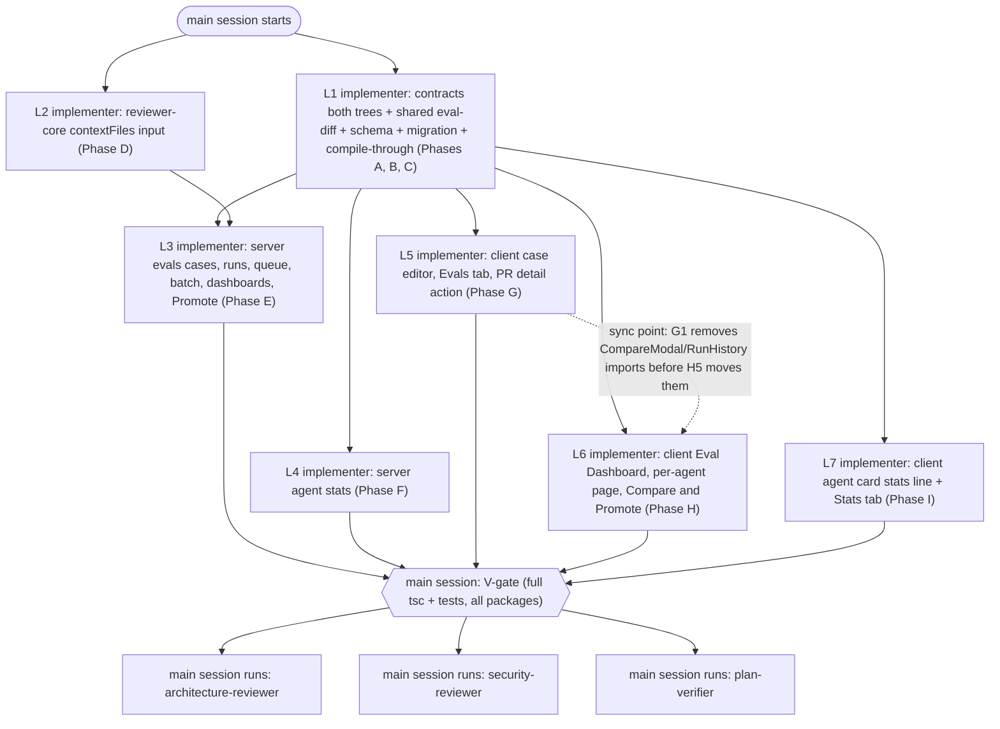
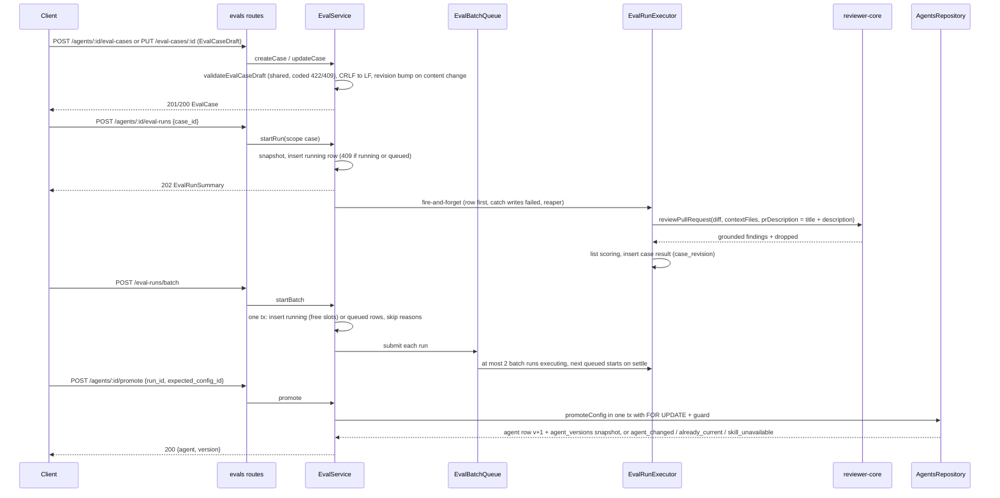
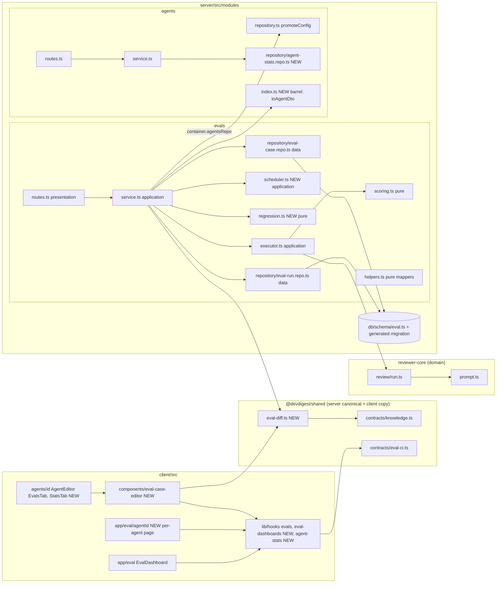

# Eval Pipeline — full design parity (delta) — Implementation plan

> Spec: [`2026-10-31-eval-design-parity`](../specs/2026-10-31-eval-design-parity.md) (`Status: approved`, rev 2) — read 2026-10-31.
> Status: **approved** (rev 1, 2026-10-31 — owner approved incl. §12 decisions 1–3 as written). Execution mode: **multi** (7 implementer lanes L1–L7 + main-session review rows).
> Scope: `server/` (pnpm), `client/` (pnpm), `reviewer-core/` (npm), `.claude/skills/onion-architecture/` (docs). ACs are owned by the spec; this plan only maps them.
> Research reused: `docs/research/eval-pipeline.research.md` R3, R6, R7, R8 (trusted, not re-traced); change sites below were opened first-hand.

---

## 0. Diagrams

### 0.1 Lane flow (execution DAG — who runs what, in which order)

### 0.2 Runtime flow (what the built feature does)

### 0.3 Structure (files per package and ring; arrows = imports, always inward)

---

## 1. Requirements (verified)

Step ids: A–C = L1, D = L2, E = L3, F = L4, G = L5, H = L6, I = L7. Verification ids V1–V30 are in §11.

| R | Requirement, restated | Spec id | Covered by steps | Verified by |
|---|---|---|---|---|
| R1 | "New eval case" opens an empty editor (empty name, empty diff, no files, empty PR meta, `[]`) | AC-D1 | G1, G5 | V20 |
| R2 | Editor shows title "Eval case · <name>" / "Eval case · New", subtitle, "Name *", Input tabs Diff/Files/PR meta, "Expected output", Run on save/Cancel/Run case/Save | AC-D2 | G5, G7 | V20 |
| R3 | Diff tab highlights `+` lines and `@@` headers, keeps prefixes as text | AC-D3 | G5 | V20 |
| R4 | Files tab add/edit/remove; "context only" label for non-diff paths; PR meta title + description | AC-D4a, AC-D4b, AC-D4c | A3, G5 | V20 |
| R5 | "valid JSON" badge vs "invalid JSON" + first error path | AC-D5 | A1, A3, G5 | V6, V20 |
| R6 | "+ Finding skeleton" appends WARNING/bug item on first diff file, line 1 | AC-D6 | A3, G5 | V20 |
| R7 | Save disabled while name/JSON/diff invalid | AC-D7 | A3, G5 | V20 |
| R8 | Server rejects `no_files`, `no_hunks` (names file), `missing_file_header`, `ambiguous_multi_file`; CRLF = LF | AC-D8a–AC-D8e | A3, E7 | V6, V12 |
| R9 | Editor shows reason-specific `invalid_diff` message | AC-D8f | G5, G7 | V20 |
| R10 | Spinner while case/draft loads; load error + Close | AC-D9a, AC-D9b | G5 | V20 |
| R11 | `input_too_large` with `limit` (diff 256 KB, file 64 KB, files 256 KB, 10 files, title 200, description 8,000) and editor shows it beside the input | AC-D10a, AC-D10b | A3, E7, G5 | V6, V12, V20 |
| R12 | "Item <n> can never match …" warning; Save stays enabled | AC-D11 | A3, G5 | V6, V20 |
| R13 | Name 1–60 `a-z0-9-` else `invalid_name`; duplicate → `409 eval_case_name_taken` | AC-D12a, AC-D12b | A3, E2, E7 | V12 |
| R14 | Run feeds stored diff + Files + PR title/description + snapshot config, nothing else | AC-D13 | E6 | V13 |
| R15 | Engine accepts optional extra-files input, fenced as untrusted (covered by the injection guard) | AC-D14 | D2, D3 | V5 |
| R16 | PR title + description reach the model only inside untrusted fencing *(Q3-a: through `prDescription`; known limitation 4,000-char engine cap)* | AC-D15 | E6 | V5, V13 |
| R17 | Without extra files the prompt is byte-identical to before | AC-D16 | D1, D2, D4 | V5 |
| R18 | Grounding keeps diff files only; Files-only citations dropped and counted | AC-D17 | D4, E6 | V5, V13 |
| R19 | Cancel / × / Escape closes a clean editor | AC-D18 | G5 | V20 |
| R20 | Dirty editor asks "Discard unsaved changes?" with Discard / Keep editing | AC-D19 | G5 | V20 |
| R21 | Failed save leaves the stored case unchanged; editor keeps input + shows error | AC-D20a, AC-D20b | E7, G5 | V12, V20 |
| R22 | Case create/edit/rename/delete keeps agent `version` | AC-D21 | E7 | V12 |
| R23 | Content edit bumps `revision` by 1; rename alone does not | AC-D22 | E2, E7 | V12 |
| R24 | "edited since last run" when `last_result.case_revision < revision` | AC-D23 | C1, G3, G5 | V20, V21 |
| R25 | Legacy cases presented in the new shape (mapping rules of C-D4) | AC-D24 | C1, C2 | V3, V12 |
| R26 | Row ▷ ("Run case <name>") and editor "Run case" call `POST /agents/:id/eval-runs {case_id}` | AC-D25 | G3, G4, G5 | V20, V21 |
| R27 | Scope-`case` run = exactly one engine review of content captured at start | AC-D26 | E6, E8 | V13 |
| R28 | Cards, deltas, sparklines, trend, banner, dashboard rows/recent runs use finished scope-`all` runs only | AC-D27 | E3, E9, G2, H3, H4 | V14, V22, V23 |
| R29 | Scope-`case` run sets the case's `last_result` | AC-D28 | C2 | V13 |
| R30 | `running` or `queued` run → `409 eval_run_in_progress` for any scope | AC-D29 | B1, E3, E8 | V13 |
| R31 | Client disables Run all evals / row run / Run case / Run eval while running or queued | AC-D30 | G1, G3, G5, H4 | V20, V21, V23 |
| R32 | Result strip passed / failed / errored / never run, cost "—" when unknown | AC-D31 | G5 | V20 |
| R33 | "Running…" while this case runs | AC-D32 | G5 | V20 |
| R34 | "Run case" disabled with "Save first" when dirty; Run on save saves then runs; run rejected keeps case saved | AC-D33a, AC-D33b, AC-D33c | G5 | V20 |
| R35 | "Turn into eval case" always enabled on agent-review findings | AC-D34 | G6 | V24 |
| R36 | Undecided → editor prefilled from `GET /findings/:id/eval-case-draft`; draft content; existing case → "Already an eval case" + link; save links `source.finding_id` | AC-D35a, AC-D35b, AC-D35c, AC-D35d | E7, E12, G4, G6 | V12, V24 |
| R37 | Action row: Accept, Dismiss, Turn into eval case; no Learn / Reply | AC-D36 | G6 | V24 |
| R38 | Case row content, icon text, accessible names | AC-D37 | G3 | V21 |
| R39 | Row chip variants (`SEVERITY · category` +k, "empty []", "must not flag") | AC-D38 | G3 | V21 |
| R40 | Row ✎ opens editor loaded with that case | AC-D39 | G1, G3, G5 | V21 |
| R41 | "New eval case" enabled at zero cases | AC-D40 | G1 | V21 |
| R42 | Heading "<passed> / <scored> passing" from latest full run; buttons right-aligned on the heading line | AC-D41a, AC-D41b | G1 | V21 |
| R43 | Strict `must_find` match (file, line intersect, severity, category) | AC-D42 | C3 | V3 |
| R44 | `must_not_flag` match by location (+ severity/category when present) | AC-D43 | C3 | V3 |
| R45 | One label per finding: `tp` / `forbidden` / `unlabelled` in output order; empty list → forbidden | AC-D44 | C3 | V3 |
| R46 | Pass = every `must_find` has a `tp` and zero `forbidden` | AC-D45 | C3 | V3 |
| R47 | Summary "expected <n> finding(s), got <m>" (+ " · <k> forbidden hit(s)") | AC-D46 | C3 | V3 |
| R48 | Zero-file diff at run time → case `error` "diff has no reviewable files", no LLM call | AC-D47 | E6 | V13 |
| R49 | Base metric formulas over item counts; `forbidden_hits` includes silent cases; `fn` counts items | AC-D48 | C3 | V3 |
| R50 | "EVAL METRICS" + "View full dashboard →" link | AC-D49 | G1, G7 | V21 |
| R51 | 4th card "TRACES PASSED" `<passed>/<scored>` | AC-D50 | G2 | V21 |
| R52 | Compare subtitle "<n>-trace gold set", "SYSTEM PROMPT DIFF", legend v<A> (old) / v<B> (new) | AC-D51a, AC-D51b | H5 | V25 |
| R53 | Compare buttons "Close", "Promote v<B>" | AC-D52 | H5 | V25 |
| R54 | Dataset warning "<n> added, <m> removed, <k> edited …" | AC-D53 | C1, H2, H5 | V25 |
| R55 | Promote disabled with "v<B> is the current config" when run B `config_id` = live `config_id` *(Q2-a as written; known limitation)* | AC-D54 | E9, H1, H5 | V25 |
| R56 | Promote confirmation lists changed fields + skills to link/unlink (unlink list from `GET /agents/:id/skills`, C3) | AC-D55 | H5 | V25 |
| R57 | Skill-version warning "<skill> is now v<cur> (run used v<old>) …" | AC-D56 | H5 | V25 |
| R58 | Promote applies prompt/provider/model/strategy, exact ordered links, version +1, snapshot; leaves other fields | AC-D57 | E10, E11 | V15 |
| R59 | Promote is all-or-nothing | AC-D58 | E10 | V15 |
| R60 | `409 agent_changed` on stale `expected_config_id`; client message + Reload | AC-D59a, AC-D59b | E10, E11, H5 | V15, V25 |
| R61 | `422 skill_unavailable` naming missing skills | AC-D59c | E10, E11 | V15 |
| R62 | Success: close + "Promoted v<B> config as v<new>"; refresh agent + eval data | AC-D60a, AC-D60b | H1, H5 | V25 |
| R63 | Dashboard rows: name, model chip, "Last run v… · date · p/s pass", sparkline, R/P/C, chevron | AC-D61 | E9, H3 | V22 |
| R64 | No sparkline under 2 full runs | AC-D62 | H3 | V22 |
| R65 | Agent row / recent-run row → per-agent page | AC-D63 | H3 | V22 |
| R66 | Recent runs bars with value text, colour bands (Q-D9) | AC-D64 | H2, H3 | V22 |
| R67 | Per-agent page header: breadcrumb, All agents, agent selector, 7/30/90 (default 30), Run eval | AC-D65a | H4 | V23 |
| R68 | "Not enough runs in this range for a trend" under 2 full runs in range | AC-D65b | E9, H4 | V14, V23 |
| R69 | RECENT RUNS table (≤50, both scopes, "1 case", bars, PASS, COST) | AC-D66 | E3, E9, H4 | V14, V23 |
| R70 | RECALL/PRECISION/CITATION cards with sparkline + "▲/▼/± n pt" delta | AC-D67 | E4, E9, H4 | V14, V23 |
| R71 | METRIC TREND chart with legend + text alternative | AC-D68 | H4 | V23 |
| R72 | "<k> selected"; Compare enabled only with exactly two finished scope-`all` runs | AC-D69a, AC-D69b | H4 | V23 |
| R73 | Skeleton while loading; error + Retry | AC-D70, AC-D71 | H4 | V23 |
| R74 | "Run eval" starts a scope-`all` run and shows progress | AC-D72 | H4 | V23 |
| R75 | Run all agents confirmation (eligible agents, case counts, total reviews, skipped names) | AC-D73 | H3 | V22 |
| R76 | One `POST /eval-runs/batch`, button disabled until it answers | AC-D74 | H1, H3 | V22 |
| R77 | Eligibility: enabled, ≥1 case, no running/queued run, provider key configured | AC-D75 | E8 | V16 |
| R78 | Result lists started / queued / skipped — reason | AC-D76 | H3 | V22 |
| R79 | One agent's failed run does not affect the others | AC-D77 | E5, E8 | V16, V17 |
| R80 | Batch request error + Retry; failure before 202 creates no run | AC-D78a, AC-D78b | E8, H3 | V16, V22 |
| R81 | ≤2 batch runs `running`, the rest `queued`, start on settle *(Q1-a: only batch runs count)* | AC-D79 | E5, E8 | V16, V17 |
| R82 | Boot marks `queued` runs `failed` "server restarted during run" | AC-D80 | E3 | V16 |
| R83 | Batch run config snapshot captured at accept *(Q1-a: case content read when the slot frees)* | AC-D81 | E8 | V16 |
| R84 | Yellow banner when latest full run drops ≥1 whole point on any metric vs previous | AC-D82 | E4, E9, H4 | V14, V23 |
| R85 | Banner text composed by code from deltas/counts, zero LLM *(composed by pure i18n code in the client from the server's `regression` object — see §12 item 3)* | AC-D83 | E4, H4 | V14, V23 |
| R86 | Banner icon + text, `role="status"` | AC-D84 | H4 | V23 |
| R87 | Tabs Config, Skills, Context, Evals, Stats, CI; `?tab=stats` | AC-D85 | I3 | V27 |
| R88 | `AgentStats` 30-day formulas, nulls on zero denominators | AC-D86 | F1, F2 | V18 |
| R89 | Card line "<runs> runs · <accept>% accept · $<avg> avg", "—" for null | AC-D87 | I2 | V26 |
| R90 | Card line placeholder while loading; hidden on error | AC-D88a, AC-D88b | I2 | V26 |
| R91 | Stats tab tiles labelled "last 30 days" | AC-D89 | I4 | V27 |
| R92 | No runs → 0 runs + "—" | AC-D90 | F2, I4 | V18, V27 |
| R93 | Stats tab skeleton; error + Retry | AC-D91a, AC-D91b | I4 | V27 |
| R94 | Stats count no eval runs/results | AC-D92 | F1 | V18 |
| R95 | Zero LLM/embedding/GitHub calls on CRUD, drafts, Promote, eval config, dashboards, stats | AC-D93 | E7, E9, E10, F2 | V15, V19 |
| R96 | Exact LLM-review counts per case run / Run on save / batch | AC-D94 | E6, E8, G5 | V19 |
| R97 | Plain-text rendering of every user/LLM string | AC-D95 | G3, G5, H3, H4, H5, I2, I4 | V20–V27 |
| R98 | Files paths never used for filesystem access | AC-D96 | E6, E7 | V13 (grep check V29) |
| R99 | Headline sequence (hand case, silent case, Run case, A v6, edit v7, B, edit v8, Compare, Promote v7 → v9) | AC-D97 | E15 | V19 (+ live screencast, owner) |
| R100 | Performance p95 targets | NFR-D1 | E3, F1, G5 | V14, V18 (soft timing), V20 |
| R101 | LLM cost per action; confirmation shows total before calls | NFR-D2 | E8, H3 | V19, V22 |
| R102 | Reliability: isolation, one active run per agent, cap 2, reaper covers queued, atomic Promote + staleness | NFR-D3 | B1, E3, E5, E8, E10 | V15, V16, V17 |
| R103 | Accessibility (names, text on icons/deltas, chart alt, announced banner, bar text, Checkbox gotcha, focus trap/Escape) | NFR-D4 | G3, G5, H3, H4, H5, I4 | V20–V27 |
| R104 | i18n: copy in `messages/en/*.json`, ICU plurals, reuse `eval.json` keys | NFR-D5 | G7, H6, I5 | V28 |
| R105 | Security/privacy: workspace-scoped, no content in logs, no keys in responses | NFR-D6 | E7, E8, E11, E12, F3 | V12, V29 |
| R106 | Observability: batch log line, Promote log line, rejected-save log line | NFR-D7 | E7, E8, E11 | V12, V15, V16 |
| R107 | Retention: no revision history; results keep expected list as scored | NFR-D8 | B1, E6 | V13 |
| R108 | Non-goals respected (no Agent Performance page, no Learn/Reply, no body restore, no LLM text, no draft runs, no cancel) | NG-D1–NG-D8 | all (negative) | V29 |

Edge cases → steps: EC-D1–EC-D5 → A3/E7 (V6, V12); EC-D6 → A3/G5 (V20); EC-D7–EC-D9 → C3 (V3); EC-D10–EC-D12 → D4/E6/E7 (V5, V13); EC-D13 → E6/E8 (V13); EC-D14 → H5 (V25); EC-D15 → E7 (V12); EC-D16–EC-D17 → E8/G5 (V13, V20); EC-D18 → G5; EC-D19–EC-D20 → E7/G6 (V12, V24); EC-D21–EC-D25 → E10/H5 (V15, V25); EC-D26–EC-D28 → E8/E3 (V16); EC-D29–EC-D30, EC-D32 → E9/H4 (V14, V23); EC-D31 → F2/I2/I4 (V18, V26, V27); EC-D33 → A1/G5 (V6, V20); EC-D34 → E6 (V13).

### Owner answers
- Q1 → **a**: only batch-originated runs occupy the 2 slots; a manual run of another agent starts at once. Config snapshot at batch accept (AC-D81); case ids fixed at accept; case **content** is read when the queued run gets its slot (that is the run's "start", AC-D26).
- Q2 → **a**: AC-D54 / `already_current` compare `config_id` exactly as written. **Known limitation (owner-accepted):** `config_id` hashes `agent_version` (`server/src/modules/evals/helpers.ts:53-62`), so after a successful Promote v7 → v9 "Promote v7" becomes enabled again, and a version bump with identical content (e.g. a name edit, R8) makes B look "not current".
- Q3 → **a**: PR meta is sent through the engine's existing fenced `prDescription` as `Title: <title>\n\n<description>`. **Known limitation (owner-accepted):** the engine truncates `prDescription` at 4,000 chars (`reviewer-core/src/prompt.ts:74,162-165`); the server still accepts 8,000 (AC-D10a).
- Q4 → **a**: AC-D97 is verified by a server `.it.test.ts` with `MockLLMProvider`, plus an owner-recorded live screencast.
- Also adopted: C3 (unlink list from `GET /agents/:id/skills`), C5 (rule-8 sanctioned-exception text extended to `queued` rows), C7 (remove `last_run`, migrate `AgentCards.tsx`).

### Recommendations
| # | Recommendation | Owner | Reflected in |
|---|---|---|---|
| R1 | Cap PR title+description at 4,000 combined | rejected | §1 Q3 known limitation, §10 |
| R2 | One pure shared `eval-diff.ts` used by server save validation and client gating | accepted | D2, A3, G5 |
| R3 | Version-free content hash for `already_current` | rejected | §1 Q2 known limitation, §10 |
| R4 | Legacy-case mapping at read time; no drop, no data migration | accepted | D3, C1, §4 |
| R5 | In-process `EvalBatchQueue` under the sanctioned eval-executor exception, not `container.jobs` | accepted | D4, E5, E13 |
| R6 | AC-D97 as a server `.it.test.ts` | accepted | E15, V19 |

## 2. Implementation decisions

| # | Decision (how, not what) | Consequence |
|---|---|---|
| D1 | Contracts: list-shaped items in `contracts/knowledge.ts` (`EvalExpectedItem`, `EvalCaseInputFile`, `EvalPrMeta`, amended `EvalCase`); request/response and run/dashboard shapes in `contracts/eval-ci.ts`. Legacy `EvalExpectation` stays exported (read-time mapping only). | Same files as the base plan D1; no import cycle (`eval-ci.ts` already imports `knowledge.ts`). |
| D2 | NEW `vendor/shared/eval-diff.ts` (both trees, barrel export): `EVAL_INPUT_LIMITS`, `normalizeEvalDiff`, `parseEvalDiff`, `validateEvalDiff`, `validateEvalCaseDraft`, `unmatchableItems`, `firstDiffFile`. Plain TS + the Zod schemas from D1; mirrors `server/src/adapters/git/diff-parser.ts:14-80` semantics. | Client and server cannot disagree on AC-D7/D8/D11. Cost: a second parser — guarded by an agreement test against `parseUnifiedDiff` (A4). |
| D3 | Reuse pre-staged `eval_cases.expected_output` (list), `input_files`, `input_meta` (= `pr_meta`). Legacy `expectation_*` columns kept; DTO mapper falls back to them when `expected_output IS NULL` (AC-D24). `eval_case_results.expectation` jsonb now stores the list; mapper wraps a legacy single object. | No data migration, no drop → one `db:generate` pass (T4). Two read paths until a later cleanup. |
| D4 | Queue = NEW `evals/scheduler.ts` `EvalBatchQueue` (promise-chained, no timers), one instance owned by the `EvalService` created in `evals/routes.ts:28`. Queued rows are durable (`status='queued'`), the `.catch` writes `failed`, boot reaper fails `queued` too. | Satisfies AC-D80 (which `JobRunner`, `platform/jobs.ts:40`, would contradict). Rule-8 sanctioned text extended in E13. Single API instance assumption (`server/src/app.ts:84-85`) inherited. |
| D5 | Case-body validation is two-layer: the route's Zod body schema checks only shape (`EvalCaseDraftBody`, `expected: z.unknown()`), then the service runs `validateEvalCaseDraft` (D2) to produce the spec's coded errors (`invalid_name`, `invalid_diff`+`reason`, `invalid_expected_output`+path, `input_too_large`+`limit`, `duplicate_file_path`). | The spec mandates codes the generic Zod 422 cannot emit; the domain validation is a pure shared function, not a hand-rolled `parse(req.body)` of the whole body. |
| D6 | CRLF → LF normalisation happens in evals only (on save, and again before parsing at run time for legacy rows); `adapters/git/diff-parser.ts` is untouched. | PR reviews unchanged (NG-D1). |
| D7 | Engine input `contextFiles?: { path: string; content: string }[]` on `ReviewInput`/`PromptParts`; rendered as section `context_files` "## Additional files (context only — not part of the diff)" with one `wrapUntrusted('file:<safe path>', content)` per file, immediately before the diff section, in every chunk call (single-pass and map-reduce). Omitted when absent or empty. `PromptAssembly` (shared `trace.ts:39`) is not changed. | Byte-identical prompts without files (AC-D16). Map-reduce cases pay the files per chunk (bounded by 256 KB). |
| D8 | Promote: route + orchestration in `evals` (it owns the run snapshot); the atomic write is NEW `AgentsRepository.promoteConfig(workspaceId, agentId, target, guard)` reached through `container.agentsRepo` (existing pattern, `server/src/platform/container.ts:82-110`). Inside one transaction: `SELECT … FOR UPDATE` on the agent row, read enabled skills, call the pure `guard` (computes live `config_id` with `configId()` → `agent_changed` / `already_current`), check skill existence, update agent (version +1), replace `agent_skills` in snapshot order, insert the `agent_versions` snapshot via the same `tx`. | AC-D58 atomicity; fixes nothing in `update()` (R8 race stays for `PUT /agents/:id`, out of scope). |
| D9 | Promote's `Agent` response needs `toAgentDto` (`server/src/modules/agents/helpers.ts:12`). NEW `server/src/modules/agents/index.ts` publishes exactly `export { toAgentDto } from './helpers.js'`, and a new allow-list edge `evals → agents (toAgentDto for the Promote response)` is added to the onion skill + layermap in E13. *(assumed default — confirm; §12 item 2)* | Avoids a duplicate DTO mapper; costs one reviewed allow-list edge. |
| D10 | Agent stats query lives in NEW `server/src/modules/agents/repository/agent-stats.repo.ts` and reads `agent_runs` / `reviews` / `findings` read-only, like the existing precedent `server/src/modules/skills/repository.ts:152-192`. Findings counted = all findings of `reviews` whose `run_id` is one of the window's `done` runs (literal AC-D86). *(assumed default — confirm)* | No new module edge; flagged for architecture-reviewer as a cross-table read. |
| D11 | Regression deltas in NEW pure `evals/regression.ts`: `points = Math.round(latest*100) - Math.round(prev*100)`; a drop is `points ≤ -1`; null metrics skipped. The banner **text** is composed by pure client code with ICU messages from `regression` (C-D11 has no text field). | No contract change; zero LLM; i18n-compliant (NFR-D5). See §12 item 3. |
| D12 | Batch insert: one transaction; per agent a nested savepoint insert so a concurrent unique-index conflict becomes a `skip eval_run_in_progress` instead of aborting the batch; executors fired only after commit. | AC-D78b (nothing created if the request fails before 202). |
| D13 | Shared editor component in `client/src/components/eval-case-editor/` (used by the Evals tab and the PR detail). Diff tab = `Textarea` + read-only highlighted preview fed by `useDeferredValue` (pre-staged key `eval.caseEditor.preview`). | One editor, two entry points; 256 KB stays responsive (NFR-D1). |
| D14 | Per-agent page route `client/src/app/eval/[agentId]/page.tsx`; nav already maps `/eval*` to the Eval Dashboard key (`client/src/components/app-shell/helpers.ts:38`). Run history + Compare move there (Q-D1). | Breadcrumb/active nav for free. |
| D15 | New dashboard copy in NEW namespace file `client/messages/en/evalDashboard.json` (auto-loaded per namespace, `client/src/i18n/request.ts:9-11`); editor/tab copy stays in `eval.json`; stats copy in `agents.json`. | Disjoint i18n files per lane. |

## 3. What already exists — do not rebuild

| Layer | Already there | File |
|---|---|---|
| DB | `eval_cases.input_files`, `input_meta`, `expected_output` jsonb (pre-staged, unused) | `server/src/db/schema/eval.ts:32-34` |
| DB | per-result `cost_usd`, `duration_ms` (feed `last_result` extension) | `server/src/db/schema/eval.ts:112-113` |
| DB | one-running-run partial unique index (to widen) | `server/src/db/schema/eval.ts:88-90` |
| Contract | `AgentStats` (unchanged, both trees identical) | `server/src/vendor/shared/contracts/observability.ts:96-119` |
| Contract | `EvalConfigSnapshot` with `config_id` | `server/src/vendor/shared/contracts/eval-ci.ts:113-125` |
| Server | `configId()` canonical hash, `caseNameFor`, `sliceFileDiff` | `server/src/modules/evals/helpers.ts:23-63` |
| Server | `last_result` = newest result in a finished run (covers AC-D28 with no new write) | `server/src/modules/evals/repository/eval-case.repo.ts:77-99` |
| Server | finding → case checks (workspace, agent, diff unavailable) to reuse for the draft | `server/src/modules/evals/service.ts:56-109` |
| Server | `enabledSkillsForPrompt`, `skillIdsForAgent`, `snapshotVersion` | `server/src/modules/agents/repository.ts:161-180,215-225` |
| Server | `MockLLMProvider` for hermetic LLM stubs | `server/src/adapters/mocks.ts:62` |
| Engine | `wrapUntrusted`, path-label sanitiser, fenced `prDescription` | `reviewer-core/src/prompt.ts:53-63,162-172` |
| Client UI | `Sparkline`, `LineChart`, `MetricCard`, `BarRow`; `ProgressBar`; kit `Checkbox`, `ConfirmDialog`, `Modal`, `Tabs`, `Textarea` | `client/src/vendor/ui/charts/`, `client/src/vendor/ui/primitives/ProgressBar.tsx`, `client/src/vendor/ui/kit/` |
| Client i18n | `eval.caseEditor.*` (title, tabs, preview, valid/invalid JSON, Run case, Save) and `agents.editor.tabs.stats` | `client/messages/en/eval.json:33-58`, `client/messages/en/agents.json:54` |
| Client | `useAgentSkills` (linked skills incl. disabled → unlink list, C3) | `client/src/lib/hooks/skills.ts:138` |
| Client | `lineDiff`, `configDiff`, `caseSetDiff`, `formatPct/Delta/Cost` | `client/src/lib/eval-format.ts:7-128` |
| Client | Compare modal + run history to move (not rebuild) | `client/src/app/agents/[id]/_components/AgentEditor/_components/EvalsTab/_components/CompareModal/`, `…/RunHistory/` |

Not reused on purpose: pre-staged `EvalDashboard` / `EvalTrendPoint` / `EvalRunRecord` (`eval-ci.ts:43-99`) — different shapes; left untouched. `agentPerformance.json` — NG-D2.

### Code map — files this change touches
| File | Why it changes | Anchor |
|---|---|---|
| `server/src/vendor/shared/contracts/knowledge.ts` + `client/src/vendor/shared/contracts/knowledge.ts` | C-D1–C-D4 | `knowledge.ts:53-101` |
| `server/src/vendor/shared/contracts/eval-ci.ts` + client copy | C-D5–C-D13 | `eval-ci.ts:103-225` |
| `server/src/vendor/shared/eval-diff.ts` + client copy — NEW | D2 | — |
| `server/src/vendor/shared/index.ts` + client copy | export `eval-diff.js` | `index.ts:19-30` |
| `server/src/db/schema/eval.ts` | new columns, `queued`, index predicate | `eval.ts:20-121` |
| `server/src/db/migrations/00xx_*.sql` — NEW (generated) | B2 | — |
| `server/src/modules/evals/helpers.ts` | DTO mappers, legacy mapping | `helpers.ts:67-157` |
| `server/src/modules/evals/scoring.ts` | list scoring | `scoring.ts:28-177` |
| `server/src/modules/evals/executor.ts` | ExecCase, feed, zero-file guard | `executor.ts:9-168` |
| `server/src/modules/evals/service.ts` | CRUD, draft, runs, batch, dashboards, config, Promote | `service.ts:42-285` |
| `server/src/modules/evals/routes.ts` | new routes | `routes.ts:26-86` |
| `server/src/modules/evals/constants.ts` | batch/dashboard constants | `constants.ts:1-17` |
| `server/src/modules/evals/repository/eval-case.repo.ts` | get/insert/update, lastResults extension | `eval-case.repo.ts:12-145` |
| `server/src/modules/evals/repository/eval-run.repo.ts` | scope, queued, batch, reaper, range queries | `eval-run.repo.ts:15-189` |
| `server/src/modules/evals/scheduler.ts` — NEW | `EvalBatchQueue` | — |
| `server/src/modules/evals/regression.ts` — NEW | deltas | — |
| `server/src/modules/agents/repository.ts` | `promoteConfig`, tx-aware snapshot | `repository.ts:112-180,268-274` |
| `server/src/modules/agents/index.ts` — NEW | publishes `toAgentDto` | `agents/helpers.ts:12` |
| `server/src/modules/agents/repository/agent-stats.repo.ts` — NEW | 30-day stats query | precedent `skills/repository.ts:152-192` |
| `server/src/modules/agents/service.ts` | `stats`, `statsFor` | `service.ts:52-114` |
| `server/src/modules/agents/routes.ts` | `GET /agents/stats`, `GET /agents/:id/stats` | `routes.ts:75-187` |
| `server/test/contracts.test.ts`, `evals-scoring.test.ts`, `evals-helpers.test.ts`, `evals.it.test.ts` | T6 literals + new behaviour | existing |
| `server/test/eval-diff.test.ts`, `evals-regression.test.ts`, `evals-scheduler.test.ts`, `evals-parity.it.test.ts`, `agent-stats.it.test.ts` — NEW | tests | — |
| `reviewer-core/src/prompt.ts`, `review/run.ts`, `index.ts` | `contextFiles` | `prompt.ts:83-213`, `run.ts:59-118,162`, `index.ts:25` |
| `reviewer-core/test/prompt.test.ts`, `run.test.ts` | AC-D14/16/17 | existing |
| `.claude/skills/onion-architecture/SKILL.md`, `references/layermap.md` | rule 8 queued, rule 10 edge | `SKILL.md:115`, `layermap.md:53,134` |
| `client/src/lib/test-support/eval-fixtures.ts`, `client/src/lib/eval-format.ts` | T6, `isFinished` excludes `queued`, edited count, bands | `eval-format.ts:7,121` |
| `client/src/lib/hooks/evals.ts` (+ `.test.tsx`) | case hooks, `case_id`, queued polling | `evals.ts:20-102` |
| `client/src/lib/hooks/eval-dashboards.ts`, `agent-stats.ts` — NEW | dashboard/batch/config/promote; stats | — |
| `client/src/components/eval-case-editor/**` — NEW | editor | — |
| `client/src/app/agents/[id]/_components/AgentEditor/_components/EvalsTab/{EvalsTab.tsx,EvalsTab.test.tsx,_components/CaseList/**,_components/MetricCards/**}` | tab parity | `EvalsTab.tsx:12-105` |
| `client/src/app/agents/[id]/_components/AgentEditor/_components/EvalsTab/_components/{CompareModal,RunHistory}/**` | moved out by L6 | — |
| `client/src/app/repos/[repoId]/pulls/[number]/_components/FindingCard/**` | always-enabled action, draft | `EvalCaseAction.tsx:19,33`, `FindingCard.tsx:127` |
| `client/src/app/eval/_components/EvalDashboard/**`, `client/src/app/eval/nav.test.ts` | rows, sparkline, Run all agents | `AgentCards.tsx` |
| `client/src/app/eval/[agentId]/**` — NEW | per-agent page | — |
| `client/src/app/agents/[id]/_components/AgentEditor/{constants.ts,AgentEditor.tsx,AgentEditor.test.tsx}`, `…/_components/StatsTab/**` — NEW | Stats tab | `constants.ts:11-17`, `AgentEditor.tsx:29-35` |
| `client/src/app/agents/_components/AgentCard/**`, `…/AgentsListView/AgentsListView.tsx` | stats line | `AgentCard.tsx:1-2`, `AgentsListView.tsx:86` |
| `client/messages/en/eval.json`, `agents.json`, `evalDashboard.json` — NEW | copy | — |

## 4. Data model

`server/src/db/schema/eval.ts` (T2: camelCase property → snake_case column):

| Table | Change |
|---|---|
| `eval_cases` | ADD `revision: integer('revision').notNull().default(1)`; ADD `updatedAt: timestamp('updated_at', { withTimezone: true }).defaultNow().notNull()`. Reuse `inputFiles` (`EvalCaseInputFile[]`), `inputMeta` (`EvalPrMeta`), `expectedOutput` (`EvalExpectedItem[]`). Update the "Pre-staged for skill-owned cases" comment (line 31) to say they now hold agent-case content. Keep `expectation_*`, `display_*`, `source_*` (legacy read path; display/source nullable already). |
| `eval_runs` | ADD `scope: text('scope', { enum: ['all', 'case'] }).notNull().default('all')`; `status` enum adds `'queued'` (TS-only, plain `text`); index `eval_runs_one_running_per_agent` predicate → ``sql`status in ('running','queued')` `` (name kept). |
| `eval_case_results` | ADD `caseRevision: integer('case_revision')` (nullable; mapper reads null as 1). `expectation` jsonb now stores the list. |

No drops, no renames → a single non-interactive pass. Then: `cd server && pnpm db:generate` → review the generated SQL (3 ADD COLUMN on eval_cases/eval_runs/eval_case_results, DROP + CREATE of the one partial index) → `./node_modules/.bin/tsx src/db/migrate.ts`. Never hand-written (T4).

## 5. Contracts (`@devdigest/shared`)

Every edit lands identically in `server/src/vendor/shared/…` and `client/src/vendor/shared/…` in the same step (T1). Casing: fields snake_case; `Severity` UPPERCASE; `FindingCategory`, `kind`, `scope`, `status`, `range`, skip `reason` lowercase (T3).

| Spec contract | Zod schema | File |
|---|---|---|
| C-D1 | `EvalExpectedItem = z.object({ kind: EvalExpectationKind.default('must_find'), file: z.string().min(1).max(300), start_line: int≥1, end_line: int≥1 optional, severity: Severity optional, category: FindingCategory optional, title: z.string().max(200) optional }).strict()` + `superRefine`: `end_line ≥ start_line`; severity and category required when `kind = must_find`. `EvalExpectedList = z.array(EvalExpectedItem)` | `contracts/knowledge.ts` |
| C-D2 | `EvalCaseInputFile = z.object({ path: z.string().min(1).max(300), content: z.string() })` | `contracts/knowledge.ts` |
| C-D3 | `EvalPrMeta = z.object({ title: z.string().max(200), description: z.string().max(8000) })` | `contracts/knowledge.ts` |
| C-D4 | `EvalCase`: remove `expectation`; add `expected: EvalExpectedList`, `input_files`, `pr_meta`, `revision: int≥1`, `updated_at`; `display` and `source` `.nullable()`; `last_result` adds `duration_ms`, `cost_usd`, `case_revision` | `contracts/knowledge.ts` |
| C-D5 | `EvalCaseDraft = z.object({ name, input_diff, input_files, pr_meta, expected })` (strict, the response of C-D6 draft); `EvalCaseDraftBody` (shape-only: `expected: z.unknown()`, `input_files: z.array(z.object({path: z.string(), content: z.string()}))`, `pr_meta: z.object({title: z.string(), description: z.string()})`); `CreateEvalCaseBody = EvalCaseDraftBody.extend({ source_finding_id: z.string().uuid().optional() })` | `contracts/eval-ci.ts` |
| C-D6 | routes only (§6) | — |
| C-D7 | `EvalCaseResult`: `expectation` → `expected: EvalExpectedList`; add `case_revision: int` | `contracts/eval-ci.ts` |
| C-D8 | `EvalRunStatus` + `'queued'`; `EvalRunScope = z.enum(['all','case'])`; `EvalRunSummary.scope`; `EvalCounts.silent_total` | `contracts/eval-ci.ts` |
| C-D9 | `StartEvalRunBody = z.object({ case_id: z.string().uuid().optional() }).optional()`; `EvalBatchItem`, `EvalBatchSkip` (`reason` enum of 4), `EvalBatchResult = { started, queued, skipped }` | `contracts/eval-ci.ts` |
| C-D10 | `EvalDashboardOverview.agents[]`: add `sparkline: z.array(z.number())`, `last_full_run: EvalRunSummary.nullable()`; **remove** `last_run` (C7) | `contracts/eval-ci.ts` |
| C-D11 | `EvalRange = z.enum(['7d','30d','90d'])`; `EvalSeriesPoint`; `EvalMetricDelta = { metric: enum, points: int }`; `EvalRegression`; `AgentEvalDashboard`; `AgentEvalDashboardQuery = { range: EvalRange.default('30d') }` | `contracts/eval-ci.ts` |
| C-D12 | reuse `EvalConfigSnapshot` | — |
| C-D13 | `PromoteEvalBody = { run_id: uuid, expected_config_id: string }`; `PromoteEvalResult = { agent: Agent, version: int }` (`Agent` imported from `knowledge.ts`) | `contracts/eval-ci.ts` |
| C-D14 | `AgentStats` unchanged | `contracts/observability.ts:96-119` |

T6 literal sites (making `expected`, `scope`, `silent_total`, `last_full_run`, `sparkline`, `case_revision`, `revision`, `updated_at` required): `server/src/modules/evals/{helpers,scoring,executor,service}.ts`, `server/test/{contracts,evals-scoring,evals-helpers}.test.ts`, `server/test/evals.it.test.ts`, `client/src/lib/test-support/eval-fixtures.ts`, `client/src/lib/hooks/evals.ts` + `.test.tsx`, `…/EvalsTab/_components/CaseList/CaseList.tsx` + `.test.tsx`, `client/src/app/eval/_components/EvalDashboard/_components/AgentCards/AgentCards.tsx`, `…/EvalDashboard/EvalDashboard.test.tsx`, `…/FindingCard/_components/EvalCaseAction/EvalCaseAction.test.tsx`, `…/FindingCard/FindingCard.test.tsx`. The compile-through steps (C1–C6) clear every one; anything else `tsc` reports is fixed in the same step.

## 6. Server

Rings: **presentation** (`routes.ts`) → **application** (`service.ts`, `executor.ts`, `scheduler.ts`) → **pure** (`scoring.ts`, `regression.ts`, `helpers.ts`) → **data access** (`repository/*.repo.ts`, `agents/repository.ts`). No Drizzle outside repos; no new SDK clients; LLM only via `container.llm()`.

Routes (T5 — every route: auth = `getContext(app.container, req)` workspace resolution, as all existing eval routes; authz = every read/write filtered by `ctx.workspaceId` and, where an agent id is in the path, the case/run must belong to that agent, else 404; validation = Zod schemas via `fastify-type-provider-zod`):

| Route | Body/query schema | Response | Notes |
|---|---|---|---|
| `POST /agents/:id/eval-cases` | `CreateEvalCaseBody` | `201 EvalCase` | 404 agent; 409 name_taken / eval_case_exists; 422 coded (D5); 422 `eval_case_limit` kept |
| `PUT /eval-cases/:id` | `EvalCaseDraftBody` | `200 EvalCase` | 404 eval_case_not_found |
| `GET /findings/:id/eval-case-draft` | params | `200 EvalCaseDraft` | 404/409/422 as base C5; nothing persisted |
| `POST /agents/:id/eval-runs` | `StartEvalRunBody` | `202 EvalRunSummary` | existing rate limit 10/min kept |
| `POST /eval-runs/batch` | none | `202 EvalBatchResult` | rate limit 10/min |
| `GET /agents/:id/eval-dashboard` | `AgentEvalDashboardQuery` | `200 AgentEvalDashboard` | |
| `GET /agents/:id/eval-config` | params | `200 EvalConfigSnapshot` | 0 LLM (no `container.llm` call) |
| `POST /agents/:id/promote` | `PromoteEvalBody` | `200 PromoteEvalResult` | 404/409/422 per C-D13 |
| `GET /eval-dashboard` | — | `200 EvalDashboardOverview` | full-set only |
| `GET /agents/stats`, `GET /agents/:id/stats` | params | `200 AgentStats[]` / `AgentStats` | in `agents/routes.ts` |

Details per file are in §9 Phases C, E, F.

## 7. Client

Feature-folder naming per `client/AGENTS.md` (`_components/<PascalName>/` + `<Name>.test.tsx` + `index.ts` + `styles.ts`). Shared editor in `client/src/components/eval-case-editor/EvalCaseEditor/` (two consumers). New page `client/src/app/eval/[agentId]/page.tsx` (thin route entry, `params` awaited per Next 15) → `_components/AgentEvalPage/`. All user/LLM text rendered as React text nodes only (AC-D95). Hooks via TanStack Query in `client/src/lib/hooks/`. Details in §9 Phases G, H, I.

## 8. Execution mode & agent lanes

**Multi-agent.** Only the main session launches agents. Lanes in the same package share one working tree: a lane's checkpoint failing **only** in files owned by another in-flight lane is reported, not fixed; the main-session V-gate (V30) is the authoritative full check.

| Lane | Agent | Phases | Files owned | Waits on | Checkpoint |
|---|---|---|---|---|---|
| L1 | implementer | A, B, C | both `vendor/shared/contracts/{knowledge,eval-ci}.ts`, both `vendor/shared/{eval-diff.ts,index.ts}`, `server/src/db/schema/eval.ts`, generated migration + `meta/`, `server/src/modules/evals/{helpers,scoring}.ts`, compile-through edits in `server/src/modules/evals/{executor,service}.ts` + `repository/eval-case.repo.ts`, `server/test/{contracts,evals-scoring,evals-helpers,eval-diff}.test.ts`, `server/test/evals.it.test.ts`, `client/src/lib/test-support/eval-fixtures.ts`, `client/src/lib/eval-format.ts`, compile-through edits in `client/src/lib/hooks/evals.ts(+test)`, `CaseList.tsx(+test)`, `AgentCards.tsx`, `EvalDashboard.test.tsx`, `EvalCaseAction.test.tsx`, `FindingCard.test.tsx` | — | V1, V2, V3, V4, V6 |
| L2 | implementer | D | `reviewer-core/src/{prompt.ts,review/run.ts,index.ts}`, `reviewer-core/test/{prompt,run}.test.ts` | — (parallel with L1) | V5 |
| L3 | implementer | E | `server/src/modules/evals/**` (all files, incl. NEW `scheduler.ts`, `regression.ts`), `server/src/modules/agents/repository.ts`, NEW `server/src/modules/agents/index.ts`, `server/test/evals.it.test.ts`, NEW `server/test/{evals-regression,evals-scheduler}.test.ts`, NEW `server/test/evals-parity.it.test.ts`, `.claude/skills/onion-architecture/SKILL.md`, `.claude/skills/onion-architecture/references/layermap.md` | L1, L2 | V1, V12–V17, V19 |
| L4 | implementer | F | NEW `server/src/modules/agents/repository/agent-stats.repo.ts`, `server/src/modules/agents/{service,routes}.ts`, NEW `server/test/agent-stats.it.test.ts` | L1 | V1, V18 |
| L5 | implementer | G | NEW `client/src/components/eval-case-editor/**`, `…/EvalsTab/{EvalsTab.tsx,EvalsTab.test.tsx,styles.ts}`, `…/EvalsTab/_components/{CaseList,MetricCards}/**`, `client/src/lib/hooks/evals.ts` + `evals.test.tsx`, `client/src/app/repos/[repoId]/pulls/[number]/_components/FindingCard/**`, `client/messages/en/eval.json` | L1 | V2, V20, V21, V24 |
| L6 | implementer | H | NEW `client/src/lib/hooks/eval-dashboards.ts` (+ test), `client/src/lib/eval-format.ts` (+ test), `client/src/app/eval/**` (incl. NEW `[agentId]/**`), `…/EvalsTab/_components/{CompareModal,RunHistory}/**` (moved out / deleted), NEW `client/messages/en/evalDashboard.json` | L1; **H5 waits on L5 step G1** | V2, V22, V23, V25 |
| L7 | implementer | I | NEW `client/src/lib/hooks/agent-stats.ts` (+ test), `client/src/app/agents/_components/{AgentCard/**,AgentsListView/AgentsListView.tsx}`, `client/src/app/agents/[id]/_components/AgentEditor/{constants.ts,AgentEditor.tsx,AgentEditor.test.tsx}`, NEW `…/AgentEditor/_components/StatsTab/**`, `client/messages/en/agents.json` | L1 | V2, V26, V27 |
| M1 | main session runs this: V-gate | — | — | L3–L7 | V30 |
| M2 | main session runs this: architecture-reviewer | — | §10-sensitive server files + client folders | M1 | report |
| M3 | main session runs this: security-reviewer | — | case routes, Promote, editor rendering | M1 | report |
| M4 | main session runs this: plan-verifier | — | whole diff vs this plan | M1 | report |

Disjointness: parallel lanes L3‖L4‖L5‖L6‖L7 share no file (`server/test/evals.it.test.ts` and `client/src/lib/eval-format.ts` are touched by L1 first, then by exactly one later lane). The only cross-lane ordering inside the parallel group is G1 → H5 (L6 must check `rg -n "CompareModal|RunHistory" "client/src/app/agents/[id]/_components/AgentEditor/_components/EvalsTab/EvalsTab.tsx"` is empty before moving the folders). T9: L1, L3, L4 server and L1, L5, L6, L7 client use **pnpm-tree binaries** (`./node_modules/.bin/...`), L2 uses **npm**; nobody runs a package-manager install.

## 9. Implementation plan

### Phase A — Contracts and shared helper (L1)
| # | Step | Files | Skill | AC |
|---|---|---|---|---|
| A1 | Add `EvalExpectedItem` (strict, superRefine), `EvalExpectedList`, `EvalCaseInputFile`, `EvalPrMeta`; amend `EvalCase` per §5 C-D4 (remove `expectation`, nullable `display`/`source`, `revision`, `updated_at`, extended `last_result`). Keep `EvalExpectation`. Identical edit in both trees. | `server/src/vendor/shared/contracts/knowledge.ts`, `client/src/vendor/shared/contracts/knowledge.ts` | `zod`, `typescript-expert` | AC-D5, AC-D24, AC-D42, AC-D43 |
| A2 | Add/amend per §5 C-D5, C-D7–C-D11, C-D13 (`EvalCaseDraft`, `EvalCaseDraftBody`, `CreateEvalCaseBody`, `queued`, `EvalRunScope`, `scope`, `silent_total`, `expected`/`case_revision` on results, `StartEvalRunBody`, batch shapes, overview rows with `sparkline`/`last_full_run` and **no** `last_run`, `AgentEvalDashboard` family, Promote body/result). Both trees. | `server/src/vendor/shared/contracts/eval-ci.ts`, `client/src/vendor/shared/contracts/eval-ci.ts` | `zod` | AC-D25, AC-D29, AC-D61, AC-D66, AC-D75, AC-D76, AC-D82, AC-D57 |
| A3 | NEW `eval-diff.ts` (D2): `EVAL_INPUT_LIMITS` (Q-D4 bytes via `TextEncoder`), `EVAL_CASE_NAME_RE = /^[a-z0-9-]{1,60}$/`, `normalizeEvalDiff`, `parseEvalDiff` (files → `{ path, hunks, newLines:Set }`, same rules as `diff-parser.ts:14-80`), `validateEvalDiff` → `null | { reason, file? }` (AC-D8a–d order: missing_file_header, ambiguous_multi_file, no_files, no_hunks), `validateEvalCaseDraft` → first coded error, `unmatchableItems(expected, parsed)`, `firstDiffFile`. Add `export * from './eval-diff.js'` to both barrels. | `server/src/vendor/shared/eval-diff.ts` (NEW), `client/src/vendor/shared/eval-diff.ts` (NEW), `server/src/vendor/shared/index.ts`, `client/src/vendor/shared/index.ts` | `zod`, `typescript-expert` | AC-D4b, AC-D6, AC-D7, AC-D8a–AC-D8e, AC-D10a, AC-D11, AC-D12a |
| A4 | Update contract literals; add `EvalExpectedItem` cases (unknown key, `critical` lowercase rejected, must_find without severity rejected). NEW `eval-diff.test.ts`: each `invalid_diff` reason, CRLF = LF result, limits, never-match, and an **agreement test** that `parseEvalDiff` new-line sets equal `parseUnifiedDiff` (`server/src/adapters/git/diff-parser.ts:14`) on 6 fixture diffs. | `server/test/contracts.test.ts`, `server/test/eval-diff.test.ts` (NEW) | `zod` | AC-D5, AC-D8a–e, EC-D1–EC-D5, EC-D33 |

### Phase B — Data model (L1)
| # | Step | Files | Skill | AC |
|---|---|---|---|---|
| B1 | Schema edits per §4. | `server/src/db/schema/eval.ts` | `postgresql-table-design`, `drizzle-orm-patterns` | AC-D22, AC-D29, AC-D79, NFR-D3 |
| B2 | `cd server && pnpm db:generate`; inspect SQL (adds + index swap only, no drop of columns). | `server/src/db/migrations/` (generated) | `drizzle-orm-patterns` | — |
| B3 | Apply locally: `cd server && ./node_modules/.bin/tsx src/db/migrate.ts`. | — | `drizzle-orm-patterns` | — |

### Phase C — Compile-through and pure scoring (L1)
| # | Step | Files | Skill | AC |
|---|---|---|---|---|
| C1 | `toEvalCaseDto`: `expected` = `expectedOutput` when an array, else legacy map (must_find → item with `display` severity/category; must_not_flag → location-only); `input_files` ?? [], `pr_meta` ?? `{title:'',description:''}`, `display` null when `displayTitle` null, `source` null when `sourceFindingId` and `sourcePrNumber` are null, `revision`, `updated_at`; `LastResult` + `durationMs`, `costUsd`, `caseRevision` (null → 1). `toEvalCaseResultDto`: wrap legacy object, `case_revision ?? 1`. `toEvalRunSummaryDto`: `scope`; metrics null for `queued`. | `server/src/modules/evals/helpers.ts` | `onion-architecture`, `typescript-expert` | AC-D23, AC-D24, AC-D53 |
| C2 | `lastResults` selects `costUsd`, `durationMs`, `caseRevision`; `insertCase` (from finding) also writes `expectedOutput` (one item), `inputFiles: []`, `inputMeta: {title:'',description:''}`. | `server/src/modules/evals/repository/eval-case.repo.ts` | `drizzle-orm-patterns` | AC-D24, AC-D28, AC-D31 |
| C3 | Rewrite scoring: `matchesMustFind` (file, intersect, severity, category), `matchesMustNotFlag` (location + optional sev/cat), `labelFindings(findings, expected[])` (tp on first not-yet-hit must_find in list order, else forbidden on any must_not_flag or empty list, else unlabelled), `caseStatus`, `caseSummary` ("expected {n} finding/findings, got {m}" + " · {k} forbidden hit/hits" when must_not_flag items exist), `aggregate` with item counts, `silent_total`, `fn` = must_find items without tp, macro recall per item. | `server/src/modules/evals/scoring.ts` | `onion-architecture`, `typescript-expert` | AC-D42–AC-D46, AC-D48, EC-D7–EC-D9 |
| C4 | Compile-through: `ExecCase.expected: EvalExpectedItem[]` (rename from `expectation`), pass to new scoring; `service.ts:201-206` builds `expected` from the DTO. No feed changes (those are E6). | `server/src/modules/evals/executor.ts`, `server/src/modules/evals/service.ts` | `onion-architecture` | AC-D44 |
| C5 | Update tests for list scoring (every EC-D7–EC-D9 case, silent case, counts) and mappers (legacy mapping both kinds); update `evals.it.test.ts` assertions from `expectation` to `expected`. | `server/test/evals-scoring.test.ts`, `server/test/evals-helpers.test.ts`, `server/test/evals.it.test.ts` | `zod` | AC-D24, AC-D42–AC-D48 |
| C6 | Client compile-through: fixtures to new shapes; `isFinished` returns false for `queued`; `CaseList` reads `expected[0]` for its interim chip; `AgentCards` reads `last_full_run`; fix every other client `tsc` error listed in §5 T6. | `client/src/lib/test-support/eval-fixtures.ts`, `client/src/lib/eval-format.ts`, `client/src/lib/hooks/evals.ts`, `client/src/lib/hooks/evals.test.tsx`, `…/EvalsTab/_components/CaseList/CaseList.tsx`, `CaseList.test.tsx`, `client/src/app/eval/_components/EvalDashboard/_components/AgentCards/AgentCards.tsx`, `EvalDashboard.test.tsx`, `EvalCaseAction.test.tsx`, `FindingCard.test.tsx` | `typescript-expert`, `react-best-practices` | AC-D27, AC-D61 |

### Phase D — Engine input (L2, npm)
| # | Step | Files | Skill | AC |
|---|---|---|---|---|
| D1 | **Before editing `prompt.ts`**: add a test that captures the current `assemblePrompt` output for a fixture with task, prDescription, skills, specs, intent and diff as an inline snapshot (the "before" baseline). | `reviewer-core/test/prompt.test.ts` | `typescript-expert` | AC-D16 |
| D2 | `PromptParts.contextFiles?`; `ReviewPromptSectionName` + `'context_files'`; render per D7 immediately before `push('diff', …)`, using `wrapUntrusted` and the existing path-label sanitiser (`prompt.ts:63`); omit when undefined/empty. | `reviewer-core/src/prompt.ts` | `onion-architecture`, `typescript-expert` | AC-D14, AC-D16 |
| D3 | `ReviewInput.contextFiles?: ReviewContextFile[]`; forward to every `assemblePrompt` call (single-pass and each map chunk); export `type ReviewContextFile` from the barrel. | `reviewer-core/src/review/run.ts`, `reviewer-core/src/index.ts` | `onion-architecture`, `typescript-expert` | AC-D14 |
| D4 | Tests: D1 snapshot unchanged with `contextFiles` undefined and `[]`; files appear fenced before the diff; `</untrusted>` inside content is escaped; a finding citing a Files-only path is dropped and counted in `dropped` (stub LLM). | `reviewer-core/test/prompt.test.ts`, `reviewer-core/test/run.test.ts` | `typescript-expert` | AC-D14, AC-D16, AC-D17, EC-D10, EC-D11 |

### Phase E — Server evals (L3)
| # | Step | Files | Skill | AC |
|---|---|---|---|---|
| E1 | Constants: `EVAL_BATCH_CONCURRENCY = 2`, `EVAL_AGENT_RUNS_LIMIT = 50`, `EVAL_SPARKLINE_POINTS = 10`, `EVAL_RANGE_DAYS = { '7d': 7, '30d': 30, '90d': 90 }`, `EVAL_EMPTY_DIFF_ERROR = 'diff has no reviewable files'`. | `server/src/modules/evals/constants.ts` | `onion-architecture` | AC-D47, AC-D66, AC-D79 |
| E2 | Repo: `getCase(ws, id)`, `insertManualCase` (all content columns, `revision 1`, `{ nameTaken }` on 23505), `updateCase(ws, id, values, contentChanged)` (`revision = revision + 1` only when `contentChanged`, `updatedAt = now()`, `{ nameTaken }` on 23505, single statement). | `server/src/modules/evals/repository/eval-case.repo.ts` | `drizzle-orm-patterns` | AC-D12b, AC-D20a, AC-D22 |
| E3 | Repo: `insertRunningRun(+scope)`; `insertBatchRuns(db, rows)` (one tx, savepoint per row, returns created + conflicts, D12); `markRunning(id)` (`queued`→`running`); `failRun`/`reapRunning` on `status in ('running','queued')`; `findActiveRun`; `listForAgentSince(ws, agent, since, 50)`; `finishedFullRuns(ws, agent, since)`; `latestTwoFinishedFull(ws, agent)`; `latestFinishedFullPerAgent`; `sparklinesByAgent(ws, 10)` (window function over finished `scope='all'`); `recentFullForWorkspace(ws, 20)`. | `server/src/modules/evals/repository/eval-run.repo.ts` | `drizzle-orm-patterns` | AC-D27, AC-D29, AC-D62, AC-D66, AC-D78b, AC-D80, NFR-D1 |
| E4 | NEW pure `regression.ts`: `metricDeltas(latest, previous)` (D11), `regressionFor(latest, previous)` → C-D11 `regression` or null (null unless at least one drop ≥1 pt), `forbidden_hits_delta`, `fn_delta`. | `server/src/modules/evals/regression.ts` (NEW) | `onion-architecture`, `typescript-expert` | AC-D67, AC-D82, AC-D83 |
| E5 | NEW `EvalBatchQueue`: `submit(start: () => Promise<void>)`; runs ≤ `EVAL_BATCH_CONCURRENCY` at once; on settle (success or failure) starts the next; `freeSlots()`; no timers; one failing start never blocks the next. | `server/src/modules/evals/scheduler.ts` (NEW) | `onion-architecture` | AC-D77, AC-D79 |
| E6 | Executor feed: `ExecCase` + `inputFiles`, `prMeta`, `revision`; `normalizeEvalDiff` then parse; zero files → `error` `EVAL_EMPTY_DIFF_ERROR` with no LLM call; `reviewPullRequest({..., contextFiles: files.length ? files : undefined, prDescription: meta non-empty ? 'Title: …\n\n…' : undefined })`; result row stores `expected` list + `caseRevision`; logs keep ids/counts only. Paths are never passed to fs. | `server/src/modules/evals/executor.ts` | `onion-architecture` | AC-D13, AC-D15, AC-D17, AC-D26, AC-D47, AC-D94, AC-D96, EC-D12, EC-D34 |
| E7 | Service cases: `createCase(ctx, agentId, body)` (normalize CRLF → `validateEvalCaseDraft` → `AppError` with spec code/details; 200-cap; optional `source_finding_id` → finding in ws and `review.agentId === agentId` else 404 `finding_not_found`, existing → 409 `eval_case_exists {case_id}`, fills source + display); `updateCase(ctx, id, body)` (contentChanged = diff/files/meta/expected differ after normalisation); `draftFromFinding(ctx, findingId)` (reuses `service.ts:56-109` checks without the decided gate, AC-D35b content); one `log.info({ code })` per rejected save (no content). No agent update anywhere. | `server/src/modules/evals/service.ts` | `onion-architecture`, `fastify-best-practices` | AC-D8a–AC-D8e, AC-D10a, AC-D12a, AC-D12b, AC-D20a, AC-D21, AC-D22, AC-D35b, AC-D35c, AC-D35d, AC-D93, AC-D96, NFR-D6, NFR-D7 |
| E8 | Service runs: extract `buildSnapshot(agent)`; `startRun(ctx, agentId, caseId?)` (case must be in the agent's set else 404 `eval_case_not_found`; `scope`; 409 covers queued via the index); `startBatch(ctx)` (eligibility AC-D75 with skip reasons; `insertBatchRuns` with `running` for `queue.freeSlots()` then `queued`; fire after commit; each run's start = `markRunning` (queued only) → read case content (Q1-a) → executor; `.catch` → `failRun`; one `log.info` with counts and reasons); `reapStaleRuns` unchanged signature. | `server/src/modules/evals/service.ts` | `onion-architecture` | AC-D25–AC-D29, AC-D72, AC-D75, AC-D77, AC-D78b, AC-D79, AC-D80, AC-D81, NFR-D7 |
| E9 | Service reads: `dashboard()` (rows with `sparkline`, `last_full_run`; recent full-set ≤20); `agentDashboard(ctx, agentId, range)` (C-D11: latest/previous any time, series + runs in range, `regressionFor`); `evalConfig(ctx, agentId)` (`buildSnapshot`, no `container.llm`). | `server/src/modules/evals/service.ts` | `onion-architecture` | AC-D27, AC-D54, AC-D61, AC-D62, AC-D65b, AC-D66, AC-D67, AC-D82, AC-D93 |
| E10 | `promoteConfig(ws, agentId, target, guard)` per D8; make `snapshotVersion` and the skill-id read accept an optional `tx`; missing skills → `{ skillUnavailable: names }` (names from the snapshot, passed in `target`); replace links in snapshot order (T7 replace semantics, done in the repo, not via the route). | `server/src/modules/agents/repository.ts` | `drizzle-orm-patterns`, `onion-architecture` | AC-D57, AC-D58, AC-D59a, AC-D59c |
| E11 | NEW `agents/index.ts` (`export { toAgentDto } from './helpers.js'` only). Service `promote(ctx, agentId, body)`: run in ws and `run.agent_id === agentId` else 404 `eval_run_not_found`; call `promoteConfig` with guard comparing live `config_id` to `expected_config_id` (409 `agent_changed`) and to `run.config.config_id` (409 `already_current`); 422 `skill_unavailable {skills}`; log `{agentId, runId, from, to}`; returns `{ agent: toAgentDto(row), version }`. | `server/src/modules/agents/index.ts` (NEW), `server/src/modules/evals/service.ts` | `onion-architecture` | AC-D57, AC-D58, AC-D59a, AC-D59c, AC-D93, NFR-D7 |
| E12 | Routes per §6 table (update the header comment list). | `server/src/modules/evals/routes.ts` | `fastify-best-practices`, `zod` | AC-D25, AC-D35a, AC-D74, NFR-D6 |
| E13 | Onion docs: rule 8 eval-executor sentence also covers rows inserted `queued` (failed by the `.catch` and by the boot reaper; `EvalBatchQueue` holds no timers); rule 10 allow-list row `evals` → add `agents` (`toAgentDto` for the Promote response). Same two edits in the layermap (`:53`, `:134`). | `.claude/skills/onion-architecture/SKILL.md`, `.claude/skills/onion-architecture/references/layermap.md` | `onion-architecture` | NFR-D3 |
| E14 | Tests: NEW `evals-regression.test.ts` (drop thresholds, nulls), NEW `evals-scheduler.test.ts` (≤2 concurrent, failure releases a slot); extend `evals.it.test.ts`: create/update/draft codes, name taken, revision bump vs rename, version unchanged, scope case → one LLM call + `last_result`, 409 on running and queued, zero-file case error with 0 calls, batch eligibility/skips/queued/reaper, nothing created on injected failure, dashboards full-set filtering and range, Promote happy path + links order + version +1 + snapshot, atomicity under an injected failure, 409s, 422, 0 LLM. | `server/test/evals-regression.test.ts` (NEW), `server/test/evals-scheduler.test.ts` (NEW), `server/test/evals.it.test.ts` | `drizzle-orm-patterns` | AC-D8–AC-D29, AC-D47, AC-D57–AC-D59c, AC-D75–AC-D82 |
| E15 | NEW headline test: `MockLLMProvider` whose findings depend on a marker in the system prompt; hand case + silent case; Run case each; run A (v6); edit prompt (v7); run B; edit (v8); Promote B → agent v9 with v7 prompt; asserts summaries, both runs in `series`, regression when a metric drops, LLM call count = cases reviewed, 0 calls during Promote. | `server/test/evals-parity.it.test.ts` (NEW) | `fastify-best-practices` | AC-D93, AC-D94, AC-D97 |

### Phase F — Agent stats server (L4)
| # | Step | Files | Skill | AC |
|---|---|---|---|---|
| F1 | NEW `agentStats(db, ws, since, agentId?)`: per agent, `agent_runs` with `status='done'` and `ran_at ≥ since` (all `source` values, Q-D13) → runs, avg cost (non-null), avg duration (non-null), total cost; findings of `reviews` whose `run_id` ∈ those runs → accepted / dismissed / pending, by severity. Grouped SQL, no N+1; workspace-scoped through `agents.workspace_id`. Never touches eval tables. | `server/src/modules/agents/repository/agent-stats.repo.ts` (NEW) | `drizzle-orm-patterns`, `onion-architecture` | AC-D86, AC-D92, NFR-D1 |
| F2 | Service `stats(ws)` / `statsFor(ws, id)`: 30-day window (`since = now - 30d`), map to `AgentStats` (ratios null on zero denominators, `trend: []`), one row per workspace agent incl. zero-run agents. | `server/src/modules/agents/service.ts` | `onion-architecture` | AC-D86, AC-D90, AC-D93 |
| F3 | Routes `GET /agents/stats` (`z.array(AgentStats)`) and `GET /agents/:id/stats` (`AgentStats`, 404 outside workspace). | `server/src/modules/agents/routes.ts` | `fastify-best-practices`, `zod` | AC-D86, NFR-D6 |
| F4 | NEW it-test: window edges (29 vs 31 days), done-only, ci source counted, eval runs ignored, null ratios, 404 cross-workspace; a soft timing check with 20 agents × 1,000 runs logged (not asserted below 500 ms in CI). | `server/test/agent-stats.it.test.ts` (NEW) | `drizzle-orm-patterns` | AC-D86, AC-D90, AC-D92, NFR-D1 |

### Phase G — Client: editor, Evals tab, PR detail (L5)
| # | Step | Files | Skill | AC |
|---|---|---|---|---|
| G1 | **First step (sync point for L6):** remove `RunHistory`/`CompareModal` imports and usage. Header "EVAL METRICS" + `Link` "View full dashboard →" to `/eval/<agentId>`; "Eval cases" heading with "<passed> / <scored> passing" from latest full run, and "Run all evals" + "New eval case" right-aligned on that line; "New eval case" always enabled; run buttons disabled while a run is `running`/`queued`; editor open state (new / edit id). | `…/EvalsTab/EvalsTab.tsx`, `…/EvalsTab/styles.ts` | `react-best-practices`, `frontend-ui-architecture` | AC-D1, AC-D30, AC-D39, AC-D40, AC-D41a, AC-D41b, AC-D49 |
| G2 | MetricCards: compute from finished `scope='all'` runs; 4th card "TRACES PASSED" `p/s`. | `…/EvalsTab/_components/MetricCards/MetricCards.tsx` | `react-best-practices` | AC-D27, AC-D50 |
| G3 | CaseList rows: status icon with text alternative, monospace name, summary or "never run", chip (AC-D38 variants), "edited since last run", ▷/✎/🗑 with accessible names "Run case/Edit case/Delete case <name>". | `…/EvalsTab/_components/CaseList/CaseList.tsx`, `styles.ts` | `react-best-practices` | AC-D23, AC-D25, AC-D37, AC-D38, AC-D39, AC-D95 |
| G4 | Hooks: `useCreateEvalCase(agentId)` (POST draft body), `useUpdateEvalCase`, `useEvalCaseDraft(findingId)`, `useStartEvalRun` accepts `{ case_id? }`, polling every 4 s also while `queued`; keep the from-finding hook. Invalidate cases + runs on success. | `client/src/lib/hooks/evals.ts` | `react-best-practices` | AC-D25, AC-D30, AC-D33b, AC-D35a |
| G5 | NEW `EvalCaseEditor` (`Modal`): title/subtitle, Name *, `Tabs` Diff (Textarea + deferred highlighted preview, prefixes kept as text) / Files (add/edit/remove, "context only" label via `parseEvalDiff`) / PR meta; Expected output textarea with "valid JSON"/"invalid JSON <path>" badge, "+ Finding skeleton", "Item n can never match …" via `unmatchableItems`; Save gated on name/JSON/`validateEvalDiff`; server error mapping (`invalid_diff` reason messages, `input_too_large` beside the field, name taken, generic) with input kept; spinner/error+Close on load; Cancel/×/Escape; dirty → `ConfirmDialog` "Discard unsaved changes?"; result strip (passed/failed/errored/never run, "—" cost, "Running…", "edited since last run"); "Run case" disabled with "Save first" when dirty; "Run on save" → save then start case run, run error shown in strip. All text as text nodes. Sub-components: `_components/{DiffTab,FilesTab,PrMetaTab,ExpectedOutput,ResultStrip}/`. | `client/src/components/eval-case-editor/EvalCaseEditor/**` (NEW), `client/src/components/eval-case-editor/index.ts` (NEW) | `frontend-ui-architecture`, `react-best-practices`, `next-best-practices` | AC-D1–AC-D7, AC-D8f, AC-D9a, AC-D9b, AC-D10b, AC-D11, AC-D18, AC-D19, AC-D20b, AC-D23, AC-D25, AC-D31, AC-D32, AC-D33a–AC-D33c, AC-D95, NFR-D1, NFR-D4 |
| G6 | `EvalCaseAction`: enabled for agent-review findings whatever the decision; decided → existing one-click POST; undecided → `useEvalCaseDraft` → editor with `source_finding_id`; `409 eval_case_exists` → "Already an eval case" + link `/agents/<id>?tab=evals`. Confirm the FindingCard row order Accept, Dismiss, Turn into eval case (no Learn/Reply exist today, `FindingCard.tsx:127`). | `…/FindingCard/_components/EvalCaseAction/EvalCaseAction.tsx`, `…/FindingCard/FindingCard.tsx` | `react-best-practices` | AC-D34, AC-D35a, AC-D35c, AC-D35d, AC-D36 |
| G7 | Copy: reuse `caseEditor.*` keys; add subtitle, "Name *", Files labels, context-only label, skeleton button, never-match, reason messages, limit messages, strip variants (ICU plurals), Save first, Run on save, discard dialog, chip variants, row accessible names, "EVAL METRICS", "View full dashboard →", "TRACES PASSED", "edited since last run", "Already an eval case". | `client/messages/en/eval.json` | `next-best-practices` | NFR-D5, AC-D2, AC-D8f |
| G8 | Tests: NEW `EvalCaseEditor.test.tsx` (+ sub-component tests where logic lives), update `CaseList.test.tsx`, `MetricCards.test.tsx`, `EvalsTab.test.tsx`, `EvalCaseAction.test.tsx`, `FindingCard.test.tsx`, `evals.test.tsx`; `` in name/diff/files/meta/JSON renders as text. | test files beside each component | `react-testing-library` | AC-D1–AC-D41b, AC-D95 |

### Phase H — Client: dashboards, per-agent page, Compare/Promote (L6)
| # | Step | Files | Skill | AC |
|---|---|---|---|---|
| H1 | NEW hooks: `useAgentEvalDashboard(agentId, range)` (polls 4 s while any run in `runs` is running/queued), `useStartEvalBatch`, `useAgentEvalConfig(agentId)`, `usePromoteEvalRun(agentId)` (on success invalidate agent, agent eval dashboard, eval-config, overview). | `client/src/lib/hooks/eval-dashboards.ts` (NEW) | `react-best-practices` | AC-D54, AC-D60b, AC-D72, AC-D74 |
| H2 | `eval-format.ts`: `caseSetDiff` gains `edited` from per-result `case_revision`; `metricBand(v)` (≥0.8 green, ≥0.5 amber, else red); `formatPoints` ("▲ n pt" / "▼ n pt" / "± 0pt"). | `client/src/lib/eval-format.ts` (+ `eval-format.test.ts`) | `typescript-expert` | AC-D53, AC-D64, AC-D67 |
| H3 | EvalDashboard: agent rows (name, model chip, "Last run v… · date · p/s pass" from `last_full_run`, `Sparkline` hidden with <2 points, RECALL/PREC/CITE, chevron, row → `/eval/<id>`); RECENT EVAL RUNS · ALL AGENTS with `ProgressBar` + value text, band colours, row → `/eval/<agent_id>`; "Run all agents" → NEW `RunAllAgentsDialog` (eligible list with case counts, total reviews, skipped disabled/no-cases) → one batch call, button disabled while pending, result list started/queued/skipped — reason, error + Retry. | `client/src/app/eval/_components/EvalDashboard/**` (incl. NEW `_components/{AgentRows,RunAllAgentsDialog}/`) | `frontend-ui-architecture`, `react-best-practices` | AC-D61–AC-D64, AC-D73, AC-D74, AC-D76, AC-D78a, NFR-D2 |
| H4 | NEW per-agent page: `page.tsx` (await `params`) → `AgentEvalPage`: breadcrumb "Eval Dashboard > <Agent>", "All agents", agent `SelectInput` (navigates), range 7/30/90 (default 30, kept in `?range=`), "Run eval" (scope all, disabled while running/queued, progress); `RegressionBanner` (`role="status"`, icon + text composed from `regression` with ICU messages per AC-D83); three `MetricCard`s with `Sparkline` + delta; METRIC TREND `LineChart` with legend, gaps for nulls, visually-hidden text alternative, "Not enough runs…" under 2 points; `RecentRunsTable` (from RunHistory: checkbox via kit `Checkbox` gotcha, RAN AT, VERSION + "1 case", bars, PASS, COST; "<k> selected"; Compare only with exactly two finished `scope='all'`); skeleton; error + Retry. | `client/src/app/eval/[agentId]/page.tsx` (NEW), `client/src/app/eval/[agentId]/_components/AgentEvalPage/**` (NEW) | `next-best-practices`, `frontend-ui-architecture`, `react-best-practices` | AC-D27, AC-D30, AC-D65a, AC-D65b, AC-D66–AC-D72, AC-D82–AC-D84, AC-D95, NFR-D4 |
| H5 | **After G1:** move `CompareModal` into `AgentEvalPage/_components/CompareModal/` and delete `EvalsTab/_components/{CompareModal,RunHistory}/`. Compare: subtitle "<n>-trace gold set", "SYSTEM PROMPT DIFF" + legend, "Close" / "Promote v<B>", dataset warning with edited count; Promote disabled with hint when run B `config_id` = `useAgentEvalConfig().config_id` (Q2-a); NEW `PromoteConfirm` listing changed fields and skills to link/unlink (unlink = `useAgentSkills` links not in B's snapshot, C3) and skill-version warnings; `agent_changed` message + Reload; success toast "Promoted v<B> config as v<new>", close, refresh. | `client/src/app/eval/[agentId]/_components/AgentEvalPage/_components/{CompareModal,PromoteConfirm}/**` (NEW location), `…/EvalsTab/_components/{CompareModal,RunHistory}/**` (deleted) | `frontend-ui-architecture`, `react-best-practices` | AC-D51a–AC-D60b, EC-D21–EC-D25 |
| H6 | NEW namespace `evalDashboard.json`: rows, Run all agents dialog/results (ICU), per-agent page labels, range options, banner fragments (ICU), Compare subtitle/legend/Promote/confirm/errors/toast. | `client/messages/en/evalDashboard.json` (NEW) | `next-best-practices` | NFR-D5 |
| H7 | Tests: `EvalDashboard.test.tsx` (rows, sparkline hidden, bars text, batch dialog/result/error), NEW `AgentEvalPage.test.tsx` (header, range, banner role/text, cards/deltas, chart alt, selection rules, skeleton/error), moved `CompareModal.test.tsx` (+ Promote states), NEW `PromoteConfirm.test.tsx`, `nav.test.ts` (`/eval/<id>` active), `eval-dashboards.test.tsx`. | test files beside each component; `client/src/app/eval/nav.test.ts` | `react-testing-library` | AC-D51a–AC-D84 |

### Phase I — Client: agent stats (L7)
| # | Step | Files | Skill | AC |
|---|---|---|---|---|
| I1 | NEW hooks `useAgentsStats()` (`GET /agents/stats`) and `useAgentStats(id)`. | `client/src/lib/hooks/agent-stats.ts` (NEW) | `react-best-practices` | AC-D86 |
| I2 | AgentsListView fetches stats once and passes `stats` + `statsState` to each `AgentCard`; card line "<runs> runs · <accept>% accept · $<avg> avg", "—" for null, placeholder while loading, hidden on error. Update the "Stats are an A5 mount" header comment. | `client/src/app/agents/_components/AgentsListView/AgentsListView.tsx`, `client/src/app/agents/_components/AgentCard/{AgentCard.tsx,styles.ts}` | `react-best-practices` | AC-D87, AC-D88a, AC-D88b |
| I3 | Insert `{ key: "stats", labelKey: "editor.tabs.stats", icon: … }` between evals and ci; render `StatsTab` for `tab === "stats"`. | `client/src/app/agents/[id]/_components/AgentEditor/constants.ts`, `AgentEditor.tsx` | `frontend-ui-architecture` | AC-D85 |
| I4 | NEW `StatsTab`: tiles Runs, Accept %, Dismiss %, Avg cost, Avg latency, Findings by severity, label "last 30 days" (mirrors `SkillEditor/_components/StatsTab/StatsTab.tsx:37-53`); 0 / "—"; skeleton; error + Retry. | `…/AgentEditor/_components/StatsTab/**` (NEW) | `react-best-practices`, `frontend-ui-architecture` | AC-D89, AC-D90, AC-D91a, AC-D91b |
| I5 | Copy for card line, tiles, "last 30 days". | `client/messages/en/agents.json` | `next-best-practices` | NFR-D5 |
| I6 | Tests: `AgentCard.test.tsx` (line, nulls, placeholder, hidden on error), `AgentEditor.test.tsx` (tab order, `?tab=stats`), NEW `StatsTab.test.tsx`, `agent-stats.test.tsx`. | test files beside each | `react-testing-library` | AC-D85–AC-D91b |

## 10. Risks & gotchas

- **T1 two contract trees** — A1/A2/A3 each edit server and client copies in the same step; V4 diffs the trees (`server/src/vendor/shared/contracts/eval-ci.ts` vs client copy were identical on 2026-10-31).
- **T2 casing** — new columns: `revision`/`revision`, `updatedAt`/`updated_at`, `scope`/`scope`, `caseRevision`/`case_revision`; mapping in `evals/helpers.ts` (C1); JSON stays snake_case (`case_revision`, `silent_total`, `last_full_run`).
- **T3 enum casing** — `severity` UPPERCASE, `category`/`kind`/`scope`/`status`/`range`/skip `reason` lowercase; `EvalExpectedItem` is `.strict()` so `critical` and unknown keys fail (EC-D33).
- **T4 migrations** — generated only; adds + index predicate swap; no column drops (legacy columns kept, D3), so `drizzle-kit generate` stays non-interactive.
- **T5 routes** — auth/authz/validation stated per route in §6.
- **T6 required fields** — literal sites enumerated in §5; cleared in C1–C6 so L3–L7 start from a green `tsc`.
- **T7 skill links** — Promote replaces the whole ordered set inside `promoteConfig` (no use of `POST /agents/:id/skills` `{skill_id}` append semantics).
- **T8 secrets** — untouched; provider checks call `container.llm()` which reads `~/.devdigest/secrets.json` / env; no key in any response (NFR-D6).
- **T9 package managers** — server/client: pnpm trees, use `./node_modules/.bin/*`; reviewer-core: npm (`npm test`, `npm run typecheck`). No installs.
- **Known limitation Q2-a (owner-accepted)** — `config_id` includes `agent_version` (`server/src/modules/evals/helpers.ts:53-62`): Promote re-enables right after a successful Promote and can create a content-identical version. Tests assert the as-written behaviour.
- **Known limitation Q3-a (owner-accepted)** — PR meta passes through `prDescription`, truncated at 4,000 chars by the engine (`reviewer-core/src/prompt.ts:74`); the server accepts 8,000.
- **Shared parser drift** — `parseEvalDiff` (shared) vs `parseUnifiedDiff` (`server/src/adapters/git/diff-parser.ts:14`): the A4 agreement test is the guard; if they disagree, the server parser wins.
- **Queue is in-process** — single API instance (`server/src/app.ts:84-85`); `EvalService` is created twice (`routes.ts:28` for requests, `app.ts:97` for the reaper) — the queue must live on the routes instance only; the reaper instance never submits.
- **Onion rule 8 / 10** — the queued-row exception and the new `evals → agents` edge are documented in E13 in the same change; architecture-reviewer should find both in the skill.
- **Cross-module table read (D10)** — `agent-stats.repo.ts` reads PR-run tables, like `server/src/modules/skills/repository.ts:152-192`; flag it in the M2 review instead of hiding it.
- **Pre-existing deviation, not new** — `evals/executor.ts:3` imports the concrete `adapters/git/diff-parser.js`; E6 keeps it (no new adapter import).
- **L5/L6 sync point** — H5 must not move/delete the folders until G1 has removed their imports from `EvalsTab.tsx`.
- **`isFinished` and `queued`** — `client/src/lib/eval-format.ts:7` must treat `queued` as unfinished (C6), or queued runs are selectable for Compare and counted in cards.
- **Map-reduce + Files** — files repeat per chunk (D7); a 256 KB Files set × chunks raises tokens, not the review count (AC-D94 counts reviews).
- **Machine without Docker** — `.it.test.ts` run against native Postgres via `TEST_DATABASE_URL` (`TESTING.md:81`); e2e is not part of this plan.

## 11. Verification

| # | Command | Expected | AC |
|---|---|---|---|
| V1 | `cd server && ./node_modules/.bin/tsc --noEmit` | clean | — |
| V2 | `cd client && ./node_modules/.bin/tsc --noEmit` | clean | — |
| V3 | `cd server && ./node_modules/.bin/vitest run test/evals-scoring.test.ts test/evals-helpers.test.ts` | green: strict match, labels, pass, summaries, counts, legacy mapping | AC-D24, AC-D42–AC-D48, EC-D7–EC-D9 |
| V4 | `diff -r server/src/vendor/shared client/src/vendor/shared` | no output | T1 |
| V5 | `cd reviewer-core && npm run typecheck && npm test` | green; baseline snapshot unchanged; files fenced; Files-only path dropped | AC-D14–AC-D17, EC-D10, EC-D11 |
| V6 | `cd server && ./node_modules/.bin/vitest run test/eval-diff.test.ts test/contracts.test.ts` | green incl. parser agreement | AC-D5, AC-D8a–AC-D8e, AC-D10a, AC-D11, AC-D12a, EC-D1–EC-D6, EC-D33 |
| V7 | `cd server && pnpm db:generate` then `./node_modules/.bin/tsx src/db/migrate.ts` | one new migration, applies cleanly, no prompts | B1–B3 |
| V12 | `cd server && TEST_DATABASE_URL=… ./node_modules/.bin/vitest run evals.it.test --no-file-parallelism` (case CRUD block) | codes/409/422 as C-D6, revision rules, version unchanged, failed save leaves row, draft endpoint, rejected-save log line without content | AC-D8a–e, AC-D10a, AC-D12a/b, AC-D20a, AC-D21, AC-D22, AC-D24, AC-D35b–d, NFR-D6, NFR-D7 |
| V13 | same file (runs block) | scope case = 1 LLM call; `last_result` updated; 409 on running and queued; zero-file → error + 0 calls; LLM input contains diff, fenced files, fenced `Title:` meta, nothing else; result stores expected list + `case_revision` | AC-D13, AC-D15, AC-D17, AC-D26, AC-D28, AC-D29, AC-D47, AC-D96, NFR-D8 |
| V14 | same file (dashboards block) + `./node_modules/.bin/vitest run test/evals-regression.test.ts` | full-set filtering; range; ≤50 runs; sparkline ≤10 oldest→newest; regression null/non-null; soft timing for 20×200 logged | AC-D27, AC-D61, AC-D62, AC-D65b, AC-D66, AC-D67, AC-D82, AC-D83, NFR-D1 |
| V15 | same file (Promote block) | v+1, prompt/provider/model/strategy from B, links exactly B order, snapshot row, other fields unchanged; injected failure → nothing changed; 409 agent_changed / already_current; 422 skill_unavailable; 0 LLM; log line | AC-D57, AC-D58, AC-D59a, AC-D59c, AC-D93, NFR-D3, NFR-D7 |
| V16 | same file (batch block) | eligibility + 4 skip reasons; 2 running rest queued; failure before 202 → 0 rows; reaper fails queued with restart message; snapshot at accept; log line | AC-D75, AC-D77, AC-D78b, AC-D79, AC-D80, AC-D81, EC-D26–EC-D28, NFR-D7 |
| V17 | `cd server && ./node_modules/.bin/vitest run test/evals-scheduler.test.ts` | ≤2 concurrent; failure releases slot; no timers | AC-D77, AC-D79 |
| V18 | `cd server && TEST_DATABASE_URL=… ./node_modules/.bin/vitest run agent-stats.it.test --no-file-parallelism` | 30-day window, done-only, ci counted, eval excluded, nulls, 404 cross-workspace | AC-D86, AC-D90, AC-D92, NFR-D1 |
| V19 | `cd server && TEST_DATABASE_URL=… ./node_modules/.bin/vitest run evals-parity.it.test --no-file-parallelism` | headline sequence passes; LLM calls = cases reviewed; 0 calls in Promote and all non-run endpoints | AC-D93, AC-D94, AC-D97 |
| V20 | `cd client && ./node_modules/.bin/vitest run src/components/eval-case-editor` | editor states, labels, JSON badge, skeleton, never-match, Save gating, server error mapping, Escape/discard, strip variants, Save first, Run on save, plain text | AC-D1–AC-D7, AC-D8f, AC-D9a/b, AC-D10b, AC-D11, AC-D18–AC-D20b, AC-D23, AC-D25, AC-D31–AC-D33c, AC-D95 |
| V21 | `cd client && ./node_modules/.bin/vitest run "src/app/agents/[id]/_components/AgentEditor/_components/EvalsTab"` | rows, chip variants, accessible names, header/link, TRACES PASSED, New eval case at zero, buttons disabled while queued | AC-D23, AC-D25, AC-D27, AC-D30, AC-D37–AC-D41b, AC-D49, AC-D50 |
| V22 | `cd client && ./node_modules/.bin/vitest run src/app/eval/_components` | rows, sparkline hidden, bars with text, navigation, Run all agents dialog/result/error | AC-D61–AC-D64, AC-D73, AC-D74, AC-D76, AC-D78a |
| V23 | `cd client && ./node_modules/.bin/vitest run "src/app/eval/[agentId]" src/app/eval/nav.test.ts` | per-agent page header, range, banner role/text, cards/deltas, chart alt, selection, skeleton/error, Run eval | AC-D30, AC-D65a–AC-D72, AC-D82–AC-D84 |
| V24 | `cd client && ./node_modules/.bin/vitest run "src/app/repos/[repoId]/pulls/[number]/_components/FindingCard"` | always enabled; undecided → editor via draft; exists → "Already an eval case"; row order, no Learn/Reply | AC-D34–AC-D36 |
| V25 | `cd client && ./node_modules/.bin/vitest run "src/app/eval/[agentId]/_components/AgentEvalPage/_components"` | Compare subtitle/legend/buttons/warning; Promote disabled hint; confirm lists fields + unlink + version warning; agent_changed + Reload; success toast | AC-D51a–AC-D60b |
| V26 | `cd client && ./node_modules/.bin/vitest run src/app/agents/_components` | card stats line, "—", placeholder, hidden on error | AC-D87, AC-D88a, AC-D88b |
| V27 | `cd client && ./node_modules/.bin/vitest run "src/app/agents/[id]/_components/AgentEditor"` | tab order + `?tab=stats`; tiles, empty, skeleton, error + Retry | AC-D85, AC-D89–AC-D91b |
| V28 | `rg -n '"[A-Z][a-z]+ [a-z]' client/src/components/eval-case-editor "client/src/app/eval/[agentId]"` reviewed by hand | no hard-coded user copy outside `messages/en/*.json` | NFR-D5 |
| V29 | `rg -n "readFile\|writeFile\|fs\.\|child_process" server/src/modules/evals` and `rg -n "dangerouslySetInnerHTML" client/src/components/eval-case-editor client/src/app/eval` | no matches; no Learn/Reply/Agent Performance UI added | AC-D95, AC-D96, NG-D2, NG-D3 |
| V30 | main session: `./scripts/verify.sh --full --it server client reviewer-core` (or V1, V2, V5 + `cd server && ./node_modules/.bin/vitest run --exclude '**/*.it.test.ts'` + `cd client && ./node_modules/.bin/vitest run` + the `.it` runs) | all PASS | all |
| V31 | owner: live screencast of AC-D97 on a booted app (native Postgres boot) | matches the spec's results list | AC-D97 |

## 12. Open questions & recommendations

1. **Known limitations accepted by the owner** — Q2-a (`config_id` includes `agent_version`; Promote re-enables after Promote) and Q3-a (PR meta truncated at 4,000 chars by the engine). No action unless the owner reopens R1/R3 (then `spec-creator` revises C-D3/AC-D10a or AC-D54/C-D13).
2. **New allow-list edge `evals → agents` (`toAgentDto`)** — *assumed default — confirm* (D9). Alternative: duplicate the Agent DTO mapping inside evals (no edge, but two mappers). The implementer must not choose differently alone; the owner decides.
3. **AC-D83 says "the server shall compose the banner text", but C-D11 carries no text field.** The plan composes the text with pure i18n code in the client from the server's `regression` object (zero LLM, NFR-D5-compliant) and does not change the contract. If the owner wants server-side text, `spec-creator` must add a field to C-D11. *(assumed default — confirm)*
4. **Agent stats finding scope (D10)** — all findings of the window's `done` runs (literal AC-D86), not only `kind='finding'` as the skill stats do. *(assumed default — confirm)*
5. **Note for `spec-creator` (hygiene, C6; do not block):** the section "Proposed (owner to confirm; ACs marked "proposed")" (spec lines 250-255) and the "(proposed, P1)" tags in C-D4/C-D7 remain after rev 2 said they were dropped; AC-D14 "before the injection guard" should read "covered by the injection guard" (the guard is in the system message, `reviewer-core/src/prompt.ts:149`); the AC-D97 traceability row says "e2e hermetic", but the agreed verification is a server `.it` test (R6).
