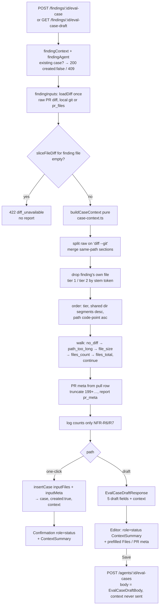
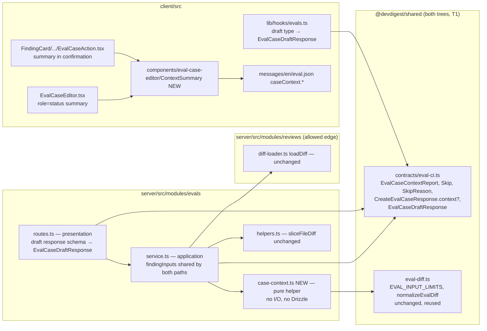

# Finding-derived eval cases carry the original review's context — Implementation plan

> Spec: [`2026-11-01-finding-case-review-context`](../specs/2026-11-01-finding-case-review-context.md) (`Status: approved`, rev 2) — read 2026-11-01.
> Research: [`docs/research/2026-11-01-finding-case-review-context.research.md`](../research/2026-11-01-finding-case-review-context.research.md) (trusted, not re-traced).
> Status: **approved** (rev 1, 2026-11-01). Execution mode: **single**.
> Scope: `server/` (evals module + shared contracts), `client/` (shared contracts copy, hooks, finding card action, case editor, i18n). No DB/migration change. `reviewer-core`, `mcp/`, `e2e/` untouched.
> ACs are owned by the spec; this plan only maps them.

## 0. Diagrams

### Flow — building a case from a finding (both paths)

### Structure — rings and files touched

## 1. Requirements (verified)

| R | Requirement, restated | Spec id | Covered by steps | Verified by |
|---|-----------------------|---------|------------------|-------------|
| R1 | Candidates = every file section of the click-time PR diff except the finding's own file; both paths, both kinds | AC-R1, EC-R1, EC-R15, EC-R19 | B1, B3, B4 | V3 (u1), V6 (i2, i3) |
| R2 | Tier 1 = stem (file name minus last extension) occurs as a whole token in the finding's **whole** diff section *(Q1 = a)*; empty stem never matches *(G3 default — assumed default, confirm)* | AC-R2, EC-R8 | B1 | V3 (u2) |
| R3 | Order tier 1 → tier 2 | AC-R3 | B1 | V3 (u2) |
| R4 | Within tier: shared leading dir segments desc, then path ascending **by code point** *(Q3 = a)* | AC-R4 | B1 | V3 (u2) |
| R5 | Included candidate = one Files entry `{path, content}`; content = exact section slice, LF; deleted file → old path; same-path sections merged *(Q2 = a)* | AC-R5, C-R4, EC-R7, Q-R7 | B1 | V3 (u3, u4) |
| R6 | Skip reasons `no_diff`, `path_too_long`, `file_size`, `files_count`, `files_total` | AC-R6a…AC-R6e, EC-R3, EC-R6 | B1 | V3 (u5) |
| R7 | Exactly one reason, first in AC-R6a…e order | AC-R6f | B1 | V3 (u5) |
| R8 | Continue after a skip | AC-R6g, EC-R2, EC-R3 | B1 | V3 (u5) |
| R9 | Whole section or nothing | AC-R7 | B1 | V3 (u3) |
| R10 | `files_unavailable = max(0, files_count − distinct paths in loaded diff)` | AC-R8, EC-R4, EC-R5 | B1, B3 | V3 (u6), V6 (i4) |
| R11 | PR title = PR row title | AC-R9, EC-R11 | B1, B3 | V6 (i1) |
| R12 | PR description = PR row body or `""` | AC-R10, EC-R9 | B1, B3 | V3 (u7), V6 (i1) |
| R13 | Title > 200 UTF-16 units → 199 + "…", body > 8,000 → 7,999 + "…", never split a surrogate *(Q3 = a)* | AC-R11a, AC-R11b, EC-R10 | B1 | V3 (u7) |
| R14 | Report `pr_meta`: `empty` / `truncated` / `attached` | AC-R12 | B1 | V3 (u7) |
| R15 | Draft and one-click byte-identical diff, Files, PR meta, report | AC-R13, NFR-R3 | B3, B4 (one shared method, Rec R2) | V3 (u8), V6 (i2) |
| R16 | 0 LLM / embedding / GitHub API calls on create and draft | AC-R14, NFR-R2 | B1 (pure), B3 | V6 (i3) |
| R17 | Saving an edited draft stores the body's Files and PR meta | AC-R15, EC-R14 | existing `prepareDraft` (`service.ts:233`); C3 never sends `context` | V6 (i5), V8 (c4) |
| R18 | Editor on a finding draft shows the summary (new `role="status"` line, G1 default) | AC-R16 | C2, C3 | V8 (c3) |
| R19 | One-click `created: true` → summary in confirmation; absent on `created: false` | AC-R17, EC-R1, EC-R13 | C1, C4, C5 | V8 (c1, c2) |
| R20 | "· {u} PR files had no diff available" when `files_unavailable > 0` | AC-R18, EC-R4 | C1, C5 | V8 (c1) |
| R21 | "Show skipped files" toggle + 5 reason texts | AC-R19 | C1, C5 | V8 (c1) |
| R22 | > 20 skips → 20 + "and {n} more" | AC-R20 | C1, C5 | V8 (c1) |
| R23 | Auto-filled Files / PR meta reach the model only via existing fenced case inputs | AC-R21, EC-R16 | no engine change (NG-R6); B3 stores into the same columns | V6 (i6) |
| R24 | Skipped paths and reasons rendered as plain text | AC-R22, EC-R17 | C1 | V8 (c1) |
| R25 | Pre-existing cases unchanged | AC-R23, EC-R20, NG-R3 | no backfill; no migration | V6 (i7) |
| R26 | Headline: `src/artifact.ts` first Files entry; eval prompt holds it + title + body | AC-R24a, AC-R24b | B1, B3 | V3 (u9), V6 (i6), V11 (manual) |
| R27 | `diff_unavailable` unchanged, no report | EC-R12 | B3 (slice check before building) | V6 (existing tests stay green) |
| R28 | Report not stored, shown at creation only | NG-R7, EC-R18, Q-R1 | A1 (response-only schema), B3 | V6 (i5) |
| R29 | Build adds ≤ 500 ms p95 for ≤ 1,000 sections / ≤ 5 MB | NFR-R1 | B1 (token set, single pass) | V3 (u10, Rec R4) |
| R30 | Logs: counts, `pr_meta`, skip reasons only; one info line per created case / draft | NFR-R6, NFR-R7 | B1 (`contextLogFields`), B3, B4 | V3 (u11) |
| R31 | Accessible: summary inside `role="status"`; toggle keyboard + `aria-expanded` | NFR-R4 | C1, C3, C4 | V8 (c1, c3) |
| R32 | Every new string in `client/messages/en/eval.json`, ICU plurals | NFR-R5 | C5 | V8 (c1) |
| R33 | C-R1…C-R3 identical in both trees (diff `contracts/eval-ci.ts` only, C4) | NFR-R8 | A1, A2 | V2 |
| R34 | Create / update bodies stay `EvalCaseDraftBody`; a `context` key is stripped, never stored *(Q4 = a)* | C-R3, NG-R7 | A1 (bodies untouched) | V6 (i5) |

### Owner answers
- Q1 → **a**: the tier-1 token search scans the finding's whole diff section, as AC-R2 is written (so `index` is always tier 1 on clone diffs; accepted noise, EC-R8).
- Q2 → **a**: same-path sections are merged into one candidate, in diff order (matches `sliceFileDiff`, `server/src/modules/evals/helpers.ts:41-53`).
- Q3 → **a**: length limits in UTF-16 code units (as `eval-diff.ts:225-230` and `EvalPrMeta` measure), never split a surrogate pair; AC-R4 path order uses a real code-point comparator.
- Q4 → **a**: bodies stay non-strict (`contracts/eval-ci.ts:115-141`); `context` in a body is stripped; a test proves it is not stored. `spec-creator` should later fix the C-R3 wording ("rejected" → "ignored").
- Execution mode → **single**.

### Recommendations
| # | Recommendation | Owner | Reflected in |
|---|----------------|-------|--------------|
| R1 | Token search over hunk lines only | rejected | — (Q1 = a) |
| R2 | One private service method builds inputs for both paths | accepted | D2, B2–B4 |
| R3 | Pure builder in new `evals/case-context.ts`, reuse `EVAL_INPUT_LIMITS` | accepted | D1, B1 |
| R4 | NFR-R1 as a hermetic unit test of the pure builder | accepted | V3 (u10) |
| R5 | Fix unrelated tree drift (`productionize.ts:36`, `trace.ts:44-47`) | rejected here — separate later change | §12 (out of scope) |

## 2. Implementation decisions

| # | Decision (how, not what) | Consequence |
|---|--------------------------|-------------|
| D1 | All selection logic is one pure function `buildCaseContext(input)` in NEW `server/src/modules/evals/case-context.ts`, plus `truncateChars` and `contextLogFields`. Input: `{ raw, findingFile, findingSection, pull: { title, body, filesCount } }`. Output: `{ inputFiles, inputMeta, context }`. Limits come from `EVAL_INPUT_LIMITS` (`server/src/vendor/shared/eval-diff.ts:9-16`); bytes via `TextEncoder` after `normalizeEvalDiff` (`eval-diff.ts:66-68`). | No I/O → unit-testable, onion-clean; limits cannot drift from the save validator. |
| D2 | `EvalService.findingDiff` (`service.ts:198-220`) becomes `findingInputs(ctx, found)` and returns `{ inputDiff, repoRow, inputFiles, inputMeta, context }` from **one** `loadDiff` call. Both `createCaseFromFinding` and `draftFromFinding` call it. | AC-R13 by construction (Rec R2). |
| D3 | Sections are cut from `raw` text, not from `UnifiedDiff.files`: `parseUnifiedDiff` drops binary / mode-only / rename-only / deleted sections (`server/src/adapters/git/diff-parser.ts:37-41,79`) (G2). A section is the exact substring from its `diff --git` line start to the next `diff --git` line start (last one: to end of `raw`), then `normalizeEvalDiff`. | Byte-exact content (C-R4); binary files exist as candidates and get `no_diff`. |
| D4 | Section path: the `+++ b/
` line; if that is `+++ /dev/null`, the `--- a/
` line; else a `rename to 
` line; else the `diff --git a/X b/Y` header's `b/` half (text after the last ` b/`). Git-quoted paths (`"b/…"`) are kept verbatim. *(G2 default — assumed default, confirm)* | Deleted file → old path (Q-R7). Quoted-path files are never the finding's file (same rule as `sliceFileDiff`). |
| D5 | Finding-file exclusion uses the `sliceFileDiff` rule: a section whose `diff --git` line ends with `` ` b/${findingFile}` `` (`helpers.ts:46-47`). | The case diff and the exclusion always agree. |
| D6 | Same-path sections are concatenated in diff order into one candidate *(Q2 = a)*. `files_unavailable` uses **distinct paths** across all sections (finding's file included) as "file sections". | Unique Files paths → an editor save never hits `duplicate_file_path` (`eval-diff.ts:228-232`). |
| D7 | Hunk count = lines in the section that match `/^@@ -\d/`; 0 → `no_diff`. | Covers binary, mode-only, rename-only. |
| D8 | Stem = basename without its last `.ext` (`lastIndexOf('.')`; at index 0 → `""`). An empty stem never matches *(G3 default — assumed default, confirm)*. Match: if the stem is all `[A-Za-z0-9_]`, look it up in a `Set` of the maximal `[A-Za-z0-9_]+` tokens of the finding section (built once); otherwise a regex-escaped `(?<![A-Za-z0-9_])<stem>(?![A-Za-z0-9_])` test. | The same semantics as AC-R2 with one tokenisation pass (NFR-R1); stems like `c++` or `foo.test` are safe. |
| D9 | Shared dir segments = common prefix length of `path.split('/').slice(0, -1)` for candidate and finding file. Path order = a code-point comparator (iterate `codePointAt`), not JS `<` *(Q3 = a)*. | A total order (paths unique after D6) → deterministic (NFR-R3). |
| D10 | `truncateChars(s, max)`: if `s.length > max`, `cut = s.slice(0, max - 1)`; if the last unit of `cut` is a high surrogate (`0xD800–0xDBFF`), drop it; return `cut + '…'`. Units are UTF-16 *(Q3 = a)*. | The result always passes `EvalPrMeta` (`contracts/knowledge.ts:126-129`) and the save validator. |
| D11 | The draft response gets a new schema `EvalCaseDraftResponse = z.object({ ...EvalCaseDraft.shape, context: EvalCaseContextReport }).strict()`; `EvalCaseDraft` itself stays unchanged (C2). | The existing strict test (`server/test/contracts.test.ts:577-579`) stays valid; the draft route stops being a 500 risk. |
| D12 | `CreateEvalCaseResponse.context` is `.optional()`; the service sets it only when the insert returned `created: true` (including the race in which `insertCase` returns an existing row). | C-R2 holds even in the concurrent case. |
| D13 | One info log per created case / draft: `this.log.info(contextLogFields(context), 'eval case context built')`, fields `files_included`, `skipped_<reason>` counts, `files_unavailable`, `pr_meta`. No paths, no content, no title or body. | NFR-R6/R7; paths are untrusted and are left out of logs too. |
| D14 | Client: one presentational component `ContextSummary` in NEW `client/src/components/eval-case-editor/ContextSummary/`, exported from `client/src/components/eval-case-editor/index.ts`, used by the editor and by `EvalCaseAction`. In the editor it sits in a NEW `
` above the name field (G1). | No duplicate UI; the existing confirmation `role="status"` (`EvalCaseAction.tsx:71`) wraps it there. |

## 3. What already exists — do not rebuild

| Layer | Already there | File |
|-------|---------------|------|
| DB | `pull_requests.title` / `body` / `files_count` — no schema change | `server/src/db/schema/pulls.ts:16,24,26` |
| DB | `eval_cases.input_files` / `input_meta` jsonb columns | `server/src/db/schema/eval.ts:31` (research R2 F1) |
| Repo | `findingContext` already returns the whole `pull` row | `server/src/modules/reviews/repository/review.repo.ts:120-134` |
| Repo | `insertCase` already takes `inputFiles` / `inputMeta` | `server/src/modules/evals/service.ts:162-163` |
| Loader | `loadDiff` (local git, else `pr_files`) — 0 GitHub API calls | `server/src/modules/reviews/diff-loader.ts:12-44` |
| Helper | `sliceFileDiff` (finding's file section) | `server/src/modules/evals/helpers.ts:41-53` |
| Limits | `EVAL_INPUT_LIMITS`, `normalizeEvalDiff`, `validateEvalCaseDraft` | `server/src/vendor/shared/eval-diff.ts:9-16,66-68,202-250` |
| Contracts | `EvalCaseInputFile`, `EvalPrMeta` | `server/src/vendor/shared/contracts/knowledge.ts:120-129` |
| Engine | Files fenced as "Additional files (context only — not part of the diff)"; PR meta as `Title: …\n\n…` | `reviewer-core/src/prompt.ts:206`, `server/src/modules/evals/executor.ts:30-33,126-135` |
| Client | Editor already maps draft Files / PR meta into the form | `client/src/components/eval-case-editor/EvalCaseEditor/helpers.ts:53-62` |
| Client | Confirmation `role="status"` block | `client/src/app/repos/[repoId]/pulls/[number]/_components/FindingCard/_components/EvalCaseAction/EvalCaseAction.tsx:71-80` |

Nothing for the context report itself is pre-staged — verified by `rg -n -i "EvalCaseContext|files_skipped|files_unavailable|no_diff|path_too_long|showSkipped|relatedness|fileStem" server/src client/src client/messages reviewer-core/src` (only hits: onboarding's `files_skipped`, unrelated; `server/src/modules/skills/helpers.ts:191 fileStem`, not importable from `evals` under onion rule 10).

### Code map — files this change touches

| File | Why it changes | Anchor |
|------|----------------|--------|
| `server/src/vendor/shared/contracts/eval-ci.ts` | C-R1 schemas, `CreateEvalCaseResponse.context?`, `EvalCaseDraftResponse` | `:108-112`, `:145-154` |
| `client/src/vendor/shared/contracts/eval-ci.ts` | identical copy (T1) | same lines |
| `server/src/modules/evals/case-context.ts` **NEW** | pure builder (D1, D3–D10, D13) | — |
| `server/src/modules/evals/service.ts` | `findingInputs`, both paths, log, response | `:98-170`, `:198-224`, `:357-387` |
| `server/src/modules/evals/routes.ts` | draft response schema | `:6-12`, `:59-63` |
| `server/test/evals-case-context.test.ts` **NEW** | unit tests u1–u11 | — |
| `server/test/evals.it.test.ts` | update broken asserts; new integration cases i1–i7 | `:205-221`, `:280-281`, `:1092-1093` |
| `server/test/contracts.test.ts` | new schema tests | `:570-580` |
| `client/src/lib/hooks/evals.ts` | draft response type | `:76-85` |
| `client/src/components/eval-case-editor/ContextSummary/{ContextSummary.tsx,styles.ts,index.ts,ContextSummary.test.tsx}` **NEW** | summary + skipped list | — |
| `client/src/components/eval-case-editor/index.ts` | export `ContextSummary` | `:1-2` |
| `client/src/components/eval-case-editor/EvalCaseEditor/EvalCaseEditor.tsx` | pass `context` to `EditorBody`, render status line | `:108-117`, `:125-136`, `:230-232` |
| `client/src/components/eval-case-editor/EvalCaseEditor/styles.ts` | style for the status line | — |
| `client/src/components/eval-case-editor/EvalCaseEditor/EvalCaseEditor.test.tsx` | draft mocks gain `context`; c3, c4 | `:32`, `:340` |
| `client/src/app/repos/[repoId]/pulls/[number]/_components/FindingCard/_components/EvalCaseAction/EvalCaseAction.tsx` | summary in confirmation | `:71-80` |
| `client/src/app/repos/[repoId]/pulls/[number]/_components/FindingCard/_components/EvalCaseAction/EvalCaseAction.test.tsx` | c2 | `:120` |
| `client/messages/en/eval.json` | `caseContext.*` keys | `:200-209` |

## 4. Data model

No change. No `schema.ts` edit, no `pnpm db:generate`, no migration (T4 n/a). The report is never persisted (NG-R7). Legacy rows are untouched (NG-R3).

## 5. Contracts (`@devdigest/shared`)

Edit **both** `server/src/vendor/shared/contracts/eval-ci.ts` and `client/src/vendor/shared/contracts/eval-ci.ts`, identically, in step A1/A2 (T1). Exported through the existing barrel line `export * from './contracts/eval-ci.js'` (`server/src/vendor/shared/index.ts:27`). All new fields are snake_case; all enum values are lowercase (T3).

| Spec contract | Zod schema | Change |
|---|---|---|
| C-R1 skip reason | `EvalCaseContextSkipReason = z.enum(['no_diff','path_too_long','file_size','files_count','files_total'])` | NEW |
| C-R1 skip | `EvalCaseContextSkip = z.object({ path: z.string(), reason: EvalCaseContextSkipReason })` | NEW |
| C-R1 report | `EvalCaseContextReport = z.object({ files_included: z.number().int().min(0), files_skipped: z.array(EvalCaseContextSkip), files_unavailable: z.number().int().min(0), pr_meta: z.enum(['attached','truncated','empty']) })` | NEW, response-only |
| C-R2 | `CreateEvalCaseResponse` gains `context: EvalCaseContextReport.optional()` | amend `:108-112` |
| C-R3 | `EvalCaseDraftResponse = z.object({ ...EvalCaseDraft.shape, context: EvalCaseContextReport }).strict()` + type | NEW, placed after `EvalCaseDraft` (`:145-154`) |
| C-R3 bodies | `EvalCaseDraftBody`, `CreateEvalCaseBody`, `EvalCaseDraft` | **unchanged** (Q4 = a) |
| C-R4 / C-R5 | existing `EvalCaseInputFile`, `EvalPrMeta` | unchanged shape |

T6: `context` is optional on `CreateEvalCaseResponse`, so no existing literal breaks. `EvalCaseDraftResponse` is new; its only literal builders are `service.ts` `draftFromFinding` (B4) and the client draft mocks in `EvalCaseEditor.test.tsx` (`:32`, `:340`) (C6).

## 6. Server

**Presentation — `server/src/modules/evals/routes.ts`**
- `GET /findings/:id/eval-case-draft` (`:59-63`): response `{ 200: EvalCaseDraftResponse }`. Auth and workspace scoping are unchanged (`getContext`, the workspace check in the service); params are validated by `IdParams` (T5: no new route).
- `POST /findings/:id/eval-case` (`:47-57`): no change; `CreateEvalCaseResponse` now carries the optional `context`.

**Application — `server/src/modules/evals/service.ts`**
- `findingInputs(ctx, found)` replaces `findingDiff` (D2): `loadDiff` → `raw`; `inputDiff = sliceFileDiff(raw, finding.file)`; `''` → the same `diff_unavailable` 422 as today (EC-R12); then `buildCaseContext({ raw, findingFile: finding.file, findingSection: inputDiff, pull: { title: pull.title, body: pull.body, filesCount: pull.filesCount } })`. The camelCase row fields are mapped here and the report is snake_case (T2).
- `createCaseFromFinding`: uses `inputFiles` / `inputMeta` from `findingInputs` instead of `[]` / empty (`:162-163`); `caseResponse(row, created, created ? context : undefined)`; logs once when created (D12, D13).
- `draftFromFinding`: returns `EvalCaseDraftResponse` with `input_files`, `pr_meta` and `context` from `findingInputs` (replaces `:374-375`); logs once.

**Pure helper (application ring, no I/O) — NEW `server/src/modules/evals/case-context.ts`**
- Imports only `EVAL_INPUT_LIMITS`, `normalizeEvalDiff` and types from `@devdigest/shared`. No Drizzle, no container, no Fastify.

**Data access / infrastructure:** unchanged. `loadDiff` stays in `reviews/` (edge `evals → reviews` is already allowed for `loadDiff`, onion rule 10).

## 7. Client

- `client/src/lib/hooks/evals.ts:79`: `api.get<EvalCaseDraftResponse>`.
- NEW `client/src/components/eval-case-editor/ContextSummary/`:
  - `ContextSummary.tsx`: prop `{ report: EvalCaseContextReport }`. Renders the summary text (C5 keys), then, when `files_skipped.length > 0`, a native `<button type="button" aria-expanded>` "Show skipped files". Expanded, a `<ul>` of the first 20 entries as `{path} — {reason text}` text nodes, plus "and {n} more" when there are more than 20. Plain text only, no `dangerouslySetInnerHTML`, no markdown (AC-R22).
  - `styles.ts`, `index.ts`, `ContextSummary.test.tsx` (feature-folder naming per `client/AGENTS.md`).
- `client/src/components/eval-case-editor/index.ts`: `export { ContextSummary } from "./ContextSummary";`.
- `EvalCaseEditor.tsx`:
  - pass `context={caseId ? undefined : draftQ.data?.context}` into `EditorBody` (`:108-117`);
  - add the optional prop to its props (`:125-136`);
  - render `{context && 
<ContextSummary report={context} />
}` at the top of `s.body` (`:230`) (G1).
  - `formFromDraft` (`helpers.ts:53-62`) already copies only the 5 fields, so `context` is never sent on save.
- `EvalCaseAction.tsx:71-80`: inside the existing `create.data` `role="status"` block, when `create.data.created && create.data.context`, render `<ContextSummary report={create.data.context} />` after the "View in Evals tab" link. The editor-save confirmation (`:63-70`) is unchanged.
- `client/messages/en/eval.json`: a NEW `caseContext` object (C5).

## 8. Execution mode & agent lanes

| Lane | Agent | Phases | Files owned | Waits on | Checkpoint |
|------|-------|--------|-------------|----------|------------|
| L1 | implementer | A, B, C, D | every file in §3 code map | — | V1–V9 |
| L2 | main session runs this: `architecture-reviewer` | — | `evals/case-context.ts`, `evals/service.ts`, `evals/routes.ts`, both `eval-ci.ts` | L1 | report |
| L3 | main session runs this: `plan-verifier` | — | whole diff vs §1 | L1 | report |

## 9. Implementation plan

Package managers: `server/` and `client/` are **pnpm**; use only the direct binaries in §11 (T9). No `npm` anywhere.

### Phase A — Contracts (both trees)
| # | Step | Files | Skill | AC |
|---|------|-------|-------|-----|
| A1 | Add `EvalCaseContextSkipReason`, `EvalCaseContextSkip`, `EvalCaseContextReport` (lowercase enums), `context: EvalCaseContextReport.optional()` on `CreateEvalCaseResponse`, and NEW `EvalCaseDraftResponse` (D11) with exported types. Leave `EvalCaseDraft`, `EvalCaseDraftBody` and `CreateEvalCaseBody` unchanged | `server/src/vendor/shared/contracts/eval-ci.ts` | `zod`, `typescript-expert` | C-R1…C-R3, NFR-R8 |
| A2 | Apply the byte-identical edit to the client copy | `client/src/vendor/shared/contracts/eval-ci.ts` | `zod` | NFR-R8 |
| A3 | Contract tests: report accepts a valid object and rejects an uppercase reason / negative count; `CreateEvalCaseResponse` passes with and without `context`; `EvalCaseDraftResponse` requires `context` and rejects an extra key; existing `EvalCaseDraft` strict test (`:577-579`) unchanged | `server/test/contracts.test.ts` | `zod` | C-R1…C-R3 |

Checkpoint: V1 (server tsc), V2 (tree parity on `eval-ci.ts`). The client tsc may flag draft mocks only after C3; that is expected.

### Phase B — Server
| # | Step | Files | Skill | AC |
|---|------|-------|-------|-----|
| B1 | NEW pure module: `splitSections(raw)` (D3, D4, D6, D7), `stemOf`, `sharedDirSegments`, `compareCodePoints` (D8, D9), `truncateChars` (D10), `buildCaseContext` (walk + reasons AC-R6a…g, whole-or-nothing, `files_unavailable`, PR meta, `pr_meta` state), `contextLogFields` (D13) | `server/src/modules/evals/case-context.ts` (NEW) | `onion-architecture`, `typescript-expert` | AC-R1…AC-R12, AC-R24a, NFR-R1, NFR-R3, NFR-R6 |
| B2 | Replace `findingDiff` with `findingInputs` (D2): one `loadDiff`, slice, the unchanged `diff_unavailable`, then `buildCaseContext` with the `pull` row fields mapped | `server/src/modules/evals/service.ts` (`:198-220`) | `onion-architecture` | AC-R13, AC-R14 |
| B3 | `createCaseFromFinding`: use `findingInputs`; insert `inputFiles` / `inputMeta`; `caseResponse(row, created, context?)` (extend the signature at `:222-224`); `this.log.info(contextLogFields(context), 'eval case context built')` when `created` | `server/src/modules/evals/service.ts` (`:140-169`, `:222-224`) | `onion-architecture` | AC-R1, AC-R9, AC-R10, AC-R14, AC-R21, NFR-R7 |
| B4 | `draftFromFinding`: return type `EvalCaseDraftResponse`; `input_files`, `pr_meta`, `context` from `findingInputs`; log once | `server/src/modules/evals/service.ts` (`:357-387`) | `onion-architecture` | AC-R13, NFR-R7 |
| B5 | Draft route response schema → `EvalCaseDraftResponse`; import it | `server/src/modules/evals/routes.ts` (`:6-12`, `:61`) | `fastify-best-practices`, `zod` | C-R3 |
| B6 | NEW unit tests u1–u11 (§11 V3) | `server/test/evals-case-context.test.ts` (NEW) | `typescript-expert` | AC-R1…AC-R12, AC-R24a, NFR-R1, NFR-R6 |
| B7 | Update broken asserts: `:280-281` (one-click from the fixture → now `input_files` = `[ {path:'other.ts', …} ]` and `pr_meta` = `{title:'PR', description:''}`) and `:1092-1093` (draft, the same). Add integration cases i1–i7 (§11 V6) | `server/test/evals.it.test.ts` | `drizzle-orm-patterns` (fixtures only) | AC-R9, AC-R10, AC-R13…AC-R15, AC-R21, AC-R23, AC-R24b |

Checkpoint: V1, V3, V4; V6 when a DB is available.

### Phase C — Client
| # | Step | Files | Skill | AC |
|---|------|-------|-------|-----|
| C1 | NEW `ContextSummary` (+ `styles.ts`, `index.ts`) per §7 | `client/src/components/eval-case-editor/ContextSummary/` (NEW) | `frontend-ui-architecture`, `react-best-practices` | AC-R17…AC-R20, AC-R22, NFR-R4 |
| C2 | Export `ContextSummary` from the barrel | `client/src/components/eval-case-editor/index.ts` | `frontend-ui-architecture` | AC-R16 |
| C3 | Draft hook type → `EvalCaseDraftResponse` | `client/src/lib/hooks/evals.ts` (`:76-85`) | `react-best-practices`, `typescript-expert` | C-R3 |
| C4 | Editor: optional `context` prop on `EditorBody`, `role="status"` line at the top of the body; add `contextStatus` style | `client/src/components/eval-case-editor/EvalCaseEditor/EvalCaseEditor.tsx`, `.../EvalCaseEditor/styles.ts` | `react-best-practices` | AC-R16, NFR-R4 |
| C5 | Confirmation: render `ContextSummary` inside the existing `create.data` status block when `created && context` | `client/src/app/repos/[repoId]/pulls/[number]/_components/FindingCard/_components/EvalCaseAction/EvalCaseAction.tsx` (`:71-80`) | `react-best-practices` | AC-R17, EC-R13 |
| C6 | i18n: add `caseContext` with `summary` = `"Context: {n, plural, one {# file} other {# files}} from the PR · {meta}"`, `metaAttached` = `"PR meta attached"`, `metaTruncated` = `"PR meta attached (truncated)"`, `metaEmpty` = `"no PR meta"`, `skipped` = `" · {k, plural, one {# file} other {# files}} skipped (limit)"`, `unavailable` = `" · {u, plural, one {# PR file} other {# PR files}} had no diff available"`, `showSkipped` = `"Show skipped files"`, `more` = `"and {n} more"`, `reason.no_diff` = `"no diff (binary or empty change)"`, `reason.path_too_long` = `"path over 300 characters"`, `reason.file_size` = `"over 64 KB"`, `reason.files_count` = `"over the 10-file limit"`, `reason.files_total` = `"over the 256 KB total"` | `client/messages/en/eval.json` | `next-best-practices` | AC-R17…AC-R19, NFR-R5 |
| C7 | Tests: NEW `ContextSummary.test.tsx` (c1); `EvalCaseAction.test.tsx` (c2); `EvalCaseEditor.test.tsx` — add `context` to the draft mocks at `:32` / `:340`, add c3, c4 | the 3 test files | `react-testing-library` | AC-R15…AC-R20, AC-R22 |

Checkpoint: V7, V8.

### Phase D — Wrap-up
| # | Step | Files | Skill | AC |
|---|------|-------|-------|-----|
| D1 | Run V1–V9; record insights (e.g. "`parseUnifiedDiff` drops binary/deleted sections — split `raw` when you need every file") | `server/INSIGHTS.md` | `engineering-insights` | — |

Main session after L1: `architecture-reviewer` (L2) and `plan-verifier` (L3). Not implementer steps.

## 10. Risks & gotchas

- **T1 two contract trees** — A1 and A2 edit `server/src/vendor/shared/contracts/eval-ci.ts` and `client/src/vendor/shared/contracts/eval-ci.ts` in the same phase. **C4:** the trees already differ in unrelated files (`contracts/productionize.ts:36` provider enum, `contracts/trace.ts:44-47` comments), so the parity check V2 diffs **`contracts/eval-ci.ts` only**. Fixing that drift is out of scope (Rec R5, separate change).
- **T2 casing** — the report is snake_case (`files_included`…); `pull.filesCount` / `pull.body` (camelCase Drizzle props, `pulls.ts:24,26`) are mapped in `service.ts` B2. No schema or repo edit.
- **T3 enum casing** — `EvalCaseContextSkipReason` and `pr_meta` are **lowercase**. They are never persisted; Zod response serialization is the guard.
- **T4 migrations** — none. Do not run `db:generate`.
- **T5 routes** — no new route. The draft route's response schema must change (B5, **C2**). The service returning `context` against the old strict `EvalCaseDraft` would fail serialization with a 500.
- **T6 required fields** — `CreateEvalCaseResponse.context` is optional; `EvalCaseDraftResponse.context` is required, but the type is new. Its literal sites: `service.ts` `draftFromFinding`, client mocks `EvalCaseEditor.test.tsx:32,340`.
- **T9** — pnpm packages only; direct binaries.
- **Existing tests that will break (expected)** — `server/test/evals.it.test.ts:280-281` and `:1092-1093` assert empty Files and PR meta for finding-created cases; the fixture (`:205-221`) has PR title `'PR'` and `other.ts`, so after the change they must expect `other.ts` in Files and `title: 'PR'` (B7). `server/test/contracts.test.ts:577-579` stays green (D11). The client draft mocks need `context` (C7).
- **C3 stale-base clone diff (`server/INSIGHTS.md:137`)** — if the clone's local base branch is stale, `git diff base...head` can return dozens of unrelated files (69 for a 2-file PR). The builder then fills Files with unrelated sections, and `files_unavailable` floors to 0, so the report cannot reveal it. The spec does not cover this and the plan does **not** fix it. The tier/directory order limits the damage. Watch for it in V11 (manual), and raise it to the owner if seen.
- **G2 parser blind spot** — never build candidates from `UnifiedDiff.files`; binary, mode-only, rename-only and deleted sections are missing there (`diff-parser.ts:37-41,79`). Split `raw` (D3).
- **Q1 = a noise** — on clone diffs, every section has an `index <sha>..<sha>` line, so a candidate named `index.*` is always tier 1. Directory names in the finding's header (`agent-runner`) promote stems like `agent`. Accepted (EC-R8). Tests must assert that order explicitly so nobody "fixes" it.
- **Regex injection** — stems with metacharacters (`c++`, `[id]`) must be escaped (D8). Unit test u2 covers `[id].tsx`.
- **Q3 code-point order** — JS `<` / `localeCompare` are **wrong** for AC-R4. Use the D9 comparator. u2 covers an astral-plane path vs a BMP path.
- **Determinism** — `getPrFiles` has no ORDER BY (`server/src/modules/reviews/repository/pull.repo.ts:32`), so fallback section order varies between calls. Output order depends only on the D9 total order and the D6 merge, so AC-R13 still holds; u8 shuffles the input.
- **Logs** — never log `found.pull.title`, `body`, paths or content (NFR-R6). Only `contextLogFields`.
- **Onion** — `case-context.ts` must import nothing from `db/`, `adapters/`, `platform/` or Fastify. The `evals → reviews` edge stays limited to `loadDiff` (rule 10 allow-list).

## 11. Verification

| # | Command | Expected | AC |
|---|---------|----------|----|
| V1 | `cd server && ./node_modules/.bin/tsc --noEmit` | clean | — |
| V2 | `diff server/src/vendor/shared/contracts/eval-ci.ts client/src/vendor/shared/contracts/eval-ci.ts` | no output | NFR-R8 |
| V3 | `cd server && ./node_modules/.bin/vitest run test/evals-case-context.test.ts` — **u1** finding file excluded, both kinds; **u2** tier/dir/code-point order on a fixed fixture (incl. `index.ts` via the `index` header line, `[id].tsx`, empty stem `.gitignore` never tier 1, astral path); **u3** content byte-equal to the raw slice, CRLF → LF, never cut; **u4** deleted file → old path; same-path sections merged; **u5** one fixture per reason, precedence when several apply, a later small file included after a `files_total` skip; **u6** `files_unavailable` with `filesCount` > / < distinct paths; **u7** 201-char title, 8,001-char body, surrogate pair at the cut, null body, `empty` / `truncated` / `attached`; **u8** shuffled section order → identical output; **u9** AC-R24a fixture (`src/run.ts` with `from './artifact.js'`, `src/artifact.ts` added, 12 other files) → `src/artifact.ts` is Files[0]; **u10** synthetic 1,000-section / 5 MB diff builds in < 500 ms; **u11** `contextLogFields` has counts only — no title, body, path or content substring | all pass | AC-R1…AC-R12, AC-R24a, NFR-R1, NFR-R3, NFR-R6, NFR-R7 |
| V4 | `cd server && ./node_modules/.bin/vitest run --exclude '**/*.it.test.ts'` | all pass (incl. A3 contract tests) | C-R1…C-R3 |
| V5 | — | (reserved) | — |
| V6 | `cd server && TEST_DATABASE_URL=… ./node_modules/.bin/vitest run .it.test --no-file-parallelism` — **i1** one-click: stored `pr_meta` = PR row title/body; **i2** GET draft then POST one-click for the same accepted finding → `input_diff`, `input_files`, `pr_meta`, `context` deep-equal; **i3** `llm.calls` = 0 and a GitHub override whose methods throw is never hit, on both paths; **i4** `pr_files` fallback with `files_count` = 5 and 2 patched rows → `files_unavailable` = 3; **i5** POST `/agents/:id/eval-cases` with the edited draft (a prefilled file removed, title edited) plus an extra `context` key → 201, the stored case has the edited Files/meta and no `context`; **i6** AC-R24b: one-click on the headline fixture, then a scope-`case` run (`POST /agents/:id/eval-runs {case_id}`); the captured prompt (`llm.prompts`, pattern `evals.it.test.ts:473-480`) contains `## Additional files (context only — not part of the diff)`, the `src/artifact.ts` diff text and `Title: <title>` + body; **i7** a pre-existing case with empty Files/meta keeps identical diff, Files, meta, expected and `revision` after i1–i6; updated asserts `:280-281`, `:1092-1093` | all pass (self-skips without Docker) | AC-R9, AC-R10, AC-R13…AC-R15, AC-R21, AC-R23, AC-R24b, EC-R4, EC-R12 |
| V7 | `cd client && ./node_modules/.bin/tsc --noEmit` | clean | — |
| V8 | `cd client && ./node_modules/.bin/vitest run` — **c1** `ContextSummary`: each report variant's text (0 files, 1 file, meta states, skipped part only when non-empty, unavailable part only when > 0), toggle is a button with `aria-expanded` false → true via keyboard, 5 reason texts, 25 skips → 20 + "and 5 more", a path `<b>x</b>` renders as literal text; **c2** `EvalCaseAction`: summary inside `role="status"` on `created: true` with `context`, absent on `created: false`; **c3** editor on a finding draft shows the summary in a `role="status"` region; no summary when editing an existing case; **c4** editor save body has no `context` key | all pass | AC-R15…AC-R20, AC-R22, NFR-R4, NFR-R5 |
| V9 | `cd client && ./node_modules/.bin/next build` (catches the vendored-barrel `.js` resolution, `client/INSIGHTS.md:93`) | builds | — |
| V10 | main session: `architecture-reviewer` + `plan-verifier` | no blocking findings | all |
| V11 | Manual end-to-end (owner): re-create the PR #13 incident case from finding `98622400-…` (delete the old case first) → the confirmation shows "Context: N files from the PR · PR meta attached · … · 171 PR files had no diff available"; the case's Files tab lists `agent-runner/src/artifact.ts` first; run the case → the agent finds the bug | as described | AC-R24a, AC-R24b, EC-R4 |

## 12. Open questions & recommendations

- **G2 / D4 path rule** and **G3 / D8 empty stem** are *assumed defaults — confirm* (owner). The implementer must not change them alone.
- **C-R3 wording** — the spec says a body carrying `context` is "rejected"; per Q4 = a it is stripped and ignored. For `spec-creator`: change "rejected as today (the schema is strict)" to "ignored (the body schema strips unknown keys); never stored".
- **C3 stale-base diff** — not covered by the spec. If V11 or real use shows unrelated Files from a stale clone, the owner decides whether `spec-creator` adds a guard (for example, prefer `pr_files` when the clone diff has far more sections than `files_count`).
- **Out of scope (Rec R5, rejected here):** the existing server/client drift in `contracts/productionize.ts:36` (client enum lacks `openrouter`) and `contracts/trace.ts:44-47` — a separate later change.
