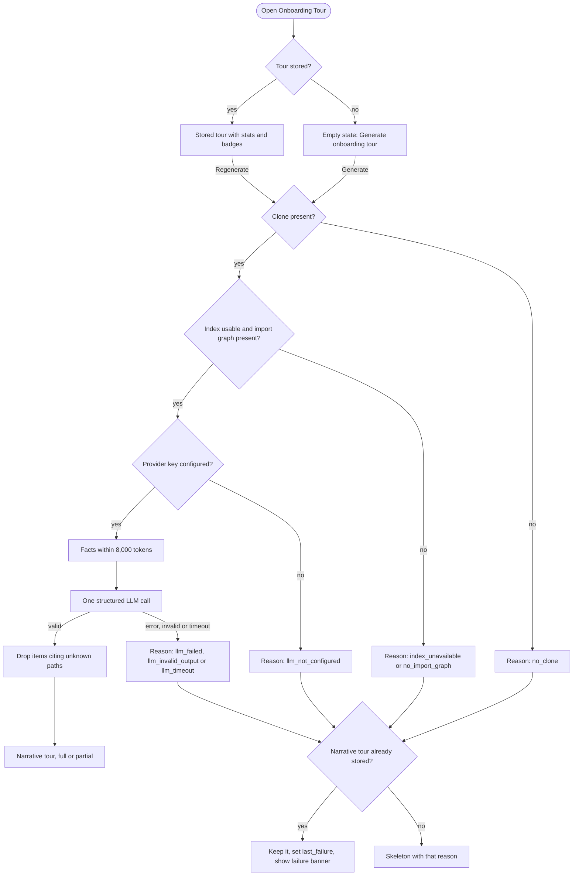
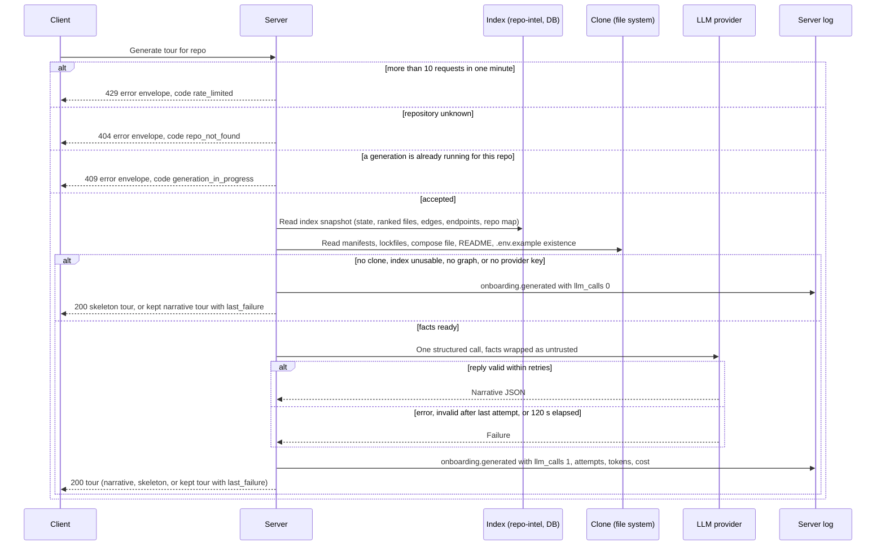

# Spec: Onboarding Generator ("Onboarding Tour")

Spec ID: 2026-10-11-onboarding-generator
Status: approved
Supersedes: —
Modules: server, client, e2e (browser flow for a skeleton state), plus the shared contracts in both `vendor/shared` trees
Revision: rev 8 (2026-10-11)
Design sources: owner's requirements (Ukrainian original, relayed verbatim) and the lab grading checklist; 2 screenshots: (1) "Onboarding for payments-api" page — sidebar WORKSPACE "Onboarding Tour", "On this page" TOC, Regenerate / Share link, subtitle "Generated from index of 12,450 files · last refreshed 2h ago", Architecture overview (prose + diagram), Critical paths (file rows with description + Open), How to run locally (start); (2) How to run locally (4 numbered commands with copy) and Guided reading path (3 numbered files with a reason). Research: [`docs/research/2026-10-11-onboarding-generator.research.md`](../research/2026-10-11-onboarding-generator.research.md) (R1–R3).

> Changelog
> - rev 1: first draft. Blocking answers applied: Q1 → a (one cached tour per repo, explicit Generate/Regenerate, the owner's five sections), Q2 → a (skeleton with zero LLM calls when the index is unusable; partial narrative when capped; skeleton on LLM failure), Q3 → a (no clone → DB-metadata skeleton, no GitHub calls), Q4 → a (indexer unchanged, honest "X of Y", ≤ 8,000-token facts budget, JS/TS demo repo), Q5 → a (`PageRank × (1 + hotness)`, hotness = 0 stated honestly), Q6 → a (pipeline gaps recorded with manual workarounds), Q7 → default retries kept but logged. Proposals P1–P5 accepted; P6 (MCP tool) rejected → NG4.
> - rev 2: owner accepted every default ("приймаю дефолти"): Q-1 to Q-13 resolved with option a and moved to Resolved questions; "(default → Q-n)" markers replaced by "(decided: Q-n)"; Clarifications log and Lab reconciliation row 15 closed. No requirement changed.
> - rev 3: approved by owner (2026-10-11).
> - rev 4: two owner decisions applied after approval; status back to `draft` until the owner re-approves. (1) C2 errors now use the standard envelope `{ error: { code, message, details? } }` with codes `repo_not_found` / `generation_in_progress` / `rate_limited`; AC-33, AC-34, AC-70 and the sequence diagram updated; AC-76 added for the 404. (2) AC-36 extended to every `SkeletonReason`: a regeneration reduced to a pre-LLM skeleton (`no_clone`, `index_unavailable`, `no_import_graph`, `llm_not_configured`) also keeps a stored narrative tour; setting `last_failure` split out as AC-75; `last_failure` gains `provider` and `attempts` so AC-71 can fill the sentence placeholders; flowchart, hand-off table, EC-11, EC-26, EC-27 and Traceability updated.
> - rev 5: owner decisions on rev 4: `last_failure.provider` / `attempts`, AC-76 and EC-27 kept; in-place revision accepted (no superseding spec). P7 accepted: the AC-71 banner also shows the Skeleton-reasons next step (AC-71, its observable and Traceability row updated). P8 (a clearing rule for `last_failure`) rejected — recorded under Rejected proposals.
> - rev 6: approved by owner (2026-10-11).
> - rev 7: two owner changes after plan review; status back to `draft` until the owner re-approves. (1) P8 reversed to accepted: new AC-78 stores `last_failure: null` when a generation replaces the stored tour (AC-35); C1 `last_failure` meaning, Accepted/Rejected proposals, EC-29 and Traceability updated. (2) First tasks floor: new AC-77 makes First tasks `available: false` with a defined `unavailable_reason` when fewer than 3 valid tasks remain in a narrative tour after the AC-54/AC-55 drops; AC-52 limited to ≥ 3 valid tasks; AC-55 points to AC-77; AC-56 scoped to Critical paths and Guided reading path (First tasks have no deterministic fallback); state table, EC-28, Q-6 and Traceability updated.
> - rev 8: approved by owner (2026-10-11).

## Problem & user

A developer who joins a team, or picks up an unfamiliar open-source repository, needs a first-day map: what the system is, which files matter, how to run it, what to read first, and what to try first. Today they piece this together from a README (often stale), by grepping, or by asking a colleague. DevDigest already knows a lot about every imported repository — the repo-intel index holds symbols, the import graph, a PageRank-based file rank, endpoints and a cached repo map (`server/src/modules/repo-intel/README.md:3-12`) — but none of it is shown to a human as a guided tour.

A starter scaffold exists but is unused and partly contradicts this feature:
- a contract `Onboarding { sections[] { kind, title, body, diagram, links[] } }` with a free-string `kind` (`server/src/vendor/shared/contracts/knowledge.ts:28-47`);
- a per-repo storage slot nothing writes to (`server/src/db/schema/context.ts:120-126`), and no registered module (`server/src/modules/index.ts:30-44`);
- a system prompt with an untrusted-data guard and grounding rules, but a different section set (`routes_and_apis`, `server/src/prompts/onboarding.system.md:1-45`);
- a feature-model entry "Onboarding Tour" in Settings → Feature Models (`server/src/vendor/shared/contracts/platform.ts:15,45-47`, `server/src/modules/settings/feature-models.ts:14-57`);
- client copy listing a different five sections (`client/messages/en/onboarding.json:10`);
- no sidebar item (`client/src/vendor/ui/nav.ts:21-28`), while the sidebar's active-key helper maps any path containing `/onboarding` — today the **Add repository** page (`client/src/app/onboarding/page.tsx:1-9`) — to `onboarding-tour` (`client/src/components/app-shell/helpers.ts:29`).
- facade methods already labelled for the onboarding reading path, with no production caller (`server/src/modules/repo-intel/types.ts:180-186`; research R2).

Two facts constrain the feature and must be stated honestly to the user:
- **Rank has no hotness today.** `rank = pagerank`, `hotness = 0`, because the clone is shallow (`server/src/modules/repo-intel/pipeline/rank.ts:4-7`, `server/src/modules/repos/constants.ts:9`).
- **The index is JS/TS-only and capped.** Only `.ts .tsx .js .jsx .mjs .cjs` are walked; at most 5,000 files, the first 5,000 alphabetical paths; reaching the cap still yields status `full`; `bounded` is not counted in `filesSkipped`; the total candidate count is not exposed by `GET /repos/:id/index-state` and is lost after an incremental refresh (`server/src/modules/repo-intel/pipeline/walk.ts:6-12,65-67`, `pipeline/full.ts:252-253`; research R2).

The user is (a) a **newcomer developer** who reads the tour, and (b) the **workspace owner** who generates it and pays for the LLM call. This feature is also the deliverable of the L05 lab; the lab's grading checklist is reconciled in [Lab assessment reconciliation](#lab-assessment-reconciliation).

## Goals / Non-goals

**Goals**
- G1 One click produces, for a JS/TS repository, a tour with exactly five sections in this order: Architecture overview, Critical paths, How to run locally, Guided reading path, First tasks.
- G2 Every file, route, script and command in the tour comes from deterministic facts (the index snapshot and the clone's manifests); exactly one logical structured LLM call turns the facts into narrative text.
- G3 The Guided reading path is ordered by `PageRank × (1 + hotness)` and shows each file's rank percentile.
- G4 When the index is unusable, the clone is missing, or the LLM call fails, the user still gets a deterministic skeleton with an honest status and reason; a capped or partial index yields an honest "partial" label.
- G5 The cost of a generation is visible: the header shows calls, tokens, cost and model, and one server log line per generation records the same, including attempts.
- G6 The lab grading checklist is mapped item by item to the AC, artifact or verification step that proves it, with an honest status.

**Non-goals**
- NG1 Changing the indexer: languages, the 5,000-file cap, walk order, hotness computation, incremental bookkeeping, or the `GET /repos/:id/index-state` contract.
- NG2 Automatic generation (on clone, on index, on page view). Generation happens only on an explicit Generate or Regenerate.
- NG3 Any GitHub API call: no README/manifest fetch for clone-less repositories, no "good first issue" lookup.
- NG4 An MCP tool for the tour (P6, rejected).
- NG5 Public or unauthenticated share links, and export (markdown, PDF).
- NG6 An in-app file viewer. "Open" leaves DevDigest.
- NG7 Changing any review-pipeline invariant: the injection guard, the untrusted-wrapping mechanism, `groundFindings()`, the review prompt, or Project Context injection. The tour is never injected into review prompts.
- NG8 Tour history or versioning. One tour per repository is kept; regenerating replaces it (except AC-36).
- NG9 Localisation beyond English (the client has only `client/messages/en/`).
- NG10 Changing the structured-call retry defaults (owner, Q7): provider retries stay as they are; they are logged instead.
- NG11 Fixing the pipeline-tooling gaps (agents, skills, settings) listed in the Lab assessment reconciliation. They are recorded with workarounds; changing them is outside this feature.
- NG12 Per-section regeneration, editing the tour, or user-supplied prompt text.

## Clarifications log (six categories)

Every `[NEEDS CLARIFICATION]` is closed. Round 1 blocking questions were answered by the owner; in rev 2 the owner accepted option a for Q-1 to Q-13 (see [Resolved questions](#resolved-questions-rev-2)). No question remains open.

| Category | Question | Resolution |
|---|---|---|
| 1. Scope and meaning of "onboarding" | What is a tour; which sections; one per what? | One cached tour per repository; the owner's five sections, in order; Add repository keeps `/onboarding` (Q1 → a) |
| 2. Users, entry points, UX flow | How does the user get there and trigger it? | WORKSPACE sidebar item; explicit Generate/Regenerate; Share link copies the URL (Q1 → a; Q-1) |
| 3. Facts and data sources, very large repos | What facts; what happens with 12,000+ files or non-JS/TS? | Indexer unchanged; honest "X of Y"; facts ≤ 8,000 tokens of top-ranked items; non-JS/TS → skeleton; demo repo must be JS/TS (Q4 → a, Q-9) |
| 4. Degradation, failure, no clone | What is shown without a full clone or a usable index, and on LLM failure? | Skeleton with zero LLM calls and an honest reason; no GitHub calls (Q2 → a, Q3 → a; Q-4) |
| 5. LLM cost and observability | How many calls; how is cost proven? | One logical structured call (one `call_id`), default retries kept, attempts/tokens/cost logged and shown (Q7; P1) |
| 6. Lifecycle | Freshness, regeneration, concurrency, sharing | Cached until regenerated; stale marker (P3); one generation per repo at a time; snapshot at start (Q-3, Q-13) |

## User stories
- **US-1** As a newcomer developer, I want a five-section tour of a repository I have never seen, so that I understand its architecture and key files on day one.
- **US-2** As a newcomer developer, I want a short reading path ordered by how central each file is, with a reason per file, so that I read the most load-bearing code first.
- **US-3** As a newcomer developer, I want copyable run commands that come from the repository's own manifests, so that I can start the project locally without guessing.
- **US-4** As a workspace owner, I want to generate and regenerate the tour on demand and see when it is out of date, so that I control when I pay for an LLM call.
- **US-5** As any user, I want an honest status when the index is incomplete, the clone is missing or the AI call failed, so that I never mistake a skeleton or a partial tour for a complete one.
- **US-6** As a workspace owner, I want each generation's LLM calls, attempts, tokens, cost and model in the UI and in the server log, so that I can verify cost.
- **US-7** As a newcomer developer, I want to share the tour with a teammate, so that we read the same page.
- **US-8** As the lab owner, I want every grading item mapped to its evidence, so that I know the lab is complete before the demo.

## Design & UX

**Sources analysed:** both screenshots; existing screens and copy: `client/messages/en/onboarding.json:1-17` (Generate/Regenerate copy), the Mermaid renderer (`client/src/components/mermaid-diagram/MermaidDiagram.tsx`), the GitHub blob-URL pattern used by Blast Radius (`client/src/lib/github-urls.ts:21-31`).

**State table**

| Screen / component | loading | empty | error | partial | long content |
|---|---|---|---|---|---|
| Tour page (whole) | "Generating…"/"Regenerating…", existing tour stays visible (AC-17) | "Generate onboarding tour" (AC-5) | load error + Retry (AC-19); skeleton banner (AC-31); regeneration-failure banner (AC-71); 409 message (AC-70) | "Partial" badge with reasons (AC-32) | sections capped (AC-47–AC-53) |
| Header stats | n/a — rendered with the tour | "0 LLM calls" for a skeleton (AC-11) | "cost unknown" (AC-12) | "({n} attempts)" (AC-13) | n/a |
| Architecture overview | as page | skeleton facts (AC-46) | diagram fallback (AC-62) | as page | prose ≤ 1,200 chars (AC-45) |
| Critical paths | as page | "No ranked files" (EC-6) | n/a | as page | ≤ 8 rows, middle-truncated paths (AC-47, AC-63) |
| How to run locally | as page | "No package.json found…" (AC-42) | skipped manifests listed (AC-43) | n/a | ≤ 8 commands (AC-41) |
| Guided reading path | as page | "No ranked files" (EC-6) | n/a | as page | ≤ 10 rows (AC-49) |
| First tasks | as page | unavailable in a skeleton (AC-53), or in a narrative tour with fewer than 3 valid tasks (AC-77) | n/a | n/a | 3–5 tasks (AC-52) |
| Sidebar item | n/a | n/a | n/a | n/a | n/a |

**Skeleton reasons** (AC-31; the regeneration-failure banner of AC-71 uses the same sentence and next step) — banner text "Showing the index skeleton — {sentence} {next step}":

| Reason | Sentence | Next step |
|---|---|---|
| `no_clone` | "Clone not available." | "Regenerate once the repository is cloned." |
| `index_unavailable` | "The code index is not available (status: {status})." | "Resync the index, then regenerate." |
| `no_import_graph` | "No JS/TS import graph — the indexer reads only .ts, .tsx, .js, .jsx, .mjs and .cjs files." | "The AI narrative needs a JS/TS repository." |
| `llm_not_configured` | "No API key for {provider}." | "Add one in Settings → API Keys, then regenerate." |
| `llm_failed` | "The AI call failed." | "Regenerate to try again." |
| `llm_invalid_output` | "The AI reply did not match the expected format after {attempts} attempts." | "Regenerate to try again." |
| `llm_timeout` | "The AI call took longer than 120 s." | "Regenerate to try again." |

**Partial reasons** (AC-32): `index_partial` "the index is partial"; `index_capped` "{X} of {Y} source files were indexed (cap reached)"; `files_skipped` "{n} files were skipped (too large or unparseable)"; `facts_truncated` "facts were trimmed to fit 8,000 tokens".

**Accepted UX decisions:** P1 header stats (AC-11–AC-13); P2 commands only from deterministic facts (AC-40, AC-41); P3 stale marker (AC-20); P4 provenance badges "from index" / "AI-written" (AC-16); P5 rank percentile on reading-path rows (AC-51); P7 the regeneration-failure banner also shows the reason's next step (AC-71, rev 5); P8 `last_failure` is cleared when a generation replaces the stored tour (AC-78) — rejected in rev 5, accepted by the owner in rev 7.

**Rejected proposals:** P6 MCP tool (NG4).

## Service communication

| Hand-off | Started by | What crosses | Sync / async | On failure / timeout | Source of truth |
|---|---|---|---|---|---|
| Client → Server: read tour | client, on page open | repo id → C1 | sync | load-error state + Retry (AC-19) | server's stored tour |
| Client → Server: generate | user click | repo id → C1 | sync request, up to 120 s (decided: Q-3) | 409 / 429 / network error shown; server keeps running and persists (AC-18) | server |
| Server → Index | server | index state, ranked files, import edges, endpoints, cached repo map | sync DB reads, once per generation (AC-21) | unusable → skeleton `index_unavailable` / `no_import_graph`, or a kept narrative tour + `last_failure` (AC-36, AC-75) | index (`repo_index_state` and friends) |
| Server → Clone | server | root and depth-1 manifests, lockfile presence, compose presence, `.env.example` presence, README | sync file reads | missing clone → `no_clone` (skeleton, or a kept narrative tour + `last_failure`, AC-36, AC-75); unreadable file → skipped and listed (AC-43) | clone working tree |
| Server → LLM | server | C3 facts → C4 narrative | sync, one logical call (one `call_id`), provider default retries | skeleton or kept tour + reason (AC-28, AC-29, AC-36, AC-75) | the index for every path; the LLM only for prose |
| Server → Log | server | C5 record | sync, fire-and-forget | a log failure never fails the generation | log |

No call to GitHub (NG3). Nothing is cached besides the stored tour; the cached repo map is read, never rebuilt.

## Contracts

All field names are `snake_case`; enum values are lowercase `snake_case`. The shape replaces the unused starter shape `Onboarding` (`server/src/vendor/shared/contracts/knowledge.ts:28-47`); whether it is renamed or extended is the planner's call.

**C1 — Tour read response** (server → client; the response of both "read tour" and "generate")

| Field | Type | Req | Meaning |
|---|---|---|---|
| `repo_id` | string | yes | repository id |
| `repo_full_name` | string | yes | `owner/name` |
| `tour` | `Tour` \| null | yes | null when never generated |
| `current_index` | `IndexSummary` | yes | the index as it is now (drives the stale marker, AC-20) |
| `generation_in_progress` | boolean | yes | a generation for this repo is running |
| `last_failure` | `{ at: ISO string, reason: SkeletonReason, provider: string \| null, attempts: int \| null }` \| null | yes | set when a regeneration ended in a skeleton while a narrative tour was stored, and that tour was kept (AC-36, AC-75); null once a generation replaces the stored tour (AC-78). `reason` may be any of the seven `SkeletonReason` values — pre-LLM (`no_clone`, `index_unavailable`, `no_import_graph`, `llm_not_configured`) or LLM (`llm_failed`, `llm_invalid_output`, `llm_timeout`). `provider`: the provider of the "Onboarding Tour" feature model at that regeneration (fills `{provider}` in AC-71). `attempts`: the attempts of the failed call, null when no LLM call was made (fills `{attempts}` in AC-71) |

`Tour`:

| Field | Type | Req | Meaning |
|---|---|---|---|
| `generated_at` | ISO string | yes | generation time ("last refreshed") |
| `mode` | `narrative` \| `skeleton` | yes | whether the LLM narrative is present |
| `skeleton_reason` | `SkeletonReason` \| null | yes | non-null iff `mode = skeleton` |
| `completeness` | `full` \| `partial` | yes | AC-30 |
| `partial_reasons` | `PartialReason[]` | yes | empty when `full` |
| `index` | `IndexSummary` | yes | the snapshot the tour was built from |
| `llm` | `LlmUsage` | yes | `calls = 0` for a skeleton |
| `dropped_ai_items` | integer ≥ 0 | yes | AI items dropped for citing unknown paths (AC-54) |
| `skipped_files` | `{ path, reason: too_large \| invalid_json \| unreadable \| outside_repo }[]` | yes | clone files the facts could not use (AC-43) |
| `sections` | `Section[5]` | yes | exactly five, in the order of `SectionKind` |

`SkeletonReason` = `no_clone` \| `index_unavailable` \| `no_import_graph` \| `llm_not_configured` \| `llm_failed` \| `llm_invalid_output` \| `llm_timeout`.
`PartialReason` = `index_partial` \| `index_capped` \| `files_skipped` \| `facts_truncated`.

`IndexSummary`: `status` (`full` \| `partial` \| `degraded` \| `failed`), `files_indexed` (int), `source_files_total` (int \| null — Y; null when unknown, Q-9), `files_bounded` (int \| null — files left out by the cap; null when unknown), `files_skipped` (int), `last_indexed_sha` (string \| null), `hotness_available` (boolean — false today), `clone_available` (boolean).

`LlmUsage`: `calls` (0 \| 1), `call_id` (string \| null), `attempts` (int \| null), `provider` (string \| null), `model` (string \| null), `tokens_in` (int \| null), `tokens_out` (int \| null), `cost_usd` (number \| null).

`Section`: `kind` (`SectionKind` = `architecture_overview` \| `critical_paths` \| `run_locally` \| `reading_path` \| `first_tasks`), `title` (string), `provenance` (`from_index` \| `ai_written`), `available` (boolean), `unavailable_reason` (string \| null), `body_markdown` (string \| null — architecture prose only), `diagram` (string \| null — Mermaid, architecture only), `items` (array; element shape by `kind`):
- `critical_paths`: `{ path, description, description_provenance: from_index | ai_written, importers: int, endpoints: int, rank_percentile: int 0–100 }`
- `run_locally`: `{ order: int ≥ 1, command, annotation: string | null, source_path }`
- `reading_path`: `{ order: int ≥ 1, path, reason, reason_provenance: from_index | ai_written, rank_percentile: int 0–100, score: number }`
- `first_tasks`: `{ title, rationale, paths: string[1..3] }`

**C2 — Generate** (client → server): method POST, purpose "generate or regenerate the tour of one repository"; the repository is identified by the path; no body. Success: 200 with C1. Errors use the repository's standard error envelope:

| Field | Type | Req | Meaning |
|---|---|---|---|
| `error.code` | string | yes | machine-readable code, lowercase `snake_case` |
| `error.message` | string | yes | human-readable English sentence; no file content, README text or key material (NFR-8) |
| `error.details` | unknown | no | extra context; never file content or key material |

| Status | `error.code` | When |
|---|---|---|
| 404 | `repo_not_found` | the repository in the path does not exist (AC-76) |
| 409 | `generation_in_progress` | a generation for this repository is already running (AC-33) |
| 429 | `rate_limited` | more than 10 generate requests within one minute (AC-34) |

This is the shape the shared error handler already returns (`server/src/app.ts:122-170`, `server/src/platform/errors.ts:1-21`) and the client already reads as `body.error.code` (`client/src/lib/api.ts:44-58`). The three codes are new behaviour this spec requires: today the generic not-found error carries the code `not_found` (`server/src/platform/errors.ts:19-21`), and the handler answers any error that is not an application error with the code `internal_error` while keeping its status (`server/src/app.ts:165-169`). An LLM failure is **not** an HTTP error: it returns 200 with a skeleton or with the kept tour and `last_failure`.

**C3 — Facts** (server → LLM, inside the untrusted fence; ≤ 8,000 tokens by the shared tokenizer): `repo { full_name, default_branch }`; `index` (IndexSummary); `stack { package_manager: pnpm | npm | yarn | null, ts_files: int, js_files: int, frameworks: string[], manifests: string[] }`; `structure [{ dir, files }]` (≤ 15); `routes [{ endpoint, file }]` (≤ 40, from the existing endpoint heuristic — research R2); `scripts [{ manifest, name, command }]` (≤ 30); `run_commands [{ order, command }]` (AC-40); `critical_paths [{ path, importers, endpoints, rank_percentile }]`; `reading_path [{ order, path, importers, rank_percentile }]`; `readme_excerpt` (string \| null, ≤ 1,500 tokens, decided: Q-11); `repo_map` (string \| null, the cached repo map).

**C4 — Narrative** (LLM → server, structured output):
- `architecture { prose_markdown: string ≤ 1,200 chars, diagram: string | null }`
- `critical_path_descriptions [{ path, description ≤ 120 chars }]`
- `reading_path_reasons [{ path, reason ≤ 120 chars }]`
- `command_annotations [{ order, annotation ≤ 80 chars }]`
- `first_tasks [{ title ≤ 80 chars, rationale ≤ 240 chars, paths: string[1..3] }]` (3–5 items)

**C5 — Generation log record** (server → server log, one per generation, info level): `event: "onboarding.generated"`, `repo_id`, `mode`, `completeness`, `skeleton_reason`, `partial_reasons`, `llm_calls` (0 \| 1), `call_id`, `attempts`, `provider`, `model`, `tokens_in`, `tokens_out`, `cost_usd`, `facts_tokens`, `dropped_ai_items`, `duration_ms`. Content-free: no prompt text, file content, README text or key material.

## Acceptance criteria (EARS)

Each AC ends with "(observable: …)".

### Navigation and entry
- **AC-1** (ubiquitous · US-1) The sidebar's WORKSPACE group shall show the item "Onboarding Tour" between "Pull Requests" and "Project Context", linking to the active repository's tour page. (observable: the sidebar order is Pull Requests, Onboarding Tour, Project Context; clicking opens the tour of the active repository)
- **AC-2** (state · US-1) WHILE the user is on a tour page, the sidebar shall mark "Onboarding Tour" as active. (observable: the item has the active style and `aria-current`)
- **AC-3** (state · US-1) WHILE the user is on the Add repository page at `/onboarding`, the sidebar shall not mark "Onboarding Tour" as active. (observable: `/onboarding` still renders the add-repository form, with no active "Onboarding Tour" item)
- **AC-4** (event · US-1) WHEN the user switches the active repository while on a tour page, the client shall show the tour state of the newly selected repository. (observable: switching from repo A to repo B shows B's tour or B's empty state)

### Page and header
- **AC-5** (event · US-4) WHEN the user opens the tour page of a repository that has no tour, the client shall show the empty state titled "Generate onboarding tour" with a "Generate onboarding tour" button and a body naming the five sections in order: Architecture overview, Critical paths, How to run locally, Guided reading path, First tasks. (observable: the empty state text lists exactly these five names)
- **AC-6** (event · US-1) WHEN the user opens the tour page of a repository that has a tour, the client shall show the stored tour without starting a generation. (observable: no generate request is sent; the server makes no LLM call)
- **AC-7** (ubiquitous · US-1) The page header shall show the title "Onboarding for {repository name}" with the repository name visually emphasised, and the buttons "Regenerate" and "Share link". (observable: title and both buttons render)
- **AC-8** (ubiquitous · US-1, US-5) The header subtitle shall read "Generated from index of {X} of {Y} source files (JS/TS) · last refreshed {relative time}", where X is `files_indexed`, Y is `source_files_total` and the time is `generated_at`. (observable: a fixture tour with X = 5,000 and Y = 12,450 shows "Generated from index of 5,000 of 12,450 source files (JS/TS) · last refreshed …")
- **AC-9** (unwanted · US-5) IF `source_files_total` is null, THEN the subtitle shall read "Generated from index of {X} source files (JS/TS) · last refreshed {relative time}" (decided: Q-9). (observable: a fixture with null Y omits "of {Y}")
- **AC-10** (ubiquitous · US-6) The header shall show the stats "{calls} LLM call · {N} tokens · ${cost} · {model}" for a narrative tour, where N is `tokens_in + tokens_out` and cost has 4 decimals (P1). (observable: a fixture with 1 call, 6,000 + 1,200 tokens, $0.0123, `gpt-4o-mini` shows "1 LLM call · 7,200 tokens · $0.0123 · gpt-4o-mini")
- **AC-11** (state · US-6) WHILE the tour is a skeleton, the header stats shall read "0 LLM calls". (observable: a skeleton fixture shows "0 LLM calls" and no tokens, cost or model)
- **AC-12** (unwanted · US-6) IF `cost_usd` is null, THEN the stats shall show "cost unknown" in place of "${cost}". (observable: a fixture with null cost)
- **AC-13** (state · US-6) WHILE `attempts` is greater than 1, the stats shall show "1 LLM call ({attempts} attempts)". (observable: a fixture with attempts = 3 shows "1 LLM call (3 attempts)")
- **AC-14** (ubiquitous · US-1) The page shall show an "On this page" list of the five section titles in order. (observable: the list renders the five titles in section order)
- **AC-73** (event · US-1) WHEN the user activates an "On this page" entry, the client shall scroll to that section and move keyboard focus to its heading. (observable: activating "Guided reading path" focuses that heading)
- **AC-15** (ubiquitous · US-1) Each section shall be collapsible from its header control, expanded by default, exposing its state through `aria-expanded`. (observable: Enter/Space on the header toggles the section and `aria-expanded`)
- **AC-16** (ubiquitous · US-5) Each section shall show the provenance badge "AI-written" when it displays any LLM-written text, and "from index" otherwise (P4). (observable: in a narrative fixture, Architecture overview is "AI-written" and How to run locally without annotations is "from index"; in a skeleton every section is "from index")
- **AC-17** (state · US-4) WHILE a generation for the repository is running, the client shall disable Generate and Regenerate and label the button "Generating…" (no tour yet) or "Regenerating…" (a tour exists), keeping an existing tour visible. (observable: during a slow fixture generation the button is disabled with the label; the old tour stays readable)
- **AC-18** (event · US-4) WHEN the user returns to the tour page after leaving it during a generation, the client shall show that generation's result once the server has stored it. (observable: navigate away mid-generation, return after completion — the new `generated_at` is shown)
- **AC-19** (unwanted · US-4) IF loading the tour fails with a network error or a 5xx, THEN the client shall show "Couldn’t load the onboarding tour" with a Retry action. (observable: a forced 500 shows the message; Retry reloads)
- **AC-20** (state · US-4) WHILE `current_index.last_indexed_sha` differs from `tour.index.last_indexed_sha`, the header shall show "The index has changed since this tour was generated" next to Regenerate (P3). (observable: a fixture with different SHAs shows the marker; equal SHAs do not)
- **AC-21** (event · US-7) WHEN the user activates "Share link", the client shall copy the tour page's URL to the clipboard and show "Link copied" (decided: Q-1). (observable: the clipboard holds the page URL)

### Generation
- **AC-22** (event · US-4) WHEN the user activates Generate or Regenerate, the server shall read the index state and assemble the facts once at the start and use that snapshot for the whole generation. (observable: an index refresh finishing mid-generation does not change the tour's `index.last_indexed_sha`)
- **AC-23** (unwanted · US-5) IF the repository has no clone, THEN the server shall produce a skeleton with reason `no_clone`, built only from stored repository metadata (name, default branch, index status), making zero LLM calls and zero GitHub calls. (observable: a repo with null clone path yields `mode: skeleton`, `skeleton_reason: no_clone`, `llm.calls: 0`; the counting mocks record no LLM and no GitHub call; the page shows "Clone not available.")
- **AC-24** (unwanted · US-5) IF the index status is `degraded` or `failed`, or repo-intel is disabled, THEN the server shall produce a skeleton with reason `index_unavailable` and make zero LLM calls. (observable: a fixture with a degraded index state yields the skeleton and 0 calls)
- **AC-25** (unwanted · US-5) IF the index has zero indexed JS/TS files or zero import edges, THEN the server shall produce a skeleton with reason `no_import_graph` and make zero LLM calls. (observable: a fixture Python-only clone yields `no_import_graph` and 0 calls)
- **AC-26** (unwanted · US-5) IF no API key is configured for the provider of the "Onboarding Tour" feature model, THEN the server shall produce a skeleton with reason `llm_not_configured` and make zero LLM calls. (observable: with no key, the banner points to "Settings → API Keys")
- **AC-27** (event · US-1, US-6) WHEN none of AC-23–AC-26 applies, the server shall make exactly one logical structured LLM call, identified by one `call_id`, to produce C4; schema re-prompts and transient retries inside that call follow the provider defaults (Q7, owner). (observable: a counting mock records one structured-call invocation per generation; the C5 line has one `call_id`)
- **AC-28** (unwanted · US-5) IF the structured call throws after its retries, or its output is still invalid after the last attempt, THEN the server shall end the generation with reason `llm_failed` or `llm_invalid_output` respectively. (observable: a mock that throws yields `llm_failed`; a mock returning invalid JSON on every attempt yields `llm_invalid_output` with `attempts` = 3)
- **AC-29** (unwanted · US-5) IF a generation has run for 120 s without a valid reply, THEN the server shall end it with reason `llm_timeout` (decided: Q-3). (observable: a mock that never answers yields `llm_timeout` after 120 s, in a test with a shortened clock)
- **AC-30** (ubiquitous · US-5) The server shall mark a tour `partial` and list each applying reason: `index_partial` (index status `partial`), `index_capped` (`files_bounded` > 0), `files_skipped` (`files_skipped` > 0) and `facts_truncated` (AC-39 trimmed facts). (observable: a fixture with a capped index has `completeness: partial` and `partial_reasons` containing `index_capped`)
- **AC-31** (state · US-5) WHILE the shown tour is a skeleton, the page shall show the banner "Showing the index skeleton — {sentence} {next step}" for its reason, per the Skeleton reasons table. (observable: each reason fixture shows its row's text)
- **AC-32** (state · US-5) WHILE the shown tour is `partial`, the header shall show a "Partial" badge whose description lists each reason in the words of the Partial reasons list. (observable: the badge's accessible description contains "facts were trimmed to fit 8,000 tokens" for a `facts_truncated` fixture)
- **AC-33** (unwanted · US-4) IF a generation is requested while one is running for the same repository, THEN the server shall reject it with 409 and the C2 error envelope whose `error.code` is `generation_in_progress`. (observable: two concurrent requests → one 200, one 409 whose body is `{ error: { code: "generation_in_progress", message: … } }`; one LLM call in total)
- **AC-70** (event · US-4) WHEN a generate request is answered with 409 and `error.code` `generation_in_progress`, the client shall show "A generation is already running for this repository". (observable: a mocked 409 with body `{ error: { code: "generation_in_progress", message: "…" } }` shows the text)
- **AC-34** (unwanted · US-4) IF more than 10 generate requests arrive within one minute, THEN the server shall answer the excess with 429 and the C2 error envelope whose `error.code` is `rate_limited`. (observable: the 11th request in a minute returns 429 with `error.code: "rate_limited"`)
- **AC-76** (unwanted · US-4) IF a generate request names a repository that does not exist, THEN the server shall answer 404 with the C2 error envelope whose `error.code` is `repo_not_found`. (observable: a generate request for an unknown repository id returns 404 with `error.code: "repo_not_found"` and makes no LLM call)
- **AC-35** (event · US-4) WHEN a generation ends with a narrative tour, or with a skeleton while no narrative tour is stored, the server shall replace the repository's stored tour with the new one. (observable: after regeneration the read returns the new `generated_at`; only one tour exists per repo)
- **AC-36** (unwanted · US-4) IF a regeneration ends in a skeleton while a narrative tour is stored, THEN the server shall keep the stored narrative tour, for every `SkeletonReason`: the pre-LLM reasons `no_clone`, `index_unavailable`, `no_import_graph` and `llm_not_configured`, and the LLM reasons `llm_failed`, `llm_invalid_output` and `llm_timeout` (decided: Q-4; extended to pre-LLM reasons by the owner in rev 4). (observable: with a narrative tour stored, a regeneration after removing the clone, with a degraded index, with a Python-only index, with no API key, and with a throwing, invalid or hanging mock each leaves the stored tour's `generated_at` and `mode: narrative` unchanged)
- **AC-75** (unwanted · US-4, US-5) IF AC-36 keeps a stored narrative tour, THEN the server shall set `last_failure` to the end time of that regeneration, its `SkeletonReason`, the feature model's provider, and the attempts of the failed call (null when no LLM call was made). (observable: in each AC-36 case the read response carries `last_failure.reason` equal to that case's reason; the four pre-LLM cases carry `attempts: null` and record 0 LLM calls; the `llm_invalid_output` case carries `attempts: 3`)
- **AC-78** (event · US-4) WHEN a generation replaces the stored tour (AC-35), the server shall store `last_failure: null`. (observable: with a narrative tour stored and `last_failure.reason: llm_timeout` set, a successful regeneration returns a new `generated_at` and `last_failure: null`, and the page no longer shows the "Regeneration failed —" banner)
- **AC-71** (state · US-4, US-5) WHILE `last_failure` is set, the client shall show "Regeneration failed — {sentence} {next step} Showing the tour from {relative time}." with the sentence and the next step of the Skeleton reasons table row for `last_failure.reason`, filling `{status}` from `current_index.status`, `{provider}` from `last_failure.provider` and `{attempts}` from `last_failure.attempts` (decided: Q-4; next step added by P7, rev 5). (observable: a fixture with `last_failure.reason: llm_timeout` shows "Regeneration failed — The AI call took longer than 120 s. Regenerate to try again. Showing the tour from …"; a fixture with `last_failure.reason: no_clone` shows "Regeneration failed — Clone not available. Regenerate once the repository is cloned. Showing the tour from …"; a fixture with `index_unavailable` and `current_index.status: degraded` shows "Regeneration failed — The code index is not available (status: degraded). Resync the index, then regenerate. Showing the tour from …")

### Deterministic facts
- **AC-37** (ubiquitous · US-1) The server shall assemble the C3 facts deterministically: the same index snapshot and the same clone files yield byte-identical facts. (observable: two assemblies over one fixture are equal)
- **AC-38** (ubiquitous · US-1) The facts shall describe the stack from manifests (`package.json`) at the repository root and in its direct child folders (at most 10 manifests): the package manager by lockfile (`pnpm-lock.yaml` → pnpm, `yarn.lock` → yarn, `package-lock.json` → npm, else npm when a manifest exists), the TS and JS file counts from the index, and the dependencies that appear in a configurable list of known frameworks. (observable: a fixture with `pnpm-lock.yaml` and `fastify` in dependencies yields `package_manager: pnpm`, `frameworks` containing `fastify`)
- **AC-39** (unwanted · US-5) IF the assembled facts exceed 8,000 tokens by the shared tokenizer, THEN the server shall drop the lowest-ranked items first (then trim the README excerpt and the repo map) until they fit, and record `facts_truncated`. (observable: a large fixture yields facts ≤ 8,000 tokens and `partial_reasons` containing `facts_truncated`)
- **AC-40** (ubiquitous · US-3) The "How to run locally" commands shall be derived, in this order, only from clone facts (P2): (1) `{pm} install` for the root manifest, or, when there is no root manifest, `cd {dir} && {pm} install` for at most 3 child-folder manifests in path order; (2) `cp .env.example .env` for each such folder where `.env.example` exists; (3) `docker compose up -d` when `docker-compose.yml`, `docker-compose.yaml`, `compose.yml` or `compose.yaml` exists at the root; (4) `{pm} run dev` when the manifest has a `dev` script, else `{pm} start` when it has a `start` script. (observable: the design's fixture — pnpm lockfile, `.env.example`, compose file, `dev` script — yields exactly `pnpm install`, `cp .env.example .env`, `docker compose up -d`, `pnpm run dev`)
- **AC-41** (ubiquitous · US-3) The LLM output shall never add, remove, reorder or change a command; it may only supply an annotation for an existing command `order`. The section shows at most 8 commands. (observable: a mock reply that annotates order 9 or invents a command changes nothing in the command list)
- **AC-42** (unwanted · US-3) IF no manifest exists at the root or in a direct child folder, THEN the How to run locally section shall show "No package.json found at the repository root or one level below — run commands unavailable." (observable: a manifest-less fixture shows the text)
- **AC-43** (unwanted · US-5) IF a manifest is larger than 512 KB, is not valid JSON, cannot be read, or resolves (following symbolic links) outside the clone, THEN the server shall leave it out of the facts and list it in `skipped_files` with reason `too_large`, `invalid_json`, `unreadable` or `outside_repo`, shown on the page under "Skipped files". (observable: a fixture with a broken `package.json` lists it with `invalid_json`)
- **AC-44** (ubiquitous · US-3) The server shall never read the contents of `.env` or of any `.env.*` file; it shall only test whether `.env.example` exists. (observable: a fixture `.env` with a sentinel secret never appears in facts, logs, prompts or the tour)

### Sections
- **AC-45** (state · US-1) WHILE the tour is narrative, Architecture overview shall show the LLM prose (≤ 1,200 characters) and, when present and valid, its diagram. (observable: a mock reply's prose and diagram render)
- **AC-46** (state · US-1, US-5) WHILE the tour is a skeleton with a clone and an index, Architecture overview shall show the stack line (package manager, TS/JS counts, frameworks) and the top-level folders (at most 15, by indexed file count descending) with their file counts, and no diagram. (observable: a skeleton fixture lists folders with counts)
- **AC-47** (ubiquitous · US-1) Critical paths shall list at most 8 files: the highest-ranked indexed files after excluding tests, configs, type declarations, migrations, fixtures and generated files, in rank order (decided: Q-7). (observable: a fixture graph yields its top-ranked non-test files, in rank order)
- **AC-48** (ubiquitous · US-1) Each critical-path row shall show the path, a description and an "Open" action; the description is the LLM's text for that path in a narrative tour, else "Imported by {N} files" followed by " · {E} endpoints" when E > 0. (observable: a skeleton row reads "Imported by 14 files · 3 endpoints")
- **AC-49** (ubiquitous · US-2) The Guided reading path shall list at most 10 files, ordered by `score = pagerank × (1 + hotness)` descending, ties broken by path ascending, with the same exclusions as AC-47. (observable: a fixture graph with known PageRank values yields the expected order; a tie is ordered by path)
- **AC-50** (ubiquitous · US-2, US-5) The Guided reading path section shall show the note "Ranked by import graph" while `hotness_available` is false, which is the case for every repository today. (observable: the note renders; the tour records `hotness_available: false` and every `score` equals the file's PageRank)
- **AC-51** (ubiquitous · US-2) Each reading-path row shall show its order number, path, reason and "top {max(1, 100 − rank_percentile)}%" (P5); the reason is the LLM's text for that path in a narrative tour, else "Imported by {N} files". (observable: a file at percentile 98 shows "top 2%")
- **AC-74** (unwanted · US-1, US-2) IF no indexed file remains after the AC-47 exclusions, THEN Critical paths and Guided reading path shall each show "No ranked files". (observable: a fixture whose index holds only test files shows the text in both sections)
- **AC-52** (state · US-1) WHILE the tour is narrative and at least 3 valid tasks remain after the AC-54 and AC-55 drops, First tasks shall show those tasks (3 to 5), each with a title, a rationale and 1 to 3 file paths with an "Open" action (decided: Q-6). (observable: a mock reply with 4 valid tasks renders 4)
- **AC-53** (state · US-5) WHILE the tour is a skeleton, First tasks shall be unavailable with the text "First tasks are written by the AI narrative — unavailable in the skeleton." (observable: skeleton fixtures show it)
- **AC-77** (unwanted · US-1, US-5) IF fewer than 3 valid tasks remain in a narrative tour after the AC-54 and AC-55 drops, THEN the server shall store the First tasks section with `available: false`, no items, and the `unavailable_reason` "Fewer than 3 AI-written first tasks cited files in the index — unavailable for this tour.", which the page shows in place of the tasks as it does for AC-53. (observable: a mock reply with 3 tasks of which 2 cite only `src/ghost.ts` stores `available: false` with that text, shows no task rows, and keeps `mode: narrative`; the 1 remaining valid task is not shown and is not added to `dropped_ai_items`)
- **AC-54** (unwanted · US-1, US-5) IF an LLM item cites a path that is not an indexed file of the snapshot, THEN the server shall drop that description, reason, annotation or task path and count it in `dropped_ai_items`. (observable: a mock reply citing `src/ghost.ts` drops that item; `dropped_ai_items` = 1)
- **AC-72** (state · US-5) WHILE `dropped_ai_items` is greater than 0, the page shall show "{n} AI items were dropped because they cited files not in the index" ("1 AI item was dropped…" when n = 1). (observable: a fixture with 2 dropped items shows the plural text)
- **AC-55** (unwanted · US-1) IF a first task has no valid path left after AC-54, THEN the server shall drop the task; when fewer than 3 tasks then remain, AC-77 applies. (observable: a task citing only `src/ghost.ts` is absent)
- **AC-56** (unwanted · US-1) IF the LLM gives no valid description or reason for a listed path in Critical paths or Guided reading path, THEN that row shall show the deterministic text of AC-48 or AC-51 with `from_index` provenance; First tasks have no deterministic fallback and follow AC-55 and AC-77 instead. (observable: a mock reply missing one reason shows "Imported by {N} files" on that row)
- **AC-57** (event · US-1, US-2) WHEN the user activates "Open" on a file, the client shall open the file on GitHub at the tour's `last_indexed_sha` in a new tab, or at the default branch when the SHA is null (decided: Q-2). (observable: the link is `https://github.com/{owner}/{name}/blob/{sha}/{path}` with `target="_blank"` and `rel="noopener noreferrer"`)
- **AC-58** (event · US-3) WHEN the user activates a command's copy control, the client shall copy exactly the command text — without its order number or annotation — and show "Copied". (observable: the clipboard holds `pnpm install`)
- **AC-59** (ubiquitous · US-3) A command annotation shall render after the command as muted text on a single line of at most 80 characters, with line breaks and control characters removed. (observable: an annotation containing `\n rm -rf /` renders on one line and is not part of the copied text)

### Untrusted handling
- **AC-60** (ubiquitous · US-1) The server shall place every repository-derived string in the LLM input (README excerpt, repo map, paths, script commands, endpoints, dependency names) inside the existing untrusted fence, with the onboarding system prompt's untrusted-data instruction unchanged. (observable: the assembled prompt in a test wraps the facts; a closing delimiter inside a README is neutralised)
- **AC-61** (ubiquitous · US-1) The client shall render LLM markdown without raw HTML, without executing scripts or event handlers, and without making non-`http(s)` links clickable. (observable: a mock prose containing `<script>`, `` and a `javascript:` link runs nothing and shows the link as text)
- **AC-62** (unwanted · US-1) IF the diagram is not valid Mermaid, THEN the client shall omit it, keep the prose, and show "Diagram could not be rendered". (observable: a broken diagram fixture shows the text; the diagram renderer runs without script execution or click handlers)
- **AC-63** (ubiquitous · US-1) File paths shall render as plain text, middle-truncated when longer than the row, with the full path in the accessible name of the row's "Open" action. (observable: a 200-character path is truncated visually; the Open action's name contains the full path)

### Observability and cost
- **AC-64** (event · US-6) WHEN a generation ends, the server shall write one C5 record at info level, whatever the `PROMPT_LOG` mode. (observable: with `PROMPT_LOG=off` the log has exactly one `onboarding.generated` line per generation)
- **AC-65** (ubiquitous · US-6) The C5 record and the tour's `llm` fields shall report `attempts`, `tokens_in`, `tokens_out` and `cost_usd` summed over every attempt of the logical call. (observable: a mock that fails validation once then succeeds yields `attempts: 2` and the sum of both attempts' tokens)
- **AC-66** (optional · US-6) WHERE `PROMPT_LOG` is not `off`, the server shall emit the existing `prompt.assembled` record for the onboarding call with the same `call_id` as the C5 record (`server/src/platform/prompt-log.ts:193-206`). (observable: with `PROMPT_LOG=summary` both lines share the `call_id`)
- **AC-67** (ubiquitous · US-6) The C5 record shall contain no prompt text, file content, README text or key material. (observable: a fixture README sentinel and an API-key sentinel are absent from the log)
- **AC-68** (ubiquitous · US-4, US-6) A generation shall make at most one logical LLM call, zero embedding calls and zero GitHub calls; viewing, collapsing, copying, sharing and opening shall make no LLM call. (observable: counting mocks over a page view and a generation record 0 and ≤ 1 LLM calls, 0 embedding calls, 0 GitHub calls)

### Headline scenario
- **AC-69** (event · US-1, US-2, US-6) WHEN Generate is run on a JS/TS fixture repository with a known import graph and a recorded model reply, the system shall produce a narrative tour with the five sections in order, a reading path in descending `score` order, only indexed paths, exactly one logical LLM call and one C5 record carrying `llm_calls: 1`, `attempts`, tokens and `cost_usd`. Verified by a hermetic DB-backed server test in CI, a hermetic browser e2e flow for a skeleton state (no LLM in e2e), and a manual live demo on an unfamiliar open-source JS/TS repository reading the C5 line. (observable: test asserts section order, sort order, path validity, one call; the demo shows the tour and the log line with attempts and cost)

## Edge cases

| # | Situation | Expected behaviour | AC / Q |
|---|---|---|---|
| EC-1 | Repository imported but clone still running or failed | Skeleton `no_clone`, 0 calls | AC-23 |
| EC-2 | Index never built (no state row) or repo-intel disabled | Skeleton `index_unavailable` | AC-24 |
| EC-3 | Python / Go / Rust repository (no JS/TS files) | Skeleton `no_import_graph`; How to run still derived if a `package.json` exists | AC-25, AC-40 |
| EC-4 | 12,450 source files, cap 5,000 | Narrative runs; "5,000 of 12,450"; `partial` / `index_capped` | AC-8, AC-30 |
| EC-5 | Y unknown after an incremental refresh | Subtitle without "of Y"; `index_capped` unknowable | AC-9, Q-9 |
| EC-6 | Index has files but every file is excluded (only tests/configs) | Critical paths and reading path show "No ranked files"; skeleton reason not triggered if edges exist | AC-74 |
| EC-7 | Facts exceed 8,000 tokens | Lowest-ranked items trimmed; `facts_truncated` | AC-39 |
| EC-8 | No API key | Skeleton `llm_not_configured`, banner → Settings → API Keys | AC-26 |
| EC-9 | LLM returns invalid JSON 3 times | `llm_invalid_output`, attempts 3, cost still logged | AC-28, AC-65 |
| EC-10 | Provider hangs | `llm_timeout` after 120 s | AC-29, Q-3 |
| EC-11 | Regeneration fails with a good tour stored | Keep it, `last_failure` set, banner "Regeneration failed…" | AC-36, AC-75, Q-4 |
| EC-12 | Two tabs press Regenerate | One 200, one 409; one call | AC-33 |
| EC-13 | User leaves mid-generation | Server finishes and stores; result shown on return | AC-18 |
| EC-14 | Index refreshed during generation | Tour uses start snapshot; stale marker afterwards | AC-22, AC-20 |
| EC-15 | LLM cites a non-existent file | Item dropped and counted | AC-54, AC-55 |
| EC-16 | LLM tries to add a command (prompt injection in README) | Commands unchanged | AC-41, AC-60 |
| EC-17 | README contains `<script>` that the LLM echoes into prose | Not executed | AC-61 |
| EC-18 | Invalid Mermaid | Diagram omitted, prose kept | AC-62 |
| EC-19 | `package.json` is broken or a symlink outside the clone | Skipped and listed | AC-43 |
| EC-20 | `.env` with secrets in the clone | Never read | AC-44 |
| EC-21 | Cited file later deleted from the repo | Open still works: link pins the indexed SHA | AC-57 |
| EC-22 | Feature model changed after generation | Stored tour unchanged; next generation uses the new model | AC-6, AC-27 |
| EC-23 | Very long path | Middle-truncated; full path in accessible name | AC-63 |
| EC-24 | Model with no known price | "cost unknown"; `cost_usd: null` | AC-12 |
| EC-25 | User opens `/onboarding` (Add repository) | Add-repository page; tour item not active | AC-3 |
| EC-26 | A narrative tour is stored, then the clone is removed, the index degrades, the repo has no JS/TS graph, or the API key is removed, and the user presses Regenerate | Narrative tour kept; `last_failure` set with that pre-LLM reason; 0 LLM calls; banner "Regeneration failed — {sentence} …" | AC-36, AC-75, AC-71 |
| EC-27 | Generate for a repository id that does not exist | 404, `error.code: "repo_not_found"` | AC-76 |
| EC-28 | Narrative reply whose first tasks mostly cite non-existent files, leaving fewer than 3 valid tasks | First tasks `available: false` with the AC-77 text; other sections stay narrative; dropped paths counted (AC-54), remaining tasks not shown | AC-54, AC-55, AC-77 |
| EC-29 | A regeneration succeeds after an earlier one failed with a narrative tour kept | Stored tour replaced; `last_failure: null`; failure banner gone | AC-35, AC-78 |

## Non-functional requirements

- **NFR-1** (performance) Reading a stored tour shall answer in p95 ≤ 300 ms for a tour at its maximum size, with no LLM call and no clone walk.
- **NFR-2** (performance) A skeleton generation shall complete in p95 ≤ 5 s on an index of 5,000 files.
- **NFR-3** (performance / reliability) A narrative generation shall end — successfully or with `llm_timeout` — within 120 s (AC-29).
- **NFR-4** (LLM cost) Per generation: ≤ 1 logical LLM call, facts ≤ 8,000 input tokens, narrative output ≤ 3,000 tokens; per page view: 0 calls (AC-27, AC-39, AC-68).
- **NFR-5** (reliability) No LLM, clone or index failure shall produce a 5xx from the generate endpoint; every such failure yields a 200 with a skeleton or a kept tour (AC-23–AC-29, AC-36).
- **NFR-6** (accessibility) Every control (TOC entries, section toggles, Regenerate, Share link, copy, Open) shall be reachable and operable by keyboard alone and have an accessible name; badges carry text, not colour only.
- **NFR-7** (i18n) All user-facing copy shall come from the client's English message files, with correct singular/plural ("1 LLM call" / "0 LLM calls", "1 file" / "{n} files"). UA localisation is NG9.
- **NFR-8** (security & privacy) No API key, `.env` content or file content shall appear in the tour, the C5 record or any error message (AC-44, AC-67).
- **NFR-9** (observability) Every generation shall be reconstructable from one C5 record: mode, reasons, call count, attempts, tokens, cost, model, duration (AC-64).
- **NFR-10** (narrow widths) At a viewport width of 1,024 px or less, the page shall remain readable without horizontal scrolling of prose; command rows may scroll horizontally.

## Inputs and provenance

| Input | Source | Who creates / changes it | Trust |
|---|---|---|---|
| Index snapshot (state, ranks, edges, endpoints, repo map) | DB (repo-intel) | the indexer, from the clone | trusted structure; string contents (paths, endpoints) untrusted |
| Manifests, lockfile/compose/`.env.example` presence, README | cloned repo | repository authors | untrusted |
| Repository metadata (name, default branch) | DB | GitHub via import | untrusted strings |
| Feature model and API key | Settings, secrets store | workspace owner | trusted |
| Narrative (C4) | LLM | the model, influenced by repo text | untrusted |
| Generate click | user | workspace user | trusted intent |

## Untrusted inputs

| Input | Threat | Defensive requirement |
|---|---|---|
| README, repo map, paths, scripts in the prompt | prompt injection steering the narrative | AC-60, AC-41, AC-54 |
| Script commands shown with a copy button | a crafted annotation smuggling a command | AC-40, AC-41, AC-58, AC-59 |
| LLM prose and diagram | stored XSS through markdown or Mermaid | AC-61, AC-62 |
| LLM-cited paths | fabricated files presented as real | AC-54, AC-55, AC-56 |
| Manifest files | oversized / malformed JSON / symlink escape | AC-43 |
| `.env` files | secret leakage into prompt, logs or UI | AC-44, AC-67 |
| File paths in links | URL injection through odd characters | AC-57, AC-63 |

## Lab assessment reconciliation

Status as of 2026-10-11, from research R1 (`docs/research/2026-10-11-onboarding-generator.research.md`). HEAD is `302209f`; nothing on branch `LO5` is committed yet. **In scope of this spec:** rows 7–8 and 13 (feature behaviour). **Pre-existing pipeline tooling** (rows 1–6, 9–12, 14) is outside this feature (NG11); the spec records its status and the owner's workarounds (Q6 → a).

| # | Grading item | Proof (AC / artifact / step) | Status |
|---|---|---|---|
| 1 | `spec-creator` created | `.claude/agents/spec-creator.md`; this spec is its output | exists — uncommitted on LO5 |
| 2 | `planner` renamed to `implementation-planner` | `.claude/agents/implementation-planner.md`; no live reference to `planner.md` in `.claude/**`, `AGENTS.md`, `docs/**` (R1); legacy root `specs/05,06,07,09,12` and dated INSIGHTS entries still name it (historic) | exists — rename **staged, not committed** |
| 3 | `plan-verifier` available | `.claude/agents/plan-verifier.md` | exists |
| 4 | `run-plan` executes the approved plan | `.claude/skills/run-plan/SKILL.md`; proof = running it on `docs/plans/2026-10-11-onboarding-generator.md` | tool exists; proof **to be produced** |
| 5 | `workflow-retro` analyses a run and proposes improvements | `.claude/skills/workflow-retro/SKILL.md`; prior example `docs/retros/2026-10-11-project-context-spec.md` (untracked) | tool exists; retro of this feature **to be produced** |
| 6 | Docs in `specs/`, `docs/`, `insights/` found recursively and affect review | Project Context spec `docs/specs/2026-10-11-project-context.md` (approved rev 5, AC-1, AC-45); buckets default `specs,docs,insights` (`server/src/platform/config.ts:29-31,50`); module, tests and e2e flow present but **untracked** (R1) | implemented in working tree — **entirely uncommitted**; spec still `approved`, not `implemented`; AC-45 test result not recorded |
| 7 | Onboarding Generator makes one narrative LLM call | AC-27, AC-64, AC-65, AC-68, AC-69. Evidence = one logical structured call per generation (one `call_id`) with `attempts` reported. **Grading risk:** with provider default retries (Q7), a schema re-prompt makes more than one HTTP request (up to 3 attempts; transient retries are invisible to `attempts` — R3), so the demo must show the C5 line with `llm_calls: 1`, `attempts` and `cost_usd` | **to be produced** |
| 8 | Reading path sorted by rank | AC-49, AC-50, AC-51; hotness = 0 today, stated in the UI | **to be produced** |
| 9 | All pipeline artifacts exist: spec, plan, code, tests/review, verifier report | spec: this file; plan: `docs/plans/2026-10-11-onboarding-generator.md`; code + tests: implementation; review: `architecture-reviewer` output via `run-plan`; verifier report: saved by the main session to `docs/plans/2026-10-11-onboarding-generator.verification.md` (plan-verifier cannot write — `.claude/agents/plan-verifier.md:13-14`) | spec draft exists; others **to be produced**; persisted verifier report is a **gap with workaround** |
| 10 | Lab step 2: plan sent to cross-model review before implementation | no cross-model tooling exists; workaround: owner runs the plan through a second model manually and saves the review (default path → Q-12) | **gap with workaround** |
| 11 | Lab step 4: `test-writer` + `architecture-reviewer`; tests derive from ACs | `architecture-reviewer` runs inside `run-plan`; `test-writer` is denied (`.claude/settings.json:17`, `.claude/skills/run-plan/SKILL.md:154-156`); workaround: implementers write one test per AC from this spec, or the owner un-denies `test-writer` for this run; architectural invariants checked by `architecture-reviewer` against NG7 | **gap with workaround** |
| 12 | Lab step 5: matrix `AC → task → test → commit`, open rows shown before merge | plan-verifier report (row 9) + this spec's Traceability; commit column filled from the stage commits (row 14) | **to be produced** |
| 13 | Final demo: unfamiliar OSS repo, read the tour, check logs for call count and cost | AC-69 (manual part), AC-10, AC-64; the repo **must be JS/TS** (AC-25) | **to be produced** |
| 14 | Each SDD stage committed separately | Expected commits, in order, after first committing the pending LO5 work (agent rename; Project Context) in their own commits: (1) `docs(spec): onboarding generator spec` — this spec + research file, at approval; (2) `docs(plan): onboarding generator plan` + cross-model review file; (3) `feat(onboarding): …` — code (one or more); (4) `test(onboarding): …` / `fix(onboarding): …` — tests and review fixes; (5) `docs(verify): onboarding generator verification report`; (6) `docs(retro): onboarding generator workflow retro`. `run-plan` never commits (`.claude/skills/run-plan/SKILL.md:144`) — the owner commits each stage | **to be produced**; risk: uncommitted LO5 work mixing into stage commits |
| 15 | Step 1: all `[NEEDS CLARIFICATION]` closed | Clarifications log above; Q-1 to Q-13 resolved with option a by the owner (rev 2); no open question remains | closed |

## Traceability

| Goal | User story | AC | Edge cases | NFR | Contract | How to verify |
|---|---|---|---|---|---|---|
| G1 | US-1, US-4 | AC-1, AC-2, AC-3, AC-4 | EC-25 | NFR-6 | — | client unit — sidebar order, active key on tour page and on `/onboarding` |
| G1 | US-1, US-4, US-7 | AC-5, AC-6, AC-7, AC-14, AC-73, AC-15, AC-17, AC-18, AC-19, AC-21 | EC-13 | NFR-1, NFR-6, NFR-7, NFR-10 | C1 | client unit with mocked hooks — empty state text, header, TOC focus, `aria-expanded`, loading labels, error + Retry, clipboard; manual — narrow width |
| G1, G2 | US-1 | AC-22, AC-27, AC-35, AC-45, AC-47, AC-48, AC-52 | EC-14, EC-22 | NFR-4 | C1, C2, C3, C4 | server integration (DB) — snapshot SHA, one call via counting mock, replacement of stored tour, section contents |
| G2 | US-3 | AC-37, AC-38, AC-40, AC-41, AC-42, AC-58, AC-59 | EC-16 | NFR-4 | C3 | server unit — facts determinism, lockfile → package manager, command derivation on the design's fixture; client unit — copy text, annotation rendering |
| G2, G4 | US-5 | AC-39, AC-43, AC-44 | EC-7, EC-19, EC-20 | NFR-8 | C3 | server unit — token budget, skipped-file reasons, `.env` sentinel absent |
| G3 | US-2 | AC-49, AC-50, AC-51, AC-74 | EC-6 | — | C1 | server unit — order by score with tie-break; client unit — "Ranked by import graph", "top 2%" |
| G4 | US-5 | AC-8, AC-9, AC-23, AC-24, AC-25, AC-26, AC-28, AC-29, AC-30, AC-31, AC-32, AC-46, AC-53 | EC-1–EC-5, EC-8–EC-10 | NFR-2, NFR-3, NFR-5 | C1, C2 | server integration — each skeleton reason with 0 calls (counting mocks: LLM, GitHub); partial reasons; e2e browser flow — skeleton banner "Clone not available." with no LLM |
| G4 | US-4 | AC-20, AC-33, AC-70, AC-34, AC-76 | EC-12, EC-14, EC-27 | NFR-5 | C1, C2 | server integration — 409 with `error.code: "generation_in_progress"` on concurrent, 429 with `error.code: "rate_limited"` on the 11th, 404 with `error.code: "repo_not_found"` for an unknown repo, all in the `{ error: { code, message } }` envelope; client unit — stale marker, 409 message from a mocked envelope |
| G4 | US-4, US-5 | AC-36, AC-75, AC-71 | EC-11, EC-26 | NFR-5 | C1 | server integration — with a narrative tour stored, each of the seven skeleton reasons keeps `generated_at` and sets `last_failure.reason`, `provider`, `attempts` (0 LLM calls for the four pre-LLM reasons, counting mock); client unit — failure banner shows the reason's sentence and next step for `llm_timeout`, `no_clone`, `index_unavailable` fixtures (e.g. "… (status: degraded). Resync the index, then regenerate. Showing the tour from …") |
| G2, G4 | US-1, US-5 | AC-54, AC-72, AC-55, AC-56, AC-57, AC-63 | EC-15, EC-21, EC-23 | — | C1, C4 | server unit — unknown paths dropped and counted; client unit — Open URL, truncation, accessible name |
| G2, G4 | US-1, US-5 | AC-52, AC-77 | EC-28 | — | C1, C4 | server unit — a mock reply leaving 1 valid task stores First tasks `available: false` with the AC-77 `unavailable_reason`, `mode: narrative`, `dropped_ai_items` counting only the dropped paths; 3 valid tasks stay available; client unit — the AC-77 text renders with no task rows |
| G4 | US-4 | AC-78 | EC-29 | — | C1 | server integration — with `last_failure` set, a successful regeneration returns `last_failure: null`; client unit — no "Regeneration failed —" banner when `last_failure` is null |
| G2 | US-1 | AC-60, AC-61, AC-62 | EC-16, EC-17, EC-18 | NFR-8 | C3, C4 | server unit — fence around facts; client unit — script/`javascript:` fixture inert, broken diagram fallback |
| G5 | US-6 | AC-10, AC-11, AC-12, AC-13, AC-16 | EC-24 | NFR-7 | C1 | client unit — stats strings, plural, "cost unknown", attempts, badges |
| G5 | US-6 | AC-64, AC-65, AC-66, AC-67, AC-68 | EC-9 | NFR-4, NFR-8, NFR-9 | C5 | server unit — one `onboarding.generated` line with `PROMPT_LOG=off`, summed attempts, shared `call_id`, sentinels absent, counting mocks |
| G1–G5 | US-1, US-2, US-6 | AC-69 | EC-4 | NFR-3, NFR-4 | C1–C5 | server integration (CI) + e2e skeleton flow + manual live demo on an OSS JS/TS repo reading the C5 line |
| G6 | US-8 | — (Lab assessment reconciliation rows 1–15) | — | — | — | manual — plan-verifier matrix and the stage commits |

## Open questions

None.

## Resolved questions (rev 2)

The owner accepted the recommended option a for every question below (2026-10-11). Each is kept for context.

- **Q-1** What does "Share link" do?
  - Context: the header button in the design; DevDigest is a local, single-workspace app.
  - Options: a) copy the page URL — cost low, no new surface · b) export the tour as markdown — cost low-medium, new formatting work · c) public read-only link — cost high, needs auth and hosting (NG5).
  - Decision (owner, rev 2): a — simplest, meets US-7 for teammates on the same instance. · Affects: AC-21
- **Q-2** Where does "Open" go?
  - Context: critical-path rows and first tasks; there is no in-app file viewer.
  - Options: a) GitHub blob at the tour's indexed SHA, new tab — cost low, the Blast Radius pattern exists (`client/src/lib/github-urls.ts:21-31`) · b) GitHub at the default branch — cost low, but drifts from what the tour describes · c) in-app viewer — cost high (NG6).
  - Decision (owner, rev 2): a — stable link even after files move. · Affects: AC-57
- **Q-3** Synchronous generation with a 120 s limit, or a background job with polling?
  - Context: one LLM call takes roughly 10–60 s; the user waits on the button.
  - Options: a) synchronous request, 120 s limit, rate-limited like conventions extraction (`server/src/modules/conventions/routes.ts:43-45`) — cost low · b) background job + polling — cost medium, survives longer calls and reloads more cleanly.
  - Decision (owner, rev 2): a — matches the existing system-LLM feature pattern. · Affects: AC-17, AC-18, AC-29, AC-33
- **Q-4** When a regeneration fails, keep the stored narrative tour or replace it with a skeleton?
  - Context: the owner's rule "LLM failure → skeleton + reason" was given for generation in general; a paid narrative already exists.
  - Options: a) keep the stored narrative and show "Regeneration failed — …" — cost low, no loss of paid content · b) replace with the skeleton — cost low, strictly literal, loses the narrative.
  - Decision (owner, rev 2): a. · Affects: AC-35, AC-36, AC-75
  - Extension (owner, rev 4): the same "keep the stored narrative" rule applies when a regeneration is reduced to a pre-LLM skeleton (`no_clone`, `index_unavailable`, `no_import_graph`, `llm_not_configured`). · Affects: AC-36, AC-75, AC-71
- **Q-5** Row caps.
  - Context: long content on large repositories.
  - Options: a) ≤ 8 critical paths, ≤ 10 reading-path files, 3–5 first tasks, ≤ 8 commands, ≤ 15 folders, ≤ 40 routes in facts — cost low · b) user-expandable "show more" — cost medium.
  - Decision (owner, rev 2): a. · Affects: AC-41, AC-46, AC-47, AC-49, AC-52
- **Q-6** Where do First tasks come from?
  - Context: the design does not show this section.
  - Options: a) written by the LLM inside the same single call, each citing 1–3 indexed paths — cost low, zero extra calls · b) GitHub "good first issue" issues — cost medium, new GitHub calls (NG3), often empty · c) deterministic TODO/FIXME scan — cost medium, new clone walk, low quality.
  - Decision (owner, rev 2): a. · Affects: AC-52, AC-53, AC-55
  - Floor (owner, rev 7): fewer than 3 valid tasks after the path drops → the section is unavailable. · Affects: AC-52, AC-77
- **Q-7** What is a "critical path"?
  - Context: the facade's `getCriticalPaths` returns import chains (`server/src/modules/repo-intel/service.ts:694-733`); the design shows single file rows.
  - Options: a) the top-8 ranked non-junk files, with importer and endpoint counts — cost low, matches the design · b) the import chains, one row per chain — cost medium, needs a new row design.
  - Decision (owner, rev 2): a. · Affects: AC-47, AC-48
- **Q-8** Who draws the architecture diagram?
  - Context: the design shows a small flow diagram in Architecture overview.
  - Options: a) the LLM writes Mermaid inside the single call; invalid → omitted; the skeleton has no diagram — cost low · b) a deterministic diagram of top-level folders and their import edges — cost medium, shown also in the skeleton.
  - Decision (owner, rev 2): a. · Affects: AC-45, AC-46, AC-62
- **Q-9** What does the subtitle show when Y (total source files) is unknown?
  - Context: Y is persisted only by a full index and lost after an incremental refresh (R2); NG1 keeps the indexer unchanged.
  - Options: a) omit "of {Y}" and treat `index_capped` as unknown — cost low · b) require the server to keep Y across incremental refreshes — cost medium, touches indexer bookkeeping (conflicts with NG1).
  - Decision (owner, rev 2): a. · Affects: AC-8, AC-9, AC-30
- **Q-10** Tour language.
  - Context: the onboarding prompt has a `{{language}}` slot (`server/src/prompts/onboarding.system.md:42`); the UI is English-only.
  - Options: a) English — cost low · b) a per-workspace language setting — cost medium.
  - Decision (owner, rev 2): a. · Affects: NFR-7
- **Q-11** Is a README excerpt part of the facts?
  - Context: it improves the architecture prose but is the main injection vector.
  - Options: a) include the root README's first ≤ 1,500 tokens, inside the untrusted fence and the 8,000-token budget — cost low · b) exclude it — cost low, thinner prose.
  - Decision (owner, rev 2): a — guarded by AC-60, AC-41, AC-54. · Affects: C3, AC-39, AC-60
- **Q-12** File paths of the manual pipeline artifacts.
  - Context: no tooling persists the cross-model plan review or the verifier report (Lab rows 9–10).
  - Options: a) `docs/plans/2026-10-11-onboarding-generator.review.md` and `docs/plans/2026-10-11-onboarding-generator.verification.md` — cost low · b) a new `docs/reports/` folder — cost low, new convention.
  - Decision (owner, rev 2): a — sits next to the plan. · Affects: Lab rows 9, 10, 14
- **Q-13** Confirm before Regenerate?
  - Context: each regeneration is a paid call; the header already shows the last cost (P1).
  - Options: a) no confirmation — cost low · b) a confirmation dialog naming the model and last cost — cost low-medium, one more click.
  - Decision (owner, rev 2): a. · Affects: AC-17
