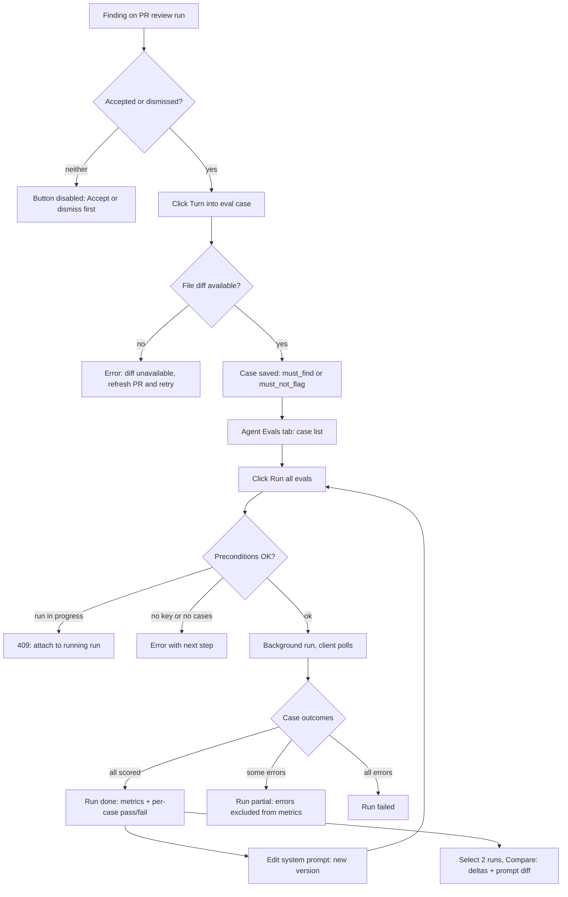
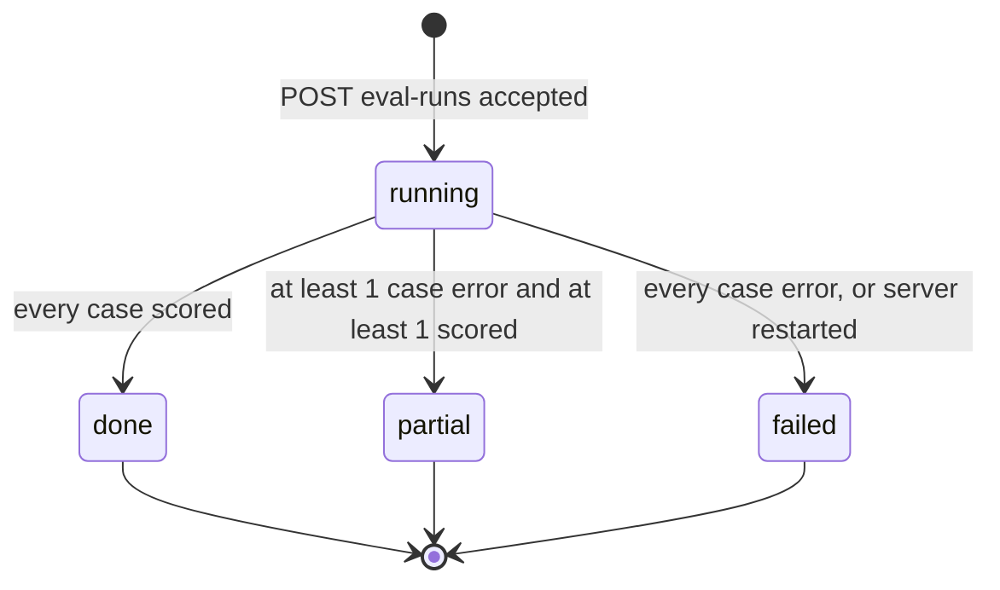
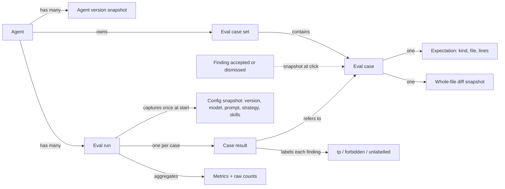
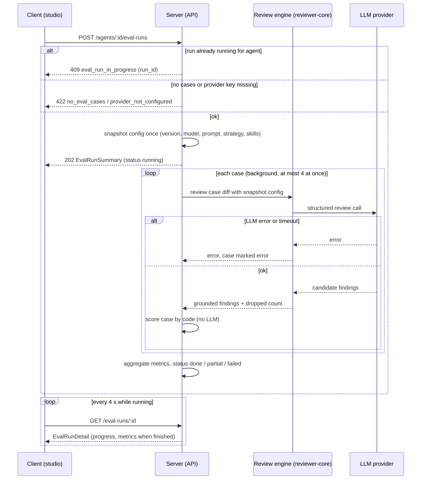
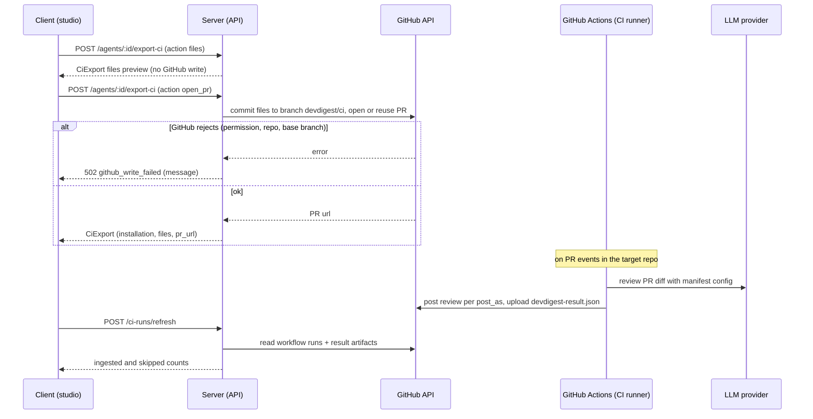

# Spec: Eval Pipeline for reviewer agents (+ Export agent to CI)

Spec ID: 2026-10-29-eval-pipeline
Status: approved
Supersedes: —
Modules: server, client, reviewer-core (engine reused unchanged) · Part B also adds a CI runner (new; pre-staged as `agent-runner`, `.gitignore:3-6`)
Revision: rev 5 (2026-10-29)
Design sources: owner's L06 homework text ("Eval Pipeline для DevDigest + Export власного агента"); 6 mockups — #1 PR review run with "Turn into eval case" on a finding, #2 Eval Dashboard (all agents), #3 per-agent dashboard, #4 "Compare runs · v6 → v7" modal, #5 Agent → Evals tab, #6 eval case editor modal; existing contracts and copy in the repo (cited below); research file `docs/research/eval-pipeline.research.md` (R1–R4).

> Changelog
> - rev 1: first draft. Owner decisions applied:
>   - Eval Pipeline and Export-to-CI in one spec (Part B is separable);
>   - minimum UI to meet the homework criteria;
>   - fixed inputs = case diff + system prompt + model + strategy + bound enabled skills;
>   - one case = one finding = one expectation, carrying the finding's whole-file diff;
>   - labelled-only headline precision plus strict precision;
>   - background run + polling;
>   - a new root `verify:l06`;
>   - proposals P1–P6 accepted.
> - rev 2: owner accepted the defaults of Q-1…Q-20 (now resolved). Q-21 resolved as option a: added AC-B6c (a publish-dialog notice that the system prompt and linked skills become readable in the target repo), EC-31 and a traceability entry.
> - rev 3: approved by owner (2026-10-29)
> - rev 4: owner-authorised in-place revision of approved rev 3 — `post_as` added to AgentManifest (contradiction AC-B11a vs C16 found by the planner); Q-16 resolved via `DEVDIGEST_RUNNER_REF`.
> - rev 5: approved by owner (2026-10-29)

> **Naming note.** The homework asks for `specs/eval-pipeline.md`. Repo convention puts cross-module specs in `docs/specs/YYYY-MM-DD-slug.md` (`docs/specs/README.md:33-38`); the legacy root `specs/` takes no new files (`specs/README.md:8-13`). See Q-14.

> **How this spec is split.** **Part A: Eval Pipeline** (G1–G5, US-1…US-7, AC-1…AC-64) is the homework body. **Part B: Export agent to CI** (G6, US-8…US-9, AC-B1…AC-B17) comes from the homework heading only. It is kept in clearly marked sections so it can later move to its own spec with `Supersedes`.
>
> **AC ids.** An id with a letter suffix (AC-7a, AC-7b) is one requirement of a group that shares a trigger. Each suffixed id is a separate, separately checkable AC.

---

## Problem & user

**User.** A DevDigest user curates reviewer agents (system prompt, model, linked skills) in the Agents studio and reviews PRs with them. This is usually a team lead or the developer who owns the repo.

**Problem today.** Changing an agent's system prompt, model or linked skills is a blind edit. Nothing tells the user whether the new version still catches what the old one caught. Nothing tells them whether it now flags things the team already rejected. The only signal is to re-run reviews on live PRs and eyeball them. That is slow, it is paid, and it compares different diffs each time.

The team already produced a labelled dataset without noticing. Every **accepted** finding says "this is a real issue at file:line". Every **dismissed** finding says "this is noise at file:line" (`server/src/modules/reviews/findings.ts:6-10`: "These decisions are the dataset later lessons build on (eval cases from accept/dismiss…)").

**Workaround today:** none in the product. The lab used a separate harness, `evals/`. It evaluates Claude Code skills and agents (`evals/README.md:3`), not DevDigest's own reviewer agents.

**Why now.** This is L06, and the pieces are pre-staged but unwired:
- `eval_cases` and `eval_runs` exist in the DB schema (`server/src/db/schema/eval.ts:7-35`).
- Base Zod contracts exist (`server/src/vendor/shared/contracts/knowledge.ts:28-63`, `contracts/eval-ci.ts:19-89`).
- UI copy exists (`client/messages/en/eval.json:1-84`).
- No server module registers eval routes (`server/src/modules/index.ts:32-49`).
- For Export-to-CI, contracts exist (`contracts/eval-ci.ts:129-239`), as do tables (`server/src/db/schema/ci.ts:4-26`) and UI copy (`client/messages/en/ci.json:1-106`). The GitHub adapter can already commit files and open PRs (`server/src/vendor/shared/adapters.ts:208-216`; `server/src/adapters/github/octokit.ts:247-264,266`).

## Goals / Non-goals

**Goals**
- **G1** A user turns any accepted or dismissed finding into an eval case with one click: accepted → `must_find`, dismissed → `must_not_flag`.
- **G2** A user runs an agent on all of its eval cases with fixed inputs, so that runs of different agent versions are comparable. The run yields recall, precision and citation_accuracy, computed by code with **zero** LLM calls in scoring.
- **G3** A user sees an agent's run history and compares two runs side by side: metric deltas, cost delta, system-prompt diff, and skill or model changes. "Old prompt vs new" becomes a number.
- **G4** A workspace-level **Eval Dashboard** in the sidebar shows each agent's latest eval metrics and the most recent eval runs across all agents.
- **G5** The homework acceptance is demonstrable:
  - the eval set has ≥8 cases, and both expectation kinds work;
  - a system-prompt change visibly moves recall or precision between two runs;
  - a deliberately broken prompt lowers precision;
  - `pnpm verify:l06` passes.
- **G6 (Part B)** A user exports an agent to a GitHub repository as a GitHub Actions review: DevDigest opens a PR with the workflow and the agent's config. The user then sees the CI-executed reviews on a "CI Runs" page.

**Non-goals**
- **NG1** Manual case authoring. This excludes:
  - the "New eval case" editor of mockup #6 (Diff / Files / PR meta tabs, JSON expected output, "Finding skeleton", "Run on save");
  - editing or renaming a case.

  Cases are only created from findings, and can be deleted.
- **NG2** Per-case "Run case" buttons (mockups #5, #6). The only run unit is "all cases of one agent".
- **NG3** "Promote v7" (mockup #4), i.e. restoring an older agent version from the compare view.
- **NG4** "Run all agents" on the Eval Dashboard (mockup #2).
- **NG5** On the dashboards: the 30-day range selector, the metric trend line chart, sparklines, and the regression banner (mockups #2, #3).
- **NG6** Skill-owned eval cases. The schema allows `owner_kind = 'skill'` (`eval.ts:12`). The Skills editor keeps its Evals placeholder (`client/src/app/skills/_components/SkillEditor/_components/EvalsTab/EvalsTab.tsx:1-11`).
- **NG7** The Agent **Stats** tab, the "Agent Performance" page, and the agent-card run and accept stats shown in mockup #5.
- **NG8** An LLM judge of any kind. Scoring is code only.
- **NG9 (invariants left untouched).** This feature must not change any of the following:
  - the review engine's citation-grounding gate (`reviewer-core/src/grounding.ts:52-84`) and its full-file-kind exemption (`grounding.ts:16`);
  - the untrusted fencing and the fixed injection guard on every agent prompt (`reviewer-core/AGENTS.md`: "Untrusted content is fenced with `wrapUntrusted()` + a fixed `INJECTION_GUARD`");
  - out-of-band structured output;
  - score derivation from grounded findings (`reviewer-core/src/review/run.ts:233-257`);
  - the PR review pipeline (`server/src/modules/reviews/run-executor.ts`);
  - accept/dismiss semantics (`server/src/modules/reviews/repository/review.repo.ts:143,156`).
- **NG10** Eval runs never feed intent derivation, the repo map, the callers digest, project-context docs or memory into the prompt. They never need a cloned repository or GitHub access.
- **NG11** Cancelling a running eval run (default → Q-10).
- **NG12 (Part B)** The following are excluded:
  - CI targets other than GitHub Actions (CircleCI, Jenkins, generic CLI; `eval-ci.ts:133`);
  - "Block merge on findings", which needs a GitHub App (`client/messages/en/ci.json:70-71`);
  - automatic CI-run polling (default → Q-17).

## User stories

- **US-1** As an agent owner, I want to turn an accepted or dismissed finding into an eval case with one click, so that my past review decisions become a regression set without writing test scenarios.
- **US-2** As an agent owner, I want to see all eval cases of an agent, with each case's last result, and delete the ones I no longer want, so that I know what the set covers.
- **US-3** As an agent owner, I want to run the agent on all its cases with fixed inputs, so that runs of different versions are comparable.
- **US-4** As an agent owner, I want to see recall, precision and citation accuracy for a run, with the raw counts, so that I know whether the agent got better or worse.
- **US-5** As an agent owner, I want to open an agent's run history and compare two runs side by side (old prompt vs new), so that I can attribute a metric change to the config change.
- **US-6** As a workspace user, I want an Eval Dashboard in the sidebar with every agent's latest eval metrics and the recent eval runs, so that I can spot a regressing agent without opening each one.
- **US-7** As the homework author and repo maintainer, I want a one-command verification and a repeatable prompt experiment, so that I can prove the pipeline works.
- **US-8 (Part B)** As an agent owner, I want to export an agent to a GitHub repository as a GitHub Actions workflow through a PR, so that the agent reviews every PR in CI.
- **US-9 (Part B)** As an agent owner, I want to see the reviews that ran in CI, so that I know the exported agent is working.

---

## Design & UX

**Sources analysed.**
- Mockups:
  - #1: the button sits on an expanded finding, next to Accept / Dismiss.
  - #2: the Eval Dashboard, with agent cards and a "RECENT EVAL RUNS · ALL AGENTS" table.
  - #3: the per-agent runs table, with checkbox selection and "Compare".
  - #4: the compare modal.
  - #5: the agent Evals tab.
  - #6 was analysed and excluded (NG1).
- Existing UI copy in `client/messages/en/eval.json`.
- Existing app chrome:
  - the sidebar nav groups (`client/src/vendor/ui/nav.ts:21-42`);
  - the active-key mapping `/eval` → `eval` (`client/src/components/app-shell/helpers.ts:38`);
  - the nav label "Eval Dashboard" (`client/messages/en/shell.json:24`).

**Mockup elements that do not exist in the product today.**
- The "Learn" and "Reply to author" buttons in #1. FindingCard has only Accept and Dismiss (`client/src/app/repos/[repoId]/pulls/[number]/_components/FindingCard/FindingCard.tsx:101-122`).
- The Stats and CI tabs in #5. AgentEditor has Config, Skills and Context (`client/src/app/agents/[id]/_components/AgentEditor/constants.ts:11-15`).

Only the CI tab is added, in Part B. The numbers in the mockups are illustrative ("20-trace gold set", "v6 → v7", costs).

### Workflow (Part A)

### Eval run lifecycle

### Domain concepts (structure; not storage)

### State table

| Screen / component | loading | empty | error | partial | long content |
|---|---|---|---|---|---|
| "Turn into eval case" button | button disabled while saving (AC-11b) | n/a | inline error under the action row (AC-8b, AC-9) | n/a | n/a |
| Evals tab: metric cards | skeleton (AC-20) | "—" + "No runs yet" (AC-44b) | error + Retry (AC-21) | values from a `partial` run, status shown in history (AC-46a) | n/a |
| Evals tab: case list | skeleton / "Loading cases…" (AC-20) | `eval.json:66` empty text (AC-14b) | error + Retry (AC-21) | per-case `error` status (AC-16a) | truncated names with full name on hover and to screen readers (AC-16b) |
| Evals tab: run history | skeleton (AC-20) | "No runs yet. …" (`eval.json:11`) (AC-46b) | error + Retry (AC-21) | `partial` / `failed` status (AC-46a) | newest 50 runs (AC-46a) |
| Run in progress | "Running… k / N cases" (AC-29a) | n/a | `failed` with reason (AC-34); poll failure → "Reconnecting…" (AC-29c) | `partial` (AC-33b) | n/a |
| Compare view | spinner (AC-49b) | n/a: opens only with exactly 2 runs (AC-48b) | error + Close (AC-49c) | dataset-change warning (AC-53) | long prompt diff scrolls (AC-51a) |
| Eval Dashboard | skeleton (AC-58a) | "No agents yet" / "No runs yet" (AC-56b) | error + Retry (AC-58b) | `partial` status in recent runs (AC-57) | 20 most recent runs (AC-57) |
| Agent CI tab (Part B) | spinner (AC-B2b) | `ci.json:84` text (AC-B2a) | GitHub error text (AC-B9b) | n/a | n/a |
| CI Runs page (Part B) | "Refreshing…" (AC-B14b) | `ci.json:3-4` (AC-B13b) | refresh error (AC-B15b) | skipped-artifact count (AC-B16b) | newest 100 rows (AC-B13b) |

**Accepted UX decisions (P1–P6).**
- P1: a per-run config snapshot, plus a "config changed" marker (AC-26a, AC-47).
- P2: a case-set-change warning in Compare (AC-53).
- P3: the button is disabled on undecided findings, and a confirmation with a link follows creation (AC-11a, AC-12).
- P4: the call count on the run button and the cost per run (AC-23, AC-46a).
- P5: a hint while there are fewer than 8 cases (AC-15).
- P6: eval runs never appear in PR timelines or stats (AC-36a, AC-36b).

---

## Service communication

### Part A: eval run

| Hand-off | Who starts | What crosses | Sync / async | On failure / timeout | Source of truth |
|---|---|---|---|---|---|
| Create case from finding | client (button) | finding id → EvalCase | sync request | 404 / 422 with code; no partial case (AC-8a, AC-9, AC-10) | server; the case is a self-contained snapshot after creation (AC-3a, AC-3b) |
| Start run | client | agent id → EvalRunSummary (`running`) | sync accept, async work | 409 / 422 before any run exists (AC-30a, AC-31a, AC-32a) | server run status |
| Server → engine | server | case diff, system prompt, model, strategy, skill blocks | in-process call per case | case → `error` with the message; run continues (AC-33a) | engine output, unmodified |
| Engine → LLM | engine | assembled prompt (diff fenced as untrusted) | network; provider retries and timeouts as today (`openrouter.ts:52-57`, `anthropic.ts:101`, per research R3) | surfaces as case `error` | provider response |
| Scoring | server | grounded findings + expectation → labels + counts | in-process, pure code | n/a (no I/O) | case result |
| Polling | client | run id → EvalRunDetail | client polls every 4 s (same cadence as review runs, `client/src/lib/hooks/reviews.ts:33,45-46`, per R3) | keep last state, show "Reconnecting…", retry next tick (AC-29c) | server |
| Restart while running | server boot | — | on boot | every `running` eval run → `failed` (AC-35) | server |

### Part B: export to CI and CI runs

**Part B hand-offs**

- **Export (preview and publish).**
  - Started by: the client.
  - What crosses: the agent's config and the target repo.
  - Timing: synchronous.
  - On a GitHub error: no installation is recorded, and the message is shown (AC-B9a, AC-B9b).
  - Source of truth: the studio for the agent config; the files in the target repo for what runs in CI.
- **CI review.**
  - Started by: GitHub Actions, on PR events.
  - It reads the manifest from the repo. The DevDigest server is not called.
- **Ingest.**
  - Started by: the user, with "Refresh".
  - The server reads workflow-run artifacts from GitHub.
  - An invalid artifact is skipped and counted (AC-B16a).
  - Source of truth: the GitHub artifact.

---

## Contracts

These are shapes only. Casing follows repo convention: fields are `snake_case`, Severity is UPPERCASE, and category and kinds are lowercase (root `AGENTS.md` → Naming).

**Extend the existing contracts; do not fork them.** The contracts in scope are `EvalCase` (`knowledge.ts:52-63`), `EvalRun` (`knowledge.ts:37-47`), and `EvalCaseInput`, `EvalRunRecord` and `EvalDashboard` (`eval-ci.ts:19-89`). Every change lands identically in both shared trees (root `INSIGHTS.md:46-57`).

Today's shapes are missing three things:
- an expectation kind;
- a run that groups case results with a config snapshot (`eval_runs` is one row per case, with no agent or version: `eval.ts:22-35`);
- the raw counts.

### Part A

**C1 `EvalExpectationKind`**: enum `must_find` | `must_not_flag`.

**C2 `EvalExpectation`**

| field | type | req | meaning |
|---|---|---|---|
| kind | `EvalExpectationKind` | yes | from the finding decision: accepted → `must_find`, dismissed → `must_not_flag` |
| file | string | yes | path of the finding's file (new side) |
| start_line | int ≥ 1 | yes | the finding's start line |
| end_line | int ≥ start_line | yes | the finding's end line |

**C3 `EvalCase` (response)**

| field | type | req | meaning |
|---|---|---|---|
| id | string | yes | case id |
| owner_kind | `'agent'` | yes | always `agent` in this spec (NG6) |
| owner_id | string | yes | agent id: the agent that produced the finding |
| name | string | yes | auto-generated slug, unique within the agent's set (AC-4a, AC-4b) |
| expectation | `EvalExpectation` | yes | the single expectation |
| display | `{ title: string, severity: Severity, category: FindingCategory }` | yes | copied from the finding; for display only, never used in matching |
| input_diff | string | yes | unified diff of the expectation's file, all hunks, snapshotted at creation |
| source | `{ finding_id: string \| null, pr_number: int, repo: string }` | yes | provenance; `finding_id` becomes null when the finding is later deleted |
| created_at | ISO string | yes | |
| last_result | `{ run_id: string, status: EvalCaseStatus, ran_at: ISO string, summary: string }` \| null | yes | latest result of this case in any finished run; null means "never run" |

**C4 `EvalCaseStatus`**: enum `pass` | `fail` | `error`.

**C5 Create case from finding.** New endpoint `POST /findings/:id/eval-case`, for one-click case creation. It takes no body.
- `201` → `{ case: EvalCase, created: true }`.
- `200` → `{ case: EvalCase, created: false }` when a case already exists for this finding.
- Errors use the API's existing error envelope, with these `code` values:
  - `404 finding_not_found`
  - `422 finding_undecided`
  - `422 finding_without_agent`
  - `422 diff_unavailable` (the message names the file)

**C6 List and delete cases**
- `GET /agents/:id/eval-cases` → `EvalCase[]`, newest first.
- `DELETE /eval-cases/:id` → `204`. Error: `404 eval_case_not_found`.

**C7 `EvalRunStatus`**: enum `running` | `done` | `partial` | `failed`.

**C8 `EvalConfigSnapshot`**

| field | type | req | meaning |
|---|---|---|---|
| agent_version | int | yes | the agent's `version` at run start (`Agent.version`, `knowledge.ts:286`) |
| config_id | string | yes | opaque; two runs have equal values if and only if every other field of this snapshot is equal (P1) |
| provider | `Provider` (`openai` \| `anthropic` \| `openrouter`) | yes | |
| model | string | yes | |
| system_prompt | string | yes | full text |
| strategy | `ReviewStrategy` | yes | |
| skills | array of `{ skill_id: string, name: string, version: int }` | yes | skills that are bound **and** enabled, in prompt order at run start; may be empty |

**C9 `EvalMetrics`**: each value is in [0, 1], or null when its denominator is 0.

| field | type | meaning |
|---|---|---|
| recall | number \| null | tp / must_find_total (pooled) |
| precision | number \| null | tp / (tp + forbidden_hits) (pooled, labelled-only, the headline) |
| strict_precision | number \| null | tp / emitted (pooled, lower bound) |
| citation_accuracy | number \| null | grounded / (grounded + dropped) (pooled) |
| macro_recall | number \| null | mean of per-case recall over scored `must_find` cases |
| macro_precision | number \| null | mean of per-case precision over scored cases where it is defined |

**C10 `EvalCounts`**: every field is an int ≥ 0.
- `cases_total`, `cases_scored`, `cases_passed`, `cases_failed`, `cases_error`
- `must_find_total`, `must_not_flag_total`
- `tp`, `fn`, `forbidden_hits`, `unlabelled`
- `emitted` (equals grounded findings), `grounded`, `dropped`

**C11 `EvalRunSummary`**

| field | type | req | meaning |
|---|---|---|---|
| id | string | yes | |
| agent_id | string | yes | |
| agent_name | string | yes | name at run start |
| status | `EvalRunStatus` | yes | |
| started_at | ISO string | yes | |
| finished_at | ISO string \| null | yes | |
| progress | `{ done: int, total: int }` | yes | cases finished (any status) / cases in the run |
| config | `EvalConfigSnapshot` | yes | |
| case_ids | string[] | yes | the case set this run scored (used by AC-53) |
| metrics | `EvalMetrics` \| null | yes | null while `running` or when `failed` |
| counts | `EvalCounts` \| null | yes | null while `running` |
| cost_usd | number \| null | yes | sum of case costs; null if any cost is unknown |
| duration_ms | int \| null | yes | |
| error | string \| null | yes | reason when `failed` |

**C12 `EvalCaseResult`**

| field | type | req | meaning |
|---|---|---|---|
| case_id | string | yes | |
| case_name | string | yes | name at run time, kept after the case is deleted |
| expectation | `EvalExpectation` | yes | as scored |
| status | `EvalCaseStatus` | yes | |
| findings | array of `{ file, start_line, end_line, severity: Severity, category: FindingCategory, title: string, label: 'tp' \| 'forbidden' \| 'unlabelled' }` | yes | grounded findings the agent emitted for this case |
| grounded | int | yes | |
| dropped | int | yes | |
| summary | string | yes | e.g. "expected 1 finding, got 1" or "must not flag src/a.ts:12, got 1" |
| cost_usd | number \| null | yes | |
| duration_ms | int \| null | yes | |
| error | string \| null | yes | provider or engine message when `error` |

**C13 Eval run endpoints**
- `POST /agents/:id/eval-runs` (homework-mandated) starts a run. It takes no body.
  - `202` → `EvalRunSummary` with status `running`.
  - Errors:
    - `404 agent_not_found`
    - `409 eval_run_in_progress` (the body includes the running `run_id`)
    - `422 no_eval_cases`
    - `422 provider_not_configured` (the message names the provider)
- `GET /agents/:id/eval-runs` → `EvalRunSummary[]`, newest first, at most 50.
- `GET /eval-runs/:id` → `EvalRunDetail`, which is `EvalRunSummary` plus `results: EvalCaseResult[]`. Error: `404 eval_run_not_found`.

**C14 `EvalDashboardOverview`.** `GET /eval-dashboard` returns:
- `agents`: an array of `{ agent_id, name, model, enabled: boolean, cases_total: int, last_run: EvalRunSummary | null }`;
- `recent_runs`: `EvalRunSummary[]`, newest first, at most 20, across all agents of the workspace.

This spec does not require the existing `EvalDashboard` shape (`eval-ci.ts:67-89`, with `trend` and `alert`); see NG5.

### Part B (existing contracts, `eval-ci.ts:129-239`)

**C15 `CiExportInput` → `CiExport`.** `POST /agents/:id/export-ci`.
- Body: `CiExportInput` (`eval-ci.ts:174-183`):
  - `repo`: "owner/name";
  - `target`: only `gha` is accepted (NG12);
  - `action`: `files` | `open_pr`;
  - `post_as`: `github_review` | `pr_comment` | `none`;
  - `triggers`;
  - `base`.
- Response: `CiExport` (`eval-ci.ts:198-202`), with `installation`, `files: CiFile[]` and `pr_url` (null for `action: files`).
- Errors:
  - `404 agent_not_found`
  - `422 unsupported_target`
  - `422 repo_not_connected`
  - `502 github_write_failed` (with the message)

**C16 `AgentManifest`** (`eval-ci.ts:152-171`): the content of the generated agent config file. Fields: `name`, `provider`, `model`, `system_prompt`, `skills` (slugs), `strategy`, and `ci_fail_on` (`never` | `critical` | `warning` | `any`, `knowledge.ts:274`), plus one new field:

| field | type | req | meaning |
|---|---|---|---|
| post_as | `github_review` \| `pr_comment` \| `none` | no (default `github_review`, Q-18) | how the CI runner publishes its result; the export step writes the value chosen in `CiExportInput.post_as` (`server/src/vendor/shared/contracts/eval-ci.ts:179`) into the manifest, so the runner needs no workflow inputs |

Adding an optional field keeps older manifests valid. The shape is shared by the studio and the runner.

**C17 `CiInstallation`** (`eval-ci.ts:188-194`): `GET /agents/:id/ci-installations` → `CiInstallation[]`, newest first.

**C18 `CiResultArtifact`** (`eval-ci.ts:228-238`): the `devdigest-result.json` file the CI runner uploads. Fields: `findings_count`, `critical`, `warning`, `suggestion`, `cost_usd`, `duration_ms`, `agent`, `version`, `pr_number`.

**C19 CI runs**
- `GET /ci-runs` → `CiRun[]` (`eval-ci.ts:209-222`), newest first, at most 100.
- `POST /ci-runs/refresh` → `{ ingested: int, skipped: int }`. Error: `502 github_read_failed`.

---

## Acceptance criteria (EARS)

### Part A: Eval Pipeline

**Case creation (US-1)**
- **AC-1** (event · US-1) WHEN the user clicks "Turn into eval case" on an accepted finding, the server shall create one eval case in the producing agent's set, with expectation `must_find` and the finding's file, start_line and end_line. (default → Q-2)
- **AC-2** (event · US-1) WHEN the user clicks "Turn into eval case" on a dismissed finding, the server shall create one eval case in the producing agent's set, with expectation `must_not_flag` and the finding's file, start_line and end_line. (default → Q-2)
- **AC-3a** (ubiquitous · US-1) The server shall store in a new case the unified diff of the finding's file, including all hunks available at click time. (default → Q-15)
- **AC-3b** (ubiquitous · US-1) The server shall keep a case's diff and expectation unchanged when the PR is updated, the finding's decision changes, or the review run or finding is deleted.
- **AC-4a** (ubiquitous · US-1) The server shall derive a new case's name from the finding's title: lowercase, every run of characters outside `a-z0-9` replaced by one `-`, and at most 60 characters.
- **AC-4b** (unwanted · US-1) IF the derived name is already used in the agent's set, THEN the server shall append `-2`, `-3`, … until it is unique.
- **AC-5** (ubiquitous · US-1) The server shall copy the finding's title, severity and category into the case for display.
- **AC-6a** (ubiquitous · US-1) Creating a case shall make zero LLM calls.
- **AC-6b** (ubiquitous · US-1) Creating or deleting a case shall leave the agent's `version` unchanged.
- **AC-7a** (unwanted · US-1) IF a case created from the same finding already exists, THEN the server shall return that case unchanged with `created: false`. (default → Q-1)
- **AC-7b** (event · US-1) WHEN the server answers `created: false`, the client shall show "Already an eval case" with a link to the agent's Evals tab.
- **AC-8a** (unwanted · US-1) IF no diff of the finding's file can be obtained (no git diff and no stored patch for that file), THEN the server shall reject the request with `diff_unavailable` naming the file, and create nothing.
- **AC-8b** (event · US-1) WHEN the server answers `diff_unavailable`, the client shall show "Diff for <file> is unavailable — open the PR to refresh its files, then retry".
- **AC-9** (unwanted · US-1) IF the finding belongs to a review with no producing agent (e.g. the seeded demo review, research R2), THEN the server shall reject the request with `finding_without_agent`.
- **AC-10** (unwanted · US-1) IF the finding does not exist or belongs to another workspace, THEN the server shall respond `404 finding_not_found`.
- **AC-11a** (state · US-1) WHILE a finding is neither accepted nor dismissed, the client shall render "Turn into eval case" disabled with the hint "Accept or dismiss first".
- **AC-11b** (state · US-1) WHILE a create request is pending, the client shall keep "Turn into eval case" disabled.
- **AC-12** (event · US-1) WHEN a case is created, the client shall show a confirmation that names the expectation kind (`must_find` or `must_not_flag`) and links to that agent's Evals tab.
- **AC-13a** (ubiquitous · US-1) The client shall show "Turn into eval case" in the expanded finding's action row, after Accept and Dismiss (mockup #1).
- **AC-13b** (ubiquitous · US-1) The client shall hide "Turn into eval case" on findings of a review without a producing agent.

**Case list (US-2)**
- **AC-14a** (ubiquitous · US-2) The agent editor shall have an "Evals" tab after "Context", reachable as `?tab=evals`.
- **AC-14b** (state · US-2) WHILE the agent has zero cases, the Evals tab shall show the existing empty text (`eval.json:66`).
- **AC-15** (state · US-2) WHILE the agent has fewer than 8 cases, the Evals tab shall show the case count with the hint "8+ cases recommended for stable metrics".
- **AC-16a** (ubiquitous · US-2) The Evals tab shall list every case of the agent with:
  - its name and expectation kind;
  - `file:start_line[-end_line]`;
  - `SEVERITY · category`;
  - its last result (`pass`, `fail`, `error` or "never run") with the result summary.
- **AC-16b** (ubiquitous · US-2) The Evals tab shall truncate a case name longer than its row to one line. The full name shall stay available on hover and to screen readers.
- **AC-17** (ubiquitous · US-2) The Evals tab shall show "<passed> / <scored> passing" from the latest finished run next to the "Eval cases" heading.
- **AC-18a** (event · US-2) WHEN the user deletes a case and confirms the dialog, the server shall remove it from the agent's set.
- **AC-18b** (ubiquitous · US-2) The system shall keep the results of a deleted case in past runs, shown under the name the case had at run time. (default → Q-3)
- **AC-19** (unwanted · US-2) IF a case is deleted while a run of that agent is `running`, THEN the server shall finish that run with the case set it captured at start.
- **AC-20** (state · US-2) WHILE cases or runs are loading, the Evals tab shall show skeleton placeholders.
- **AC-21** (unwanted · US-2) IF loading cases or runs fails, THEN the Evals tab shall show an error text with a "Retry" action.

**Running (US-3)**
- **AC-22a** (event · US-3) WHEN the user clicks "Run all evals", the client shall call `POST /agents/:id/eval-runs`.
- **AC-22b** (event · US-3) WHEN `POST /agents/:id/eval-runs` passes its checks, the server shall answer `202` with a `running` run within 1 s (p95), before any LLM call completes.
- **AC-23** (ubiquitous · US-3) The "Run all evals" button shall show the number of cases it will run, e.g. "Run all evals (8)" (P4). (default → Q-11)
- **AC-24** (ubiquitous · US-3) For each case, the eval run shall feed the review engine only:
  - the case's stored diff;
  - the agent's system prompt, model and strategy;
  - the agent's bound and enabled skills, in link order.
- **AC-25** (ubiquitous · US-3) An eval run shall complete without a cloned repository and without any GitHub API call.
- **AC-26a** (event · US-3) WHEN a run starts, the server shall capture the `EvalConfigSnapshot` exactly once.
- **AC-26b** (state · US-3) WHILE a run is `running`, edits to the agent or its skills shall not change that run's inputs.
- **AC-27a** (ubiquitous · US-3) An eval run shall perform at most one engine review per case.
- **AC-27b** (ubiquitous · US-3) An eval run shall use the review engine's prompt assembly and grounding gate unchanged (NG9).
- **AC-28** (ubiquitous · US-3) An eval run shall make zero LLM calls beyond the engine reviews of its cases.
- **AC-29a** (state · US-3) WHILE a run is `running`, the client shall poll it every 4 s and show "Running… k / N cases".
- **AC-29b** (state · US-3) WHILE a run of the agent is `running`, the client shall keep "Run all evals" disabled.
- **AC-29c** (unwanted · US-3) IF a poll request fails, THEN the client shall show "Reconnecting…" and retry on the next 4 s tick.
- **AC-30a** (unwanted · US-3) IF a run of the same agent is already `running`, THEN the server shall reject a new run with `409 eval_run_in_progress` and the running `run_id`.
- **AC-30b** (event · US-3) WHEN the client receives `eval_run_in_progress`, it shall show the progress of the returned `run_id`.
- **AC-31a** (unwanted · US-3) IF the agent has zero cases, THEN the server shall reject the run with `422 no_eval_cases`.
- **AC-31b** (state · US-3) WHILE the agent has zero cases, the client shall render "Run all evals" disabled.
- **AC-32a** (unwanted · US-3) IF no API key is configured for the agent's provider, THEN the server shall reject the run with `422 provider_not_configured` naming the provider, and create no run.
- **AC-32b** (event · US-3) WHEN the client receives `provider_not_configured`, it shall show the message with a link to Settings → API Keys.
- **AC-33a** (unwanted · US-3) IF a case's engine review fails (provider error, timeout, structured-output failure), THEN the server shall mark that case `error` with the message and continue with the remaining cases. The case is excluded from every metric and every count except `cases_error`.
- **AC-33b** (ubiquitous · US-3) A run with at least one `error` case and at least one scored case shall end `partial`.
- **AC-34** (unwanted · US-3) IF every case of a run ends in `error`, THEN the server shall end the run `failed`, with `metrics: null` and `error` set to the first case's message.
- **AC-35** (unwanted · US-3) IF the server starts while an eval run is `running`, THEN the server shall mark that run `failed` with the error "server restarted during run".
- **AC-36a** (ubiquitous · US-3) An eval run shall not appear in any PR's run timeline, the active-runs list, the PR list's score or cost, or skills statistics (P6).
- **AC-36b** (ubiquitous · US-3) An eval run shall create no PR review and no finding.
- **AC-37** (ubiquitous · US-3) The server shall accept eval runs for a disabled agent. (default → Q-5)

**Scoring (US-4)**
- **AC-38** (ubiquitous · US-4) The server shall treat a grounded finding as matching an expectation when both hold: its file equals the expectation's file, and its [start_line, end_line] range intersects the expectation's range. Severity, category and title are ignored. (default → Q-7)
- **AC-39** (ubiquitous · US-4) The server shall give each grounded finding of a case exactly one label, assigning greedily in engine output order:
  - `tp`: the first finding that matches a `must_find` expectation;
  - `forbidden`: the first finding that matches a `must_not_flag` expectation;
  - `unlabelled`: every other finding.
- **AC-40** (ubiquitous · US-4) The server shall set a case's status to `pass` when its `must_find` expectation has a `tp`, or when its `must_not_flag` expectation has no `forbidden` finding. Otherwise the status is `fail`. `unlabelled` findings never affect the status.
- **AC-41a** (ubiquitous · US-4) The server shall compute, pooled over the scored cases of a run:
  - recall = tp / must_find_total;
  - precision = tp / (tp + forbidden_hits);
  - strict_precision = tp / emitted;
  - citation_accuracy = grounded / (grounded + dropped).
- **AC-41b** (ubiquitous · US-4) The server shall return null for any metric whose denominator is 0.
- **AC-41c** (ubiquitous · US-4) The client shall show a null metric as "—".
- **AC-42a** (ubiquitous · US-4) The server shall compute macro_recall and macro_precision as means of the per-case values over the cases where each is defined.
- **AC-42b** (ubiquitous · US-4) The client shall show macro values as secondary text under the pooled values.
- **AC-43a** (ubiquitous · US-4) Scoring shall make zero LLM, embedding or network calls.
- **AC-43b** (ubiquitous · US-4) Scoring the same engine outputs twice shall produce identical labels, counts and metrics.

**Metrics & history (US-4, US-5)**
- **AC-44a** (ubiquitous · US-4) The Evals tab shall show four cards from the latest finished run, with percentages as whole numbers:
  - RECALL;
  - PRECISION, with strict precision and the unlabelled count beneath;
  - CITATION ACCURACY;
  - CASES PASSED "<passed>/<scored>".
- **AC-44b** (state · US-4) WHILE the agent has no finished run, the metric cards shall show "—" and "No runs yet".
- **AC-45a** (ubiquitous · US-4) Each metric card shall show the change from the previous finished run of the same agent in whole percentage points, as "▲ n pt", "▼ n pt" or "± 0 pt". The sign shall be written in text, not shown by colour alone. (default → Q-8)
- **AC-45b** (state · US-4) WHILE the agent has only one finished run, the metric cards shall show no delta.
- **AC-46a** (ubiquitous · US-5) The Evals tab shall list the agent's newest 50 runs, newest first, with these columns: ran at, version as "v<agent_version>", recall, precision, citation, pass "<passed>/<scored>", cost ("—" when unknown, never "$0.00"), and status.
- **AC-46b** (state · US-5) WHILE the agent has no runs, the run history shall show "No runs yet. Create an eval case and run it." (`eval.json:11`).
- **AC-47** (ubiquitous · US-5) The run history shall mark a run "config changed" when it has the same `agent_version` as the previous listed run but a different `config_id`. This covers a skills-only change, which does not bump the agent version (`server/src/modules/agents/repository.ts:268-274`). (default → Q-9)
- **AC-48a** (ubiquitous · US-5) Each run row shall have a checkbox with the accessible name "Select run <ran at>".
- **AC-48b** (state · US-5) WHILE exactly two finished runs are selected, the client shall enable "Compare". In every other selection state, "Compare" stays disabled.

**Compare (US-5)**
- **AC-49a** (event · US-5) WHEN the user clicks "Compare", the client shall open a compare view titled "Compare runs · v<A> → v<B>", where A is the older run.
- **AC-49b** (state · US-5) WHILE the two runs load, the compare view shall show a spinner.
- **AC-49c** (unwanted · US-5) IF loading either run fails, THEN the compare view shall show the error and "Close".
- **AC-50** (ubiquitous · US-5) The compare view shall show RECALL, PRECISION, CITATION and COST cards. Each card shows "A → B" with the signed delta, in points for metrics and in USD for cost.
- **AC-51a** (ubiquitous · US-5) The compare view shall show a line diff of the two runs' system prompts, marking added lines "+" and removed lines "−".
- **AC-51b** (state · US-5) WHILE both system prompts are identical, the compare view shall show "No system prompt change" in place of the diff.
- **AC-52a** (ubiquitous · US-5) The compare view shall list model, strategy and skill differences between the two snapshots: skill added, skill removed, skill version changed.
- **AC-52b** (state · US-5) WHILE the two snapshots have the same model, strategy and skills, the compare view shall show "Same model and skills".
- **AC-53** (unwanted · US-5) IF the two runs scored different case sets, THEN the compare view shall show "<n> cases added, <m> removed between runs — deltas include dataset change" (P2).
- **AC-54** (event · US-5) WHEN the user clicks "Close" or presses Escape, the client shall close the compare view and keep the run selection.

**Eval Dashboard (US-6)**
- **AC-55a** (ubiquitous · US-6) The sidebar shall show "Eval Dashboard" in SKILLS LAB, after "Conventions", linking to the Eval Dashboard page.
- **AC-55b** (state · US-6) WHILE the Eval Dashboard page is open, the sidebar shall highlight "Eval Dashboard" (`helpers.ts:38`).
- **AC-56a** (ubiquitous · US-6) The Eval Dashboard shall show one card per agent of the workspace, with:
  - name and model;
  - the last finished run's version, date and "<passed>/<scored>";
  - recall, precision and citation.
- **AC-56b** (state · US-6) WHILE an agent has no finished run, its card shall show "No runs yet". WHILE the workspace has no agents, the page shall show "No agents yet".
- **AC-57** (ubiquitous · US-6) The Eval Dashboard shall show "Recent eval runs · all agents" with the 20 most recent eval runs across agents, newest first. Columns: agent, ran at, version, recall, precision, citation, pass, status.
- **AC-58a** (state · US-6) WHILE the overview loads, the Eval Dashboard shall show skeleton placeholders.
- **AC-58b** (unwanted · US-6) IF loading the overview fails, THEN the Eval Dashboard shall show an error with "Retry".
- **AC-59** (event · US-6) WHEN the user clicks an agent card or a recent-run row, the client shall open that agent's Evals tab.
- **AC-60** (ubiquitous · US-6) Loading the Eval Dashboard shall make zero LLM calls.

**Rendering safety (US-2, US-4, US-5)**
- **AC-64** (ubiquitous · US-2, US-4, US-5) The client shall render finding titles, case names, case summaries, system prompts and diffs in every eval view as plain text, never as HTML or markdown.

**Homework verification (US-7)**
- **AC-61a** (ubiquitous · US-7) The root command `pnpm verify:l06` shall run the repository's generic verification (`scripts/verify.sh`) for `server`, `client` and `reviewer-core`: typecheck plus tests, including the scoring tests. It shall exit 0 only when all of them pass. (default → Q-12)
- **AC-61b** (ubiquitous · US-7) The repository root shall declare no workspace and no dependencies, so it stays a non-workspace repo (root `AGENTS.md` → Conventions).
- **AC-62** (ubiquitous · US-7) The demonstrated agent's eval set shall hold ≥8 cases, including ≥1 `must_find` and ≥1 `must_not_flag`, all created through "Turn into eval case".
- **AC-63** (event · US-7, headline) WHEN this sequence completes, the compare view of A → B shall show the new version, the prompt diff, and a non-zero delta in recall or precision:
  1. an agent with ≥8 cases is run (run A);
  2. its system prompt is edited (version +1);
  3. it is run again (run B).

  How this is verified:
  - **Hermetic:** a stubbed LLM whose findings depend on a marker in the system prompt yields different recall and precision, with an LLM call count equal to the number of cases.
  - **Live:** the screencast and the comparison screenshot.

### Part B: Export agent to CI (separable)

- **AC-B1** (ubiquitous · US-8) The agent editor shall have a "CI" tab after "Evals", with the heading "Continuous Integration" (`ci.json:78-79`).
- **AC-B2a** (ubiquitous · US-8) The CI tab shall list the agent's installations (repo, "installed <date>"), or show the empty text (`ci.json:84`) when there are none.
- **AC-B2b** (state · US-8) WHILE installations load, the CI tab shall show a spinner.
- **AC-B3** (state · US-8) WHILE the workspace has no connected repository, the CI tab shall render "Publish to CI" disabled with "Connect a repository first" (`ci.json:83`).
- **AC-B4a** (event · US-8) WHEN the user opens "Publish to CI" for a connected repository, the client shall request a preview with `action: files`.
- **AC-B4b** (ubiquitous · US-8) The publish dialog shall list every generated file with its path and contents before anything is written to GitHub.
- **AC-B5** (ubiquitous · US-8) The generated files shall be:
  - one GitHub Actions workflow under `.github/workflows/`, running on the selected triggers (default `opened`, `synchronize`, `reopened`), whose reference to the CI runner is the value of the configurable setting `DEVDIGEST_RUNNER_REF` (default: the agent-runner action in the DevDigest repository, `OlegDEma/dev-digest/agent-runner@<tag>`);
  - the agent manifest at `.devdigest/agents/<agent-slug>.yaml`, matching `AgentManifest` and including the chosen `post_as`;
  - one `.devdigest/skills/<skill-slug>.md` per bound and enabled skill (`eval-ci.ts:144-151`). (Q-16 → resolved)
- **AC-B6a** (ubiquitous · US-8) The generated files shall contain no API key or token value.
- **AC-B6b** (ubiquitous · US-8) The publish dialog shall show "Add <KEY> to the repo's Actions secrets before the workflow runs", naming the provider's key variable (`ci.json:93`).
- **AC-B6c** (ubiquitous · US-8) The publish dialog shall show the one-line notice "The system prompt and linked skills will be readable by anyone with read access to <repo>." before "Publish". (Q-21 → a)
- **AC-B7a** (event · US-8) WHEN the user clicks "Publish", the server shall commit the generated files as one commit to the branch `devdigest/ci` of the target repo, creating the branch from `base` if it is missing.
- **AC-B7b** (event · US-8) WHEN that commit succeeds, the server shall open a PR titled "Add DevDigest CI review", or reuse the open PR from `devdigest/ci` (`adapters.ts:209-216`), and return its URL. (default → Q-20)
- **AC-B8a** (event · US-8) WHEN publishing succeeds, the server shall record one installation `{agent, repo, target: gha}`.
- **AC-B8b** (event · US-8) WHEN publishing succeeds, the publish dialog shall show "Published" and "View pull request".
- **AC-B9a** (unwanted · US-8) IF GitHub rejects the commit or the PR, THEN the server shall respond `502 github_write_failed` with GitHub's message and record no installation. Examples: a token without permission to write workflows, no repo access, a missing base branch.
- **AC-B9b** (event · US-8) WHEN the client receives `github_write_failed`, the publish dialog shall show the message.
- **AC-B10** (event · US-8) WHEN a PR event listed in the triggers occurs in the target repo, the CI runner shall review the PR diff with the manifest's provider, model, system prompt, skills and strategy, through the same review engine and grounding gate (NG9). (Q-16 → resolved: runner taken from `DEVDIGEST_RUNNER_REF`)
- **AC-B11a** (ubiquitous · US-8) The CI runner shall publish its result as the manifest's `post_as` says: a GitHub review, a PR comment, or nothing, using `github_review` when the field is absent.
- **AC-B11b** (ubiquitous · US-8) The CI runner shall exit non-zero when a grounded finding's severity reaches the manifest's `ci_fail_on` threshold. `never` never fails the run.
- **AC-B12** (ubiquitous · US-8) The CI runner shall upload a `devdigest-result.json` artifact matching `CiResultArtifact` on every run.
- **AC-B13a** (ubiquitous · US-9) The sidebar shall show "CI Runs", linking to the CI Runs page.
- **AC-B13b** (ubiquitous · US-9) The CI Runs page shall list the newest 100 ingested CI runs with the columns of `ci.json:16-23`, or show the empty state of `ci.json:3-4`.
- **AC-B14a** (event · US-9) WHEN the user clicks "Refresh" on CI Runs, the server shall read the result artifacts of the installations' workflow runs and add each new one exactly once. (default → Q-17)
- **AC-B14b** (state · US-9) WHILE a refresh is in progress, the CI Runs page shall show "Refreshing…".
- **AC-B15a** (unwanted · US-9) IF reading from GitHub fails, THEN the server shall respond `502 github_read_failed` and keep the existing rows.
- **AC-B15b** (event · US-9) WHEN the client receives `github_read_failed`, the CI Runs page shall show the error.
- **AC-B16a** (unwanted · US-9) IF an artifact does not match `CiResultArtifact`, THEN the server shall skip it and count it in `skipped`.
- **AC-B16b** (event · US-9) WHEN a refresh reports `skipped` > 0, the CI Runs page shall show "<n> artifacts skipped (invalid format)".
- **AC-B17** (unwanted · US-8) IF the target repo is not a repository connected in the workspace, THEN the server shall reject the export with `422 repo_not_connected`. (default → Q-19)

## Edge cases

| # | Situation | Expected behaviour | AC / Q |
|---|---|---|---|
| EC-1 | Finding is undecided | Button disabled with "Accept or dismiss first" | AC-11a |
| EC-2 | Button clicked twice, or in two tabs | One case; the second call returns it with `created: false` | AC-7a, AC-7b |
| EC-3 | Finding's decision flipped after the case was created | Case unchanged; the user deletes and recreates it to change the kind | AC-3b, Q-1 |
| EC-4 | Review run or finding deleted later | Case keeps its diff and expectation; `source.finding_id` becomes null | AC-3b |
| EC-5 | PR got new commits after the review | Case uses the diff available at click time, which may differ from the reviewed head (research R2) | AC-3a, Q-15 |
| EC-6 | No clone and `pr_files.patch` is null, or the file is beyond the first 100 files | `diff_unavailable` naming the file | AC-8a, AC-8b |
| EC-7 | Full-file kind finding (`secret_leak`, `lethal_trifecta`) with lines outside every hunk | Case created; matching still uses line intersection | AC-38 |
| EC-8 | Seeded demo review with no agent | Button hidden; the API answers `finding_without_agent` | AC-9, AC-13b |
| EC-9 | Two "Run all evals" (double-click, two tabs) | The second gets 409 and shows the running run | AC-30a, AC-30b |
| EC-10 | Prompt edited while a run is running | The run uses its start snapshot; the next run uses the new version | AC-26a, AC-26b |
| EC-11 | Skills-only change (version not bumped) | "config changed" marker; Compare lists the skill changes | AC-47, AC-52a |
| EC-12 | One case's LLM call times out | Case `error`, run `partial`, metrics computed over the scored cases | AC-33a, AC-33b |
| EC-13 | Every case errors (e.g. an invalid model id) | Run `failed`, metrics "—" | AC-34, AC-41c |
| EC-14 | Server restarts mid-run | Run `failed` with "server restarted during run" | AC-35 |
| EC-15 | Provider key missing | 422 before any run exists; link to Settings | AC-32a, AC-32b |
| EC-16 | Agent emits two findings on the same expected lines | The first is `tp`, the second `unlabelled` | AC-39 |
| EC-17 | Run with only `must_not_flag` cases and no forbidden hits | Recall and precision "—"; cases pass | AC-40, AC-41b |
| EC-18 | Cases added between run A and run B | Compare warns about the dataset change | AC-53 |
| EC-19 | Case deleted after being scored | Past runs still show it under its run-time name | AC-18b |
| EC-20 | Agent deleted | Its cases and runs are removed with it | Q-4 |
| EC-21 | Agent disabled | Still runnable | AC-37, Q-5 |
| EC-22 | Very long system prompts in Compare | The diff area scrolls | AC-51a |
| EC-23 | Model price unknown | Run cost "—", never "$0.00" | AC-46a |
| EC-24 | Finding from another workspace (id guessing) | 404 | AC-10 |
| EC-25 | Case title with markup or emoji | Name reduced to `a-z0-9-`; the title is shown as plain text | AC-4a, AC-64 |
| EC-26 | (B) Token cannot write `.github/workflows/*` | `github_write_failed`; no installation | AC-B9a, AC-B9b |
| EC-27 | (B) Same agent published again to the same repo | New commit on `devdigest/ci`; the existing PR is reused | AC-B7b, Q-20 |
| EC-28 | (B) Malformed or foreign `devdigest-result.json` | Skipped and counted | AC-B16a, AC-B16b |
| EC-29 | (B) Refresh clicked twice | No duplicate CI-run rows | AC-B14a |
| EC-30 | (B) Target repo typed by hand, not connected | `repo_not_connected` | AC-B17 |
| EC-31 | (B) Target repo is public, or has many readers | Publish dialog warns that the system prompt and skills become readable there | AC-B6c |

## Non-functional requirements

- **NFR-1 (performance)**
  - `POST /agents/:id/eval-runs` shall respond within 1 s at p95 (AC-22b).
  - `GET /eval-dashboard` and `GET /agents/:id/eval-runs` shall respond within 500 ms at p95 for 20 agents × 200 runs.
  - The Evals tab shall render 200 cases without blocking input for more than 200 ms.
- **NFR-2 (LLM cost)**
  - One eval run costs exactly one engine review per case, plus the engine's own structured-output retries (AC-27a, AC-28).
  - Creating a case, scoring, the dashboard, Compare, the CI preview and CI refresh each cost **0** LLM calls (AC-6a, AC-43a, AC-60).
  - CI export costs 0 LLM calls in DevDigest. The CI runner costs one review per PR event in the target repo, paid with that repo's key.
- **NFR-3 (reliability)**
  - per-case failure isolation (AC-33a);
  - at most one running eval run per agent (AC-30a);
  - a restart reaper (AC-35);
  - cases within a run proceed with at most 4 in flight at once (default → Q-6).
- **NFR-4 (accessibility)**
  - every new control is keyboard-reachable and operable;
  - run-selection checkboxes and the case delete buttons have accessible names (AC-48a; see the client gotcha on the kit `Checkbox`, `client/AGENTS.md`);
  - deltas and pass/fail are conveyed by text and symbols, not colour alone (AC-45a);
  - the compare view keeps focus inside while open and closes on Escape (AC-54).
- **NFR-5 (i18n)**
  - all new copy lives in the English message catalogue, reusing `client/messages/en/eval.json` and `ci.json` keys where they exist;
  - counts use ICU plurals;
  - Ukrainian: n/a, because only `en` catalogues exist (default → Q-13).
- **NFR-6 (security & privacy)**
  - API keys never appear in eval results, logs, generated CI files or artifacts (AC-B6a);
  - eval endpoints are scoped to the caller's workspace (AC-10);
  - eval-run server logs contain no diff text and no system-prompt text.
- **NFR-7 (observability)**
  - the server shall log one line when an eval run starts and one when it finishes, with run id, agent id, case count, status, duration and cost;
  - the server shall log one line per errored case, with its message;
  - per-case errors are visible in the UI (AC-16a, AC-33a).
- **NFR-8 (data retention)** Eval runs and case results are kept until their agent is deleted. There is no automatic pruning (default → Q-4).

## Inputs and provenance

| Input | Source | Who creates / changes it | Trust |
|---|---|---|---|
| Finding (file, lines, title, severity, category, decision) | DB; produced from LLM output plus the user's accept/dismiss | LLM (content), user (decision) | untrusted content, trusted decision |
| File diff snapshot in a case | git diff of the clone or the stored GitHub patch (`server/src/modules/reviews/diff-loader.ts:12-44`) | PR author | untrusted |
| Agent system prompt, model, strategy | DB | workspace user | trusted (same standing as today) |
| Skill bodies | DB | workspace user; may be imported | trusted text, per the skills decision (root `INSIGHTS.md:70`) |
| Engine findings during an eval run | LLM output | LLM | untrusted |
| Eval metrics | computed by code | server | trusted |
| (B) Target repo `owner/name` | user text | user | untrusted (validated) |
| (B) `devdigest-result.json` artifacts | GitHub Actions in the target repo | the target repo's workflow (anyone who can change it) | untrusted |
| (B) PR diff in CI | target repo PR | PR author | untrusted |

## Untrusted inputs

| Input | Threat | Defensive requirement |
|---|---|---|
| Case diff (PR content) | prompt injection into the agent's prompt | It reaches the LLM only through the engine's unchanged prompt assembly, with untrusted fencing and the injection guard (AC-27b, NG9) |
| Engine findings (titles) and case summaries | XSS when rendered in eval views | Rendered as plain text only (AC-64) |
| Finding title → case name | markup or path characters in names | Slug restricted to `a-z0-9-`, ≤ 60 characters (AC-4a) |
| Finding id in `POST /findings/:id/eval-case` | IDOR across workspaces | 404 outside the caller's workspace (AC-10) |
| Engine findings citing lines outside the diff | inflated scores from hallucinated citations | Only grounded findings are scored; dropped ones lower citation accuracy (AC-38, AC-41a) |
| (B) Target repo string | writing to an unintended repo | Only connected repositories are accepted (AC-B17) |
| (B) Generated files | secrets leaking into a repo | No key or token values (AC-B6a) |
| (B) Result artifacts | malformed or forged JSON corrupting CI Runs | Validated; invalid ones are skipped and counted (AC-B16a) |
| (B) PR diff in CI | prompt injection | Same engine, fencing and grounding (AC-B10) |

## Traceability

| Goal | User story | AC | Edge cases | NFR | Contract | How to verify |
|---|---|---|---|---|---|---|
| G1 | US-1 | AC-1, AC-2, AC-3a, AC-3b, AC-5 | EC-3, EC-4, EC-5, EC-7 | — | C1, C2, C3, C5 | integration (DB): accept → POST → case `must_find` with that file's diff; dismiss → `must_not_flag`; delete the run → case unchanged |
| G1 | US-1 | AC-4a, AC-4b | EC-25 | NFR-6 | C3 | unit: title with symbols → slug ≤ 60 characters; a clash gets the `-2` suffix |
| G1 | US-1 | AC-6a, AC-6b | — | NFR-2 | C5 | integration: LLM stub call count 0; agent `version` unchanged after create and delete |
| G1 | US-1 | AC-7a, AC-7b | EC-2 | — | C5 | integration: second POST → 200 `created:false`, one case; component: "Already an eval case" |
| G1 | US-1 | AC-8a, AC-8b, AC-9, AC-10 | EC-6, EC-8, EC-24 | NFR-6 | C5 | integration: null patch and no clone → 422 `diff_unavailable`; seed finding → 422; other workspace → 404; component: message text |
| G1 | US-1 | AC-11a, AC-11b, AC-12, AC-13a, AC-13b | EC-1, EC-8 | NFR-4 | C5 | component test: undecided → disabled with hint; success → confirmation names the kind and links |
| G2 | US-2 | AC-14a, AC-14b, AC-15, AC-16a, AC-16b, AC-17, AC-20, AC-21 | — | NFR-1, NFR-5 | C3, C6 | component test: tab at `?tab=evals`; 5 cases → hint; rows show kind, file:line, last result; error → Retry |
| G2 | US-2 | AC-18a, AC-18b, AC-19 | EC-19 | NFR-8 | C6, C12 | integration: deleted case absent from the list; the old run detail still shows `case_name`; a running run finishes its captured set |
| G2 | US-3 | AC-22a, AC-22b, AC-23 | — | NFR-1 | C11, C13 | integration: POST returns 202 `running` before the stub LLM resolves; component: button label shows the count |
| G2 | US-3 | AC-24, AC-25, AC-27a, AC-27b, AC-28 | — | NFR-2 | C8 | integration: engine input captured by the stub holds only diff, prompt and skills; GitHub and git mocks unused; LLM calls = cases |
| G2 | US-3 | AC-26a, AC-26b | EC-10 | — | C8 | integration: editing the prompt during a run → the run snapshot keeps the old prompt |
| G2 | US-3 | AC-29a, AC-29b, AC-29c | — | NFR-4 | C13 | component test with fake timers: polls every 4 s; "k / N" text; poll error → "Reconnecting…" |
| G2 | US-3 | AC-30a, AC-30b, AC-31a, AC-31b, AC-32a, AC-32b | EC-9, EC-15 | NFR-3 | C13 | integration: second POST → 409 with run_id; 0 cases → 422; no key → 422 and no run; component: messages and the link |
| G2 | US-3 | AC-33a, AC-33b, AC-34 | EC-12, EC-13 | NFR-3, NFR-7 | C7, C12 | integration: stub fails case 2 → `error`, run `partial`; all fail → `failed`; log lines present |
| G2 | US-3 | AC-35 | EC-14 | NFR-3 | C7 | integration: a run left `running`, then boot → `failed` with the reason |
| G2 | US-3 | AC-36a, AC-36b | — | — | — | integration: after an eval run, PR runs, active runs, the PR list and skills stats are unchanged; review and finding counts unchanged |
| G2 | US-3 | AC-37 | EC-21 | — | C13 | integration: disabled agent → 202 |
| G2 | US-4 | AC-38, AC-39, AC-40 | EC-7, EC-16, EC-17 | — | C12 | unit: table-driven matching (same file and intersecting range, off-by-one, other file, duplicates) |
| G2 | US-4 | AC-41a, AC-41b, AC-41c, AC-42a, AC-42b | EC-13, EC-17 | — | C9, C10 | unit: fixed fixtures → exact pooled, strict and macro values and nulls; component: "—" |
| G2 | US-4 | AC-43a, AC-43b | — | NFR-2 | C9 | unit: scoring with an LLM stub that throws if called; scoring twice gives identical output |
| G3 | US-4 | AC-44a, AC-44b, AC-45a, AC-45b | — | NFR-4 | C9, C11 | component test: whole-number percentages; "▲ 4 pt" text; no delta with a single run |
| G3 | US-5 | AC-46a, AC-46b, AC-47, AC-48a, AC-48b | EC-11, EC-23 | NFR-4 | C8, C11 | component test: at most 50 rows; same version with a different `config_id` → "config changed"; Compare enabled only with exactly 2 selected |
| G3 | US-5 | AC-49a, AC-49b, AC-49c, AC-50, AC-51a, AC-51b, AC-52a, AC-52b, AC-53, AC-54 | EC-18, EC-22 | NFR-4 | C8, C11 | component test: deltas, prompt +/− lines, "No system prompt change", skill change list, dataset warning, Escape closes |
| G3 | US-2, US-4, US-5 | AC-64 | EC-25 | NFR-6 | C3, C12 | component test: a title containing `` renders as literal text |
| G4 | US-6 | AC-55a, AC-55b, AC-56a, AC-56b, AC-57, AC-58a, AC-58b, AC-59, AC-60 | — | NFR-1, NFR-2 | C14 | component test: nav item active on the page; cards and a 20-row table; click → the agent's Evals tab; e2e (hermetic) with seeded runs renders the page |
| G5 | US-7 | AC-61a, AC-61b | — | — | — | manual: `pnpm verify:l06` exits 0; break a scoring test → non-zero; the root manifest has no workspaces or dependencies |
| G5 | US-7 | AC-62 | — | — | C3 | manual: the Evals tab shows ≥ 8 cases of both kinds (screencast) |
| G5 | US-7 | AC-63 | — | NFR-2 | C8, C9, C11 | integration with a prompt-sensitive LLM stub: run A vs B metrics differ, LLM calls = cases; manual: screencast + compare screenshot; a broken prompt drops precision |
| G6 | US-8 | AC-B1, AC-B2a, AC-B2b, AC-B3 | — | NFR-4 | C17 | component test: CI tab, empty text, disabled without a repo |
| G6 | US-8 | AC-B4a, AC-B4b, AC-B5, AC-B6a, AC-B6b, AC-B6c | EC-31 | NFR-6 | C15, C16 | integration: `action: files` → file list; the manifest parses with `AgentManifest`; no key values; GitHub mock untouched; component: publish dialog shows the readability notice with the repo name; generated manifest contains `post_as` equal to the request's value; workflow's runner reference equals `DEVDIGEST_RUNNER_REF` (default when unset) |
| G6 | US-8 | AC-B7a, AC-B7b, AC-B8a, AC-B8b, AC-B9a, AC-B9b, AC-B17 | EC-26, EC-27, EC-30 | NFR-6 | C15, C17 | integration with the GitHub mock: one commit on `devdigest/ci`; PR reused on re-publish; mock error → 502 and no installation; unconnected repo → 422 |
| G6 | US-8 | AC-B10, AC-B11a, AC-B11b, AC-B12 | — | NFR-2 | C16, C18 | runner unit tests with a stub LLM: exit code per `ci_fail_on`; the artifact validates; runner unit test: manifest without `post_as` → GitHub review; `post_as: none` → nothing posted; manual: one real PR in a test repo |
| G6 | US-9 | AC-B13a, AC-B13b, AC-B14a, AC-B14b, AC-B15a, AC-B15b, AC-B16a, AC-B16b | EC-28, EC-29 | NFR-7 | C18, C19 | integration with the GitHub mock: refresh ingests once; an invalid artifact is skipped; an error → 502 with rows kept |
| — | — | — | — | NFR-1 … NFR-8 | — | as listed in the rows above; NFR-7: integration asserts the start, finish and per-error log lines |

## Open questions

> **All resolved (2026-10-29, rev 2).** The owner accepted the recommended default of Q-1…Q-20, so every `(default → Q-n)` marker now points to a decided answer. Q-21 was resolved as option a (AC-B6c). The entries are kept below as the decision record.

- **Q-1** What happens when the user clicks "Turn into eval case" again after the finding's decision flipped?
  - Context: a case is a snapshot. A finding accepted (→ `must_find` case) and then dismissed still has its `must_find` case.
  - Options:
    - a) return the existing case unchanged; the user deletes and recreates it — cost low, no new behaviour;
    - b) update the case's kind — cost low/medium, past runs then mix kinds under one case;
    - c) create a second case — cost low, but adds duplicate noise.
  - Recommendation (used as default): **a**, because it keeps history honest. Affects: AC-7a.
- **Q-2** Which agent's set does a case join?
  - Options:
    - a) the agent that produced the finding — cost low;
    - b) a picker of any agent — cost medium, an extra dialog, and the case may not fit that agent's purpose.
  - Recommendation (used as default): **a**. Affects: AC-1, AC-2.
- **Q-3** Does deleting a case keep its past results?
  - Options:
    - a) keep them under the run-time name — cost low;
    - b) delete them too — cost low, but past metrics change.
  - Recommendation (used as default): **a**. Affects: AC-18b.
- **Q-4** What happens on agent deletion, and is there retention?
  - Options:
    - a) cases and runs are deleted with the agent, with no other pruning — cost low;
    - b) keep orphaned runs on the dashboard — cost medium.
  - Recommendation (used as default): **a**. Affects: EC-20, NFR-8.
- **Q-5** Can a disabled agent be evaluated?
  - Context: disabling removes an agent from PR reviews. Users may want to tune it before re-enabling.
  - Options:
    - a) yes — cost low;
    - b) no, the button is disabled — cost low.
  - Recommendation (used as default): **a**. Affects: AC-37.
- **Q-6** How many cases run at once inside one run?
  - Options:
    - a) up to 4 — cost low, about 4× faster and still gentle on rate limits;
    - b) strictly one at a time — cost low, slowest;
    - c) all at once — cost low, but risks 429s.
  - Recommendation (used as default): **a**. Affects: NFR-3.
- **Q-7** Does matching tolerate nearby lines?
  - Context: a re-run may cite line 13 for an issue labelled at line 12.
  - Options:
    - a) exact range intersection, as the homework says — cost low;
    - b) ±N-line tolerance — cost low, but it changes the metric definition.
  - Recommendation (used as default): **a**. Affects: AC-38.
- **Q-8** What is the delta baseline on the metric cards?
  - Options:
    - a) the previous finished (`done` or `partial`) run of the same agent — cost low;
    - b) the previous run with a different `config_id` — cost low/medium.
  - Recommendation (used as default): **a**. Affects: AC-45a.
- **Q-9** When does the "config changed" marker appear?
  - Options:
    - a) only when the version is equal and the config differs, since a version bump already signals a change — cost low;
    - b) on every config change — cost low, but noisier.
  - Recommendation (used as default): **a**. Affects: AC-47.
- **Q-10** Can the user cancel a running eval run?
  - Options:
    - a) no, not in v1 — cost low;
    - b) a Cancel button that stops the remaining cases — cost medium.
  - Recommendation (used as default): **a**. Affects: NG11.
- **Q-11** Is there a cap on cases per run?
  - Context: cost grows linearly with cases.
  - Options:
    - a) no cap; the button shows the count — cost low;
    - b) cap at 50 with `too_many_cases` — cost low.
  - Recommendation (used as default): **a**. Affects: AC-23.
- **Q-12** What exactly does `pnpm verify:l06` run?
  - Context: it is not defined anywhere today, and there is no root `package.json` (research R1).
  - Options:
    - a) a new minimal root `package.json` whose only script runs `scripts/verify.sh --full server client reviewer-core` — cost low;
    - b) a) plus the hermetic e2e suite — cost medium, slower and needs the e2e tooling.
  - Recommendation (used as default): **a**, per the owner's decision. Affects: AC-61a, AC-61b.
- **Q-13** Is Ukrainian copy needed?
  - Options:
    - a) English only, matching the existing catalogues — cost low;
    - b) add `uk` catalogues — cost medium, a whole locale.
  - Recommendation (used as default): **a**. Affects: NFR-5.
- **Q-14** What about the homework path `specs/eval-pipeline.md`?
  - Context: the homework checklist names that path. spec-creator cannot write in the root `specs/`.
  - Options:
    - a) the owner or the main session adds a one-line pointer file there — cost low;
    - b) accept the convention path only — cost low.
  - Recommendation (used as default): **a**. Affects: submission only.
- **Q-15** Which diff does a case capture when the PR moved past the reviewed head?
  - Context: nothing stores the reviewed head sha (research R2). The stored patch reflects the last PR refresh.
  - Options:
    - a) whatever diff is available at click time — cost low, but it may differ from what the agent saw;
    - b) refuse when the PR head changed since the review — cost medium, needs the head recorded per review.
  - Recommendation (used as default): **a**. Affects: AC-3a.
- **Q-16 (B)** How does the generated workflow get the CI runner code?
  - Context: the runner does not exist yet. `.gitignore:3-6` pre-stages its committed bundle as a JS GitHub Action.
  - Options:
    - a) the workflow references the action in the DevDigest repository at a pinned ref — cost medium, and that repo must be readable from the target repo's Actions;
    - b) vendor the bundled runner into the target repo with the other files — cost medium, a large file in the PR.
  - Recommendation was **a**. **Resolved (owner, 2026-10-29):** the generated workflow's runner reference comes from the configurable setting `DEVDIGEST_RUNNER_REF`; default `OlegDEma/dev-digest/agent-runner@<tag>`; that repository must be readable by the target repo's Actions and the built runner must be committed at that tag (`.gitignore:3-6`). Affects: AC-B5, AC-B10.
  - Note (planner concern, not an AC): research R5 (`docs/research/eval-pipeline.research.md`) found that the earlier `neo/devdigest/ci` design copied the runner bundle into the target repo instead of using `uses:`, and that the `agent-runner/dist/` ignore rules conflict (`.gitignore:3-6` vs the earlier package's own `.gitignore`).
- **Q-17 (B)** How are CI runs ingested?
  - Context: the GitHub adapter has no workflow-run or artifact reads today (`adapters.ts:196-229`).
  - Options:
    - a) a manual "Refresh" reads the last 30 days of runs per installation — cost medium;
    - b) automatic polling every N minutes — cost medium/high, needs background jobs and costs rate-limit budget.
  - Recommendation (used as default): **a**. Affects: AC-B14a, NG12.
- **Q-18 (B)** What is the default for "Post results as"?
  - Options:
    - a) GitHub review (the default at `eval-ci.ts:179`) — cost low;
    - b) PR comment — cost low.
  - Recommendation (used as default): **a**. Affects: AC-B11a. Applied to the manifest's `post_as` (C16).
- **Q-19 (B)** Which repositories may be export targets?
  - Options:
    - a) only repositories connected in the workspace — cost low, guards against typos and unintended writes;
    - b) any `owner/name` — cost low, more flexible and more risk.
  - Recommendation (used as default): **a**. Affects: AC-B17.
- **Q-20 (B)** What does re-publishing do?
  - Options:
    - a) write the current config as a new commit on `devdigest/ci` and reuse the open PR; the artifact reports the agent version — cost low;
    - b) block re-publishing while a PR is open — cost low.
  - Recommendation (used as default): **a**. Affects: AC-B7b.
- **Q-21 (B)** Should the dialog warn that publishing makes the system prompt readable in the target repo?
  - Context: the system prompt and skill bodies become readable by everyone with read access to the target repo.
  - Options:
    - a) a one-line notice in the publish dialog — cost low;
    - b) no notice — cost low.
  - Recommendation was **b**. **Resolved: option a** (owner, 2026-10-29). Affects: AC-B6c.
