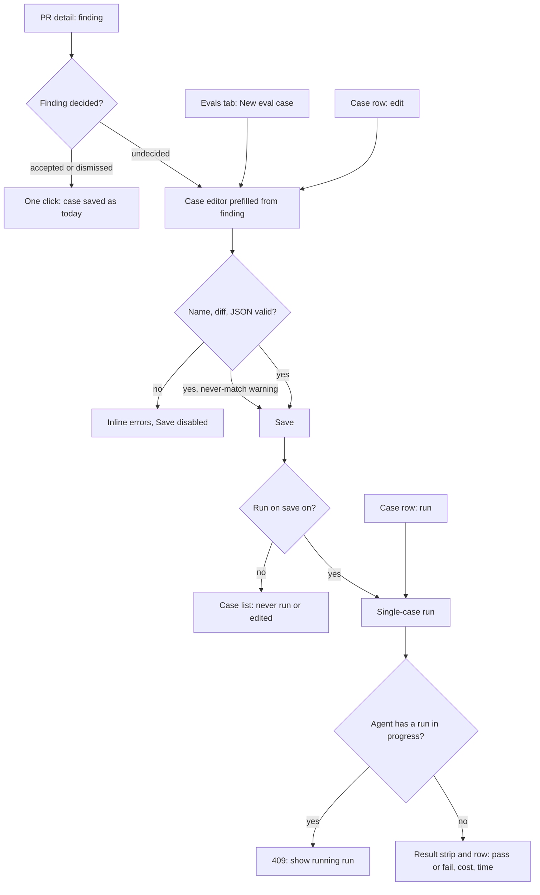
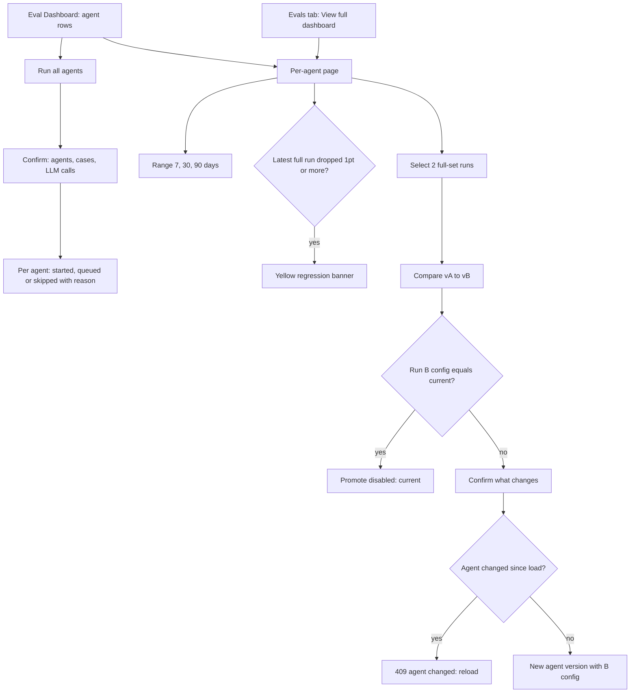
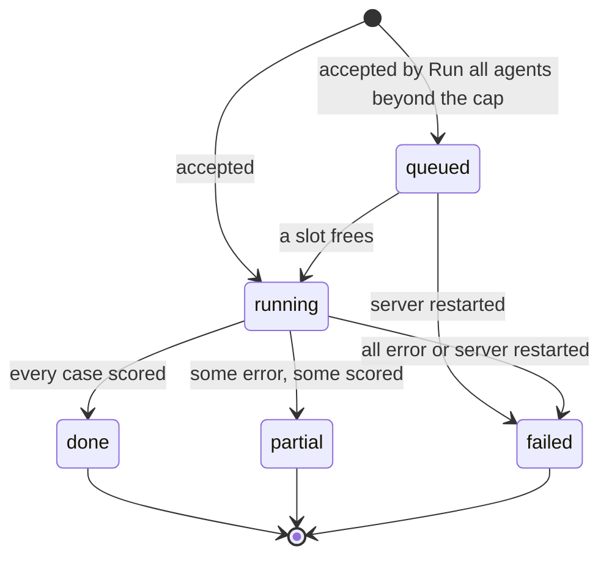
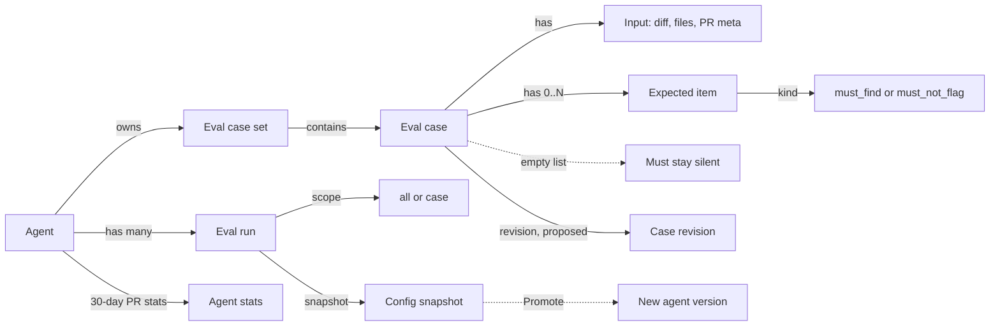
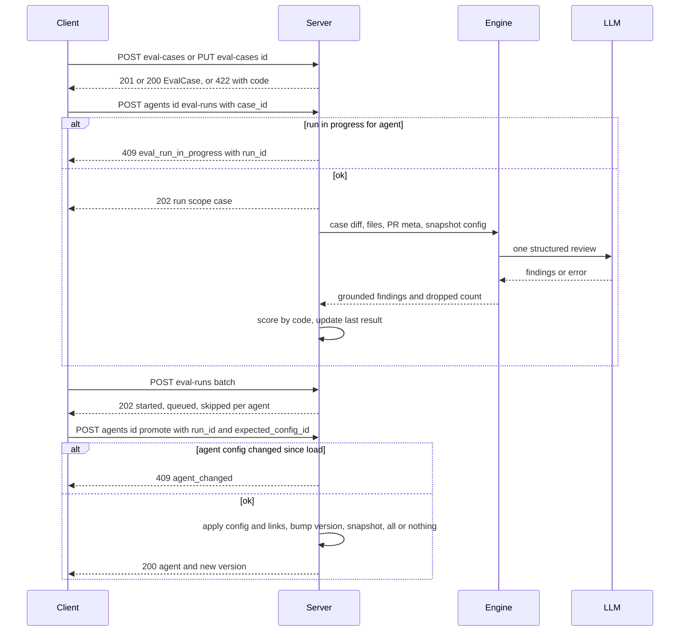

# Spec: Eval Pipeline — full design parity (delta)

Spec ID: 2026-10-31-eval-design-parity
Status: approved
Supersedes: — (partial delta of [2026-10-29-eval-pipeline](2026-10-29-eval-pipeline.md); see "Base items superseded / amended")
Modules: server, client, reviewer-core (one new optional engine input; everything else in the engine unchanged)
Revision: rev 2 (2026-10-31)
Design sources:
- six mockups: #1 PR detail with "Turn into eval case", #2 Eval Dashboard (all agents), #3 per-agent eval dashboard, #4 "Compare runs · v6 → v7" modal, #5 Agents → Evals tab, #6 eval case editor modal;
- owner decision (verbatim): "Хочу повну відповідність макетам: спочатку онови спеку (spec-creator) під ці пункти, а потім план і реалізація.";
- owner answers to Round-1 questions Q1–Q6 (2026-10-31);
- base spec `docs/specs/2026-10-29-eval-pipeline.md` (approved, rev 5);
- research `docs/research/eval-pipeline.research.md` (R1–R4, plus R6–R8 under "Design-parity round (2026-10-31)").

> Changelog
> - rev 1: first draft. Owner decisions applied:
>   - Q1: the expected output is a list; matching is strict on severity and category;
>   - Q2: Files and PR meta are editable inputs fed to the agent;
>   - Q3: a single-case run is an ordinary run with scope `case`;
>   - Q4: Promote applies run B's config as a new version;
>   - Q5: an agent card stats line and a Stats tab, with no Agent Performance page;
>   - Q6: the button is always active; Learn and Reply stay out.
>
>   Proposals P1, P3, P4, P5 and P6 are included and marked "(proposed — owner to confirm)".
> - rev 2: rev 1 approved 2026-10-31 — approved by owner (2026-10-31) with all defaults Q-D1…Q-D13 and proposals P1, P3, P4, P5, P6 accepted (Open questions marked resolved; "proposed" tags dropped from ACs).

> **How to read this delta.** The base spec stays in force except for the items listed under **Base items superseded / amended**. New ids carry a `D` prefix (G-D1, US-D1, AC-D1, C-D1, EC-D1, NFR-D1, Q-D1) and never clash with base ids. When a base AC is amended, the new AC names it (e.g. "amends AC-11a"). An AC id with a letter suffix (AC-D7a, AC-D7b) is a separate, separately checkable requirement that shares a trigger with its siblings.

> **Mockup numbers are illustrative.** Examples are "20-trace gold set", "v6 → v7", "142 runs · 78% accept · $0.04 avg", "Precision dipped 2pts on v7". Where the mockup gives a fixed UI string, that string is copied verbatim into the ACs.

---

## Base items superseded / amended

| Base item | Change in this delta | New item(s) |
|---|---|---|
| NG1 (manual case authoring) | **lifted**: create, edit and rename cases in an editor | US-D1, AC-D1…AC-D24 |
| NG2 (no per-case run) | **lifted**: single-case runs | US-D2, AC-D25…AC-D33 |
| NG3 (no Promote) | **lifted**: Promote run B's config | US-D4, AC-D52…AC-D60 |
| NG4 (no Run all agents) | **lifted** | US-D5, AC-D72…AC-D78 |
| NG5 (no range, trend, sparklines, banner) | **lifted** | US-D5, US-D6, AC-D61…AC-D71, AC-D79…AC-D84 |
| NG7 (no Stats tab, card stats, Agent Performance) | **partly lifted**: the card stats line and the Stats tab; the Agent Performance page stays out | US-D7, AC-D85…AC-D92, NG-D2 |
| NG6, NG8, NG11, NG12 | **unchanged** | — |
| NG9 (engine invariants) | **narrowed**: the engine gains one optional untrusted input for extra file contents. Every listed invariant stays. | NG-D1, AC-D14…AC-D17 |
| NG10 (inputs never include …) | **narrowed**: eval runs may also feed the case's own PR meta and Files; everything else stays excluded | AC-D13 |
| C2 `EvalExpectation`, C3 `EvalCase`, C12 `EvalCaseResult` | single expectation → list of expected items; new input fields | C-D1…C-D4 |
| C5 create case from finding | unchanged for decided findings; a new draft endpoint for undecided findings | C-D6 |
| C7 `EvalRunStatus` | adds `queued` (default → Q-D7) | C-D8 |
| C11 `EvalRunSummary`, C13 run endpoints | adds `scope`, adds an optional `case_id` body | C-D8, C-D9 |
| C14 `EvalDashboardOverview` | adds the row sparkline; recent runs become full-set only | C-D10 |
| AC-11a (disabled on undecided) | **superseded**: always enabled; on an undecided finding it opens the editor | AC-D34, AC-D35 |
| AC-13a (action row) | **amended**: Learn and Reply to author are not added | AC-D36, NG-D3 |
| AC-14a (tabs) | **amended**: tab order Config, Skills, Context, Evals, Stats, CI | AC-D85 |
| AC-16a (case row content) | **superseded** by the mockup #5 row | AC-D37…AC-D39 |
| AC-24 (inputs fed) | **amended**: plus the case's PR meta and Files | AC-D13 |
| AC-27b (engine unchanged) | **amended**: unchanged except the new optional input | AC-D14…AC-D17 |
| AC-29b, AC-30a (one running run per agent) | **extended** to single-case and queued runs | AC-D29, AC-D30 |
| AC-31b (Run all evals disabled at zero cases) | **amended**: "New eval case" stays enabled | AC-D40 |
| AC-38, AC-39, AC-40 (matching, labels, pass) | **superseded** by list scoring with strict severity/category | AC-D41…AC-D47 |
| AC-41a, AC-42a (metrics) | formulas unchanged; the counts now cover list items and silent cases | AC-D48 |
| AC-44a (metric cards) | **amended**: header "EVAL METRICS", "View full dashboard →", 4th card label | AC-D49, AC-D50 |
| AC-44b, AC-45a, AC-45b (cards, deltas) | **amended**: computed over full-set runs only | AC-D27 |
| AC-46a…AC-48b (run history in Evals tab) | **moved** to the per-agent page; full-set filter for Compare (default → Q-D1) | AC-D66…AC-D69 |
| AC-49a…AC-54 (Compare) | **amended**: subtitle, legend, Promote, edited-case warning | AC-D51…AC-D60 |
| AC-56a…AC-59 (Eval Dashboard) | **superseded** by rows, drill-down page and Run all agents | AC-D61…AC-D84 |
| AC-6b (case changes keep agent version) | **extended** to case create, edit and rename | AC-D21 |

Every other base AC, edge case, NFR and contract stays as written.

---

## Problem & user

**User.** As in the base spec: the owner of DevDigest reviewer agents. Usually this is a team lead or the developer who owns the repo.

**Problem today.** The built Eval Pipeline (branch LO6) covers the homework minimum, but it diverges from the six mockups the owner designed against:
- Cases can only be cloned from decided findings. The user cannot write a scenario that never happened on a real PR, such as "a clean refactor must produce no findings". They cannot fix a case, run one case, or say "this finding at CRITICAL·security, not any finding on those lines".
- A regression is visible only by reading two rows of a table:
  - no trend;
  - no per-agent page;
  - no regression banner;
  - no way to run every agent at once.
- After a Compare, the user who prefers the older-tested config must re-type it by hand. Nothing applies it.
- The agents list gives no signal of how an agent performs on real PRs (runs, accept rate, cost).

**Why now.** The owner asked for full parity with the mockups before the next lesson. The run, scoring and versioning foundations exist (base spec, research R6–R8), so this is an extension rather than a new system.

## Goals / Non-goals

**Goals**
- **G-D1** A user authors, edits and renames an eval case in an editor. A case holds a diff, optional full files, optional PR meta, and an expected output: a JSON list of 0..N expected findings.
- **G-D2** A user runs one case and sees its result within one engine review.
- **G-D3** A per-agent eval dashboard shows the agent's full-set run trend over a selectable range, sparklines, deltas and a code-generated regression banner. It also shows the run history with Compare.
- **G-D4** From Compare, a user applies the newer run's config to the agent as a new version, with zero LLM calls.
- **G-D5** The all-agents Eval Dashboard shows one row per agent with a sparkline, and starts eval runs for all eligible agents with one action.
- **G-D6** The agents list and a new agent Stats tab show 30-day PR-review stats: runs, accept %, average cost.
- **G-D7** Every element named in mockups #1–#6 exists in the product, except the items in NG-D2 and NG-D3.

**Non-goals**
- **NG-D1 (invariants left untouched).** The following stay exactly as in base NG9:
  - the grounding gate (`reviewer-core/src/grounding.ts:52-84`), including the exact-path file gate (`grounding.ts:61-64`, research R7) and the full-file-kind exemption (`grounding.ts:16`);
  - untrusted fencing and the fixed injection guard;
  - out-of-band structured output;
  - score derivation from grounded findings;
  - the PR review pipeline (`server/src/modules/reviews/run-executor.ts`);
  - accept/dismiss semantics.

  The only engine change is one **optional** input for extra file contents (AC-D14). The planner decides its shape.
- **NG-D2** The "Agent Performance" page, the GLOBAL nav group, and the Memory and Multi-Agent Review nav items shown in the mockup sidebars. The existing `/agent-performance` → nav-key mapping (`client/src/components/app-shell/helpers.ts:40`) stays unused. (Owner Q5.)
- **NG-D3** The "Learn" and "Reply to author" finding actions of mockup #1. They are unrelated to evals: memory lessons and GitHub writes. (Owner Q6.)
- **NG-D4** Restoring skill **bodies** on Promote. Promote sets skill links only; linked skills keep their current bodies (snapshots hold ids only, research R8). Promote of the older run A of a Compare (owner Q4: "B only").
- **NG-D5** Any LLM judge or LLM-generated text, including the regression banner text (base NG8 stays).
- **NG-D6** Drafts or trial runs of unsaved case content. "Run case" runs the saved case (owner Q3).
- **NG-D7** Skill-owned eval cases (base NG6 stays): no mockup needs them.
- **NG-D8** Cancelling a running or queued eval run (base NG11 stays).

## User stories

- **US-D1** As an agent owner, I want to write and edit an eval case by hand (diff, full files, PR meta, expected findings), so that I can test scenarios that never occurred on a real PR, including "must stay silent".
- **US-D2** As an agent owner, I want to run a single case from its row or from the editor, so that I can check one scenario without paying for the whole set.
- **US-D3** As an agent owner, I want "Turn into eval case" on any finding, including undecided ones, so that I can capture a scenario while reviewing.
- **US-D4** As an agent owner, I want to apply the newer compared run's config to my agent, so that I can go back to the configuration that scored better without retyping it.
- **US-D5** As a workspace user, I want an all-agents dashboard with per-agent rows and sparklines, and a way to run every agent's evals at once, so that I can spot and re-check regressions across agents.
- **US-D6** As an agent owner, I want a per-agent eval page with a trend, a range selector, a regression banner and the run history, so that I understand how the agent changed over time.
- **US-D7** As an agent owner, I want to see each agent's 30-day PR-review runs, accept rate and average cost on its card and in a Stats tab, so that I can compare eval quality with real-world reception.

---

## Design & UX

**Sources analysed.**
- Mockups #5 and #6 were inspected directly. Mockups #1–#4 were analysed through the caller's verbatim description: element names, labels and layout.
- Existing UI to stay consistent with:
  - the agent editor tabs (`client/src/app/agents/[id]/_components/AgentEditor/constants.ts:11-17`);
  - the AgentCard meta row (`client/src/app/agents/_components/AgentCard/AgentCard.tsx:77-86`);
  - the skill Stats tab tiles (`client/src/app/skills/_components/SkillEditor/_components/StatsTab/StatsTab.tsx:37-53`), which the agent Stats tab mirrors;
  - existing copy "New eval case" and "Run case" (`client/messages/en/eval.json:34,36`).

### Workflow: authoring and running a case

### Workflow: dashboards, Compare and Promote

### Run lifecycle (amends base "Eval run lifecycle")

### Domain concepts (structure; not storage)

### Screen map (mockup → screen)

| Mockup | Screen | Main elements (verbatim where quoted) |
|---|---|---|
| #1 | PR detail → expanded finding | Accept, Dismiss, "Turn into eval case" (always enabled for agent reviews) |
| #2 | Eval Dashboard (all agents) | agent rows: model chip, "Last run vN · date · p/s pass", sparkline, RECALL / PREC / CITE, chevron; "Run all agents"; "RECENT EVAL RUNS · ALL AGENTS" with coloured bars |
| #3 | Per-agent eval page | breadcrumb "Eval Dashboard > <Agent>", "All agents", agent selector, "30 days" selector, "Run eval", yellow banner, 3 metric cards with sparkline and delta, "METRIC TREND", "RECENT RUNS" (checkbox, RAN AT, VERSION, RECALL, PRECISION, CITATION, PASS, COST), "N selected", "Compare" |
| #4 | Compare modal | "Compare runs · v<A> → v<B>", subtitle, 4 delta cards, "SYSTEM PROMPT DIFF" with legend "v<A> (old)" / "v<B> (new)", "Close", "Promote v<B>" |
| #5 | Agents → Evals tab | tabs Config, Skills, Context, Evals, Stats, CI; "EVAL METRICS", "View full dashboard →"; 4 cards; "Eval cases" + "p / s passing"; "Run all evals", "New eval case"; case rows with ▷ ✎ 🗑; card line "N runs · P% accept · $X avg" |
| #6 | Case editor modal | "Eval case · <name>", "<Agent> · simulate a PR and assert the expected output", Name*, Input tabs Diff / Files / PR meta, "Expected output", "valid JSON", "+ Finding skeleton", result strip, "Run on save", "Cancel", "Run case", "Save" |

### State table

| Screen / component | loading | empty | error | partial | long content |
|---|---|---|---|---|---|
| Case editor | spinner while the case or the finding draft loads (AC-D9) | new case: empty name, empty diff, `[]` (AC-D1) | load error + Close (AC-D9); validation errors inline (AC-D5…AC-D8); save error inline (AC-D20) | n/a | diff and files areas scroll; limits enforced (AC-D10) |
| Editor result strip | "Running…" (AC-D32) | "Never run" (AC-D31) | "Last run errored · <message>" (AC-D31) | n/a | message truncated to 1 line, full text on hover |
| Evals tab case rows | base AC-20 skeleton | base AC-14b | base AC-21 | row status `error` (AC-D37) | base AC-16b truncation |
| Per-agent page | skeleton (AC-D70) | "No runs yet" / trend "Not enough runs in this range" (AC-D65) | error + "Retry" (AC-D71) | `partial` runs listed with status (AC-D66) | newest 50 runs in range (AC-D66) |
| Eval Dashboard rows | base AC-58a | base AC-56b | base AC-58b | sparkline hidden with <2 full runs (AC-D62) | all agents listed, page scrolls |
| Run all agents | button busy while the request is pending (AC-D74) | all skipped → result lists reasons (AC-D76) | request error inline (AC-D78) | some skipped (AC-D76) | result list scrolls |
| Compare / Promote | base AC-49b | n/a | base AC-49c; Promote errors (AC-D57…AC-D59) | dataset warning (AC-D53) | base AC-51a |
| Agent card stats line | "…" placeholder (AC-D88) | "0 runs · — accept · — avg" (AC-D87) | line hidden (AC-D88) | n/a | n/a |
| Stats tab | skeleton (AC-D91) | tiles show 0 / "—" (AC-D90) | error + "Retry" (AC-D91) | n/a | n/a |

### Accepted UX decisions (owner)
- Q1: list of expected findings; strict severity/category on `must_find` (AC-D41…AC-D47).
- Q2: Files and PR meta are editable and fed to the agent (AC-D13…AC-D17).
- Q3: a single-case run is ordinary with scope `case`, is excluded from metrics, runs the saved case, and "Run on save" saves then runs (AC-D25…AC-D33).
- Q4: Promote B as a new version, disabled when current (AC-D52…AC-D60).
- Q5: card line plus Stats tab; no Agent Performance page (AC-D85…AC-D92, NG-D2).
- Q6: always enabled; undecided → editor; Learn and Reply out (AC-D34…AC-D36, NG-D3).

### Proposed (owner to confirm; ACs marked "proposed")
- P1: case revision and "k cases edited" in the Compare warning (AC-D22, AC-D23, AC-D53).
- P3: Run all agents confirmation and per-agent result (AC-D73, AC-D76).
- P4: Promote confirmation with skills warning (AC-D55, AC-D56).
- P5: "can never match" editor warning (AC-D11).
- P6: unsaved-changes confirmation (AC-D19).

---

## Service communication

| Hand-off | Who starts | What crosses | Sync / async | On failure / timeout | Source of truth |
|---|---|---|---|---|---|
| Create / edit case | client | EvalCaseDraft → EvalCase | sync | 404 / 409 / 422 with code; nothing saved (AC-D20) | server case set |
| Draft from undecided finding | client | finding id → EvalCaseDraft | sync, 0 LLM | 404 / 422 as base C5 (AC-D35) | server; nothing persisted |
| Single-case run | client | agent id + case id → EvalRunSummary | sync accept, async work | 409 / 422 before any run exists (AC-D29, AC-D30); case error → run `failed` (AC-D28) | server run status |
| Server → engine | server | diff, extra files, PR meta, prompt, model, strategy, skills | in-process | case `error` with message (base AC-33a) | engine output |
| Run all agents | client | none → per-agent outcome list | sync accept, async runs, ≤2 executing at once (default → Q-D7) | per-agent skip reasons; one agent's failure never stops another (AC-D77) | server run statuses |
| Promote | client | run id + expected config id → Agent | sync, 0 LLM | 409 `agent_changed` / `already_current`, 422 `skill_unavailable`; the agent is unchanged on any error (AC-D57…AC-D59) | agent row + version snapshot |
| Per-agent dashboard | client | agent id + range → AgentEvalDashboard | sync, 0 LLM | error + Retry (AC-D71) | server runs |
| Agent stats | client | agent ids → AgentStats | sync, 0 LLM | card line hidden; tab error + Retry (AC-D88, AC-D91) | PR-review runs + findings (research R6) |
| Polling | client | run id → EvalRunDetail | every 4 s (base AC-29a), also for `queued` | base AC-29c | server |
| Restart | server boot | — | on boot | `running` and `queued` → `failed` (AC-D80) | server |

---

## Contracts

Shapes only. Fields are `snake_case`. `Severity` is UPPERCASE, and category and kinds are lowercase (root `AGENTS.md` → Naming). Every change lands identically in both shared trees (root `INSIGHTS.md` → contract drift).

**C-D1 `EvalExpectedItem`** (replaces base C2 for cases)

| field | type | req | meaning |
|---|---|---|---|
| kind | `must_find` \| `must_not_flag` | no (default `must_find`) | |
| file | string, 1–300 chars | yes | new-side path, compared by exact equality with the diff's file path (R7) |
| start_line | int ≥ 1 | yes | |
| end_line | int ≥ start_line | no (default `start_line`) | |
| severity | `CRITICAL` \| `WARNING` \| `SUGGESTION` | required when `kind = must_find`; optional for `must_not_flag` | must equal the finding's severity to match (AC-D42) |
| category | `bug` \| `security` \| `perf` \| `style` \| `test` | required when `kind = must_find`; optional for `must_not_flag` | must equal the finding's category to match (AC-D42) |
| title | string ≤ 200 | no | display only, never matched |

Unknown keys are rejected with `invalid_expected_output`. An empty list means **must stay silent**.

**C-D2 `EvalCaseInputFile`**: `{ path: string 1–300 chars, content: string }`. `path` is unique within a case.

**C-D3 `EvalPrMeta`**: `{ title: string ≤ 200, description: string ≤ 8,000 }`. Both may be empty.

**C-D4 `EvalCase`** (amends base C3). Base fields stay except as noted.

| field | type | req | change |
|---|---|---|---|
| expected | `EvalExpectedItem[]` | yes | **replaces** `expectation` |
| input_diff | string | yes | unchanged |
| input_files | `EvalCaseInputFile[]` | yes | new; may be empty |
| pr_meta | `EvalPrMeta` | yes | new; empty strings when absent |
| display | `{ title, severity, category }` \| null | yes | now nullable; kept for finding-derived cases, null for hand-written ones |
| source | `{ finding_id: string \| null, pr_number: int, repo: string }` \| null | yes | now nullable; null for hand-written cases |
| revision | int ≥ 1 | yes | new (proposed, P1): bumped by every content edit (AC-D22) |
| last_result | base shape + `duration_ms: int \| null`, `cost_usd: number \| null`, `case_revision: int` | yes | extended (`case_revision` proposed, P1) |
| updated_at | ISO string | yes | new |

How existing data maps (AC-D24):
- A stored case with a `must_find` expectation becomes one item with the same file and lines, plus `severity` and `category` from its `display`.
- A stored `must_not_flag` expectation becomes one `must_not_flag` item with the same file and lines and no severity or category (location-only, default → Q-D2).
- `input_files` = [], `pr_meta` = empty, `revision` = 1.

**C-D5 `EvalCaseDraft`** (request body for create and update; also the response of C-D6): `{ name, input_diff, input_files, pr_meta, expected }` with the types above. `name` is 1–60 characters of `a-z0-9-`.

**C-D6 Case endpoints** (amends base C6)
- `POST /agents/:id/eval-cases` with body `EvalCaseDraft` → `201 EvalCase`. When the body also carries `source_finding_id`, the case is linked to that finding (the editor path of AC-D35).
- `PUT /eval-cases/:id` with body `EvalCaseDraft` → `200 EvalCase`.
- `GET /findings/:id/eval-case-draft` → `200 EvalCaseDraft` (nothing persisted).
- Error `code` values, in the API's existing error envelope:
  - `404 agent_not_found`, `404 eval_case_not_found`, `404 finding_not_found`;
  - `409 eval_case_name_taken`;
  - `409 eval_case_exists` (C-D6 draft or create from a finding that already has a case; the body carries the existing case id);
  - `422 invalid_name`;
  - `422 invalid_diff` with `reason`: `no_files` | `no_hunks` | `missing_file_header` | `ambiguous_multi_file`;
  - `422 invalid_expected_output` with a JSON-path `message`;
  - `422 input_too_large` with `limit`: `diff` | `file` | `files_total` | `files_count` | `pr_title` | `pr_description`;
  - `422 duplicate_file_path`;
  - `422 finding_without_agent`, `422 diff_unavailable` (draft only, as base C5).
- `GET /agents/:id/eval-cases` and `DELETE /eval-cases/:id`: unchanged.

**C-D7 `EvalCaseResult`** (amends base C12)
- `expectation` is **replaced** by `expected: EvalExpectedItem[]`, as scored.
- `case_revision: int` is added (proposed, P1).
- `findings[].label` keeps `tp` | `forbidden` | `unlabelled`.

**C-D8 Run shape** (amends base C7 and C11)
- `EvalRunStatus` adds `queued` (default → Q-D7).
- `EvalRunSummary` adds `scope: 'all' | 'case'`.
- `EvalCounts` adds:
  - `silent_total` (cases with an empty expected list);
  - `must_not_flag_total` (now counts items, not cases).

**C-D9 Run endpoints** (amends base C13)
- `POST /agents/:id/eval-runs` accepts an optional body `{ case_id?: string }`.
  - With `case_id`: a scope-`case` run of that one saved case.
  - Without: as base (scope `all`).
- New errors: `404 eval_case_not_found` (case not in this agent's set).
- `409 eval_run_in_progress` also covers `queued` runs.
- `POST /eval-runs/batch` (no body) → `202 { started: Item[], queued: Item[], skipped: Skip[] }`:
  - `Item` = `{ agent_id, agent_name, run_id, cases: int }`;
  - `Skip` = `{ agent_id, agent_name, reason: 'disabled' | 'no_eval_cases' | 'eval_run_in_progress' | 'provider_not_configured' }`.

**C-D10 `EvalDashboardOverview`** (amends base C14). Each agent row adds:
- `sparkline: number[]`: recall of up to the last 10 full-set finished runs, oldest → newest; null recall values are omitted (default → Q-D5);
- `last_full_run: EvalRunSummary | null` (replaces the meaning of `last_run`: full-set runs only).

`recent_runs` holds full-set runs only, ≤20.

**C-D11 `AgentEvalDashboard`**: `GET /agents/:id/eval-dashboard?range=7d|30d|90d` (default `30d`).

| field | type | meaning |
|---|---|---|
| agent | `{ id, name, model }` | |
| range | `7d` \| `30d` \| `90d` | as requested |
| latest | `EvalRunSummary` \| null | newest finished full-set run (any time) |
| previous | `EvalRunSummary` \| null | the full-set finished run before `latest` |
| series | array of `{ run_id, ran_at, agent_version, recall, precision, citation_accuracy }` | finished full-set runs in range, oldest → newest; metric values may be null |
| runs | `EvalRunSummary[]` | all runs (both scopes) started in range, newest first, ≤50 |
| regression | `{ agent_version: int, drops: Delta[], rises: Delta[], forbidden_hits_delta: int, fn_delta: int }` \| null | null unless AC-D79 holds. `Delta` = `{ metric: 'recall' \| 'precision' \| 'citation_accuracy', points: int }` |

**C-D12 Current eval config**: `GET /agents/:id/eval-config` → `EvalConfigSnapshot` (base C8) built from the live agent, including `config_id`. 0 LLM calls.

**C-D13 Promote**: `POST /agents/:id/promote` with body `{ run_id: string, expected_config_id: string }` → `200 { agent: Agent, version: int }`.
- Errors:
  - `404 agent_not_found`, `404 eval_run_not_found` (or the run belongs to another agent);
  - `409 agent_changed` (the live `config_id` ≠ `expected_config_id`);
  - `409 already_current` (the run's `config_id` = the live `config_id`);
  - `422 skill_unavailable` with the names of snapshot skills that no longer exist.

**C-D14 `AgentStats`** (existing contract, `server/src/vendor/shared/contracts/observability.ts:96-119`, reused unchanged).
- `GET /agents/:id/stats` → `AgentStats`.
- `GET /agents/stats` → `AgentStats[]`, one per agent of the workspace.
- Window: rolling 30 days. `trend` is returned empty in this spec (not rendered). Field meanings: AC-D86.

---

## Acceptance criteria (EARS)

### Case editor (US-D1)
- **AC-D1** (event · US-D1) WHEN the user clicks "New eval case" on the Evals tab, the client shall open the case editor with an empty name, an empty diff, no files, empty PR meta and the expected output `[]`.
- **AC-D2** (ubiquitous · US-D1) The case editor shall show:
  - the title "Eval case · <name>" ("Eval case · New" while the name is empty);
  - the subtitle "<Agent name> · simulate a PR and assert the expected output";
  - "Name *";
  - "Input" with the tabs "Diff", "Files" and "PR meta";
  - "Expected output";
  - "Run on save", "Cancel", "Run case" and "Save".
- **AC-D3** (ubiquitous · US-D1) The Diff tab shall render added lines (`+`) with a highlighted background and hunk headers (`@@`) in an accent colour. Every line shall keep its `+`, `-` or space prefix as text.
- **AC-D4a** (ubiquitous · US-D1) The Files tab shall let the user add, edit and remove entries of `{ path, content }`.
- **AC-D4b** (ubiquitous · US-D1) The Files tab shall label each entry whose path is not a file of the diff "context only — findings on this file are not scored". (R7: the grounding file gate is exact path equality.)
- **AC-D4c** (ubiquitous · US-D1) The PR meta tab shall edit a title and a description.
- **AC-D5** (state · US-D1) WHILE the expected-output text parses as JSON and satisfies `EvalExpectedItem[]`, the editor shall show the badge "valid JSON". In every other state it shall show "invalid JSON" with the first error's JSON path.
- **AC-D6** (event · US-D1) WHEN the user clicks "+ Finding skeleton", the client shall append to the expected list one `must_find` item with `severity` "WARNING", `category` "bug", an empty `title`, `file` set to the diff's first file path (empty when none) and `start_line` 1. (default → Q-D3)
- **AC-D7** (state · US-D1) WHILE the name is empty or invalid, the JSON is invalid, or the diff is invalid, the editor shall keep "Save" disabled.
- **AC-D8a** (unwanted · US-D1) IF the saved diff parses to zero files with a non-empty path, THEN the server shall reject it with `invalid_diff` reason `no_files`. (R7: the parser never throws and returns `files: []`. Before this rule, a zero-file diff made `must_not_flag` pass silently.)
- **AC-D8b** (unwanted · US-D1) IF a file of the diff has zero hunks, THEN the server shall reject it with `invalid_diff` reason `no_hunks`, naming the file.
- **AC-D8c** (unwanted · US-D1) IF the diff contains a hunk header (`@@`) before any `+++ <path>` line, THEN the server shall reject it with `invalid_diff` reason `missing_file_header`.
- **AC-D8d** (unwanted · US-D1) IF the diff contains more than one `+++ ` header and not every file section starts with a `diff --git` line, THEN the server shall reject it with `invalid_diff` reason `ambiguous_multi_file`. (R7: such sections would merge into one file.)
- **AC-D8e** (ubiquitous · US-D1) The server shall treat a diff with CRLF line endings exactly as the same diff with LF endings. (R7: CRLF otherwise opens no hunk.)
- **AC-D8f** (event · US-D1) WHEN the server answers `invalid_diff`, the editor shall show a reason-specific message under the Diff tab. For example, `no_hunks` shows "No hunk found in <file> — add an @@ header".
- **AC-D9a** (state · US-D1) WHILE an existing case or a finding draft loads, the editor shall show a spinner.
- **AC-D9b** (unwanted · US-D1) IF that load fails, THEN the editor shall show the error with "Close".
- **AC-D10a** (unwanted · US-D1) IF an input exceeds a limit (diff 256 KB, one file 64 KB, all files 256 KB, 10 files, PR title 200 characters, description 8,000 characters), THEN the server shall reject the save with `input_too_large` naming the limit. (default → Q-D4)
- **AC-D10b** (event · US-D1) WHEN the server answers `input_too_large`, the editor shall show the limit beside the input that exceeded it.
- **AC-D11** (state · US-D1, P5) WHILE an expected item's file is not a file path of the diff, or none of its lines `[start_line, end_line]` is a context or `+` line of that file's hunks, the editor shall show under the JSON: "Item <n> can never match — <file>:<lines> is not on the new side of the diff". Save stays enabled.
- **AC-D12a** (ubiquitous · US-D1) The server shall accept a name of 1–60 characters of `a-z0-9-`, and reject any other name with `invalid_name`.
- **AC-D12b** (unwanted · US-D1) IF the name is already used by another case of the same agent, THEN the server shall reject the save with `409 eval_case_name_taken`.
- **AC-D13** (ubiquitous · US-D1) For each case, an eval run shall feed the review engine:
  - the stored diff;
  - the case's Files entries;
  - the case's PR title and description;
  - the snapshot's system prompt, model, strategy and bound enabled skills.

  It feeds nothing else (amends base AC-24; base NG10's other exclusions stay).
- **AC-D14** (ubiquitous · US-D1) The review engine shall accept extra file contents as an optional input. It shall render that input inside the same untrusted fencing as the diff, before the injection guard. (The planner decides the input's shape.)
- **AC-D15** (ubiquitous · US-D1) The PR title and description of a case shall reach the model only inside untrusted fencing.
- **AC-D16** (ubiquitous · US-D1) WHEN the extra-files input is absent, the engine shall assemble a prompt byte-identical to the prompt it assembled before this change, for the same other inputs. This covers every PR review and every case without Files.
- **AC-D17** (ubiquitous · US-D1) The grounding gate shall keep only findings whose file is a file of the diff (exact path equality). A finding citing a Files-only path shall be dropped and counted in `dropped`.
- **AC-D18** (event · US-D1) WHEN the user clicks "Cancel", "×" or presses Escape in an editor with no unsaved changes, the client shall close the editor.
- **AC-D19** (event · US-D1, P6) WHEN the user tries to close an editor that has unsaved changes, the client shall ask "Discard unsaved changes?" with "Discard" and "Keep editing".
- **AC-D20a** (unwanted · US-D1) IF a save fails, THEN the server shall leave the stored case unchanged.
- **AC-D20b** (unwanted · US-D1) IF a save fails, THEN the editor shall keep the user's input and show the error.
- **AC-D21** (ubiquitous · US-D1) Creating, editing, renaming or deleting a case shall leave the agent's `version` unchanged (extends base AC-6b; the zero-LLM rule is AC-D93).
- **AC-D22** (event · US-D1, P1) WHEN a save changes the diff, Files, PR meta or expected output, the server shall increase the case's `revision` by 1. A rename alone shall keep `revision` unchanged.
- **AC-D23** (state · US-D1, P1) WHILE a case's `last_result.case_revision` is lower than its `revision`, the case row and the editor result strip shall show "edited since last run" next to the last result.
- **AC-D24** (ubiquitous · US-D1) The server shall present every case that existed before this change as described in C-D4 "How existing data maps", with unchanged name, diff and source.

### Single-case runs (US-D2)
- **AC-D25** (event · US-D2) WHEN the user clicks a case row's run button (accessible name "Run case <name>") or "Run case" in the editor, the client shall call `POST /agents/:id/eval-runs` with that case's id.
- **AC-D26** (ubiquitous · US-D2) A scope-`case` run shall perform exactly one engine review, of the saved case content captured at its start.
- **AC-D27** (ubiquitous · US-D2) The metric cards, deltas, sparklines, trend, regression banner, dashboard rows and dashboard recent runs shall use finished scope-`all` runs only.
- **AC-D28** (event · US-D2) WHEN a scope-`case` run finishes, the server shall set that case's `last_result` from it.
- **AC-D29** (unwanted · US-D2) IF the agent has a `running` or `queued` run, THEN the server shall reject a new run of any scope with `409 eval_run_in_progress` and that `run_id` (extends base AC-30a).
- **AC-D30** (state · US-D2) WHILE the agent has a `running` or `queued` run, the client shall keep "Run all evals", every case row run button, "Run case" and "Run eval" disabled.
- **AC-D31** (ubiquitous · US-D2) The editor result strip shall show the saved case's last result as:
  - "Last run passed · 
 · <duration>s · $<cost>";
  - "Last run failed · 
 · <duration>s · $<cost>";
  - "Last run errored · <message>";
  - "Never run".

  An unknown cost shows "—".
- **AC-D32** (state · US-D2) WHILE a run of this case is in progress, the result strip shall show "Running…".
- **AC-D33a** (state · US-D2) WHILE the editor has unsaved changes, "Run case" shall be disabled with the hint "Save first".
- **AC-D33b** (event · US-D2) WHEN the user saves with "Run on save" on, the client shall start a scope-`case` run of the saved case after the save succeeds.
- **AC-D33c** (unwanted · US-D2) IF the save succeeds but the run is rejected (409 or 422), THEN the client shall keep the case saved and show the run error in the result strip.

### PR detail (US-D3)
- **AC-D34** (state · US-D3) WHILE a finding belongs to an agent review, the client shall render "Turn into eval case" enabled, whatever the finding's decision (supersedes base AC-11a; base AC-11b and AC-13b stay).
- **AC-D35a** (event · US-D3) WHEN the user clicks "Turn into eval case" on an undecided finding, the client shall open the case editor prefilled from `GET /findings/:id/eval-case-draft`, with nothing saved until "Save".
- **AC-D35b** (ubiquitous · US-D3) The draft shall hold:
  - the auto name (base AC-4a, AC-4b);
  - the finding's whole-file diff (base AC-3a);
  - one `must_find` item with the finding's file, lines, severity, category and title;
  - no Files;
  - empty PR meta. (default → Q-D6)
- **AC-D35c** (unwanted · US-D3) IF a case already exists for that finding, THEN the client shall show "Already an eval case" with a link to the agent's Evals tab in place of the editor (base AC-7b wording).
- **AC-D35d** (event · US-D3) WHEN the user saves a draft opened from a finding, the server shall link the new case to that finding (`source.finding_id`).
- **AC-D36** (ubiquitous · US-D3) The finding action row shall show Accept, Dismiss and "Turn into eval case", in that order, and no "Learn" or "Reply to author" (amends base AC-13a; NG-D3).

### Evals tab (US-D1, US-D2)
- **AC-D37** (ubiquitous · US-D1) Each case row shall show:
  - a status icon with a text alternative ("passed", "failed", "errored", "never run");
  - the name in a monospace font;
  - the last result summary, or "never run";
  - a chip;
  - the buttons run ▷, edit ✎ and delete 🗑, with accessible names "Run case <name>", "Edit case <name>" and "Delete case <name>".

  (Supersedes base AC-16a.)
- **AC-D38** (ubiquitous · US-D1) The row chip shall show:
  - `"<SEVERITY> · <category>"` of the first `must_find` item, with "+<k>" appended when the list has k further items;
  - "empty []" for an empty list;
  - "must not flag" when the list holds only `must_not_flag` items.
- **AC-D39** (event · US-D1) WHEN the user clicks a row's edit button, the client shall open the case editor loaded with that case.
- **AC-D40** (state · US-D1) WHILE the agent has zero cases, "New eval case" shall stay enabled (amends base AC-31b).
- **AC-D41a** (ubiquitous · US-D1) The "Eval cases" heading shall show "<passed> / <scored> passing" from the latest finished full-set run (base AC-17).
- **AC-D41b** (ubiquitous · US-D1) "Run all evals" and "New eval case" shall sit on the heading line, right-aligned.

### Scoring (US-D1, US-D2)
- **AC-D42** (ubiquitous · US-D1) The server shall treat a grounded finding as matching a `must_find` item when all of these hold:
  - its file equals the item's file;
  - its line range intersects the item's range;
  - its severity equals the item's severity;
  - its category equals the item's category.

  The title is ignored. (Supersedes base AC-38 for list items.)
- **AC-D43** (ubiquitous · US-D1) The server shall treat a grounded finding as matching a `must_not_flag` item when its file and line range match, plus its severity and category when the item carries them. (default → Q-D2)
- **AC-D44** (ubiquitous · US-D1) The server shall give each grounded finding exactly one label, in engine output order:
  - `tp` if it matches a `must_find` item not yet hit (items in list order);
  - otherwise `forbidden` if it matches any `must_not_flag` item, or if the expected list is empty;
  - otherwise `unlabelled`.
- **AC-D45** (ubiquitous · US-D1) The server shall set a case's status to `pass` when every `must_find` item has a `tp` and the case has zero `forbidden` findings. Otherwise the status is `fail` (supersedes base AC-40).
- **AC-D46** (ubiquitous · US-D1) The server shall write the case summary as follows:
  - "expected <n> finding(s), got <m>", where n = the number of `must_find` items and m = the number of grounded findings;
  - when the case has `must_not_flag` items, add " · <k> forbidden hit(s)".
- **AC-D47** (unwanted · US-D2) IF a case's diff parses to zero files at run time, THEN the server shall mark that case `error` with "diff has no reviewable files" and make no LLM call for it.
- **AC-D48** (ubiquitous · US-D1) The server shall compute the base metrics with the base formulas (AC-41a, AC-42a), where:
  - `must_find_total` counts `must_find` items;
  - `forbidden_hits` counts `forbidden` labels, including those in silent cases;
  - `fn` counts `must_find` items without a `tp`.

### Metric header and Compare (US-D4, US-D6)
- **AC-D49** (ubiquitous · US-D6) The Evals tab shall show the section label "EVAL METRICS" with a "View full dashboard →" link to the agent's per-agent eval page.
- **AC-D50** (ubiquitous · US-D6) The fourth metric card shall be labelled "TRACES PASSED", with the value "<passed>/<scored>". (default → Q-D8)
- **AC-D51a** (ubiquitous · US-D4) The compare view shall show the subtitle "Old prompt vs new — metric deltas and prompt diff on the <n>-trace gold set", where n is the case count of run B.
- **AC-D51b** (ubiquitous · US-D4) The compare view shall label its prompt diff section "SYSTEM PROMPT DIFF", with the legend "v<A> (old)" and "v<B> (new)".
- **AC-D52** (ubiquitous · US-D4) The compare view shall show the buttons "Close" and "Promote v<B>".
- **AC-D53** (unwanted · US-D4) IF the two runs scored different case sets or different case revisions, THEN the compare view shall show "<n> cases added, <m> removed, <k> edited between runs — deltas include dataset change". (Extends base AC-53; "edited" comes from P1.)
- **AC-D54** (state · US-D4) WHILE run B's `config_id` equals the agent's current `config_id` (C-D12), "Promote v<B>" shall be disabled with the hint "v<B> is the current config".
- **AC-D55** (event · US-D4, P4) WHEN the user clicks "Promote v<B>", the client shall show a confirmation that lists the fields that will change (system prompt, provider, model, strategy, skills to link and to unlink), with "Promote" and "Cancel".
- **AC-D56** (state · US-D4, P4) WHILE a skill in run B's snapshot has a different current version than the snapshot recorded, the confirmation shall show "<skill> is now v<cur> (run used v<old>) — current body will be used".
- **AC-D57** (event · US-D4) WHEN the user confirms Promote, the server shall:
  - set the agent's system prompt, provider, model and strategy to run B's snapshot;
  - set its skill links to exactly the snapshot's skills, in snapshot order;
  - increase `version` by 1;
  - record the new version's config snapshot.

  It leaves name, description, enabled, context docs, `ci_fail_on`, `repo_intel` and the output schema unchanged.
- **AC-D58** (unwanted · US-D4) IF any part of a Promote fails, THEN the server shall leave the agent's config, version, skill links and version snapshots exactly as before the request.
- **AC-D59a** (unwanted · US-D4) IF the agent's live `config_id` differs from `expected_config_id` (the value the client loaded when the compare view opened), THEN the server shall reject Promote with `409 agent_changed` and change nothing.
- **AC-D59b** (event · US-D4) WHEN the client receives `agent_changed`, it shall show "The agent changed since you opened this comparison — reload and review again" with "Reload".
- **AC-D59c** (unwanted · US-D4) IF a skill in run B's snapshot no longer exists, THEN the server shall reject Promote with `422 skill_unavailable`, naming those skills.
- **AC-D60a** (event · US-D4) WHEN Promote succeeds, the client shall close the compare view and show "Promoted v<B> config as v<new>".
- **AC-D60b** (event · US-D4) WHEN Promote succeeds, the client shall refresh the agent and its eval data.

### Eval Dashboard, all agents (US-D5)
- **AC-D61** (ubiquitous · US-D5) The Eval Dashboard shall show one row per agent (supersedes base AC-56a) with:
  - name;
  - model chip;
  - "Last run v<version> · <date> · <passed>/<scored> pass" from the latest full-set run;
  - a sparkline;
  - RECALL, PREC and CITE values;
  - a chevron.
- **AC-D62** (state · US-D5) WHILE an agent has fewer than 2 full-set finished runs, its row shall show no sparkline.
- **AC-D63** (event · US-D5) WHEN the user clicks an agent row or a recent-run row, the client shall open that agent's per-agent eval page (supersedes base AC-59).
- **AC-D64** (ubiquitous · US-D5) The "RECENT EVAL RUNS · ALL AGENTS" table shall render recall, precision and citation as a bar whose filled width equals the value, with the percentage as text beside it. The bar colour comes from the value bands of Q-D9.

### Per-agent eval page (US-D6)
- **AC-D65a** (ubiquitous · US-D6) The per-agent page shall show:
  - the breadcrumb "Eval Dashboard > <Agent name>";
  - an "All agents" link back to the Eval Dashboard;
  - an agent selector listing every agent of the workspace;
  - a range selector with "7 days", "30 days" and "90 days", defaulting to "30 days" (default → Q-D10);
  - a "Run eval" button.
- **AC-D65b** (state · US-D6) WHILE fewer than 2 full-set finished runs fall in the range, the "METRIC TREND" area shall show "Not enough runs in this range for a trend".
- **AC-D66** (ubiquitous · US-D6) The "RECENT RUNS" table shall list the agent's runs started in range, newest first, at most 50. Columns:
  - a checkbox;
  - RAN AT;
  - VERSION ("v<n>", plus "1 case" for scope-`case` runs);
  - RECALL, PRECISION and CITATION as bars;
  - PASS;
  - COST.

  (Moves base AC-46a; default → Q-D1.)
- **AC-D67** (ubiquitous · US-D6) The per-agent page shall show RECALL, PRECISION and CITATION cards, each with:
  - the latest full-set value;
  - a sparkline over the range's series;
  - the delta vs the previous full-set run as "▲ <n>pt", "▼ <n>pt" or "± 0pt".
- **AC-D68** (ubiquitous · US-D6) The "METRIC TREND" chart shall plot recall, precision and citation over `series` against run time, with a legend naming the three lines and a text alternative listing the latest values.
- **AC-D69a** (state · US-D6) WHILE k runs are selected, the page shall show "<k> selected".
- **AC-D69b** (state · US-D6) WHILE exactly two finished scope-`all` runs are selected, "Compare" shall be enabled. In every other state it stays disabled.
- **AC-D70** (state · US-D6) WHILE the page data loads, the page shall show skeleton placeholders.
- **AC-D71** (unwanted · US-D6) IF loading the page data fails, THEN the page shall show an error with "Retry".
- **AC-D72** (event · US-D6) WHEN the user clicks "Run eval", the client shall start a scope-`all` run exactly like "Run all evals" (base AC-22a), and the page shall show its progress (base AC-29a).

### Run all agents (US-D5)
- **AC-D73** (event · US-D5, P3) WHEN the user clicks "Run all agents", the client shall show a confirmation that lists each eligible agent with its case count and the total number of LLM reviews, and names the agents to be skipped for being disabled or having no cases.
- **AC-D74** (event · US-D5) WHEN the user confirms, the client shall call `POST /eval-runs/batch` once and keep the button disabled until it answers.
- **AC-D75** (ubiquitous · US-D5) The batch shall create one scope-`all` run per enabled agent with ≥1 case and no `running` or `queued` run, whose provider key is configured. (default → Q-D7)
- **AC-D76** (event · US-D5, P3) WHEN the batch answers, the client shall list every agent as "started", "queued" or "skipped — <reason>".
- **AC-D77** (unwanted · US-D5) IF one agent's run ends `failed`, THEN the server shall continue the other agents' runs unchanged.
- **AC-D78a** (unwanted · US-D5) IF the batch request fails, THEN the client shall show the error with "Retry".
- **AC-D78b** (unwanted · US-D5) IF the batch request fails before it answers `202`, THEN the server shall have created no run.
- **AC-D79** (state · US-D5) WHILE 2 batch runs are `running`, any further batch run shall stay `queued` and start when one finishes. (default → Q-D7)
- **AC-D80** (unwanted · US-D5) IF the server starts while an eval run is `queued`, THEN the server shall mark it `failed` with "server restarted during run" (extends base AC-35).
- **AC-D81** (ubiquitous · US-D5) Each batch run shall capture its config snapshot when the batch request is accepted (base AC-26a; for queued runs).

### Regression banner (US-D6)
- **AC-D82** (state · US-D6) WHILE the latest full-set finished run has at least one of recall, precision or citation at least 1 whole point lower than the previous full-set finished run, the per-agent page shall show a yellow banner. (default → Q-D11)
- **AC-D83** (ubiquitous · US-D6) The server shall compose the banner text by code from the run deltas and counts (zero LLM calls):
  - "<Metric> dipped <n>pts on v<version>" for each drop;
  - " — a new false positive slipped in" when `forbidden_hits` rose;
  - " — <k> expected finding(s) missed" when `fn` rose;
  - a final "<Metrics> both up." / "<Metric> up." / "<Metrics> unchanged." for the other metrics.

  Example: "Precision dipped 2pts on v7 — a new false positive slipped in. Recall and citation both up."
- **AC-D84** (ubiquitous · US-D6) The banner shall convey the regression with an icon and text, and have the role of a status message for screen readers.

### Agent stats (US-D7)
- **AC-D85** (ubiquitous · US-D7) The agent editor shall have the tabs Config, Skills, Context, Evals, Stats and CI, in that order, with Stats reachable as `?tab=stats` (amends base AC-14a).
- **AC-D86** (ubiquitous · US-D7) The server shall compute `AgentStats` over the rolling last 30 days (research R6):
  - runs = PR-review runs of the agent with status `done`;
  - accept_rate = accepted / (accepted + dismissed) over findings of those runs;
  - dismiss_rate = dismissed / (accepted + dismissed);
  - avg_cost_usd = mean cost over runs with a known cost;
  - avg_latency_ms = mean duration over runs with a known duration;
  - findings_by_severity.

  Every ratio or mean is null when its denominator is 0.
- **AC-D87** (ubiquitous · US-D7) Each agent card in the agents list shall show "<runs> runs · <accept>% accept · $<avg> avg", where a null value is shown as "—".
- **AC-D88a** (state · US-D7) WHILE the stats load, the card stats line shall show a placeholder.
- **AC-D88b** (unwanted · US-D7) IF loading the stats fails, THEN the card shall hide the stats line and keep the rest of the card.
- **AC-D89** (ubiquitous · US-D7) The Stats tab shall show the tiles Runs, Accept %, Dismiss %, Avg cost, Avg latency and Findings by severity, labelled "last 30 days".
- **AC-D90** (state · US-D7) WHILE the agent has no PR-review runs in 30 days, the Stats tab shall show 0 runs and "—" for every ratio and mean.
- **AC-D91a** (state · US-D7) WHILE the Stats tab loads, it shall show skeleton tiles.
- **AC-D91b** (unwanted · US-D7) IF loading fails, THEN the Stats tab shall show an error with "Retry".
- **AC-D92** (ubiquitous · US-D7) Agent stats shall count no eval run and no eval case result (base P6; research R6 confirms eval runs write no PR-run rows).

### Cost, safety, headline (all)
- **AC-D93** (ubiquitous · all) Case create, edit, rename and delete, finding drafts, Promote, the eval config, both dashboards and agent stats shall make zero LLM, embedding or GitHub calls.
- **AC-D94** (ubiquitous · all) A scope-`case` run shall cost exactly one engine review (plus the engine's own structured-output retries). "Run on save" shall add exactly one such run per save. A batch shall cost exactly the sum of the started and queued runs' case counts.
- **AC-D95** (ubiquitous · all) The client shall render case names, diffs, Files content, PR meta, expected-output JSON, finding titles, summaries, banner text and system prompts as plain text, never as HTML or markdown (extends base AC-64).
- **AC-D96** (ubiquitous · US-D1) The server shall never read or write the filesystem or a cloned repository using a Files entry's path.
- **AC-D97** (event · headline · US-D1, US-D2, US-D4, US-D6) WHEN this sequence completes, the system shall show the results listed below:
  1. the user hand-writes a case: a diff adding `stripeKey: "sk_live_…"` in `src/config.ts`, expected `[{severity: "CRITICAL", category: "security", file: "src/config.ts", start_line: 12}]`;
  2. the user also writes a silent case with `[]`;
  3. the user runs each case with "Run case";
  4. the user runs all evals (run A, v6);
  5. the user edits the prompt (v7);
  6. the user runs all evals again (run B);
  7. the user edits again (v8);
  8. the user opens Compare A → B and clicks "Promote v7".

  The results:
  - the first case passes with "expected 1 finding, got 1";
  - the silent case passes with "expected 0 findings, got 0";
  - the per-agent page shows both full runs in the trend;
  - the per-agent page shows the banner when a metric dropped;
  - after Promote, the agent is at v9 with v7's system prompt.

  How it is verified:
  - **Hermetic:** a stubbed LLM whose findings depend on a marker in the system prompt; the LLM call count equals the cases reviewed; there are zero calls in Promote.
  - **Live:** a screencast.

---

## Edge cases

| # | Situation | Expected behaviour | AC / Q |
|---|---|---|---|
| EC-D1 | Pasted diff has no `+++` line | `invalid_diff` `missing_file_header` or `no_files` | AC-D8a, AC-D8c |
| EC-D2 | Two file sections without `diff --git` | `ambiguous_multi_file` | AC-D8d |
| EC-D3 | Diff saved on Windows (CRLF) | Treated as LF; hunks found | AC-D8e |
| EC-D4 | `@@` counts wrong vs body lines | Accepted; line numbers come from the actual lines (R7) | AC-D11 |
| EC-D5 | Deleted file only (`+++ /dev/null`) | No files → `no_files` | AC-D8a |
| EC-D6 | Expected item on a line outside every hunk | "can never match" warning; Save allowed | AC-D11 |
| EC-D7 | Agent finds the right lines with the wrong severity | Not `tp`; case fails; the finding is `unlabelled` | AC-D42, AC-D44 |
| EC-D8 | Silent case, agent emits 1 finding | `forbidden`; case fails; precision falls | AC-D44, AC-D45, AC-D48 |
| EC-D9 | Same finding matches a `must_find` and a `must_not_flag` item | `tp` wins | AC-D44 |
| EC-D10 | Agent cites a Files-only path | Dropped by grounding; counted in `dropped` | AC-D17 |
| EC-D11 | Files entry has the same path as a diff file | Allowed; fed as extra context | AC-D13, AC-D14 |
| EC-D12 | Files path like `../../etc/passwd` | Treated as text only; never touches disk | AC-D96 |
| EC-D13 | Case edited during a run that includes it | The run uses the content captured at start | AC-D26, base AC-19 |
| EC-D14 | Case edited between run A and run B | Compare warns "k edited" (proposed) | AC-D53 |
| EC-D15 | Rename to an existing name | `409 eval_case_name_taken` | AC-D12b |
| EC-D16 | "Run case" while a full run is running | 409; buttons disabled | AC-D29, AC-D30 |
| EC-D17 | "Run on save": save ok, run rejected | Case saved; run error in strip | AC-D33c |
| EC-D18 | Closing the editor with edits | Discard confirmation (proposed) | AC-D19 |
| EC-D19 | Undecided finding already has a case | "Already an eval case" + link | AC-D35c |
| EC-D20 | Undecided finding, file diff unavailable | `diff_unavailable` message (base AC-8b) | AC-D35a |
| EC-D21 | Promote when B is already current | Disabled with hint; the API answers `already_current` | AC-D54 |
| EC-D22 | Agent edited in another tab after Compare opened | `409 agent_changed` + Reload | AC-D59a, AC-D59b |
| EC-D23 | Skill in B's snapshot deleted | `422 skill_unavailable` | AC-D59c |
| EC-D24 | Skill body changed since run B | Confirmation warns; current body used | AC-D56, NG-D4 |
| EC-D25 | Skill linked but disabled at run B time | Not in the snapshot → unlinked by Promote; listed in the confirmation | AC-D55, AC-D57, Q-D12 |
| EC-D26 | Run all agents with every agent ineligible | All skipped with reasons; no run created | AC-D75, AC-D76 |
| EC-D27 | One batch run fails (bad model id) | The others continue | AC-D77 |
| EC-D28 | Server restarts with queued runs | Queued → `failed` | AC-D80 |
| EC-D29 | Only 1-case runs in range | Trend "Not enough runs…"; cards use the latest full run | AC-D27, AC-D65b |
| EC-D30 | Metric null in a run (no `must_find` items) | Gap in the trend line; card "—" | AC-D68, base AC-41c |
| EC-D31 | Agent with no PR runs in 30 days | "0 runs · — accept · — avg" | AC-D87, AC-D90 |
| EC-D32 | Selection includes a 1-case run | "Compare" disabled | AC-D69b |
| EC-D33 | Expected JSON with an unknown key or wrong enum case (`critical`) | "invalid JSON" with path; Save disabled | AC-D5, AC-D7 |
| EC-D34 | Legacy zero-file case diff at run time | Case `error`, 0 LLM calls | AC-D47 |

## Non-functional requirements

- **NFR-D1 (performance)**
  - `GET /agents/:id/eval-dashboard` and `GET /eval-dashboard` shall respond within 500 ms at p95 for 20 agents × 200 runs.
  - `GET /agents/stats` shall respond within 500 ms at p95 for 20 agents × 1,000 PR runs in window.
  - Case save shall respond within 1 s at p95 for inputs at the AC-D10 limits.
  - The editor shall stay responsive (no input blocked >200 ms) with a 256 KB diff.
- **NFR-D2 (LLM cost)**
  - per action: AC-D93 (zero), AC-D94 (exact counts);
  - the confirmation of Run all agents shows the total before any call (AC-D73, proposed).
- **NFR-D3 (reliability)**
  - per-agent isolation in batches (AC-D77);
  - at most one `running`/`queued` run per agent (AC-D29);
  - at most 2 batch runs executing at once (AC-D79, default → Q-D7);
  - the restart reaper covers `queued` (AC-D80);
  - Promote is all-or-nothing (AC-D58) with a staleness check (AC-D59a).
- **NFR-D4 (accessibility)**
  - every new button has an accessible name (AC-D25, AC-D37);
  - pass/fail icons and deltas carry text (AC-D37, AC-D67);
  - the chart has a text alternative (AC-D68);
  - the banner is announced (AC-D84);
  - progress bars show their value as text (AC-D64);
  - checkboxes follow the client gotcha on the kit `Checkbox` (`client/AGENTS.md`);
  - the editor and confirmation dialogs trap focus and close on Escape (AC-D18, AC-D19).
- **NFR-D5 (i18n)**
  - all new copy lives in `client/messages/en/*.json`, reusing `eval.json` keys where they exist (`eval.json:34,36`);
  - plurals use ICU ("finding(s)", "hit(s)", "cases", "runs");
  - Ukrainian: n/a, as in the base (base Q-13).
- **NFR-D6 (security & privacy)**
  - eval endpoints stay workspace-scoped (404 outside, as base AC-10);
  - server logs contain no diff, Files content, PR meta, expected JSON or prompt text;
  - API keys never appear in any new response.
- **NFR-D7 (observability)**
  - one log line per batch with the started, queued and skipped counts and reasons;
  - one log line per Promote with agent id, run id, from-version and to-version;
  - one log line per rejected save with its error code (no content);
  - case errors are visible in the UI (AC-D31, AC-D37).
- **NFR-D8 (data retention)** As in the base: kept until the agent is deleted. Case revisions keep no history of old content; past results keep the expected list as scored (C-D7).

## Inputs and provenance

| Input | Source | Who creates / changes it | Trust |
|---|---|---|---|
| Hand-written diff | user text (often pasted from a PR) | workspace user | untrusted |
| Files entries (path, content) | user text | workspace user | untrusted |
| PR title / description | user text | workspace user | untrusted |
| Expected-output JSON | user text | workspace user | untrusted until validated |
| Finding draft (diff, item) | DB + git diff / stored patch | LLM content + PR author | untrusted content |
| Run B config snapshot (Promote) | DB | server at run start | trusted |
| Agent stats | DB aggregates of PR runs and findings | server | trusted |
| Banner text | code from counts | server | trusted |
| Engine findings in eval runs | LLM | LLM | untrusted |

## Untrusted inputs

| Input | Threat | Defensive requirement |
|---|---|---|
| Diff, Files content, PR meta | prompt injection into the agent prompt | Fenced as untrusted with the injection guard (AC-D14, AC-D15); PR prompts unchanged (AC-D16) |
| Files path | path traversal / reading local files | Never used for filesystem access (AC-D96) |
| Files path / cited path | fake grounding via context-only files | Grounding keeps diff files only (AC-D17) |
| All case text, JSON, banner, titles | XSS in eval views | Plain text only (AC-D95) |
| Expected JSON | malformed data corrupting scoring | Schema-validated; unknown keys rejected (C-D1, AC-D5) |
| Large inputs | cost and DoS via huge prompts | Size limits (AC-D10) |
| Case name | markup in names | `a-z0-9-` only (AC-D12a) |
| `run_id` / case id / finding id | IDOR across agents or workspaces | 404 outside the agent / workspace (C-D6, C-D9, C-D13) |
| `expected_config_id` | lost update from a stale view | Staleness check (AC-D59a) |

## Traceability

| Goal | User story | AC | Edge cases | NFR | Contract | How to verify |
|---|---|---|---|---|---|---|
| G-D1 | US-D1 | AC-D1…AC-D7, AC-D9a…AC-D10b, AC-D12a, AC-D12b, AC-D18…AC-D21 | EC-D15, EC-D18, EC-D33 | NFR-D1, NFR-D4 | C-D5, C-D6 | component tests (editor states, labels) · integration (save, 409/422 codes) |
| G-D1 | US-D1 | AC-D8a…AC-D8f, AC-D11 | EC-D1…EC-D6 | — | C-D6 | unit (diff validation per reason, CRLF equality) · component (warning text) |
| G-D1 | US-D1 | AC-D13…AC-D17, AC-D96 | EC-D10…EC-D12 | NFR-D6 | — | engine unit (prompt with and without files; byte-identical snapshot) · grounding unit |
| G-D1 | US-D1 | AC-D22, AC-D23, AC-D24 | EC-D13, EC-D14 | NFR-D8 | C-D4 | integration (revision bump; legacy case mapping) |
| G-D1 | US-D1 | AC-D37…AC-D41b | — | NFR-D4 | C-D4 | component (row chip variants, accessible names) |
| G-D1 | US-D1 | AC-D42…AC-D48 | EC-D7…EC-D9, EC-D34 | — | C-D1, C-D7, C-D8 | unit (labels, status, summary, counts; zero LLM for empty diff) |
| G-D2 | US-D2 | AC-D25…AC-D33c | EC-D16, EC-D17 | NFR-D2, NFR-D3 | C-D9 | integration (scope `case`, 409, one LLM call) · component (strip states) |
| G-D3 | US-D6 | AC-D27, AC-D49, AC-D50, AC-D65a…AC-D72 | EC-D29, EC-D30, EC-D32 | NFR-D1, NFR-D4 | C-D11 | integration (range filter, scope filter) · component (cards, chart alternative, selection) |
| G-D3 | US-D6 | AC-D82…AC-D84 | — | NFR-D4 | C-D11 | unit (banner rule and text) · component (role status) |
| G-D4 | US-D4 | AC-D51a…AC-D60b | EC-D21…EC-D25 | NFR-D3, NFR-D7 | C-D12, C-D13 | integration (atomicity under injected failure, 409s, version +1, links order, 0 LLM) · component (disabled hint, confirmation) |
| G-D5 | US-D5 | AC-D61…AC-D64 | — | NFR-D1 | C-D10 | component (rows, bars, sparkline hidden) |
| G-D5 | US-D5 | AC-D73…AC-D81 | EC-D26…EC-D28 | NFR-D3, NFR-D7 | C-D8, C-D9 | integration (eligibility, skip reasons, cap 2, queued reaped) |
| G-D6 | US-D7 | AC-D85…AC-D92 | EC-D31 | NFR-D1 | C-D14 | integration (30-day window, eval exclusion) · component (card line, tiles, "—") |
| G-D7 | US-D3 | AC-D34…AC-D36 | EC-D19, EC-D20 | — | C-D6 | component (button enabled, editor opens, no Learn/Reply) · integration (draft endpoint) |
| all | all | AC-D93, AC-D94, AC-D95 | — | NFR-D2, NFR-D6 | — | integration (LLM stub call counts) · component (plain-text rendering of `<script>`) |
| G-D1…G-D4 | headline | AC-D97 | — | — | all | e2e hermetic with stubbed LLM; live screencast |

## Open questions

- **Q-D1** Where does the run history live?
  - Context: mockup #5 shows no run table in the Evals tab. Today the history, checkboxes and Compare live there (base AC-46a…AC-48b).
  - Options:
    - a) Move history and Compare to the per-agent page; the tab links "View full dashboard →". Cost: low; parity.
    - b) Keep them in both places. Cost: medium; duplicate UI, two Compare entry points.
  - Resolved — owner accepted the default (2026-10-31): **a**. Affects: AC-D49, AC-D66, AC-D69a, AC-D69b.
- **Q-D2** What does a `must_not_flag` item match?
  - Context: owner Q1 made `must_find` strict. A dismissed finding means "noise at this location".
  - Options:
    - a) Location only by default; severity and category narrow the match only when present. Legacy dismissed cases are location-only. Cost: low; keeps the base scoring of dismissed cases.
    - b) Always strict, so severity and category are required. Cost: low, but a re-flag of the same noise at another severity would pass.
  - Resolved — owner accepted the default (2026-10-31): **a**. Affects: AC-D43, C-D1, C-D4 mapping.
- **Q-D3** What does "+ Finding skeleton" insert?
  - Options:
    - a) A `must_find` item with WARNING / bug, an empty title, the diff's first file and line 1. Cost: low.
    - b) The same item but on the first `+` line of the diff. Cost: low; more helpful, but less predictable.
  - Resolved — owner accepted the default (2026-10-31): **a**. Affects: AC-D6.
- **Q-D4** Which size limits apply?
  - Context: limits bound cost and prompt size.
  - Options:
    - a) Diff 256 KB, file 64 KB, files total 256 KB, 10 files, title 200 characters, description 8,000 characters. Cost: low.
    - b) Tighter limits: diff 64 KB, 5 files of 32 KB. Cost: low; cheaper runs, may reject real whole-file diffs.
  - Resolved — owner accepted the default (2026-10-31): **a**. Affects: AC-D10, C-D2, C-D3.
- **Q-D5** What does the dashboard row sparkline plot?
  - Options:
    - a) Recall over the last 10 full-set runs. Cost: low.
    - b) Precision. Cost: low.
    - c) Three tiny lines. Cost: medium; cluttered.
  - Resolved — owner accepted the default (2026-10-31): **a**. Affects: C-D10, AC-D61.
- **Q-D6** Does a draft from an undecided finding prefill PR meta?
  - Options:
    - a) No; empty PR meta, consistent with one-click cases. Cost: low.
    - b) Prefill the PR's title and description. Cost: low; the cases differ from one-click ones.
  - Resolved — owner accepted the default (2026-10-31): **a**. Affects: AC-D35b.
- **Q-D7** How does "Run all agents" handle concurrency and eligibility?
  - Options:
    - a) One server call. Enabled agents with ≥1 case are eligible. At most 2 runs execute at once; the rest are `queued` (a new status).
      - Cost: medium; a new status and queue, protects provider rate limits (each run already has ≤4 cases in flight).
    - b) Start all eligible runs at once, with no `queued` status.
      - Cost: low; up to 4 × agents parallel LLM calls.
    - c) As a), but disabled agents are included too (base AC-37 allows running them). Cost: medium.
  - Resolved — owner accepted the default (2026-10-31): **a**. Affects: AC-D75, AC-D79, AC-D80, AC-D81, C-D8, C-D9.
- **Q-D8** Which label does the 4th metric card use?
  - Context: mockup #5 says "TRACES PASSED". The base and the tab heading say "cases".
  - Options:
    - a) "TRACES PASSED" verbatim. Cost: low; parity, but inconsistent wording.
    - b) Keep "CASES PASSED". Cost: low; consistent, not parity.
  - Resolved — owner accepted the default (2026-10-31): **a**, because the owner asked for full parity. Affects: AC-D50, AC-D51a ("<n>-trace gold set").
- **Q-D9** Which colour bands do the metric bars use?
  - Options:
    - a) ≥80% green, 50–79% amber, <50% red, with the value always as text. Cost: low.
    - b) A single accent colour. Cost: low.
  - Resolved — owner accepted the default (2026-10-31): **a**. Affects: AC-D64, AC-D66.
- **Q-D10** Which ranges does the range selector offer?
  - Options:
    - a) 7 / 30 / 90 days, default 30. The range filters the trend, the sparklines and RECENT RUNS; the cards and banner use the latest full runs regardless of range. Cost: low.
    - b) 30 days only. Cost: low; the selector is then decorative.
  - Resolved — owner accepted the default (2026-10-31): **a**. Affects: AC-D65a, C-D11.
- **Q-D11** When does the regression banner appear?
  - Options:
    - a) Any metric drops ≥1 whole point vs the previous full run. Cost: low; may fire on noise.
    - b) A drop of ≥3 points. Cost: low; quieter.
  - Resolved — owner accepted the default (2026-10-31): **a**. Affects: AC-D82.
- **Q-D12** What happens on Promote when a skill was linked but disabled at run B?
  - Context: the eval snapshot lists enabled skills only (R8).
  - Options:
    - a) Links become exactly the snapshot list, so such skills are unlinked, and the confirmation lists them. Cost: low.
    - b) Keep currently linked skills that are absent from the snapshot. Cost: low; the result then differs from what was measured.
  - Resolved — owner accepted the default (2026-10-31): **a**. Affects: AC-D55, AC-D57, EC-D25.
- **Q-D13** Do agent stats count CI-sourced PR runs?
  - Context: `agent_runs.source` has `local` / `ci` (R6), but CI rows are not written today.
  - Options:
    - a) Count every source. Cost: low.
    - b) `local` only. Cost: low.
  - Resolved — owner accepted the default (2026-10-31): **a**. Affects: AC-D86.
