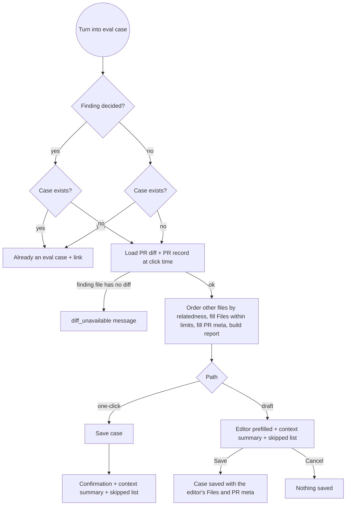
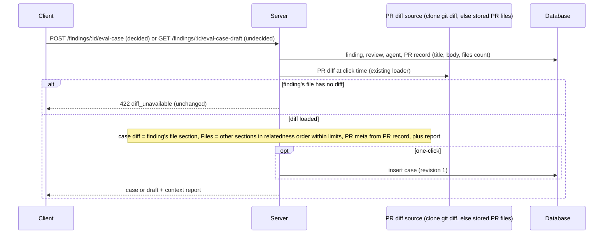

# Spec: Finding-derived eval cases carry the original review's context

Spec ID: 2026-11-01-finding-case-review-context
Status: approved
Supersedes: — (partial delta of [2026-10-29-eval-pipeline](2026-10-29-eval-pipeline.md) and [2026-10-31-eval-design-parity](2026-10-31-eval-design-parity.md); see "Items superseded / amended")
Modules: server, client (shared contracts change in both `vendor/shared` trees; `reviewer-core` unchanged)
Revision: rev 2 (2026-11-01)
Design sources:
- owner requirement (verbatim): "Кейс із знахідки має нести контекст оригінального ревʼю (повʼязані файли PR у Files, PR title/description), щоб новий кейс працював одразу.";
- owner (verbatim, earlier): "я добавив його з фпйндінгу і він не працював одразу поки ти його не поправив, але так не має бути, всі нові мають працювати одразу";
- owner answers to the Round-1 questions (2026-11-01): Q1 = b, Q2 = a, Q3 = a, Q4 = b; proposal P1 accepted;
- existing UI: the eval case editor (Files and PR meta tabs, parity AC-D4a…AC-D4c) and "Turn into eval case" on a finding card (parity AC-D34…AC-D36); no new mockups;
- research `docs/research/2026-11-01-finding-case-review-context.research.md` (R1–R3).

> Changelog
> - rev 1: first draft. Owner decisions applied:
>   - Q1 = b: the case diff stays the finding's file diff; every other changed file goes into Files, with its diff section as the content (context only);
>   - Q2 = a: no repo-intel context; base NG10 stays;
>   - Q3 = a: no backfill;
>   - Q4 = b: relatedness order, a file is skipped whole when it would break a limit, skips are reported;
>   - P1 accepted: report what was captured.
>
>   P3 ("Verify now") and P4 (size hint) are Open questions Q-R5 and Q-R6.
> - rev 2: approved by owner (2026-11-01) — "Затверджую спеку з дефолтами Q-R1…Q-R7."; Q-R1…Q-R7 resolved with their defaults (all option a).

> **Ids.** Every id in this spec carries an `R` prefix (G-R1, US-R1, AC-R1, C-R1, EC-R1, NFR-R1, Q-R1). These ids never clash with base ids or with `D`-prefixed ids. An id with a letter suffix (AC-R6a) is a separate, separately checkable requirement.

---

## Items superseded / amended

| Item | Change | New item(s) |
|---|---|---|
| Base rev-1 decision "one case = one finding = one expectation, carrying the finding's whole-file diff" (`2026-10-29-eval-pipeline.md:15`) | **amended**: still one finding, one expectation and the finding's whole-file diff. The case now also carries the PR's other changed files as Files, plus the PR's title and description. | AC-R1…AC-R14 |
| Base AC-3a (case diff = the finding's file diff at click time) | **unchanged** | — |
| Base AC-12 (the confirmation names the expectation kind) | **amended**: it also shows the context summary | AC-R17…AC-R20 |
| Base C5 / `CreateEvalCaseResponse` `{case, created}` (`eval-ci.ts:108-112`, research R3) | **amended**: adds `context` | C-R2 |
| Parity AC-D35b bullets "no Files" and "empty PR meta" (`2026-10-31-eval-design-parity.md:494-499`) | **superseded** | AC-R1…AC-R12 |
| Parity Q-D6 = a ("empty PR meta, consistent with one-click cases", `:838-842`) | **superseded**: both paths prefill PR meta from the PR record | AC-R9…AC-R12 |
| Parity C-D6 `GET /findings/:id/eval-case-draft` → `EvalCaseDraft` | **amended**: the response adds `context`. Create and update bodies are unchanged. | C-R3 |
| Parity C-D4 "How existing data maps" (legacy cases: `input_files = []`, empty `pr_meta`) | **unchanged**; no backfill | AC-R23, NG-R3 |
| Base NG10 (no repo map, callers, intent, project context or memory in eval runs) | **unchanged** | NG-R2 |
| Parity AC-D4b, AC-D10a, AC-D13…AC-D17 (context-only label, limits, inputs fed, fencing, grounding gate) | **unchanged**; they now also apply to auto-filled Files | AC-R21 |

Every other base and parity item stays as written.

---

## Problem & user

**User.** The user is a DevDigest user who curates reviewer agents and builds each agent's eval set by turning findings into eval cases ("Turn into eval case" on a finding card).

**Problem today.** The original review saw the whole PR:
- the diff of every changed file;
- the PR title (in the task line, `server/src/modules/reviews/helpers.ts:98-100`) and the PR body (`run-executor.ts:265`);
- repo-intel context.

A case created from one of its findings carries only the finding's own file diff. Both creation paths hard-code empty Files and empty PR meta:
- one-click: `server/src/modules/evals/service.ts:163-164`;
- draft: `server/src/modules/evals/service.ts:374-375`.

When the finding depends on code in another file of the PR, the agent cannot see that code during the eval. The case then fails although the agent version found the issue in the real review.

**Incident (2026-10-31).** Case `unhandled-exception-from-buildartifact-…`:
- It expected a CRITICAL bug at `agent-runner/src/run.ts:87–92`.
- It stored only `run.ts`'s 4,061-character diff.
- The v14 eval run missed the bug. The original review had seen `agent-runner/src/artifact.ts` (with `CiResultArtifact.parse`) in the same PR diff.
- Once `artifact.ts` was added to the case's Files by hand, the agent found the bug in 2–3 of 3 runs (research, "Context from the main session").

**Workaround today:** open the editor and paste the related files and PR meta by hand. The user has to know which file mattered, so a new case "does not work immediately".

**Why now.** The owner requires every new case to work immediately. 8 of the 9 existing cases have empty Files and empty PR meta (research R2). 19 of 29 PRs with stored files have more than 10 other files or more than 256 KB of them, so which files fit inside the limits matters (research R1 F5).

## Goals / Non-goals

**Goals**
- **G-R1** A case created from a finding, by either path, carries:
  - the finding's file diff, as today;
  - the PR's other changed files in Files, in relatedness order, within the existing limits;
  - the PR's title and description.

  The agent is then fed what the original review saw, minus repo-intel context and minus whatever did not fit.
- **G-R2** Both creation paths, one-click (decided finding) and draft to editor (undecided finding), produce the same Files and PR meta for the same finding and PR state.
- **G-R3** Everything that did not fit or was not available is reported to the user at creation, with paths and reasons.
- **G-R4** Creating a case stays free: zero LLM calls and zero GitHub API calls.

**Non-goals**
- **NG-R1** A guarantee that the agent passes the new case. The spec guarantees the inputs (what the case contains and what an eval run feeds), not the LLM's output.
- **NG-R2** Repo-intel context in cases or eval runs: repo map, callers digest, rank note, intent, project context, memory. Base NG10 stays (owner, Q2 = a).
- **NG-R3** Backfilling cases created before this change (owner, Q3 = a). The 8 existing empty-context cases stay as they are (research R2).
- **NG-R4** Full post-change file contents in Files. Files hold each file's diff section (owner, Q1 = b).
- **NG-R5** Fetching more PR files than the server already has. Two examples:
  - the stored PR file list is capped at 100 files per PR (`server/src/adapters/github/octokit.ts:84-89`, research R1 F1);
  - stored files with no patch are left out (`diff-loader.ts:36`).

  The gap is reported (AC-R8), not fixed.
- **NG-R6 (invariants left untouched).** This feature must not change any of the following:
  - the review engine (`reviewer-core`): prompt assembly, untrusted fencing, the injection guard, the grounding gate (exact-path file gate, parity AC-D17), score derivation;
  - eval scoring (parity AC-D42…AC-D48);
  - the editor's input limits and validation (`server/src/vendor/shared/eval-diff.ts:9-16,204-250`);
  - the PR review pipeline (`server/src/modules/reviews/run-executor.ts`);
  - accept/dismiss semantics;
  - the case diff rule (base AC-3a), naming (base AC-4a, AC-4b) and dedup by finding (base AC-7a, parity AC-D35c).
- **NG-R7** Storing the context report on the case. It is shown at creation only (default → Q-R1).
- **NG-R8** New UI surfaces. The report appears in the existing confirmation line and in the existing editor.

## User stories
- **US-R1** As an agent curator, I want a case created from a finding to carry the PR's other changed files and its title and description, so that the eval feeds the agent what the original review saw and the new case works immediately.
- **US-R2** As an agent curator, I want to see which PR files were left out and why, so that I can add a missing file by hand in the editor.
- **US-R3** As an agent curator, I want both ways of creating a case from a finding to produce the same content, so that a case does not depend on whether I decided the finding first.

## Design & UX

**Sources analysed:** the existing confirmation line after a one-click create:
- the status block, `role="status"`, with the copy "Eval case created ({kind})" + "View in Evals tab" (`client/messages/en/eval.json:203-204`, research R3);
- the existing editor opened on a finding draft (research R3: no notice slot today; the Files tab already labels non-diff paths "context only — findings on this file are not scored", parity AC-D4b).

There are no mockups. The new UI is one summary line, plus an expandable list of skipped files, in both places.

| Screen / component | loading | empty | error | partial | long content |
|---|---|---|---|---|---|
| Confirmation line (one-click) | unchanged: button disabled while pending (base AC-11b) | PR has no other files: "Context: 0 files from the PR · …" (AC-R17) | unchanged error copy (`eval.json:205-206`) | files skipped or unavailable are reported (AC-R18, AC-R19) | skipped list shows the first 20 + "and {n} more" (AC-R20, default → Q-R3) |
| Editor on a finding draft | unchanged spinner (parity AC-D9a) | summary shows 0 files; Files tab shows its existing empty state | unchanged (parity AC-D9b) | same report as one-click (AC-R16) | same as one-click (AC-R20); Files tab lists ≤ 10 entries |
| Files tab entries prefilled from the PR | n/a | n/a | n/a | n/a | each entry ≤ 64 KB (AC-R6c); the existing context-only label applies (parity AC-D4b) |

**Accepted UX decisions:**
- P1: report what was captured (AC-R16…AC-R20).
- Relatedness order (owner Q4 = b) (AC-R3, AC-R4). PR order is not used, because stored PR files have no defined order (research R1 F3); the tie-break is path order.

## Service communication

| Hand-off | Started by | What crosses | Sync / async | On failure / timeout | Source of truth |
|---|---|---|---|---|---|
| Create from finding | client | finding id → `CreateEvalCaseResponse` with `context` (C-R2) | sync, 0 LLM, 0 GitHub | 404 / 409 / 422 as today, nothing saved, no partial case (base AC-8a, AC-10; parity AC-D20a) | server case set |
| Draft from finding | client | finding id → draft + `context` (C-R3) | sync, 0 LLM, 0 GitHub; nothing persisted | 404 / 409 / 422 as today (parity AC-D35a, AC-D35c) | server, at request time |
| PR diff load | server | PR diff: the clone's `git diff`, else the stored per-file patches (`server/src/modules/reviews/diff-loader.ts:12-44`) | sync, local | finding file missing → `diff_unavailable`; other files missing → counted as unavailable (AC-R8) | clone; else `pr_files` |
| Save edited draft | client | `EvalCaseDraft` (unchanged, strict; no `context`) | sync | unchanged (parity AC-D20a, AC-D20b) | the save body |
| Eval run | server | stored diff + Files + PR meta → engine (unchanged, parity AC-D13) | async background run | unchanged | stored case at run start (parity AC-D26) |

## Contracts

**C-R1 `EvalCaseContextReport`** (server → client, responses only; never stored, never accepted in a request body)

| field | type | req | meaning |
|---|---|---|---|
| files_included | int ≥ 0 | yes | number of Files entries filled from the PR |
| files_skipped | `EvalCaseContextSkip[]` | yes | candidates not included, in context order (AC-R3, AC-R4) |
| files_unavailable | int ≥ 0 | yes | `max(0, <PR record files count> − <number of file sections in the loaded PR diff>)` |
| pr_meta | `attached` \| `truncated` \| `empty` | yes | AC-R12 |

**`EvalCaseContextSkip`**: `{ path: string, reason: EvalCaseContextSkipReason }`.

**`EvalCaseContextSkipReason`** (lowercase): `no_diff` | `path_too_long` | `file_size` | `files_count` | `files_total`.

**C-R2 `CreateEvalCaseResponse`** (amends base C5): `{ case: EvalCase, created: boolean, context?: EvalCaseContextReport }`.
- `context` is present when `created = true`.
- `context` is absent when `created = false`.

**C-R3 `GET /findings/:id/eval-case-draft` response** (amends parity C-D6): the five `EvalCaseDraft` fields (`name`, `input_diff`, `input_files`, `pr_meta`, `expected`) plus `context: EvalCaseContextReport` (required).
- The create body (`POST /agents/:id/eval-cases`) and the update body (`PUT /eval-cases/:id`) stay `EvalCaseDraft` exactly.
- A body that carries `context` is rejected as today (the schema is strict, research R3).

**C-R4 Auto-filled Files entry** (shape of the existing `EvalCaseInputFile`, parity C-D2):
- `path`: the file's new-side path. For a deleted file, the old path (default → Q-R7).
- `content`: the file's diff section exactly as it appears in the loaded PR diff. The section runs from its `diff --git` line up to the line before the next file's `diff --git` line. Line endings are LF.
- Sizes are measured in UTF-8 bytes after CRLF → LF, as the editor validator measures them (`eval-diff.ts:193-219`).

**C-R5 Auto-filled `EvalPrMeta`** (shape of parity C-D3):
- `title`: the PR record's title at click time.
- `description`: the PR record's body at click time, or `""` when it has none.
- Over-long values are cut as in AC-R11a / AC-R11b.

All of C-R1…C-R3 change identically in `server/src/vendor/shared/` and `client/src/vendor/shared/` (NFR-R8). No `mcp/` or `e2e/` code consumes these contracts (searched `mcp/**` and `e2e/**` for `eval-case`, `EvalCaseDraft` and `CreateEvalCaseResponse`: no match).

## Acceptance criteria (EARS)

### Context rule (US-R1, US-R3)
- **AC-R1** (ubiquitous · US-R1, US-R3) For a case created from a finding by either path, and whatever the finding's decision, the server shall take as context candidates every file section of the PR diff loaded at click time, except the finding's own file.
- **AC-R2** (ubiquitous · US-R1) The server shall place a candidate in tier 1 when its file name without the last extension occurs in the finding's file diff section as a whole token. A whole token is bounded on both sides by the start or end of the text, or by a character outside `A-Z a-z 0-9 _`. Example: `artifact` for `agent-runner/src/artifact.ts`, matched by `from './artifact.js'`. Every other candidate is tier 2. (default → Q-R2)
- **AC-R3** (ubiquitous · US-R1) The server shall order candidates tier 1 before tier 2.
- **AC-R4** (ubiquitous · US-R1) Within a tier, the server shall order candidates by the number of leading directory segments they share with the finding's file, highest first, then by path in ascending code-point order.
- **AC-R5** (ubiquitous · US-R1) The server shall walk the candidates in that order and add each included candidate to Files as one entry shaped as in C-R4.
- **AC-R6a** (unwanted · US-R2) IF a candidate's section has zero hunks (binary, mode-only or rename-only change), THEN the server shall skip it with reason `no_diff`.
- **AC-R6b** (unwanted · US-R2) IF a candidate's path is longer than 300 characters, THEN the server shall skip it with reason `path_too_long`.
- **AC-R6c** (unwanted · US-R2) IF a candidate's section is larger than 64 KB, THEN the server shall skip it with reason `file_size`.
- **AC-R6d** (unwanted · US-R2) IF Files already holds 10 entries, THEN the server shall skip the candidate with reason `files_count`.
- **AC-R6e** (unwanted · US-R2) IF adding a candidate would bring the Files total above 256 KB, THEN the server shall skip it with reason `files_total`.
- **AC-R6f** (ubiquitous · US-R2) The server shall report exactly one skip reason per skipped candidate: the first that applies, in the order AC-R6a…AC-R6e.
- **AC-R6g** (ubiquitous · US-R1) After a skip, the server shall continue with the next candidate. A later, smaller candidate can still be included.
- **AC-R7** (ubiquitous · US-R1) The server shall include a candidate's section whole or not at all. It never cuts a section.
- **AC-R8** (ubiquitous · US-R2) The server shall report as `files_unavailable` the PR record's files count minus the number of file sections in the loaded PR diff, floored at 0.

### PR meta (US-R1)
- **AC-R9** (ubiquitous · US-R1) The server shall set the case's PR title to the PR record's title at click time.
- **AC-R10** (ubiquitous · US-R1) The server shall set the case's PR description to the PR record's body at click time, or to `""` when the PR has no body.
- **AC-R11a** (unwanted · US-R1) IF the PR title is longer than 200 characters, THEN the server shall store its first 199 characters followed by "…". A surrogate pair is never split. (default → Q-R4)
- **AC-R11b** (unwanted · US-R1) IF the PR body is longer than 8,000 characters, THEN the server shall store its first 7,999 characters followed by "…". A surrogate pair is never split. (default → Q-R4)
- **AC-R12** (ubiquitous · US-R2) The server shall set `pr_meta` in the report to:
  - `empty` when the stored title and description are both `""`;
  - otherwise `truncated` when AC-R11a or AC-R11b applied;
  - otherwise `attached`.

### Both paths, cost, persistence (US-R1, US-R3)
- **AC-R13** (ubiquitous · US-R3) For the same finding and the same PR state, the server shall return from `GET /findings/:id/eval-case-draft` a diff, Files, PR meta and report byte-identical to those that `POST /findings/:id/eval-case` stores and returns.
- **AC-R14** (ubiquitous · US-R1) Building the context shall make zero LLM calls and zero GitHub API calls. It only uses the PR diff loader that case creation already uses, plus the PR record.
- **AC-R15** (event · US-R1) WHEN the user saves a case opened from a finding draft, the server shall store the Files and PR meta of the save body, including the user's edits and removals of prefilled entries.

### Report in the UI (US-R2)
- **AC-R16** (state · US-R2) WHILE the editor is open on a finding draft, the client shall show the context summary of AC-R17 for that draft's report.
- **AC-R17** (event · US-R2) WHEN `POST /findings/:id/eval-case` answers `created: true`, the client shall add to the confirmation line the summary "Context: {n} files from the PR · {meta} · {k} files skipped (limit)". In it:
  - `{n}` = `files_included`, with plural forms ("1 file", "{n} files");
  - `{meta}` = "PR meta attached" for `attached`, "PR meta attached (truncated)" for `truncated`, "no PR meta" for `empty`;
  - the "· {k} files skipped (limit)" part appears only when `files_skipped` is non-empty, with plural forms.
- **AC-R18** (state · US-R2) WHILE the report's `files_unavailable` is greater than 0, the summary shall end with "· {u} PR files had no diff available" (plural forms).
- **AC-R19** (state · US-R2) WHILE the report's `files_skipped` is non-empty, the client shall show a "Show skipped files" toggle. Expanded, it lists each skipped path with its reason text:
  - `no_diff` → "no diff (binary or empty change)";
  - `path_too_long` → "path over 300 characters";
  - `file_size` → "over 64 KB";
  - `files_count` → "over the 10-file limit";
  - `files_total` → "over the 256 KB total".
- **AC-R20** (unwanted · US-R2) IF `files_skipped` has more than 20 entries, THEN the expanded list shall show the first 20 and "and {n} more". (default → Q-R3)
- **AC-R21** (ubiquitous · US-R1) An eval run shall feed auto-filled Files and PR meta through the same case inputs as hand-entered ones (parity AC-D13), so that they reach the model only inside the engine's untrusted fencing (parity AC-D14, AC-D15).
- **AC-R22** (ubiquitous · US-R2) The client shall render skipped paths and reason texts as plain text, never as HTML or markdown.

### Existing data
- **AC-R23** (ubiquitous · US-R1) The server shall leave every case created before this change with unchanged diff, Files, PR meta, expected output and `revision` (NG-R3).

### Headline scenario
- **AC-R24a** (event · US-R1) WHEN the user turns into a case a finding on `src/run.ts` of a PR whose diff holds the following files, the server shall store `src/artifact.ts` as the first Files entry, with its whole diff section as the content:
  - `src/run.ts`, whose diff contains `from './artifact.js'`;
  - `src/artifact.ts`, an added file;
  - 12 other files in other directories, none of whose name stems occur in `run.ts`'s diff.
- **AC-R24b** (event · US-R1) WHEN that case is first run in an eval, the server shall send a prompt whose "Additional files (context only — not part of the diff)" section contains `src/artifact.ts`'s diff text, and whose PR description contains the PR's title and body.

## Edge cases

| # | Situation | Expected behaviour | AC / Q |
|---|---|---|---|
| EC-R1 | PR changes only the finding's file | Files empty; summary "Context: 0 files from the PR · …" | AC-R1, AC-R17 |
| EC-R2 | PR with more than 10 other files (19 of 29 stored PRs, research R1) | first 10 in relatedness order that fit; the rest reported `files_count` | AC-R3…AC-R6d |
| EC-R3 | A big related file (for example `package-lock.json`, 67,193 bytes in PR #13) | skipped `file_size`; smaller later files still included | AC-R6c, AC-R6g |
| EC-R4 | Clone unavailable; stored PR files capped at 100 (PR #13: 271 files, 100 stored) | Files built from what is stored; `files_unavailable` = 171 is shown | AC-R8, AC-R18, NG-R5 |
| EC-R5 | Stored file with no patch (`agent-runner/dist/index.js`) | not in the loaded diff; counted in `files_unavailable` | AC-R8 |
| EC-R6 | Binary or rename-only file in the `git diff` | skipped `no_diff` | AC-R6a |
| EC-R7 | Deleted file | included as its diff section, path = old path | C-R4, Q-R7 |
| EC-R8 | Common short stems (`index`, `a`) promote unrelated files to tier 1 | accepted; the directory-distance order still ranks nearby files first | AC-R2, AC-R4, Q-R2 |
| EC-R9 | PR body absent | description `""`; `pr_meta` `attached` if the title is non-empty | AC-R10, AC-R12 |
| EC-R10 | Body over 8,000 characters / title over 200 | cut + "…", `truncated` | AC-R11a, AC-R11b, AC-R12 |
| EC-R11 | PR got new commits after the review | everything is taken at click time (base Q-15 = a) | AC-R1, AC-R9 |
| EC-R12 | Finding's own file has no diff | `diff_unavailable` as today; no case, no report | base AC-8a, AC-8b |
| EC-R13 | Case already exists for the finding | "Already an eval case"; no `context`, no summary | C-R2, parity AC-D35c |
| EC-R14 | User removes or edits prefilled Files in the editor, then saves | the saved case holds the edited Files | AC-R15 |
| EC-R15 | Several cases from the same PR | each carries its own copy of the context | AC-R1 |
| EC-R16 | File diff contains text addressed to the model | fenced as untrusted, same as hand-entered Files | AC-R21 |
| EC-R17 | Skipped path contains `<script>` or markdown | shown as literal text | AC-R22 |
| EC-R18 | Report needed after a reload | not available; the Files tab shows what was included | NG-R7, Q-R1 |
| EC-R19 | Dismissed finding (`must_not_flag`) | same context rule | AC-R1 |
| EC-R20 | The 8 legacy empty-context cases | unchanged | AC-R23 |

## Non-functional requirements
- **NFR-R1 (performance)** For a loaded PR diff of ≤ 1,000 file sections and ≤ 5 MB, building the context shall add ≤ 500 ms p95 to the create or draft request.
- **NFR-R2 (LLM cost)** Creation: 0 LLM calls, 0 embedding calls, 0 GitHub API calls (AC-R14). Each eval run of such a case makes one engine review, as before, with input bounded by the existing limits: diff ≤ 256 KB, Files ≤ 256 KB, title ≤ 200 characters, description ≤ 8,000 characters.
- **NFR-R3 (reliability, determinism)** Two builds from the same finding and the same PR state shall produce byte-identical Files, PR meta and report (AC-R13). No retries are needed, because there is no network I/O.
- **NFR-R4 (accessibility)** The summary shall be inside the existing `role="status"` region, so screen readers announce it. "Show skipped files" shall be operable by keyboard and expose `aria-expanded`.
- **NFR-R5 (i18n)** Every new string shall live in `client/messages/en/eval.json`. Counts shall use ICU plural forms. Only the `en` locale exists today (`client/messages/` holds only `en`), so UA is n/a.
- **NFR-R6 (security & privacy)** Server logs about context building shall contain counts, the `pr_meta` state and skip reasons only. They never contain file content, the PR title or the PR body.
- **NFR-R7 (observability)** Every created case or draft from a finding shall emit one info log line with `files_included`, the number skipped per reason, `files_unavailable` and `pr_meta`.
- **NFR-R8 (contract parity)** C-R1…C-R3 shall be identical in the server's and the client's shared contract copies.

## Inputs and provenance

| Input | Source | Who creates / changes it | Trust |
|---|---|---|---|
| Other files' diff sections | clone `git diff`, else stored PR patches (GitHub) | PR author | untrusted |
| PR title, PR body | PR record (GitHub import) | PR author | untrusted |
| PR record files count | GitHub import | GitHub | trusted (number) |
| File paths (Files `path`, skipped `path`) | the same diff | PR author | untrusted |
| Finding file, lines, severity, category | DB, produced by the review | agent LLM output, grounded | trusted after grounding |
| Edited Files / PR meta in the editor | user | user | untrusted |

## Untrusted inputs

| Input | Threat | Defensive requirement |
|---|---|---|
| Other files' diff sections | prompt injection into the eval prompt | AC-R21 (fenced; engine unchanged, NG-R6) |
| PR title / body | prompt injection | AC-R21, parity AC-D15 |
| File paths | fence-label breakout in the prompt | AC-R21 (engine sanitises source labels, `reviewer-core/src/prompt.ts:207`; unchanged) |
| File paths | XSS in the skipped list | AC-R22 |
| Oversized content | cost blow-up, oversized prompt | AC-R6c…AC-R6e, AC-R11a, AC-R11b, NFR-R2 |
| PR body / file content | leaking into logs | NFR-R6 |

## Traceability

| Goal | User story | AC | Edge cases | NFR | Contract | How to verify |
|---|---|---|---|---|---|---|
| G-R1 | US-R1 | AC-R1 | EC-R1, EC-R15, EC-R19 | — | C-R4 | unit: candidates exclude the finding's file, for both expectation kinds |
| G-R1 | US-R1 | AC-R2, AC-R3, AC-R4 | EC-R8 | NFR-R3 | — | unit: fixed PR fixture, then the exact output order |
| G-R1 | US-R1 | AC-R5, AC-R7 | EC-R7 | — | C-R4 | unit: entry content equals the section text byte for byte |
| G-R3 | US-R2 | AC-R6a…AC-R6g | EC-R2, EC-R3, EC-R6 | NFR-R2 | C-R1 | unit: one fixture per reason; precedence; continue after a skip |
| G-R3 | US-R2 | AC-R8 | EC-R4, EC-R5 | — | C-R1 | unit/integration: stored-files fallback with files count > sections |
| G-R1 | US-R1 | AC-R9, AC-R10 | EC-R9, EC-R11 | — | C-R5 | integration: case `pr_meta` equals the PR record |
| G-R1 | US-R1 | AC-R11a, AC-R11b, AC-R12 | EC-R10 | — | C-R1, C-R5 | unit: 201-char title, 8,001-char body, emoji at the cut |
| G-R2 | US-R3 | AC-R13 | EC-R19 | NFR-R3 | C-R2, C-R3 | integration: draft and one-click for the same finding compare byte-equal |
| G-R4 | US-R1 | AC-R14 | — | NFR-R1, NFR-R2 | — | integration: mock LLM and GitHub adapters record 0 calls; timing on a 1,000-file fixture |
| G-R1 | US-R1 | AC-R15 | EC-R14 | — | — | integration: save an edited draft, then read the case |
| G-R3 | US-R2 | AC-R16, AC-R17, AC-R18 | EC-R1, EC-R4, EC-R13 | NFR-R4, NFR-R5 | C-R2, C-R3 | component: summary text for each report variant; absent on `created: false` |
| G-R3 | US-R2 | AC-R19, AC-R20 | EC-R2 | NFR-R4 | C-R1 | component: toggle, reason texts, 25 skips → 20 + "and 5 more" |
| G-R1 | US-R1 | AC-R21 | EC-R16 | — | — | integration: the eval prompt's context_files section holds the fenced Files |
| G-R3 | US-R2 | AC-R22 | EC-R17 | — | — | component: a path with `<b>` renders literally |
| — | US-R1 | AC-R23 | EC-R20 | — | — | integration: a pre-existing case is unchanged after the change |
| G-R1 | US-R1 | AC-R24a, AC-R24b | — | — | C-R2, C-R4 | integration (hermetic, mock LLM captures the prompt): fixture PR, one-click create, then a scope-`case` eval run; manual: re-create the PR #13 incident case and run it |
| — | — | — | — | NFR-R6, NFR-R7 | — | unit: the log line holds counts only (no body or content substrings) |
| — | — | — | — | NFR-R8 | C-R1…C-R3 | contract test / diff of both shared trees |

## Open questions
- **Q-R1** Should the context report be stored on the case?
  - Context: after a reload or on the Evals tab, the user can no longer see which PR files were skipped. The Files tab shows only what was included.
  - Options: a) not stored; shown at creation only — cost low, no persistence change · b) stored and shown in the editor for finding-derived cases — cost medium, a new stored field and the legacy mapping.
  - Recommendation (used as default): **a**, because the Files tab already shows what is there, and the skipped paths matter at the moment the user decides whether to add one. · Affects: NG-R7, EC-R18
  - Resolved — owner accepted the default (2026-11-01): **a**.
- **Q-R2** Should very short file-name stems count for tier 1?
  - Context: stems such as `a` or `db` occur as tokens in almost any diff. They promote unrelated files ahead of nearby ones.
  - Options: a) every stem counts; the directory order breaks ties — cost low · b) stems shorter than 3 characters are ignored — cost low, one more rule · c) also ignore a stop-list (`index`, `types`, `utils`) — cost low, but arbitrary.
  - Recommendation (used as default): **a**, the simplest rule; the directory-distance order already ranks nearby files first. · Affects: AC-R2, EC-R8
  - Resolved — owner accepted the default (2026-11-01): **a**.
- **Q-R3** How many skipped paths does the list show?
  - Context: a 1,000-file PR can skip about 990 files.
  - Options: a) first 20 + "and {n} more" — cost low · b) all of them in a scrolling list — cost low, but a long list.
  - Recommendation (used as default): **a**. · Affects: AC-R20
  - Resolved — owner accepted the default (2026-11-01): **a**.
- **Q-R4** Which truncation marker is used for an over-long PR title or body?
  - Options: a) "…" as the last character, within the limit — cost low · b) " … (truncated)" — cost low, uses 14 characters of the limit · c) cut with no marker — cost low; the model cannot tell the text was cut.
  - Recommendation (used as default): **a**. · Affects: AC-R11a, AC-R11b
  - Resolved — owner accepted the default (2026-11-01): **a**.
- **Q-R5** Should a "Verify now" run be offered after creating a case? (proposal P3)
  - Context: after creating a case, the user could start a scope-`case` run with one click and see at once whether the new case passes on the current agent version. On `fail`, the message would be "This case fails on the current agent version — it may need more context in Files".
  - Options: a) not in this spec; the existing "Run case" in the editor and on the case row already covers it — cost low · b) add an opt-in "Verify now" action to the confirmation line — cost medium, one paid LLM review per click and new UI states.
  - Recommendation (used as default): **a**. · Affects: none (b would add ACs)
  - Resolved — owner accepted the default (2026-11-01): **a**.
- **Q-R6** Should the editor show the case's input size? (proposal P4)
  - Context: auto-filled Files raise the cost of every eval run of the case (up to about 512 KB of input).
  - Options: a) no — cost low · b) show "≈ {kb} KB input · ~{tokens} tokens per run (estimate)" next to the Files tab — cost low/medium, a token estimate labelled as an estimate.
  - Recommendation (used as default): **a**. · Affects: none (b would add an AC)
  - Resolved — owner accepted the default (2026-11-01): **a**.
- **Q-R7** Which path does a deleted file's Files entry use?
  - Options: a) the old path (the deleted file's last name) — cost low · b) skip deleted files with a new reason `deleted` — cost low, but loses the removed code the original review saw.
  - Recommendation (used as default): **a**. · Affects: C-R4, EC-R7
  - Resolved — owner accepted the default (2026-11-01): **a**.
